<div align="center">
    <br>
</div>
<h3 align="center"> Universidad Peruana de Ciencias Aplicadas </h3>

<h3 align="center">Carrera de  Ingeniería de Software </h3>

<h3 align="center">1ASI0730 </h3>
<h3 align="center">Aplicaciones Web</h3>
<h3 align="center"> NRC </h3>
<h3 align="center"> 16127 </h3>

<h3 align="center">Informe del Trabajo Final</h3>


<h3 align="center"> Docente</h3>
<h3 align="center">Villafuerte Bazan, Oscar Ivan  </h3>


<h3 align="center"> Equipo </h3>
<h3 align="center"> Grupo 2</h3>

<h3 align="center"> Proyecto</h3>
<h3 align="center"> CREDITOR </h3>

<h3 align="center"> Integrantes </h3>

| Code | Member |
| :---: | :--- |
| u20221a371 | Santos Torres, Juan Manuel |
| u202215188 | Egocheaga Suyo, Miguel Angel |
| u20241a314 | Gutarra Velapatiño, Sebastián |

<h3 align="center">Periodo 202620</h3>
<h3 align="center">13 de noviembre de 2026 · Preparación local de AV2</h3>


<div style="page-break-after: always;"></div>

El documento principal integra el estado del código al **13/11/2026**. Los sprints AV1/TB1 y el anexo del 02/11 conservan sus fechas como antecedentes. La arquitectura, los contratos y el estado AV2 están actualizados en los capítulos III–V y en el [barrido por sección](docs/av2/auditoria-por-seccion.md). Las funciones que solo existen en la demostración del navegador se identifican por separado de las rutas conectadas al servidor.

## Registro de Versiones del Informe

| Versión | Fecha | Autor(es) | Descripción del cambio | Evidencia representativa |
|---|---|---|---|---|
| 0.1 | 01/09/2026 | Miguel Angel Egocheaga Suyo | Creación de la estructura inicial del informe. | [`a4e85c6`](https://github.com/Grupo-Desarrollo-Aplicaciones-Web/upc-project-report/commit/a4e85c6) |
| 0.2 | 08/09/2026 | Juan Manuel Santos Torres | Desarrollo del Startup Profile, problemática, Lean UX y segmentos objetivo. | [`295fb24`](https://github.com/Grupo-Desarrollo-Aplicaciones-Web/upc-project-report/commit/295fb24), [`6d5670c`](https://github.com/Grupo-Desarrollo-Aplicaciones-Web/upc-project-report/commit/6d5670c), [`e89e295`](https://github.com/Grupo-Desarrollo-Aplicaciones-Web/upc-project-report/commit/e89e295) |
| 0.3 | 09/09/2026 al 15/09/2026 | Sebastián Gutarra Velapatiño | Desarrollo de Style Guidelines, recursos de branding, wireframes y mock-ups del capítulo IV. | [`89330c9`](https://github.com/Grupo-Desarrollo-Aplicaciones-Web/upc-project-report/commit/89330c9), [`ff39563`](https://github.com/Grupo-Desarrollo-Aplicaciones-Web/upc-project-report/commit/ff39563), [`686a40f`](https://github.com/Grupo-Desarrollo-Aplicaciones-Web/upc-project-report/commit/686a40f) |
| 0.4 | 10/09/2026 al 16/09/2026 | Miguel Angel Egocheaga Suyo | Análisis competitivo, diseño de entrevistas, requisitos, backlog y organización de artefactos de AV1. | [`0e42d84`](https://github.com/Grupo-Desarrollo-Aplicaciones-Web/upc-project-report/commit/0e42d84), [`08e1978`](https://github.com/Grupo-Desarrollo-Aplicaciones-Web/upc-project-report/commit/08e1978), [`030e618`](https://github.com/Grupo-Desarrollo-Aplicaciones-Web/upc-project-report/commit/030e618) |
| 0.5 | 16/09/2026 al 18/09/2026 | Juan Manuel Santos Torres | Planificación del Sprint 1, criterios de aceptación, protocolo de validación e inspección heurística. | [`d8db0dd`](https://github.com/Grupo-Desarrollo-Aplicaciones-Web/upc-project-report/commit/d8db0dd), [`dd95c80`](https://github.com/Grupo-Desarrollo-Aplicaciones-Web/upc-project-report/commit/dd95c80), [`b4aaeb3`](https://github.com/Grupo-Desarrollo-Aplicaciones-Web/upc-project-report/commit/b4aaeb3) |
| 0.6 | 17/09/2026 al 18/09/2026 | Sebastián Gutarra Velapatiño | Actualización de entrevistas, incorporación del wireframe y mock-up web, e integración de imágenes de User Personas. | [`c68799f`](https://github.com/Grupo-Desarrollo-Aplicaciones-Web/upc-project-report/commit/c68799f), [`7c41cda`](https://github.com/Grupo-Desarrollo-Aplicaciones-Web/upc-project-report/commit/7c41cda), [`25f9923`](https://github.com/Grupo-Desarrollo-Aplicaciones-Web/upc-project-report/commit/25f9923) |
| 0.7 | 18/09/2026 | Miguel Angel Egocheaga Suyo | Diagramas de información, User Flows, C4, clases y base de datos, junto con el esquema SQL y el control de AV1. | [`3086a32`](https://github.com/Grupo-Desarrollo-Aplicaciones-Web/upc-project-report/commit/3086a32), [`e6a4efe`](https://github.com/Grupo-Desarrollo-Aplicaciones-Web/upc-project-report/commit/e6a4efe), [`b84d9a6`](https://github.com/Grupo-Desarrollo-Aplicaciones-Web/upc-project-report/commit/b84d9a6) |
| 0.8 | 18/09/2026 | Miguel Angel Egocheaga Suyo | Consolidación del capítulo 00 y trazabilidad de aportes mediante evidencia del historial Git. | Contenido histórico incorporado en el informe AV1. |
| 0.9, preparación TB1 | 03/10/2026 | Miguel Angel Egocheaga Suyo | Auditoría del enunciado, corrección de investigación/requisitos/modelos, nueva landing y primera frontend locales, Sprint 2 y paquete documental. | [Historial local por features](docs/tb1/commits-locales.md), [ejecución](docs/tb1/evidencia-local.md). No publicado ni release estable. |
| Revisión de retroalimentación TB1 | 03/10/2026 | Miguel Angel Egocheaga Suyo | Control de entrevistas y evidencia de Personas, wireframes móviles, alternativas de flujos, tareas de 4–8 h y paginación del informe. | [Respuesta por observación](docs/tb1/feedback-resolution.md), fuentes y capturas locales. Corrección documental; sin nueva release ni calificación. |
| Revisión documental TB1 en referencia remota | 03–04/10/2026 | Sebastián Gutarra Velapatiño y Juan Manuel Santos Torres, según objetos Git. | Sebastián incorporó la captura de prototipado (`d1e6ddc`) y su explicación (`4e2fa6e`); Juan amplió la documentación de Sprint 2 (`957dd47`). Estos aportes documentales no acreditan implementación ni revisión por pares. | [Cotejo de referencias](#e-reconciliación-de-las-versiones-local-y-remota). |
| Reorganización documental local | 02/11/2026 | Preparación asistida solicitada por Miguel Angel Egocheaga Suyo; revisión del equipo pendiente. | Informe unificado con el esquema de Allpatek, índice interno de cuatro niveles y contraste con el enunciado de Aplicaciones Web; conserva los cortes históricos y añade evidencia local de noviembre. Sin nueva release ni publicación. | [Control documental](#c-control-de-integridad-y-correspondencia-con-el-enunciado). |

| Revisión técnica y documental AV2 | 13/11/2026 | Miguel Angel Egocheaga Suyo, identidad Git configurada. | Abonos sucesivos, filtros compartidos de lista/resumen/CSV, préstamos con cuotas pactadas, transición a MySQL, documentación Scalar y auditoría de correspondencia. | [Matriz de implementación y evidencia](docs/av2/estado-implementacion.md). Preparación local: no equivale a release, despliegue o aceptación académica. |

## Project Report Collaboration Insights

| Aspecto | Evidencia observada | Lectura para el equipo | Acción siguiente |
|---|---|---|---|
| Distribución del trabajo | Los tres integrantes tienen commits propios en `develop` y artefactos diferenciados. | Existe una división reconocible entre producto/validación, diseño visual y arquitectura/integración. | Mantener esta matriz actualizada en cada entrega. |
| Identidad de autor | Juan utiliza una identidad; Sebastián y Miguel presentan alias vinculables por correo. | El historial permite atribuir aportes, aunque los alias pueden dificultar la lectura automática. | Mantener un único nombre y correo por integrante. |
| Integración | Se usaron ramas y Pull Requests para el capítulo IV; también existen cargas directas en etapas anteriores. | El proceso GitFlow está definido, pero su aplicación todavía no es uniforme. | Crear rama por alcance y PR hacia `develop` para los próximos cambios. |
| Revisión | Los commits muestran correcciones de imágenes, enlaces y contenido. | Hay iteración sobre los artefactos, pero el repositorio no conserva siempre una conversación de revisión. | Registrar observaciones y aprobación en Pull Requests. |
| Evidencia académica | Existen documentos, imágenes y diagramas; parte de la investigación y despliegue aún requiere evidencia. | El aporte documental no sustituye entrevistas, pruebas ni publicación reales. | Adjuntar enlaces autorizados y resultados verificables antes del release de AV1. |


Repositorio independiente del informe: [Grupo-Desarrollo-Aplicaciones-Web/upc-project-report](https://github.com/Grupo-Desarrollo-Aplicaciones-Web/upc-project-report). El frontend, la landing y el backend pertenecen a repositorios separados.

La presente reorganización conserva las atribuciones del corte AV1 y de la preparación TB1. Los conteos históricos no son horas trabajadas ni sustituyen la evaluación individual. Las capturas de analíticos GitHub de todos los integrantes y la reflexión/aceptación de equipo para los hitos posteriores permanecen pendientes de evidencia. El registro de crédito de planificación del frontend se conserva en el [anexo de noviembre](#b-evidencia-local-posterior-al-corte-tb1-02112026); no se interpreta como programación realizada por otros integrantes.

El cotejo de las referencias Git añade aportes posteriores al corte original: **Sebastián** incorporó la captura de prototipado y su explicación (`d1e6ddc`, `4e2fa6e`, 03/10); **Juan** amplió la documentación de Sprint 2 (`957dd47`, 04/10). Se reconoce el alcance documental comprobado, sin convertirlo en autoría del código ni en aprobación por pares. Las secciones históricas que indican que esos aportes aún no estaban confirmados conservan su fecha original y se complementan con este registro.

## Tabla de Contenidos

<!-- REPORT_TOC_START -->

  - [Registro de Versiones del Informe](#registro-de-versiones-del-informe)
  - [Project Report Collaboration Insights](#project-report-collaboration-insights)
- [Student Outcome 5](#student-outcome-5)
  - [00.8 Criterio: liderazgo y trabajo en equipo](#008-criterio-liderazgo-y-trabajo-en-equipo)
    - [00.8.1 Aporte individual verificable](#0081-aporte-individual-verificable)
    - [00.8.2 Relación entre los aportes](#0082-relación-entre-los-aportes)
    - [00.8.3 Evidencia de liderazgo compartido](#0083-evidencia-de-liderazgo-compartido)
  - [00.9 Criterio: entorno colaborativo, planificación y cumplimiento](#009-criterio-entorno-colaborativo-planificación-y-cumplimiento)
    - [00.9.1 Prácticas utilizadas](#0091-prácticas-utilizadas)
    - [00.9.2 Cumplimiento por integrante](#0092-cumplimiento-por-integrante)
  - [00.10 Reflexión del equipo](#0010-reflexión-del-equipo)
  - [00.11 Evidencias que no deben declararse sin respaldo](#0011-evidencias-que-no-deben-declararse-sin-respaldo)
  - [00.13 ABET EAC Student Outcome 5 en TB1](#0013-abet-eac-student-outcome-5-en-tb1)
    - [00.13.1 Liderazgo conjunto](#00131-liderazgo-conjunto)
    - [00.13.2 Colaboración inclusiva, metas, planificación y cumplimiento](#00132-colaboración-inclusiva-metas-planificación-y-cumplimiento)
  - [00.14 Student Outcome en la preparación AV2](#0014-student-outcome-en-la-preparación-av2)
- [Capítulo I: Introducción](#capítulo-i-introducción)
  - [1.1 Startup Profile](#11-startup-profile)
    - [1.1.1 Descripción de la startup](#111-descripción-de-la-startup)
    - [1.1.2 Perfiles de integrantes del equipo](#112-perfiles-de-integrantes-del-equipo)
  - [1.2 Solution Profile](#12-solution-profile)
    - [1.2.1 Antecedentes y problemática](#121-antecedentes-y-problemática)
      - [Análisis 5W2H](#análisis-5w2h)
    - [1.2.2 Lean UX Process](#122-lean-ux-process)
      - [1.2.2.1 Lean UX Problem Statement](#1221-lean-ux-problem-statement)
      - [1.2.2.2 Lean UX Assumptions](#1222-lean-ux-assumptions)
      - [1.2.2.3 Lean UX Hypothesis Statements](#1223-lean-ux-hypothesis-statements)
      - [1.2.2.4 Lean UX Canvas](#1224-lean-ux-canvas)
  - [1.3 Segmentos objetivo](#13-segmentos-objetivo)
    - [Contexto estadístico y límites de la fuente secundaria](#contexto-estadístico-y-límites-de-la-fuente-secundaria)
- [Capítulo II: Requirements Elicitation & Analysis](#capítulo-ii-requirements-elicitation--analysis)
  - [2.1 Competidores](#21-competidores)
    - [2.1.1 Análisis competitivo](#211-análisis-competitivo)
      - [Competitive Analysis Landscape](#competitive-analysis-landscape)
      - [Landscape comercial, identidad visual y condiciones](#landscape-comercial-identidad-visual-y-condiciones)
      - [Fortalezas, debilidades, oportunidades y amenazas](#fortalezas-debilidades-oportunidades-y-amenazas)
      - [Fuentes del análisis](#fuentes-del-análisis)
    - [2.1.2 Estrategias y tácticas frente a competidores](#212-estrategias-y-tácticas-frente-a-competidores)
      - [Criterios para revisar la estrategia](#criterios-para-revisar-la-estrategia)
  - [2.2 Entrevistas](#22-entrevistas)
    - [2.2.1 Diseño de entrevistas](#221-diseño-de-entrevistas)
      - [Objetivo general](#objetivo-general)
      - [Objetivos específicos](#objetivos-específicos)
      - [Segmentos y selección de participantes](#segmentos-y-selección-de-participantes)
      - [Modalidad y procedimiento](#modalidad-y-procedimiento)
      - [Presentación y consentimiento](#presentación-y-consentimiento)
      - [Guion común](#guion-común)
      - [Preguntas para S1: dueños de negocios](#preguntas-para-s1-dueños-de-negocios)
      - [Preguntas para S2: administradores o encargados de finanzas](#preguntas-para-s2-administradores-o-encargados-de-finanzas)
      - [Cierre y exploración de la propuesta](#cierre-y-exploración-de-la-propuesta)
      - [Relación del guion con las hipótesis del capítulo I](#relación-del-guion-con-las-hipótesis-del-capítulo-i)
    - [2.2.2 Registro de entrevistas](#222-registro-de-entrevistas)
      - [Resúmenes individuales y metadatos por completar](#resúmenes-individuales-y-metadatos-por-completar)
      - [Revisión de los registros existentes](#revisión-de-los-registros-existentes)
    - [2.2.3 Análisis de entrevistas](#223-análisis-de-entrevistas)
      - [Método de análisis y agrupación de participantes](#método-de-análisis-y-agrupación-de-participantes)
  - [2.3 Needfinding](#23-needfinding)
    - [2.3.1 User Personas](#231-user-personas)
      - [Criterios para cerrar las Personas investigadas](#criterios-para-cerrar-las-personas-investigadas)
    - [2.3.2 User Task Matrix](#232-user-task-matrix)
    - [2.3.3 User Journey Mapping](#233-user-journey-mapping)
    - [2.3.4 Empathy Mapping](#234-empathy-mapping)
    - [2.3.5 As-Is Scenario Mapping](#235-as-is-scenario-mapping)
  - [2.4 Big Picture Event Storming](#24-big-picture-event-storming)
  - [2.5 Ubiquitous Language](#25-ubiquitous-language)
- [Capítulo III: Requirements Specification](#capítulo-iii-requirements-specification)
  - [3.1 User Stories](#31-user-stories)
    - [3.1.1 Epics y To-Be Scenario Mapping](#311-epics-y-to-be-scenario-mapping)
    - [3.1.2 Functional User Stories](#312-functional-user-stories)
    - [3.1.3 Reglas observables del incremento AV2](#313-reglas-observables-del-incremento-av2)
    - [3.1.4 Acceptance Criteria](#314-acceptance-criteria)
  - [3.2 Impact Mapping](#32-impact-mapping)
    - [3.2.1 Objetivos SMART propuestos](#321-objetivos-smart-propuestos)
  - [3.3 Product Backlog](#33-product-backlog)
    - [3.3.1 Technical Stories](#331-technical-stories)
- [Capítulo IV: Product Design](#capítulo-iv-product-design)
  - [4.1 Style Guidelines](#41-style-guidelines)
    - [4.1.1 General Style Guidelines](#411-general-style-guidelines)
    - [4.1.2 Web Style Guidelines](#412-web-style-guidelines)
  - [4.2 Information Architecture](#42-information-architecture)
    - [4.2.1 Organization Systems](#421-organization-systems)
    - [4.2.2 Labeling Systems](#422-labeling-systems)
    - [4.2.3 SEO Tags and Meta Tags](#423-seo-tags-and-meta-tags)
    - [4.2.4 Searching Systems](#424-searching-systems)
    - [4.2.5 Navigation Systems](#425-navigation-systems)
  - [4.3 Landing Page UI Design](#43-landing-page-ui-design)
    - [4.3.1 Landing Page Wireframes](#431-landing-page-wireframes)
    - [4.3.2 Landing Page Mock-ups](#432-landing-page-mock-ups)
  - [4.4 Web Applications UX/UI Design](#44-web-applications-uxui-design)
    - [4.4.1 Web Application Wireframes](#441-web-application-wireframes)
    - [4.4.2 Web Application Wireflow Diagrams](#442-web-application-wireflow-diagrams)
    - [4.4.3 Web Application Mock-ups](#443-web-application-mock-ups)
    - [4.4.4 Web Application User Flow Diagrams](#444-web-application-user-flow-diagrams)
      - [Cobertura de caminos alternativos del incremento TB1](#cobertura-de-caminos-alternativos-del-incremento-tb1)
  - [4.5 Web Applications Prototyping](#45-web-applications-prototyping)
  - [4.6 Domain-Driven Software Architecture](#46-domain-driven-software-architecture)
    - [4.6.1 Design-Level Event Storming](#461-design-level-event-storming)
    - [4.6.2 Software Architecture Context Diagram](#462-software-architecture-context-diagram)
    - [4.6.3 Software Architecture Container Diagrams](#463-software-architecture-container-diagrams)
    - [4.6.4 Software Architecture Component Diagrams](#464-software-architecture-component-diagrams)
  - [4.7 Software Object-Oriented Design](#47-software-object-oriented-design)
    - [4.7.1 Class Diagrams](#471-class-diagrams)
  - [4.8 Database Design](#48-database-design)
    - [4.8.1 Database Diagrams](#481-database-diagrams)
- [Capítulo V: Product Implementation, Validation & Deployment](#capítulo-v-product-implementation-validation--deployment)
  - [5.1 Software Configuration Management](#51-software-configuration-management)
    - [5.1.1 Software Development Environment Configuration](#511-software-development-environment-configuration)
    - [5.1.2 Source Code Management](#512-source-code-management)
    - [5.1.3 Source Code Style Guide & Conventions](#513-source-code-style-guide--conventions)
    - [5.1.4 Software Deployment Configuration](#514-software-deployment-configuration)
  - [5.2 Landing Page, Services & Applications Implementation](#52-landing-page-services--applications-implementation)
    - [5.2.1 Sprint 1](#521-sprint-1)
      - [5.2.1.1 Sprint Planning 1](#5211-sprint-planning-1)
      - [5.2.1.2 Aspect Leaders and Collaborators](#5212-aspect-leaders-and-collaborators)
      - [5.2.1.3 Sprint Backlog 1](#5213-sprint-backlog-1)
      - [5.2.1.4 Development Evidence for Sprint Review](#5214-development-evidence-for-sprint-review)
      - [5.2.1.5 Execution Evidence for Sprint Review](#5215-execution-evidence-for-sprint-review)
      - [5.2.1.6 Services Documentation Evidence for Sprint Review](#5216-services-documentation-evidence-for-sprint-review)
      - [5.2.1.7 Software Deployment Evidence for Sprint Review](#5217-software-deployment-evidence-for-sprint-review)
      - [5.2.1.8 Team Collaboration Insights during Sprint](#5218-team-collaboration-insights-during-sprint)
    - [5.2.2 Sprint 2](#522-sprint-2)
      - [5.2.2.1 Sprint Planning 2](#5221-sprint-planning-2)
      - [5.2.2.2 Aspect Leaders and Collaborators](#5222-aspect-leaders-and-collaborators)
      - [5.2.2.3 Sprint Backlog 2](#5223-sprint-backlog-2)
      - [5.2.2.4 Development Evidence for Sprint Review](#5224-development-evidence-for-sprint-review)
      - [5.2.2.5 Execution Evidence for Sprint Review](#5225-execution-evidence-for-sprint-review)
      - [5.2.2.6 Services Documentation Evidence for Sprint Review](#5226-services-documentation-evidence-for-sprint-review)
      - [5.2.2.7 Software Deployment Evidence for Sprint Review](#5227-software-deployment-evidence-for-sprint-review)
      - [5.2.2.8 Team Collaboration Insights during Sprint](#5228-team-collaboration-insights-during-sprint)
    - [5.2.3 Sprint 3](#523-sprint-3)
      - [5.2.3.1 Sprint Planning 3](#5231-sprint-planning-3)
      - [5.2.3.2 Aspect Leaders and Collaborators](#5232-aspect-leaders-and-collaborators)
      - [5.2.3.3 Sprint Backlog 3](#5233-sprint-backlog-3)
      - [5.2.3.4 Development Evidence for Sprint Review](#5234-development-evidence-for-sprint-review)
      - [5.2.3.5 Execution Evidence for Sprint Review](#5235-execution-evidence-for-sprint-review)
      - [5.2.3.6 Services Documentation Evidence for Sprint Review](#5236-services-documentation-evidence-for-sprint-review)
      - [5.2.3.7 Software Deployment Evidence for Sprint Review](#5237-software-deployment-evidence-for-sprint-review)
      - [5.2.3.8 Team Collaboration Insights during Sprint](#5238-team-collaboration-insights-during-sprint)
    - [5.2.4 Sprint 4](#524-sprint-4)
      - [5.2.4.1 Sprint Planning 4](#5241-sprint-planning-4)
      - [5.2.4.2 Aspect Leaders and Collaborators](#5242-aspect-leaders-and-collaborators)
      - [5.2.4.3 Sprint Backlog 4](#5243-sprint-backlog-4)
      - [5.2.4.4 Development Evidence for Sprint Review](#5244-development-evidence-for-sprint-review)
      - [5.2.4.5 Execution Evidence for Sprint Review](#5245-execution-evidence-for-sprint-review)
      - [5.2.4.6 Services Documentation Evidence for Sprint Review](#5246-services-documentation-evidence-for-sprint-review)
      - [5.2.4.7 Software Deployment Evidence for Sprint Review](#5247-software-deployment-evidence-for-sprint-review)
      - [5.2.4.8 Team Collaboration Insights during Sprint](#5248-team-collaboration-insights-during-sprint)
  - [5.3 Validation Interviews](#53-validation-interviews)
    - [5.3.1 Diseño de entrevistas](#531-diseño-de-entrevistas)
    - [5.3.2 Registro de entrevistas](#532-registro-de-entrevistas)
    - [5.3.3 Evaluaciones según heurísticas](#533-evaluaciones-según-heurísticas)
  - [5.4 Video About-the-Product](#54-video-about-the-product)
- [Conclusiones y recomendaciones](#conclusiones-y-recomendaciones)
  - [Conclusiones](#conclusiones)
  - [Recomendaciones](#recomendaciones)
  - [Video About-the-Team](#video-about-the-team)
- [Bibliografía](#bibliografía)
    - [Fuentes internas de implementación y Sprint 2](#fuentes-internas-de-implementación-y-sprint-2)
- [Anexos](#anexos)
  - [A. Información académica y trazabilidad histórica](#a-información-académica-y-trazabilidad-histórica)
    - [00.1 Datos académicos](#001-datos-académicos)
    - [00.2 Integrantes e identidades de Git](#002-integrantes-e-identidades-de-git)
    - [00.4 Resumen de aportes por integrante](#004-resumen-de-aportes-por-integrante)
      - [00.4.1 Juan Manuel Santos Torres](#0041-juan-manuel-santos-torres)
      - [00.4.2 Sebastián Gutarra Velapatiño](#0042-sebastián-gutarra-velapatiño)
      - [00.4.3 Miguel Angel Egocheaga Suyo](#0043-miguel-angel-egocheaga-suyo)
    - [00.5 Matriz de responsabilidad de AV1](#005-matriz-de-responsabilidad-de-av1)
    - [00.7 Criterio de actualización](#007-criterio-de-actualización)
    - [00.12 Collaboration Insights de la preparación TB1](#0012-collaboration-insights-de-la-preparación-tb1)
  - [B. Evidencia local posterior al corte TB1: 02/11/2026](#b-evidencia-local-posterior-al-corte-tb1-02112026)
    - [B.1 Consulta y descarga de información financiera](#b1-consulta-y-descarga-de-información-financiera)
    - [B.2 Autorías y cortes de evidencia](#b2-autorías-y-cortes-de-evidencia)
    - [B.3 Evidencia posterior de US-005: compra a crédito](#b3-evidencia-posterior-de-us-005-compra-a-crédito)
  - [C. Control de integridad y correspondencia con el enunciado](#c-control-de-integridad-y-correspondencia-con-el-enunciado)
    - [C.1 Matriz de observaciones del profesor](#c1-matriz-de-observaciones-del-profesor)
  - [Evidencia de publicación futura](#evidencia-de-publicación-futura)
  - [D. Preparación y entregables TB1 históricos](#d-preparación-y-entregables-tb1-históricos)
  - [Control de entrega AV1 histórico](#control-de-entrega-av1-histórico)
    - [Revisión previa a publicación](#revisión-previa-a-publicación)
    - [Revisión del índice del capítulo IV frente al enunciado](#revisión-del-índice-del-capítulo-iv-frente-al-enunciado)
  - [Control de entrega TB1 histórico](#control-de-entrega-tb1-histórico)
    - [Comprobaciones finales](#comprobaciones-finales)
  - [E. Reconciliación de las versiones local y remota](#e-reconciliación-de-las-versiones-local-y-remota)
    - [E.1 Aportes posteriores disponibles en origin/main](#e1-aportes-posteriores-disponibles-en-originmain)
  - [F. Auditoría de coherencia AV2: 13/11/2026](#f-auditoría-de-coherencia-av2-13112026)

<!-- REPORT_TOC_END -->

# Student Outcome 5

El curso contribuye al cumplimiento del Student Outcome ABET:

ABET – EAC - Student Outcome 5

Criterio: La capacidad de funcionar efectivamente en un equipo cuyos miembros juntos proporcionan liderazgo, crean un entorno de colaboración e inclusivo, establecen objetivos, planifican tareas y cumplen objetivos.

En el siguiente cuadro se describe las acciones realizadas y enunciados de conclusiones por parte del grupo, que permiten sustentar el haber alcanzado el logro del ABET – EAC - Student Outcome 5.

| Criterio específico | Acciones realizadas | Conclusiones |
|---|---|---|
| Trabaja en equipo para proporcionar liderazgo en forma conjunta | **AV1 — Juan Manuel Santos Torres:** problema, Lean UX, planificación y protocolo de validación. **AV1 — Sebastián Gutarra Velapatiño:** identidad visual, wireframes/mock-ups y recursos de investigación. **AV1 — Miguel Angel Egocheaga Suyo:** requisitos, arquitectura y coordinación documental. **TB1 — Miguel Angel Egocheaga Suyo:** preparación técnica local, correcciones y evidencia. Los nuevos acuerdos/liderazgo de Juan y Sebastián en TB1 y AV2 requieren confirmación; el detalle y sus fuentes se conservan debajo. | Los aportes históricos son complementarios y permiten trazar problema, diseño e implementación. No existe evidencia suficiente para declarar concluido el liderazgo conjunto de todos los hitos posteriores. La revisión cruzada y las reflexiones personales continúan pendientes. |
| Crea un entorno colaborativo e inclusivo, establece metas, planifica tareas y cumple objetivos. | **AV1 — Juan Manuel Santos Torres:** Sprint Goal y protocolo de evaluación. **AV1 — Sebastián Gutarra Velapatiño:** insumos visuales e investigación. **AV1/TB1 — Miguel Angel Egocheaga Suyo:** backlog, tareas estimadas, integración local y comprobaciones técnicas. **TB1/AV2 — los tres integrantes:** reuniones, asignaciones y aceptación del equipo deben registrarse con evidencia real; no se infieren de un reparto de créditos Git. | Existen metas y artefactos revisables. Las estimaciones no prueban horas trabajadas; los commits no prueban reuniones ni inclusión. El cumplimiento grupal y la evaluación del líder deben completarse con acuerdos y evidencias auténticas. |

El párrafo y las columnas siguen el Anexo A del enunciado (p. 37); la tabla delimita la evidencia disponible y no declara alcanzados criterios pendientes. Las secciones históricas siguientes conservan sus fechas y autorías. El [corte de noviembre](#b-evidencia-local-posterior-al-corte-tb1-02112026) documenta avances técnicos posteriores, sin atribuirles aceptación de sprint.


## 00.8 Criterio: liderazgo y trabajo en equipo

El equipo evidencia la capacidad de colaborar mediante la distribución del informe por especialidad, el uso de control de versiones y la integración progresiva de los artefactos. La atribución siguiente se basa en el historial de `develop` al 18 de septiembre de 2026.

### 00.8.1 Aporte individual verificable

| Integrante | Rol evidenciado en AV1 | Decisiones y artefactos aportados | Evidencia |
|---|---|---|---|
| Juan Manuel Santos Torres | Análisis de producto, planificación y validación | Desarrolló la problemática y Lean UX, organizó Sprint 1 y definió protocolos, métricas e inspección heurística. | [`6d5670c`](https://github.com/Grupo-Desarrollo-Aplicaciones-Web/upc-project-report/commit/6d5670c), [`d8db0dd`](https://github.com/Grupo-Desarrollo-Aplicaciones-Web/upc-project-report/commit/d8db0dd), [`b4aaeb3`](https://github.com/Grupo-Desarrollo-Aplicaciones-Web/upc-project-report/commit/b4aaeb3) |
| Sebastián Gutarra Velapatiño | Diseño visual e integración de evidencias de investigación | Construyó la base visual del capítulo IV, incorporó wireframes y mock-ups, actualizó registros de entrevista y añadió recursos de User Personas. | [`89330c9`](https://github.com/Grupo-Desarrollo-Aplicaciones-Web/upc-project-report/commit/89330c9), [`7c41cda`](https://github.com/Grupo-Desarrollo-Aplicaciones-Web/upc-project-report/commit/7c41cda), [`25f9923`](https://github.com/Grupo-Desarrollo-Aplicaciones-Web/upc-project-report/commit/25f9923) |
| Miguel Angel Egocheaga Suyo | Coordinación documental, requisitos y arquitectura | Estructuró el repositorio, desarrolló requisitos y backlog, completó los diagramas de software y datos, y coordinó su integración mediante ramas y Pull Requests. | [`a4e85c6`](https://github.com/Grupo-Desarrollo-Aplicaciones-Web/upc-project-report/commit/a4e85c6), [`030e618`](https://github.com/Grupo-Desarrollo-Aplicaciones-Web/upc-project-report/commit/030e618), [`3086a32`](https://github.com/Grupo-Desarrollo-Aplicaciones-Web/upc-project-report/commit/3086a32), [PR #1](https://github.com/Grupo-Desarrollo-Aplicaciones-Web/upc-project-report/pull/1) |

### 00.8.2 Relación entre los aportes

1. Juan definió el problema, los supuestos y el plan de validación que orientan qué debe comprobar el producto.
2. Sebastián convirtió parte de esa dirección en lenguaje visual mediante la guía de estilo, los wireframes, mock-ups y recursos de personas.
3. Miguel conectó las necesidades y artefactos visuales con historias, flujos, arquitectura, clases y un modelo relacional revisable.
4. La combinación de estos aportes permite recorrer el proyecto desde el problema hasta la solución propuesta, sin afirmar que las actividades pendientes ya fueron ejecutadas.

### 00.8.3 Evidencia de liderazgo compartido

| Situación | Liderazgo observado | Resultado documentado | Límite de la evidencia |
|---|---|---|---|
| Definición del problema | Juan impulsó la redacción de antecedentes, 5W2H, Lean UX y segmentos. | Base del capítulo I para orientar entrevistas y diseño. | Las hipótesis necesitan contraste con usuarios. |
| Dirección visual | Sebastián avanzó Style Guidelines, recursos de marca y diseño de landing. | Base visual reutilizada en el capítulo IV. | Los mock-ups finales y el prototipo todavía requieren revisión. |
| Organización técnica | Miguel estructuró requisitos, diagramas y modelo de datos, y preparó su integración. | Diseño trazable desde historias hasta SQL propuesto. | La aplicación, API y base desplegada no forman parte de la evidencia actual. |
| Validación y Sprint 1 | Juan detalló planificación, criterios, protocolo e inspección heurística. | Procedimiento documentado para evaluar la landing. | El procedimiento no acredita por sí mismo la ejecución de pruebas. |
| Corrección colaborativa | Sebastián corrigió enlaces, imágenes y registros; Miguel integró aportes visuales en diagramas y documentación. | Informe más consistente y artefactos reutilizables. | Debe registrarse la aprobación de revisores en futuros PR. |

## 00.9 Criterio: entorno colaborativo, planificación y cumplimiento

### 00.9.1 Prácticas utilizadas

| Práctica | Aplicación en CREDITOR | Evidencia actual | Mejora necesaria |
|---|---|---|---|
| Planificación | Historias, Sprint Goal, tareas estimadas y criterios de aceptación para la landing. | Capítulos III y V; commits de Juan y Miguel. | Reemplazar responsables “propuestos” por asignaciones confirmadas cuando corresponda. |
| Especialización | Producto/validación, diseño visual y arquitectura/documentación se distribuyeron entre los integrantes. | Matriz de responsabilidad del capítulo 00. | Evitar que una sola persona concentre las revisiones finales. |
| Control de versiones | Cada integrante registra commits con una identidad vinculable. | Historial de `develop` y perfiles de GitHub. | Unificar alias de autor y mensajes con Conventional Commits. |
| Integración | Ramas de documentación y Pull Requests incorporan cambios hacia `develop`. | [PR #1](https://github.com/Grupo-Desarrollo-Aplicaciones-Web/upc-project-report/pull/1), [PR #2](https://github.com/Grupo-Desarrollo-Aplicaciones-Web/upc-project-report/pull/2) y [PR #3](https://github.com/Grupo-Desarrollo-Aplicaciones-Web/upc-project-report/pull/3). | Mantener el mismo flujo para todo cambio futuro. |
| Calidad | Se corrigieron enlaces, sintaxis de imágenes, diagramas y consistencia del informe. | Commits `b60fc68`, `1a03c2d`, `e6a4efe` y verificaciones locales. | Añadir una revisión cruzada antes de fusionar cada rama. |
| Transparencia | El informe identifica diseño propuesto y evidencia pendiente. | Capítulos II, IV, V y checklist de AV1. | Completar entrevistas, prototipo, despliegue y videos con evidencia auténtica. |

### 00.9.2 Cumplimiento por integrante

| Integrante | Entregables asumidos y observados | Estado al corte | Próximo compromiso documentable |
|---|---|---|---|
| Juan Manuel Santos Torres | Capítulo I, planificación de Sprint 1, protocolo e inspección heurística. | Aportes integrados en `develop`. | Registrar la ejecución de las pruebas o entrevistas que le correspondan, con evidencia autorizada. |
| Sebastián Gutarra Velapatiño | Style Guidelines, Landing UI Design, bocetos web, entrevistas y recursos de User Personas. | Aportes integrados en `develop`. | Revisar los mock-ups finales para alinearlos con compras a crédito y validar los enlaces de investigación. |
| Miguel Angel Egocheaga Suyo | Estructura del informe, requisitos, arquitectura, base de datos, checklist e integración. | Aportes integrados en `develop`; capítulo 00 incorporado en la versión histórica AV1. | Coordinar revisión del capítulo 00 y mantener trazabilidad de los siguientes PR. |

## 00.10 Reflexión del equipo

La evidencia muestra aportes complementarios. Juan fortaleció el planteamiento del producto y la forma de evaluarlo; Sebastián aportó la dirección visual y recursos de investigación; Miguel articuló requisitos, arquitectura y control documental. La colaboración produjo un informe más amplio que el trabajo aislado de cada integrante.

El equipo todavía debe mejorar la revisión cruzada y la consistencia del flujo Git. Los Pull Requests recientes permiten revisar cambios antes de integrarlos, pero varios aportes anteriores ingresaron mediante cargas directas. Para las siguientes entregas, cada bloque deberá pasar por una rama específica, una revisión de otro integrante y un enlace de evidencia en esta sección.

## 00.11 Evidencias que no deben declararse sin respaldo

Para preservar la validez académica, el capítulo 00 no atribuye reuniones, entrevistas, pruebas, despliegues, horas trabajadas o aprobaciones que el repositorio no demuestra. Cuando esas actividades se completen, se registrarán con responsable, fecha, resultado y enlace autorizado. De esta forma, el Student Outcome refleja contribuciones reales y permite que el docente compruebe la participación de cada integrante.

## 00.13 ABET EAC Student Outcome 5 en TB1

Se aplica el formato del Anexo A del enunciado: acciones y conclusiones por integrante para liderazgo conjunto y entorno colaborativo/inclusivo, metas, planificación y cumplimiento. Estas conclusiones delimitan lo comprobado; no sustituyen la reflexión personal ni la evaluación del líder.

### 00.13.1 Liderazgo conjunto

| Integrante | Acciones realizadas comprobables | Conclusión al corte |
|---|---|---|
| Juan Manuel Santos Torres | Sus aportes AV1 de problemática/Lean UX y validación orientan la revisión TB1. No se proporcionó evidencia de nuevas reuniones o decisiones TB1. | La base de producto facilita priorizar historias; el liderazgo de la iteración actual necesita confirmación y reflexión propia. |
| Sebastián Gutarra Velapatiño | Su identidad visual y bocetos AV1 sirven de insumo para las pantallas corregidas. No se atribuyen a él los nuevos commits locales. | El diseño aporta una dirección común; revisar el prototipo y registrar decisiones permitirá evidenciar continuidad de liderazgo. |
| Miguel Angel Egocheaga Suyo | Preparó features y commits personales para corregir el informe, construir la frontend y alinear landing, modelos, historias y Sprint 2. Registró pruebas y límites del incremento. | La trazabilidad facilita la revisión del equipo; esta preparación técnica todavía requiere aceptación y revisión cruzada. |

### 00.13.2 Colaboración inclusiva, metas, planificación y cumplimiento

| Integrante | Acciones realizadas comprobables | Conclusión al corte |
|---|---|---|
| Juan Manuel Santos Torres | Planificación y protocolos históricos conservados. La propuesta LACX asigna revisión de producto, pendiente de acuerdo. | No hay evidencia suficiente para afirmar cumplimiento de una asignación TB1 aún no confirmada. |
| Sebastián Gutarra Velapatiño | Recursos visuales e investigación históricos conservados. Revisión visual propuesta, pendiente de acuerdo. | Confirmar responsabilidades y compartir revisión permitirá valorar cumplimiento y participación real. |
| Miguel Angel Egocheaga Suyo | Preparó backlog de 26 SP y tareas estimadas, integró features localmente y comprobó compra/abono/moneda. Distinguió estimaciones, ejecución técnica y evidencia humana faltante. | Se dispone de un incremento reproducible y revisable. La velocidad, horas reales y acuerdos de equipo no pueden derivarse de los commits. |

El equipo debe añadir su reflexión individual, acuerdos y evidencia auténtica antes de declarar alcanzado todo el criterio del hito.

## 00.14 Student Outcome en la preparación AV2

| Criterio específico | Acciones realizadas y fuente | Conclusión y límite |
|---|---|---|
| Planificación y objetivos | La solicitud delimita abonos, filtros, préstamos, cambio de motor, docs y auditoría. Las features separan esos bloques. | Existe alcance técnico trazable; no se acredita una reunión de planificación ni acuerdo LACX nuevo. |
| Colaboración y liderazgo | Se conservan aportes históricos de los tres integrantes y los cambios nuevos usan la identidad de Miguel. Las ramas previas del informe se incorporan sin reescribir autores. | El historial preserva contribuciones; la revisión por otro integrante aún requiere evidencia. |
| Cumplimiento y revisión | Matriz de funciones/código, resultados reales por motor y corrección de documentación divergente. | Se puede revisar el incremento técnico; aceptación, desempeño individual y validación con usuarios permanecen separados. |

# Capítulo I: Introducción

## 1.1 Startup Profile

### 1.1.1 Descripción de la startup

CREDITOR es una propuesta de plataforma web para mypes que necesitan organizar sus compras a crédito, cuentas por pagar, abonos parciales, comprobantes y préstamos. Busca reunir en un mismo espacio la información que normalmente se distribuye entre cuadernos, hojas de cálculo, mensajes y archivos, para facilitar la consulta de saldos y vencimientos.

La propuesta contempla un panel de deuda consolidada, registro de compras con proveedor, moneda, fecha límite y comprobante; registro de abonos con voucher; seguimiento de préstamos; y reportes filtrables. El incremento conectado implementa registro y consulta de esas operaciones; la matriz AV2 distingue implementación técnica de validación con usuarios. La utilidad, adopción y disposición de pago siguen siendo hipótesis de producto.

**Misión.** Desarrollar una herramienta clara y accesible que ayude a las mypes a mantener un control transparente de sus obligaciones financieras.

**Visión.** Ser una alternativa de apoyo para la gestión diaria de cuentas por pagar de las mypes de la región.

### 1.1.2 Perfiles de integrantes del equipo

Los tres perfiles y fotografías existentes se conservan. El equipo debe confirmar las descripciones y el uso de las fotografías antes de exportar la entrega; la presencia del archivo no acredita esa confirmación.

| Integrante | Código | Perfil y responsabilidad propuesta | Fotografía existente |
|---|---|---|---|
| Juan Manuel Santos Torres | u20221a371 | Estudiante de Ingeniería de Software. Aporta perspectiva de producto e interfaces web a partir de su experiencia en la operación de negocios comerciales. ||
| Sebastián Gutarra Velapatiño | u20241a314 | Estudiante de Ingeniería de Software. Aportó al capítulo IV Product Design en AV1 y participa en la revisión visual propuesta para TB1. |  |
| Miguel Angel Egocheaga Suyo | u202215188 | Estudiante de Ingeniería de Software. Organiza avances locales de documentación y landing mediante GitFlow; sus aportes finales se contrastarán con el historial publicado. |  |

## 1.2 Solution Profile

### 1.2.1 Antecedentes y problemática

Las mypes comerciales compran bienes a proveedores y pueden recibir préstamos para su operación. CREDITOR aborda la gestión de **cuentas por pagar del negocio**: registrar una compra a crédito, conservar su comprobante, aplicar abonos y consultar el saldo y vencimiento. Los préstamos representan obligaciones del negocio; el producto no se presenta como plataforma de créditos a clientes o cobranzas.

La información fragmentada entre cuadernos, hojas de cálculo, mensajes y documentos es una **hipótesis inicial**, no un hallazgo demostrado. Hay cuatro registros de entrevista incorporados al informe (tres S1 y uno S2); sus resúmenes y análisis todavía requieren evidencia de contenido. No se atribuyen ahorros, morosidad o intención de compra a esos participantes sin analizar sus respuestas.

#### Análisis 5W2H

| Pregunta | Descripción y estado de evidencia |
|---|---|
| **What** | Posible dificultad para reconstruir compras a crédito, abonos y obligaciones pendientes. Hipótesis por contrastar. |
| **When** | Al registrar una compra, pagar parcialmente, revisar vencimientos o conciliar con el proveedor. Momentos propuestos para el guion. |
| **Where** | Administración cotidiana de una mype comercial peruana; distrito y condiciones concretas se registran por participante. |
| **Who** | S1 dueños de negocio y S2 administradores o encargados de finanzas que participan en compras o pagos. |
| **Why** | Fuentes separadas podrían aumentar el esfuerzo para conocer el saldo vigente o recuperar un comprobante. |
| **How** | Se investigarán los medios realmente usados; no se presupone que todos trabajen manualmente. |
| **How much** | No existe medición del costo del problema. Se recogerán pasos, tiempos relatados y consecuencias, indicando muestra y fuente. |

**Objetivo:** conservar la relación proveedor–compra–abono y revisar obligaciones por moneda. **Antecedente TB1:** Vue/PrimeVue con datos de demostración locales para US-004–007. **Incremento AV2:** interfaz autenticada, API ASP.NET Core/EF Core, MySQL, comprobantes privados, exportación filtrada US-008 y consulta/registro de préstamos con cronograma US-009. Tesorería añade cuentas, movimientos y asignaciones de fondos. La API integra una cotización referencial BCRPData/SBS; no convierte operaciones históricas automáticamente. Los datos de prueba son ficticios. La verificación local no cierra el criterio de servicios desplegados de AV2.

La solución no suma PEN y USD como si fueran una moneda, no procesa transferencias bancarias y no sustituye contabilidad o asesoría financiera. La ruta de práctica conserva datos ficticios en el navegador. Las rutas `/workspace` usan JWT, roles y aislamiento de negocio en el servidor; iniciar sesión no importa ni mezcla automáticamente los datos de práctica.

### 1.2.2 Lean UX Process

#### 1.2.2.1 Lean UX Problem Statement

**Brand New Initiative.** La gestión de obligaciones de las mypes comerciales puede distribuirse entre registros contables, hojas de cálculo, mensajes y comprobantes. El análisis documental identifica productos que ya ofrecen facturas, abonos y reportes; por ello la brecha propuesta no es la ausencia de esas funciones. La brecha por verificar es si dueños y administradores necesitan una experiencia más acotada a reconstruir rápidamente una compra, sus pagos y su saldo, con el vocabulario y condiciones de su operación.

CREDITOR abordará esa brecha con un recorrido continuo de cuentas por pagar: proveedor, compra, comprobante, abonos, saldo y vencimiento por moneda. El enfoque inicial abarca S1, dueños que revisan obligaciones, y S2, administradores que registran o concilian operaciones. Se considerará una señal inicial de valor si, en un piloto autorizado de 30 días con cinco negocios, al menos cuatro pueden localizar saldo y vencimiento sin ayuda y al menos tres realizan una revisión semanal durante tres semanas. Son **metas propuestas**, no resultados; el reclutamiento, la línea base, el consentimiento y el protocolo se acuerdan antes del piloto.

#### 1.2.2.2 Lean UX Assumptions

Los IDs permiten rastrear las creencias hasta hipótesis, preguntas e historias. Ningún supuesto se presenta como conclusión de las entrevistas.

| Tipo | ID | Creencia por contrastar |
|---|---|---|
| Business Assumption | B-01 | Un alcance centrado en cuentas por pagar puede aportar valor aunque existan suites contables más amplias. |
| Business Assumption | B-02 | Un eventual modelo de suscripción debe cubrir soporte, almacenamiento seguro y operación; precio y disposición de pago no están definidos. |
| Business Assumption | B-03 | Un piloto con pocas compras puede reducir el esfuerzo inicial de adopción; no se exige migrar toda la contabilidad. |
| Business Outcome Assumption | BO-01 | Una consulta de obligaciones clara podría favorecer una revisión semanal recurrente. |
| Business Outcome Assumption | BO-02 | La trazabilidad compra–abono–comprobante podría favorecer que el negocio conserve sus registros en una sola herramienta. |
| Business Outcome Assumption | BO-03 | Los reportes y préstamos podrían contribuir a la continuidad de uso únicamente si aparecen como necesidades relevantes en la investigación. |
| User Assumption | U-01 | S1 interviene en decisiones de compra, endeudamiento o priorización de pagos. |
| User Assumption | U-02 | S2 interviene en el registro, ejecución o conciliación de operaciones. |
| User Assumption | U-03 | Una persona puede realizar ambas responsabilidades; los segmentos no representan poblaciones demográficas mutuamente excluyentes. |
| User Outcome & Benefit Assumption | UB-01 | Los usuarios quieren conocer el saldo y el vencimiento sin reconstruir información en varias fuentes. |
| User Outcome & Benefit Assumption | UB-02 | El registro de campos mínimos y comprobantes podría facilitar una compra rastreable. |
| User Outcome & Benefit Assumption | UB-03 | Un historial de abonos podría facilitar la verificación del saldo. |
| User Outcome & Benefit Assumption | UB-04 | Cuando se usan préstamos, un cronograma podría aclarar próximos compromisos. |
| User Outcome & Benefit Assumption | UB-05 | Cuando se preparan revisiones contables, filtros y exportación podrían reducir búsquedas repetidas. |
| Feature Assumption | F-01 | Un dashboard con saldos separados por PEN/USD y vencimientos facilitaría revisar obligaciones. |
| Feature Assumption | F-02 | Un formulario de compra con proveedor, importe, moneda, vencimiento y comprobante facilitaría conservar la obligación. |
| Feature Assumption | F-03 | Un historial de abonos con fecha, importe y voucher permitiría reconstruir el saldo. |
| Feature Assumption | F-04 | Un módulo de préstamos con frecuencia y cronograma permitiría consultar otras obligaciones cuando el segmento las utilice. |
| Feature Assumption | F-05 | Un reporte filtrable por fecha, proveedor y moneda facilitaría preparar una revisión. |

#### 1.2.2.3 Lean UX Hypothesis Statements

| ID | Hipótesis | Supuestos y alcance |
|---|---|---|
| **H-01** | Creemos que lograremos una revisión recurrente de obligaciones si Rosa (S1) y Diego (S2) obtienen visibilidad de saldos y vencimientos mediante un dashboard por moneda. | BO-01, UB-01, F-01; US-004; TB1 local. |
| **H-02** | Creemos que lograremos registros más completos si Diego (S2) obtiene trazabilidad de la compra mediante un formulario estructurado y un comprobante asociado. | BO-02, UB-02, F-02; US-005; TB1 local. |
| **H-03** | Creemos que lograremos una verificación más sencilla del saldo si Rosa (S1) y Diego (S2) obtienen una secuencia de movimientos mediante un historial de abonos y vouchers asociados. | BO-02, UB-03, F-03; US-006/007; TB1 local. |
| **H-04** | Creemos que lograremos continuidad de uso cuando haya préstamos si Rosa (S1) obtiene claridad de próximos compromisos mediante frecuencia y cronograma de cuotas. | BO-03, UB-04, F-04; US-009; implementación AV2, validación de utilidad pendiente. |
| **H-05** | Creemos que lograremos continuidad de uso en revisiones financieras si Diego (S2) obtiene información seleccionada mediante reportes filtrados y exportables. | BO-03, UB-05, F-05; US-008; implementación AV2, validación de utilidad pendiente. |

Existe una hipótesis por cada Feature Assumption. La investigación cualitativa inicial contrasta pertinencia, tareas y lenguaje; los resultados de uso requieren una evaluación posterior. Rosa y Diego son Personas provisionales, sin demografía ni conducta atribuida a entrevistados.

#### 1.2.2.4 Lean UX Canvas

El Canvas local actualizado usa los cinco IDs anteriores y distingue hipótesis, riesgos y experimentos propuestos. Es una representación declarativa local; no acredita una sesión con usuarios ni una exportación de UXPressia.

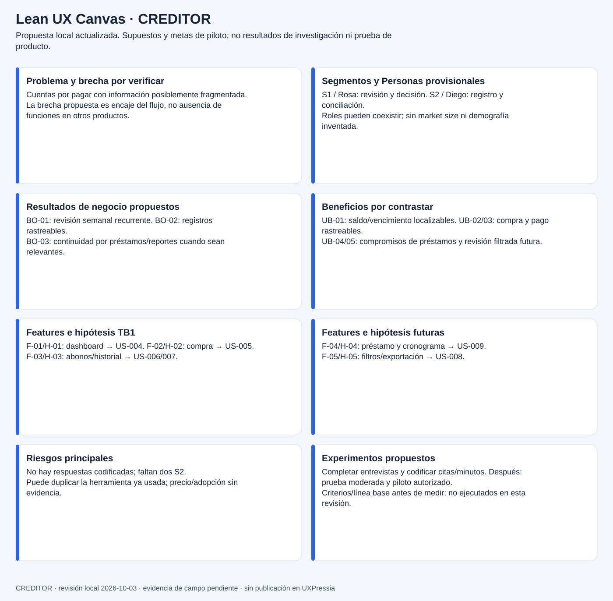

La imagen histórica `assets/research/lean-ux-canvas.jpg` se conserva en el repositorio para trazabilidad, pero no constituye el Canvas vigente de TB1.

## 1.3 Segmentos objetivo

Los segmentos se distinguen por responsabilidades, no por tamaño de mercado inventado. El criterio de inclusión es participación reciente en tareas de compras o pagos. Edad exacta, distrito, dispositivos, browser y canales se documentan con permiso y evidencia de cada participante; no se trasladan datos ficticios a las Personas.

| Segmento | Perfil operativo y demográfico de inclusión | Necesidad por contrastar | Criterio verificable |
|---|---|---|---|
| **S1. Dueños de mypes comerciales** | Persona adulta que dirige un negocio comercial y decide o supervisa compras, endeudamiento o pagos. Localidad y demás características por registrar. | Consultar obligaciones y decidir qué revisar o autorizar. | Participó en una compra a crédito, pago a proveedor o préstamo del negocio durante los últimos tres meses. |
| **S2. Administradores o encargados de finanzas** | Persona adulta que registra compras, prepara pagos, concilia saldos o conserva comprobantes en una mype. Localidad y demás características por registrar. | Registrar operaciones, recuperar comprobantes y preparar información financiera. | Realizó una tarea directa de registro, pago o conciliación durante los últimos tres meses. |

### Contexto estadístico y límites de la fuente secundaria

El informe oficial **Las Mipyme en cifras 2024** de PRODUCE/OGEIEE, Cuadro A1, registra **2 331 173 Mipyme formales** en Perú frente a **2 346 592 empresas formales** (fuente SUNAT–RUC 2024). Este universo incluye micro, pequeñas **y medianas** empresas; no es el tamaño del mercado de CREDITOR ni cuenta a dueños y administradores como personas. La cifra contextualiza la selección de negocios pequeños; no estima qué proporción usa créditos, tiene dificultades de pago o adoptaría la aplicación. Fuente consultada el 03/10/2026: [publicación oficial](https://www.producempresarial.pe/las-mipyme-en-cifras-2024/) y [informe, Cuadro A1](https://www.producempresarial.pe/wp-content/uploads/2025/11/La-Mipyme-en-Cifras-2024_.pdf).

| Segmento | Tarea a investigar | Funcionalidad propuesta | Riesgo abierto |
|---|---|---|---|
| S1 | Revisar obligaciones y decidir prioridades. | Dashboard, historial y consulta de cronograma AV2. | Que la tarea se delegue o no sea recurrente. |
| S2 | Registrar y verificar operaciones. | Compra, abono y reportes filtrados AV2. | Que otra herramienta sea obligatoria y la solución duplique trabajo. |

Pendiente de evidencia: caracterización demográfica de los participantes y análisis de su experiencia. No se publican porcentajes poblacionales de S1/S2 ni cifras de demanda a partir de una muestra cualitativa.

# Capítulo II: Requirements Elicitation & Analysis

La implementación AV2 se contrasta con esta investigación, pero no modifica sus fechas ni convierte las hipótesis en entrevistas realizadas. Precios y prestaciones de competidores corresponden al registro de fuentes de octubre; no son cotizaciones actualizadas al 13/11. La auditoría técnica revisa coherencia de alcance, no revalida el mercado.

## 2.1 Competidores

CREDITOR propone centralizar las compras a crédito, los abonos y los préstamos de las mypes, con énfasis en dueños de negocios y administradores o encargados de finanzas. Para analizar su entorno competitivo se seleccionaron tres soluciones que cubren necesidades similares de control de obligaciones con proveedores: Alegra Contabilidad, Odoo y Zoho Books. La selección responde a la coincidencia funcional con el problema descrito en el capítulo I; no constituye un ranking de participación de mercado.

| ID | Competidor | Descripción general | Propuesta de valor y características relevantes | Canal de acceso y fuente |
|---|---|---|---|---|
| C-01 | Alegra Contabilidad | Software contable y de facturación con una oferta dirigida a pymes en Perú. | Integra facturación, inventario y contabilidad. Su documentación describe la consulta de obligaciones con proveedores y sus vencimientos. | Plataforma web; [oferta para Perú][alegra-peru] y [cuentas por pagar][alegra-cxp]. |
| C-02 | Odoo | Sistema de gestión empresarial cuyo módulo contable incluye facturas de proveedores y préstamos. | Permite registrar pagos parciales, consultar deudas pendientes y gestionar cronogramas de amortización. | Aplicación empresarial; [facturas de proveedores][odoo-facturas] y [préstamos][odoo-prestamos]. |
| C-03 | Zoho Books | Software de gestión contable que incorpora compras, pagos a proveedores y reportes. | Relaciona las facturas con los pagos registrados y permite consultar saldos por proveedor. | Plataforma web; [gestión de facturas][zoho-facturas] y [reportes de obligaciones][zoho-reportes]. |

También se consideran alternativas sustitutas los cuadernos, las hojas de cálculo y el almacenamiento de comprobantes en carpetas o conversaciones. Su uso por los segmentos de CREDITOR es un supuesto del capítulo I que se explorará en las entrevistas; todavía no representa un hallazgo de campo.

### 2.1.1 Análisis competitivo

**Propósito del análisis:** identificar capacidades compartidas, oportunidades de diferenciación y riesgos para una solución centrada en el control cotidiano de deudas de mypes.

**Pregunta guía:** ¿qué valor podría aportar CREDITOR a un dueño o administrador que necesita conocer cuánto debe, cuándo debe pagar y qué abonos ya realizó, frente a las alternativas disponibles?

**Método y alcance:** revisión documental de fuentes oficiales consultadas el 10 de septiembre de 2026. Se analiza Alegra con su oferta peruana y una guía internacional, Odoo con su documentación de la versión 19.0 y Zoho Books con su documentación de la edición estadounidense. Las funciones pueden depender de la edición, configuración o plan; la revisión de Zoho no acredita adecuación tributaria al Perú. No se realizaron pruebas comparativas de uso ni se contrataron planes. La comparación de competidores conserva su fecha de fuente. La columna CREDITOR se actualiza al corte AV2: compras, abonos, historial, consulta por moneda, exportación CSV y préstamos de cuotas pactadas. Las pruebas técnicas locales no acreditan adopción ni una ventaja frente a los competidores.

#### Competitive Analysis Landscape

| Dimensión | CREDITOR — incremento local AV2 | Alegra Contabilidad | Odoo 19.0 | Zoho Books |
|---|---|---|---|---|
| Enfoque del producto | Control operativo de compras, abonos y préstamos de mypes. | Gestión contable y facturación para pymes. [Fuente][alegra-peru] | Gestión de facturas y préstamos dentro del módulo contable. [Fuentes][odoo-facturas] y [préstamos][odoo-prestamos] | Gestión de compras y pagos integrada al registro contable. [Fuente][zoho-facturas] |
| Registro de compras y vencimientos | AV2: proveedor, referencia, descripción, importe, moneda y fechas, persistidos por negocio. | Consulta de facturas de compra, montos adeudados y vencimientos. [Fuente][alegra-cxp] | Facturas con proveedor, fecha y condiciones de pago. [Fuente][odoo-facturas] | Facturas con proveedor, fecha límite y condiciones de pago. [Fuente][zoho-facturas] |
| Abonos e historial | AV2: abonos sucesivos e historial persistidos, saldo derivado y control de concurrencia. | La guía contempla abonos que afectan los saldos reportados. [Fuente][alegra-cxp] | Pagos parciales y saldo pendiente de la factura. [Fuente][odoo-facturas] | Pagos parciales y consulta de pagos registrados por factura. [Fuente][zoho-facturas] |
| Evidencias digitales | AV2: PDF, PNG o JPEG opcional hasta 2 MiB, metadatos en BD y descarga autorizada desde almacenamiento privado. | El vínculo de un archivo con cada abono no se verificó en las fuentes consultadas. | Carga de facturas en PDF; no se verificó aquí el adjunto por abono. [Fuente][odoo-facturas] | Adjuntos y notas en el registro del pago. [Fuente][zoho-facturas] |
| Consulta de deuda | AV2: listado y resumen por negocio con filtros y saldos separados PEN/USD. | Reporte de cuentas por pagar con filtros de consulta. [Fuente][alegra-cxp] | Reporte de antigüedad de deuda con detalle por proveedor. [Fuente][odoo-facturas] | Reporte por proveedor con importes facturados, pagados y saldo. [Fuente][zoho-reportes] |
| Préstamos y cuotas | AV2: registro/consulta de importes mensuales pactados; sin cálculo de amortización ni pago de cuotas. | No verificado en las fuentes consultadas. | Cronogramas importados, calculados o registrados manualmente, con capital e intereses. [Fuente][odoo-prestamos] | No verificado en las fuentes consultadas. |
| Salida de información | AV2: CSV de obligaciones filtradas; estado de cuenta de tesorería exportable/imprimible en navegador. No exporta XLSX ni PDF desde servidor. | Descarga de reportes y exportación de facturas de proveedor. [Fuente][alegra-cxp] | Exportación del reporte de deuda a PDF y XLSX. [Fuente][odoo-facturas] | Reporte de saldos con rango de fechas y filtros; formatos de exportación no verificados aquí. [Fuente][zoho-reportes] |

**Criterio de lectura:** “no verificado” identifica una limitación de esta revisión; no significa que el competidor carezca de esa función. Tampoco se atribuye exclusividad a CREDITOR por proponer abonos, adjuntos o cronogramas, ya que existen capacidades equivalentes documentadas.


#### Landscape comercial, identidad visual y condiciones

La revisión funcional de septiembre se conserva. La siguiente ampliación consulta fuentes comerciales oficiales el **03/10/2026**. Los precios son referencias públicas de distintos mercados y unidades; no son una cotización para el mismo negocio ni permiten concluir que una alternativa sea más barata. El precio de CREDITOR permanece sin definir.

| Dimensión | CREDITOR — propuesta | Alegra Contabilidad | Odoo | Zoho Books |
|---|---|---|---|---|
| Identidad visual |  |  |  |  |
| Overview / mercado objetivo | Mypes comerciales, roles de revisión y registro; alcance a validar. | Gestión contable y facturación para pymes peruanas. | Suite empresarial modular, con contabilidad y compras. | Contabilidad para pequeños negocios; se revisa edición US. |
| Valor y ventaja por explorar | Flujo compra–abono–saldo por moneda. No se acredita exclusividad ni superioridad. | Conjunto integrado de tareas contables y comerciales. | Aplicaciones de gestión bajo una misma suscripción. | Compras, pagos, documentos y reportes conectados. |
| Marketing observado/propuesto | Propuesto: demostraciones de compra/abono y piloto acotado; sin campañas ejecutadas. | Prueba de 15 días, planes por crecimiento y contenido de ayuda. | Oferta de una aplicación gratis, planes y demostraciones/consultoría. | Prueba, comparación de planes, documentación y recursos de aprendizaje. |
| Productos y servicios | Landing, frontend conectado, API ASP.NET Core y MySQL locales; préstamos y reportes con alcance descrito. | Contabilidad, facturación y POS, con alcance variable por plan. | Todas las aplicaciones en planes Standard/Custom; opciones de hosting por plan. | Books y ecosistema de aplicaciones; Professional incluye multimoneda y órdenes de compra. |
| Precios y costos observados | Sin precio; soporte, infraestructura y almacenamiento deben estimarse antes de monetizar. | Perú, PEN, mensual: Emprendedor **S/105**, Pyme **S/152**, IGV incluido. Límite y usuarios dependen del plan. [Fuente oficial](https://www.alegra.com/peru/contabilidad/precios/). | URL pública en USD: Standard **USD24.90/usuario/mes** cobrado anualmente, promoción inicial de 12 meses; regular mostrado **USD31.10**, más impuestos. Región de contratación debe confirmarse. [Planes](https://www.odoo.com/es/pricing), [configurador oficial](https://www.odoo.com/pricing-configurator?plan=standard). | Edición US, USD/organización: Professional **USD50/mes** mensual o **USD40/mes** con cobro anual, 5 usuarios. No acredita adecuación tributaria peruana. [Fuente oficial](https://www.zoho.com/us/books/pricing/). |
| Canales | Landing y frontend responsive implementados localmente; publicación TB1 pendiente. | Web y acceso a aplicaciones; ver oferta Perú y ayuda. | Odoo Online y canales/partners; Custom contempla otras opciones. | Web y aplicaciones móviles publicitadas en la oferta oficial. |

Los logos se conservan como recursos identificativos de sus titulares para este análisis académico; su origen y fecha figuran en [registro de fuentes locales](assets/research/tb1/source-register.md). Su inclusión no expresa respaldo comercial ni una licencia general de marca. Los importes no se convierten entre monedas ni se presentan como condiciones comerciales de CREDITOR.

#### Fortalezas, debilidades, oportunidades y amenazas

Las capacidades documentadas sustentan las fortalezas. Debilidades de encaje, oportunidades y amenazas son **interpretaciones estratégicas del equipo por contrastar**, no defectos demostrados mediante pruebas comparativas.

| Alternativa | Fortalezas | Debilidades o limitaciones de encaje por validar | Oportunidades | Amenazas |
|---|---|---|---|---|
| CREDITOR | Alcance propuesto centrado en compras/abonos y vocabulario de la mype. | Investigación incompleta; falta API operativa, despliegue TB1 y evidencia de adopción. | Probar un flujo acotado con negocios que necesitan consultar obligaciones. | Competidores ya ofrecen funciones equivalentes y el usuario puede mantener su herramienta actual. |
| Alegra | Oferta dirigida a Perú y combinación de contabilidad/facturación. | Para un negocio que solo necesita obligaciones, evaluar el encaje de una oferta más amplia y sus condiciones. | Adoptar gestión integrada cuando el negocio necesita varias tareas. | Otras suites y métodos ya conocidos compiten por costo y esfuerzo de cambio. |
| Odoo | Suite modular con facturas, pagos y gestión de préstamos documentada. | Configuración e implementación requieren evaluar el acompañamiento necesario para este segmento. | Extender procesos empresariales sobre una plataforma integrada. | Alternativas más acotadas pueden atraer a usuarios que prefieren un flujo reducido. |
| Zoho Books | Relación entre compras, pagos y reportes; Professional publica multimoneda. | La revisión US no demuestra encaje tributario ni de procesos con una mype peruana. | Integración contable y con su ecosistema cuando existe ese requerimiento. | Productos localizados y herramientas actuales pueden ser preferidos por el negocio. |

Los cuadernos/hojas de cálculo siguen siendo sustitutos por investigar, no medios confirmados de todos los participantes. No se afirma una ventaja comercial de CREDITOR hasta comprobar el flujo y la adopción.

#### Fuentes del análisis

- Alegra. (s. f.). [Software contable y de facturación para Pymes en Perú][alegra-peru].
- Alegra. (s. f.). [Genera el reporte de cuentas por pagar en Alegra][alegra-cxp]. Guía internacional.
- Odoo. (s. f.). [Vendor bills][odoo-facturas]. Documentación oficial 19.0, archivo fuente.
- Odoo. (s. f.). [Loans management][odoo-prestamos]. Documentación oficial 19.0, archivo fuente.
- Zoho. (s. f.). [Basic Functions in Bills][zoho-facturas]. Ayuda de Zoho Books, edición estadounidense.
- Zoho. (s. f.). [Payables Reports][zoho-reportes]. Ayuda de Zoho Books, edición estadounidense.

Las fuentes funcionales anteriores fueron consultadas el 10 de septiembre de 2026. Precios, logos y contexto secundario se ampliaron el 03/10/2026 con fuentes oficiales; ver registro local de fuentes.

[alegra-peru]: https://www.alegra.com/peru/contabilidad/
[alegra-cxp]: https://ayuda.alegra.com/int/genera-el-reporte-de-cuentas-por-pagar-en-alegra
[odoo-facturas]: https://github.com/odoo/documentation/blob/19.0/content/applications/finance/accounting/vendor_bills.rst
[odoo-prestamos]: https://github.com/odoo/documentation/blob/19.0/content/applications/finance/accounting/bank/loans.rst
[zoho-facturas]: https://www.zoho.com/us/books/help/bills/basic-functions.html
[zoho-reportes]: https://www.zoho.com/us/books/help/reports/payables.html

### 2.1.2 Estrategias y tácticas frente a competidores

Las estrategias se plantean a partir del análisis anterior y de las hipótesis del capítulo I. Sus resultados se evaluarán durante la investigación y las pruebas posteriores del prototipo.

| Estrategia | Fundamento | Tácticas propuestas | Evidencia para evaluarla |
|---|---|---|---|
| Especialización en control de obligaciones | Los competidores cubren tareas contables más amplias; debe comprobarse si un flujo acotado aporta valor al segmento. | Priorizar la consulta de saldos y vencimientos, el registro de compras y abonos y el seguimiento de préstamos. Mostrar soles y dólares por separado. | Problemas recurrentes identificados en entrevistas y tareas que los usuarios consideran prioritarias. |
| Facilidad de registro y consulta | La existencia de una función no demuestra que su uso encaje con la rutina del negocio. | Diseñar un formulario guiado con proveedor, fecha, importe, moneda y comprobante; usar términos como compra, abono y saldo pendiente. | En pruebas posteriores: tareas completadas, errores, tiempo empleado y necesidad de ayuda. |
| Trazabilidad de pagos | Recuperar el respaldo de un abono forma parte del problema planteado para CREDITOR. | Vincular cada voucher con su abono y compra; permitir consultar el historial y el saldo desde el mismo contexto. | Casos reales de búsqueda o discrepancia relatados; posteriormente, capacidad de recuperar un comprobante en el prototipo. |
| Adopción gradual | El usuario puede preferir mantener sus herramientas actuales si cambiar implica duplicar trabajo. | Proponer un piloto con pocas compras, orientación inicial y reportes exportables para compartir con el contador. | Barreras de adopción relatadas y continuidad de uso observada durante un futuro piloto. |
| Captación por demostraciones del flujo | El beneficio propuesto debe resultar comprensible para dueños y administradores. | Mostrar en la landing page ejemplos de consulta de deuda y registro de abonos; solicitar comentarios a negocios de los rubros objetivo. | Comprensión de la propuesta e interés en participar en pruebas, diferenciados de una intención de compra. |


#### Criterios para revisar la estrategia

| Decisión propuesta | Evidencia que la respalda o falta | Criterio de revisión |
|---|---|---|
| Hablar de control de obligaciones y no de contabilidad integral. | Análisis documental; falta validación con entrevistas. | Confirmar que el segmento reconoce el problema y no requiere primero una suite contable completa. |
| Priorizar compras, abonos, saldos y vencimientos. | Hipótesis Lean UX; falta evaluación de frecuencia e importancia. | Ordenar el backlog después de analizar tareas y entrevistas. |
| Mantener el precio fuera de la landing inicial. | No existe investigación de disposición de pago. | Definir precio únicamente tras comparar alternativas y recoger criterios de los participantes. |
| Comunicar una propuesta clara y comprobable. | La landing TB1 ya presenta cuentas por pagar y CTA hacia dashboard/nueva compra locales. | Revisar comprensión con participantes y comprobar los enlaces públicos cuando se autorice el despliegue. |
## 2.2 Entrevistas

Se propone realizar entrevistas para comprender cómo los usuarios gestionan actualmente las compras a crédito, los pagos a proveedores y los préstamos. La investigación permitirá contrastar los supuestos del capítulo I y las oportunidades del análisis competitivo antes de definir requisitos detallados.

Esta sección presenta el diseño de la investigación y cuatro registros existentes: tres de S1 y uno de S2. La revisión local verifica la presencia de los enlaces y metadatos declarados, no el contenido ni consentimiento de las grabaciones. Faltan al menos dos participantes S2 y el análisis de respuestas de todos los registros.

### 2.2.1 Diseño de entrevistas

#### Objetivo general

Comprender las prácticas, dificultades y criterios de decisión de dueños y administradores de mypes al registrar obligaciones, programar pagos y consultar comprobantes, para orientar el alcance y la experiencia de CREDITOR.

#### Objetivos específicos

- Reconstruir el proceso desde una compra a crédito hasta su cancelación y conciliación.
- Identificar cómo se consultan saldos y vencimientos y cómo se priorizan los pagos.
- Explorar el registro de abonos, la conservación de vouchers y el tratamiento de discrepancias.
- Conocer cómo se gestionan préstamos y operaciones en soles o dólares, cuando correspondan.
- Identificar información necesaria para reportes, barreras de adopción y criterios para elegir una herramienta.

#### Segmentos y selección de participantes

La meta mínima es un muestreo intencional de seis personas: tres dueños de negocio y tres administradores o encargados de finanzas. El registro actual contiene tres S1 y un S2; faltan dos S2 para la meta mínima. No constituye una muestra estadísticamente representativa. Se buscarán participantes de al menos tres negocios y dos rubros comerciales; si los relatos revelan procesos distintos o vacíos relevantes, se ampliará la convocatoria.

| Segmento | Perfil y criterios de inclusión | Necesidades que se busca explorar |
|---|---|---|
| S1. Dueños de negocios | Persona adulta que dirige una mype comercial, decide o supervisa sus pagos y ha intervenido en una compra a crédito o préstamo del negocio durante los últimos tres meses. | Visibilidad de obligaciones, priorización de pagos, gestión de liquidez y seguimiento de préstamos. |
| S2. Administradores o encargados de finanzas | Persona adulta que registra compras, procesa abonos o concilia saldos de una mype y ha realizado al menos una de estas tareas durante los últimos tres meses. | Registro cotidiano, control de vencimientos, recuperación de comprobantes y preparación de reportes. |

Se buscará diversidad de herramientas actuales: cuadernos, hojas de cálculo o software. No será obligatorio usar dólares ni tener préstamos, ya que su ausencia también ayuda a delimitar el alcance. Quien cumpla ambos roles se registrará una sola vez, con un rol principal y sus responsabilidades adicionales. Se excluirá a personas sin participación directa reciente en estas tareas.

#### Modalidad y procedimiento

Las entrevistas serán individuales, semiestructuradas y en español, de aproximadamente 30 a 40 minutos, presencialmente o por videollamada según disponibilidad. Un integrante conducirá la conversación y otro tomará notas, cuando sea posible.

| Momento | Duración aproximada | Actividad |
|---|---|---|
| Apertura | 5 minutos | Explicar el propósito académico, confirmar el perfil y solicitar consentimiento para participar y, por separado, para grabar. |
| Experiencia actual | 15 a 20 minutos | Aplicar las preguntas comunes y reconstruir una operación reciente mediante repreguntas. |
| Profundización por segmento | 5 a 10 minutos | Explorar decisiones del dueño o tareas operativas del administrador. |
| Cierre | 5 minutos | Resumir lo entendido, pedir correcciones y explorar la reacción a la propuesta de CREDITOR. |

La conversación comenzará por experiencias concretas sin presentar primero la solución. Se evitarán preguntas que presupongan errores o que sugieran una respuesta favorable. Se utilizarán repreguntas como “¿qué ocurrió después?”, “¿cómo lo comprobaste?” y “¿puedes contarme un ejemplo reciente?”. Si una pregunta no corresponde a la experiencia del participante, se registrará como no aplicable.

#### Presentación y consentimiento

“Somos estudiantes de Aplicaciones Web de la UPC y queremos comprender cómo se administran las compras y los pagos en los negocios. La entrevista es voluntaria: puedes omitir preguntas o terminar cuando desees. No necesitamos montos exactos, datos bancarios ni documentos identificables. ¿Aceptas participar? ¿Autorizas que grabemos la conversación para analizarla con el equipo del curso?”

Si no se autoriza la grabación, se tomarán notas con permiso. Los participantes se identificarán mediante códigos, por ejemplo S1-01 o S2-01. Los registros originales se conservarán en una carpeta de acceso restringido al equipo; en el repositorio se incluirán únicamente resúmenes anonimizados y evidencias autorizadas. No se publicarán vouchers reales, números de cuenta ni información identificable de clientes o proveedores.

#### Guion común

| ID | Pregunta | Propósito |
|---|---|---|
| G-01 | ¿A qué se dedica el negocio y qué responsabilidades tienes en sus compras y pagos? | Ubicar el contexto y confirmar el rol. |
| G-02 | Cuéntame la última compra a crédito en la que participaste, desde que se acordó hasta el último pago o su estado actual. ¿Qué registraron y quién intervino? | Reconstruir el flujo real. |
| G-03 | Si hoy necesitas conocer lo que el negocio debe a un proveedor, ¿cómo lo averiguas y cómo verificas que el saldo sea correcto? | Explorar consulta y confiabilidad de saldos. |
| G-04 | ¿Cómo identifican los pagos que se acercan? Cuéntame una ocasión reciente en la que tuvieron que decidir qué pagar primero. | Comprender vencimientos y priorización. |
| G-05 | Cuando una compra se paga en partes, ¿cómo registran cada abono y el saldo restante? ¿Dónde guardan y cómo buscan sus comprobantes? | Explorar pagos parciales y trazabilidad. |
| G-06 | ¿Alguna vez el saldo que tenían registrado fue distinto al indicado por un proveedor? Si ocurrió, ¿cómo lo resolvieron? Si no, ¿cómo lo comprueban habitualmente? | Investigar conciliación sin presuponer fallas. |
| G-07 | ¿En qué monedas compran y pagan? Si utilizan soles y dólares, ¿cómo llevan los saldos y qué hacen cuando pagan en una moneda diferente a la compra? | Explorar la necesidad bimonetaria. |
| G-08 | ¿El negocio ha recibido o concedido préstamos? Si corresponde, ¿cómo consultan las cuotas, intereses y fechas de pago? | Delimitar los tipos de préstamo y su seguimiento. |
| G-09 | ¿Qué información preparan para revisar las deudas o compartirla con el contador? ¿Cómo la obtienen, en qué formato y cuánto tiempo les tomó la última vez? | Identificar reportes y esfuerzo actual. |

#### Preguntas para S1: dueños de negocios

| ID | Pregunta | Propósito |
|---|---|---|
| D-01 | Antes de aceptar una nueva compra a crédito o un préstamo, ¿qué información revisas? Cuéntame una decisión reciente. | Comprender decisiones de endeudamiento. |
| D-02 | ¿Cómo distribuyes la revisión, autorización y ejecución de pagos entre las personas del negocio? | Identificar responsabilidades y controles. |
| D-03 | ¿Qué parte del control de las deudas te resulta más difícil o te toma más tiempo? ¿Qué consecuencias tuvo la última vez? | Priorizar problemas según experiencias. |
| D-04 | ¿Has evaluado o usado una herramienta para estas tareas? ¿Qué determinó tu elección y qué tendría que ocurrir para cambiarla? | Explorar alternativas y barreras de cambio. |
| D-05 | ¿El negocio paga actualmente por alguna herramienta de gestión? Sin indicar importes si no deseas, ¿cómo deciden si ese gasto vale la pena? | Explorar criterios económicos sin proponer un precio. |

#### Preguntas para S2: administradores o encargados de finanzas

| ID | Pregunta | Propósito |
|---|---|---|
| A-01 | ¿Qué datos necesitas para registrar una compra y qué haces cuando falta alguno o el comprobante llega después? | Identificar campos y excepciones. |
| A-02 | ¿Qué sucede cuando registran un importe incorrecto, duplican una compra o se revierte un pago? ¿Quién puede corregirlo? | Explorar correcciones y permisos. |
| A-03 | Si otra persona registra o paga la misma compra, ¿cómo te enteras y cómo evitan duplicar el trabajo? | Comprender coordinación entre usuarios. |
| A-04 | ¿Desde qué dispositivo y en qué momento registras los pagos? ¿Qué haces si no puedes registrarlos inmediatamente? | Reconocer condiciones de uso y barreras de registro. |
| A-05 | En el último cierre o revisión de cuentas, ¿qué tuviste que buscar o volver a registrar? ¿Qué información te habría facilitado esa tarea? | Identificar oportunidades de consulta y exportación. |

#### Cierre y exploración de la propuesta

Después de explorar el proceso actual, se presentará brevemente CREDITOR como una propuesta web para reunir compras, abonos y préstamos, consultar saldos por moneda y generar reportes. Se aclarará que todavía está en desarrollo.

1. De las tareas que describiste, ¿cuáles encajarían en esta propuesta y cuáles quedarían sin resolver?
2. ¿En qué situaciones preferirías seguir usando tu herramienta actual?
3. ¿Qué necesitarías comprobar antes de registrar información del negocio en una herramienta como esta?
4. ¿Qué aspecto importante de tu trabajo no hemos tratado?

La reacción a esta descripción se registrará como opinión sobre el concepto. No se interpretará como validación de usabilidad, intención de compra confirmada ni evidencia de reducción de errores.

#### Relación del guion con las hipótesis del capítulo I

| Hipótesis | Preguntas | Evidencia buscada | Historia |
|---|---|---|---|
| H-01 / F-01, dashboard | G-03, G-04, D-01, D-03 | Pasos actuales de consulta y criterios de prioridad. | US-004 |
| H-02 / F-02, registro de compra | G-02, A-01, A-02, A-03 | Datos mínimos, responsable y manejo de datos faltantes. | US-005 |
| H-03 / F-03, abonos e historial | G-05, G-06, A-02, A-03, A-04 | Relación pago–compra, comprobantes y resolución de diferencias. | US-006/007 |
| H-04 / F-04, préstamos | G-08, D-01 | Tipo de préstamo y condiciones/cronograma usados. | US-009, implementación AV2; utilidad por validar |
| H-05 / F-05, reportes | G-09, A-05 | Destinatario, filtros, formato y esfuerzo de preparación. | US-008, implementación AV2; utilidad por validar |

La matriz no contiene hallazgos. Cada respuesta debe vincularse a código de participante, pregunta y minuto antes de derivar una necesidad. Se distinguirán hechos relatados, opiniones e interpretaciones, incluyendo casos que contradigan las hipótesis.

### 2.2.2 Registro de entrevistas

La exigencia de investigación es **3 a 5 entrevistas por segmento**. Hay cuatro entradas existentes (S1: 3; S2: 1). Se conserva la información y los enlaces incorporados por el equipo; la etiqueta **registro existente** evita equiparar una URL con evidencia completa. El paquete final debe añadir captura de video, resúmenes y enlace autorizado en Microsoft Stream con inicio y duración.

| Código | Segmento | Rol y rubro declarados | Fecha declarada | Video y timing existentes | Estado de revisión |
|---|---|---|---|---|---|
| S1-01 | Dueños de mypes | Carlos Mendoza — Propietario y Gerente General; Distribuidora y Ferretería Mendoza. | 14/09/2026 | [YouTube](https://youtu.be/Ka9AmFZM3Js), 00:00, 07:25. | Registro existente; contenido, captura, consentimiento y Stream pendientes de revisión. |
| S1-02 | Dueños de mypes | Rocío Paredes — Fundadora y Gerente Comercial; Calzados & Moda Vía Nova. | 15/09/2026 | [YouTube](https://youtu.be/sIYtHGlNyWI), 00:00, 07:36. | Registro existente; contenido, captura, consentimiento y Stream pendientes de revisión. |
| S1-03 | Dueños de mypes | Ernesto Gutarra — Dueño de tienda de artículos de primera necesidad. | 17/09/2026 | [YouTube](https://youtu.be/NuDAKMMTmaY), 00:00, 07:58. | Registro existente; contenido, captura, consentimiento y Stream pendientes de revisión. |
| S2-01 | Administradores o finanzas | Fernando Terry — Administrador y Encargado de Finanzas; Distribuidora de Alimentos del Sur S.A.C. | 16/09/2026 | [YouTube](https://youtu.be/AkhgaNd8Few), 00:00, 08:13. | Registro existente; contenido, captura, consentimiento y Stream pendientes de revisión. |
| S2-02 | Administradores o finanzas | Participante no incorporado. | Pendiente | Sin evidencia. | Entrevista real pendiente. |
| S2-03 | Administradores o finanzas | Participante no incorporado. | Pendiente | Sin evidencia. | Entrevista real pendiente. |

#### Resúmenes individuales y metadatos por completar

| Código | Resumen descriptivo de respuestas | Edad/distrito/dispositivo/browser/canales | Evidencia de origen necesaria |
|---|---|---|---|
| S1-01 | Pendiente: no se transcriben respuestas que no se han revisado. | Pendiente de registro autorizado. | Respuestas por G/D, minuto, captura y consentimiento. |
| S1-02 | Pendiente: no se transcriben respuestas que no se han revisado. | Pendiente de registro autorizado. | Respuestas por G/D, minuto, captura y consentimiento. |
| S1-03 | Pendiente: no se transcriben respuestas que no se han revisado. | Pendiente de registro autorizado. | Respuestas por G/D, minuto, captura y consentimiento. |
| S2-01 | Pendiente: no se transcriben respuestas que no se han revisado. | Pendiente de registro autorizado. | Respuestas por G/A, minuto, captura y consentimiento. |

El 03/10/2026 se intentó consultar captions públicos automáticos de los cuatro videos únicamente en lectura. La metadata ofreció una pista de subtítulos en español, pero timedtext devolvió contenido vacío; no se obtuvo una transcripción utilizable. Esto no acredita ni invalida las respuestas del video. No se generaron resúmenes, capturas o citas a partir de esa metadata. La revisión humana de los videos originales y la evidencia de Microsoft Stream continúan pendientes. No se subió contenido a servicios externos durante esta ejecución local.

#### Revisión de los registros existentes

El [control de revisión de entrevistas](assets/research/tb1/interview-review-checklist.csv) concentra las cuatro entradas existentes y las dos entrevistas S2 pendientes. Registra revisor, fecha, comprobaciones y siguiente acción por participante, sin repetir toda la codificación. Cada comprobación se actualizará a **CUMPLE**, **REQUIERE COMPLEMENTO** o **NO VERIFICADO**, indicando la evidencia en el resumen individual. Las dos filas sin participante no se contabilizan como entrevistas realizadas.

| Comprobación | Condición para cerrar la revisión |
|---|---|
| Perfil y consentimiento | Confirmar responsabilidad reciente en compras/pagos, segmento principal y autorización de participación, grabación y uso académico de la evidencia. |
| Grabación y abordaje | Abrir el registro completo; revisar audio/video comprensibles, ambiente, interrupciones y preguntas que no induzcan una respuesta. Registrar incidencias y su efecto en la interpretación. |
| Cobertura y timing | Relacionar las preguntas efectivamente respondidas con los objetivos del guion y conservar el minuto de cada fragmento útil. La duración declarada de 7–8 minutos exige revisar profundidad; no demuestra por sí sola cobertura suficiente ni invalidez. |
| Resumen y codificación | Redactar un resumen individual fiel al registro, codificar respuestas con fuente/minuto y revisar inferencias con otro integrante. No convertir ausencia de respuesta en ausencia del problema. |
| Evidencia de entrega | Añadir captura autorizada y acceso de revisión en Stream con inicio/duración, conservando la relación con el registro original. |

Si una grabación deja objetivos sin responder, se realizará una entrevista complementaria o una repregunta autorizada. Se registrará como continuación del mismo participante para evitar contar dos veces a una persona.

### 2.2.3 Análisis de entrevistas

Se conserva el esquema de codificación como **base reutilizable**. Hasta disponer de respuestas rastreables no se calculan porcentajes ni se atribuyen hallazgos a S1/S2. Las proporciones futuras usarán solo entrevistas válidas, explicitarán `n/N por segmento` y no se extrapolarán a la población de mypes.

| Tema | Código | Preguntas | Dato concreto que se codificará |
|---|---|---|---|
| Consulta de saldos | SALDO | G-03, G-06 | Fuentes consultadas, pasos, contraste con proveedor. |
| Vencimientos y prioridad | VENCIMIENTO | G-04, D-01, D-03 | Señal de vencimiento y criterio de decisión. |
| Registro de compra | COMPRA | G-02, A-01, A-02 | Campos, responsable y manejo de información incompleta. |
| Abonos y comprobantes | ABONO | G-05, G-06, A-02 a A-04 | Asociación pago–compra, recuperación y correcciones. |
| Préstamos | PRESTAMO | G-08, D-01 | Condiciones, frecuencia y uso de cronograma. |
| Reportes | REPORTE | G-09, A-05 | Destinatario, filtros, formato y esfuerzo. |
| Condiciones de uso | CONTEXTO | G-01, A-03, A-04, D-04 | Dispositivo, coordinación y herramienta actual. |

[Plantilla CSV de codificación](assets/research/tb1/interview-coding-template.csv) contiene filas por participante registrado y tema, con evidencia y resultado marcados **pendientes**. [Matriz de trazabilidad de investigación](assets/research/tb1/research-traceability.csv) conecta las cinco hipótesis con el guion y las historias; no reemplaza el análisis de respuestas.

| Segmento | Registros existentes | Mínimo requerido | Estado del contenido analizado | Síntesis y porcentajes |
|---|---:|---:|---|---|
| S1 | 3 | 3 | No hay contenido codificado verificable en esta revisión. | Pendientes. |
| S2 | 1 | 3 | No hay contenido codificado verificable; faltan 2 registros. | Pendientes. |

El criterio de cierre exige resúmenes, citas/minutos y síntesis por segmento antes de convertir hipótesis de Personas y tareas en resultados investigados. No se asigna causalidad ni intención de compra a una muestra cualitativa.

#### Método de análisis y agrupación de participantes

1. **Revisar el material de origen.** Completar el control de revisión y confirmar el rol principal mediante G-01. S1 agrupa a quienes deciden o supervisan obligaciones; S2, a quienes registran o concilian. Los códigos actuales mantienen el segmento declarado hasta revisar esa respuesta. Si una persona cumple ambos roles, se conserva un único código y se anotan responsabilidades secundarias.
2. **Codificar fragmentos verificables.** En la plantilla de codificación, cada fila corresponde a una respuesta o fragmento, con participante, pregunta equivalente del guion, tema, minuto de inicio/fin y cita breve o paráfrasis anonimizada. Distinguir **RELATO**, **OPINIÓN** e **INFERENCIA DEL EQUIPO**; una inferencia debe conservar los fragmentos que la sustentan. Usar **SIN RESPUESTA** cuando el registro no cubra la pregunta y **NO APLICA** solo cuando la experiencia declarada lo justifique. Los identificadores G/D/A son una equivalencia analítica: no se afirma que los videos antiguos hayan usado literalmente este guion.
3. **Comparar dentro de cada segmento.** Agrupar por las variables operacionales siguientes y conservar la referencia al fragmento que justifica cada valor. Primero comparar experiencias S1 entre sí y S2 entre sí; después contrastar patrones comunes y diferencias de responsabilidades. Mantener casos discrepantes y revisar si requieren otra Persona o un escenario alternativo.
4. **Derivar necesidades y decisiones.** Expresar la necesidad como una tarea o resultado del negocio, antes de proponer una función. Relacionarla con una Persona candidata y una historia existente; si no hay encaje, registrar la brecha para revisar el backlog. Un caso individual puede justificar una excepción, pero no se describe como patrón del segmento. Una coincidencia entre al menos dos relatos permite proponer un patrón recurrente del grupo revisado, con sus límites y casos contrarios; no demuestra saturación ni prevalencia poblacional.

| Variable de agrupación | Valores que se registrarán desde las respuestas | Origen de evidencia |
|---|---|---|
| Responsabilidad principal | Decide/supervisa; registra/ejecuta; concilia; combinación y rol principal. | G-01, D-02, A-03. |
| Forma de consultar y conservar datos | Herramienta o fuente nombrada, pasos y personas consultadas; no verificado si no se relata. | G-02, G-03, G-05, D-04. |
| Frecuencia y criticidad de la tarea | Frecuencia explícita, último caso concreto y consecuencia descrita. No inferir frecuencia por el cargo. | G-04, G-09, D-03, A-05. |
| Tratamiento de pagos y discrepancias | Pago parcial/completo, vínculo al comprobante y pasos de comprobación/corrección. | G-05, G-06, A-02, A-03. |
| Condiciones de uso y coordinación | Dispositivo, momento de registro, participantes, delegación y barreras descritas. | A-03, A-04, D-02, D-04. |
| Complejidad aplicable | Moneda(s), presencia/ausencia declarada de préstamos, destinatario y formato de reporte. | G-07, G-08, G-09, A-05. |

La [matriz de evidencia de Personas](assets/research/tb1/persona-evidence-matrix.csv) conecta **participante → pregunta → cita/minuto → necesidad → Persona → historia**. Contiene una fila de revisión planificada por registro existente; las preguntas y destinos candidatos orientan dónde buscar evidencia, sin atribuir respuestas ni confirmar asignaciones. Al revisar los videos, se completará o descartará esa relación y se añadirá una fila por necesidad sustentada; no se multiplicarán filas vacías por cada pregunta.

En esa matriz, `question_to_review` indica la pregunta equivalente que se busca, `variable` el tema de codificación, `minute_start`/`minute_end` el intervalo verificable, `quote_or_paraphrase` el fragmento anonimizado y `need` la interpretación del equipo. `persona_candidate` y `story_candidate` solo se confirman tras contrastar el fragmento con el grupo. `reviewer`/`review_date` y `analysis_status` permiten revisar quién cerró o descartó la relación. **PENDIENTE DE REVISIÓN** no es un hallazgo.

La síntesis final de cada segmento debe describir las tareas compartidas, diferencias, excepciones y efecto en el diseño, citando los códigos de participantes. Los conteos se expresarán como `n/N de registros válidos revisados` y se mantendrán separados de la prioridad estimada por el equipo. Las tareas sin una frecuencia explícita permanecerán sin valor observado.

## 2.3 Needfinding

### 2.3.1 User Personas

Rosa y Diego se conservan como nombres de referencia de los dos segmentos. Las fichas actuales son **Personas provisionales de diseño**, sin porcentajes de mercado, edad, género, marcas, emociones o conducta atribuidos a los entrevistados. Los gráficos locales son SVG declarativos preparados para revisión; **no son exportaciones UXPressia ni evidencia de investigación**. Las fichas finales del curso deben elaborarse en UXPressia después de analizar las entrevistas.

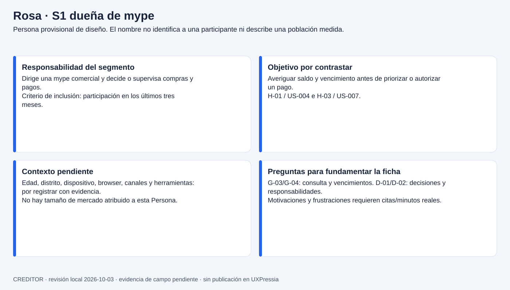

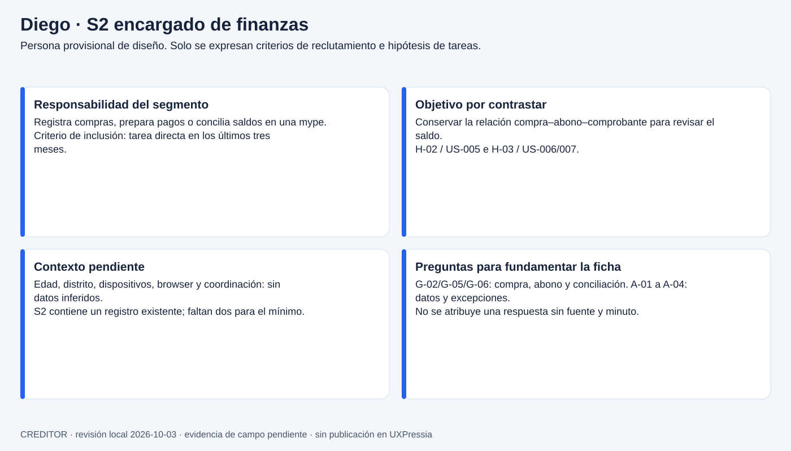

Los PNG históricos `Rosa Vargas.png` y `Diego Gutiérrez.png` se preservan sin alteración. Sus valores de “market size 80 %” y demografía no cuentan con sustento en esta revisión y se excluyen de las fichas vigentes; no deben usarse para caracterizar el mercado o a los participantes.

#### Criterios para cerrar las Personas investigadas

| Criterio | Evidencia necesaria y decisión |
|---|---|
| Base del segmento | Alcanzar 3–5 participantes revisados por segmento y confirmar su responsabilidad principal. Tener tres URLs S1 no equivale a tres entrevistas analizadas. |
| Conjunto de participantes | Identificar los códigos que sustentan cada Persona y las variables por las que se agrupan. Documentar casos distintos; Rosa/Diego pueden cambiar o dividirse si la evidencia no corresponde a los grupos previstos. |
| Objetivos y necesidades | Cada objetivo, tarea prioritaria, dificultad y condición de uso debe enlazar al menos una necesidad sustentada en la matriz. Distinguir patrones compartidos de casos individuales y conservar contraejemplos. |
| Contenido de la ficha | Incluir solo datos relatados o síntesis justificadas. Mantener sin dato la demografía, emociones o frecuencia no recogidas; no completar esos campos con estereotipos del rol. |
| Coherencia entre artefactos | Actualizar User Task Matrix, Journey As-Is y Empathy con los mismos códigos/fuentes; revisar Lean UX e historias cuando contradigan la evidencia. Las emociones requieren una expresión del participante o una observación claramente identificada. |
| Revisión y formato | Un segundo integrante revisa correspondencia fuente–necesidad–Persona. Registrar fecha, revisor y enlace/exportación UXPressia con acceso para el curso. |

El [control de entrevistas](assets/research/tb1/interview-review-checklist.csv) permite comprobar la base válida y la [matriz de evidencia](assets/research/tb1/persona-evidence-matrix.csv) permite comprobar el contenido de cada ficha. Hasta completar ambos, las Personas conservan su condición provisional. La mejora pendiente consiste en incorporar investigación real y actualizar los artefactos con ella.

### 2.3.2 User Task Matrix

La matriz existente se conserva como **base reutilizable** de hipótesis. Los valores 1 a 5 son prioridades iniciales del equipo (1 baja, 3 media, 5 alta), no frecuencias medidas. Las tareas se redactan como actividades del negocio que pueden existir sin CREDITOR.

| Tarea del negocio | Rosa: frecuencia hipotética | Rosa: importancia hipotética | Diego: frecuencia hipotética | Diego: importancia hipotética | Evidencia por recoger |
|---|---:|---:|---:|---:|---|
| Averiguar el saldo pendiente con un proveedor | 3 | 5 | 4 | 5 | G-03/G-06, momento y pasos. |
| Revisar compromisos y decidir próximos pagos | 3 | 5 | 4 | 5 | G-04/D-01, criterio real. |
| Conservar los datos de una compra a crédito | 2 | 4 | 5 | 5 | G-02/A-01, datos y responsables. |
| Registrar un pago parcial y conservar el comprobante | 2 | 5 | 5 | 5 | G-05/A-02, respaldo y excepciones. |
| Revisar cuotas de un préstamo | 2 | 3 | 2 | 3 | G-08, existencia y condiciones. |
| Preparar información para una revisión contable | 2 | 4 | 3 | 4 | G-09/A-05, destinatario/formato. |

Según esta valoración inicial, ambos roles comparten alta importancia de saldos, vencimientos y pagos. Diego tendría mayor participación en conservación de compras y abonos; Rosa en revisión y decisión. Son diferencias **por comprobar**, no resultados del estudio. Ese criterio priorizó compras/abonos/historial en TB1. Préstamos y reportes se implementan en AV2; su prioridad de negocio todavía puede cambiar con evidencia.

### 2.3.3 User Journey Mapping

Se representan dos recorridos **As-Is hipotéticos**, uno por Persona, para orientar la revisión de experiencias actuales. No muestran pantallas de CREDITOR ni una emoción observada. Cada etapa indica preguntas y evidencia faltante; las rutas finales deben documentarse en UXPressia y vincularse a la Persona del mismo proyecto.

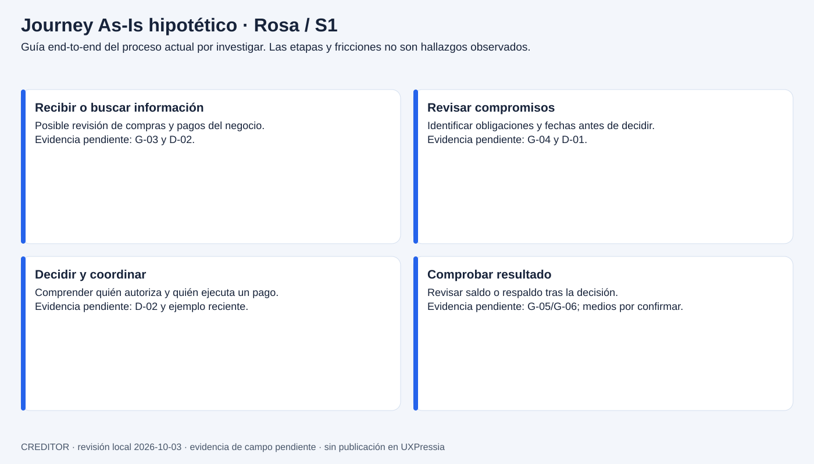

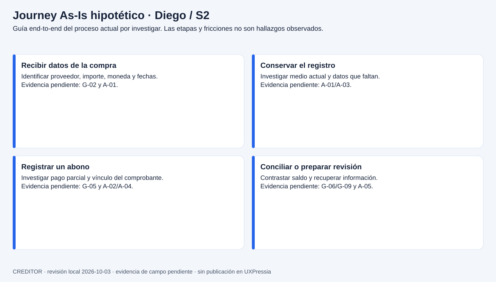

### 2.3.4 Empathy Mapping

Los dos mapas locales son guías de preguntas. “Dice”, “piensa”, “siente”, “pains” y “gains” no contienen citas fabricadas. El cierre exige reemplazar preguntas por observaciones/citas rastreables y exportar los mapas de UXPressia.

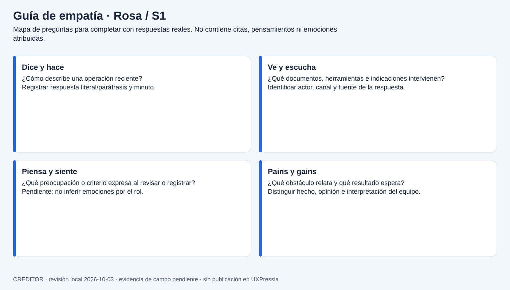

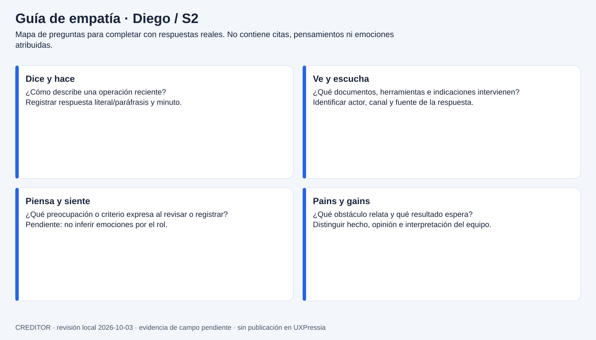

### 2.3.5 As-Is Scenario Mapping

| Persona | Escenario de negocio hipotético | Actores e información por verificar | Origen de evidencia previsto |
|---|---|---|---|
| Rosa / S1 | Averiguar obligaciones pendientes antes de autorizar un pago. | Dueño, responsable del registro y proveedor; compra, vencimiento, abonos y saldo. | G-03/G-04, D-01/D-02 y cita/minuto. |
| Diego / S2 | Conservar una compra y registrar un abono para una revisión posterior. | Administrador, dueño y proveedor; comprobante de compra y pago, importe, moneda y fecha. | G-02/G-05/G-06 y A-01 a A-04. |

Los medios concretos utilizados y las rutas alternativas se dejan pendientes; no se afirma que las seis experiencias de la meta mínima ya hayan sido observadas.

## 2.4 Big Picture Event Storming

El mapa de dominio es una propuesta local que permite discutir compra, abono y revisión de obligaciones. No es acta de una sesión colaborativa realizada. Se exige registrar participantes, fecha, captura y decisiones de la sesión para cerrar la evidencia del curso. Mermaid es una herramienta permitida para EventStorming; el archivo editable y su exportación local representan el modelado, sin sustituir la sesión.




[Fuente Mermaid completa](assets/architecture/big-picture-event-storming.mmd). Vistas parciales del mismo modelado: [proveedores y compras](assets/architecture/big-picture-event-storming-part-1.mmd), [abono y saldo](assets/architecture/big-picture-event-storming-part-2.mmd), [consulta y alcance futuro](assets/architecture/big-picture-event-storming-part-3.mmd). Las referencias entre partes representan la continuidad del mapa propuesto, sin acreditar una sesión ni eventos observados.

| Evento propuesto | Actor o comando | Regla/pregunta abierta |
|---|---|---|
| Supplier Registered | Administrador / Register Supplier | Proveedor de la misma organización que la compra. |
| Credit Purchase Registered | Administrador / Register Credit Purchase | Importe positivo, PEN/USD y vencimiento. |
| Payment Recorded | Administrador / Record Payment | Abono positivo, no mayor al saldo; moneda heredada. |
| Purchase Settled | Consecuencia de saldo cero | Saldo = total menos suma de abonos válidos. |
| Obligations Reviewed | Dueño o administrador / Query Obligations | Es observación de consulta propuesta; no crea una deuda por transcurso de fecha. |
| Loan Registered / Schedule Configured | Owner o FinanceAdmin / registrar acuerdo | Cuotas explícitas mensuales; importe total al menos igual al principal. |

Se debe contrastar si los pasos y excepciones corresponden a la operación real del segmento; no se atribuyen estos eventos a los videos aún no codificados.

**Correspondencia AV2.** El mapa conserva la discusión de negocio histórica. `Payment` pertenece al agregado `Purchase` en el código: un abono guarda el nuevo movimiento y la versión de compra en una transacción. Loans registra importes de cuotas acordados, y Reporting consulta sin mantener un saldo paralelo. Treasury es un contexto adicional para efectivo; el abono a proveedor no genera por sí mismo un movimiento de caja. Los nombres de eventos describen resultados de comandos; no se implementó un broker ni un almacén de eventos.

## 2.5 Ubiquitous Language

Los términos de dominio se nombran en inglés para mantener consistencia entre interfaz, API y modelo de datos. La definición se revisará con el equipo y con hallazgos de investigación.

| Término | Definición | Contexto |
|---|---|---|
| **Supplier** | Persona o empresa a la que la mype compra bienes o servicios y a la que puede deber un saldo. | Accounts Payable |
| **Credit Purchase** | Compra cuya obligación no se cancela por completo en el momento del registro. | Accounts Payable |
| **Due Date** | Fecha límite acordada para cumplir con una obligación. | Accounts Payable |
| **Partial Payment** | Abono que reduce el saldo de una compra, pudiendo liquidarlo; el pago de préstamos requiere un modelo futuro separado. | Accounts Payable |
| **Payment Voucher** | Evidencia digital asociada a un pago registrado. | Accounts Payable |
| **Outstanding Balance** | Importe pendiente luego de considerar los pagos aplicados. | Accounts Payable |
| **Loan** | Acuerdo de préstamo con principal, moneda, tasa anual opcional informativa y 1–60 cuotas mensuales de importe explícito. | Loans |
| **Installment** | Importe y vencimiento pactados, numerados dentro de un préstamo; no tiene estado de pago en la API actual. | Loans |
| **Debt Report** | Consulta filtrada de obligaciones para revisión, seguimiento o exportación. | Reporting |


| Término adicional | Definición | Contexto |
|---|---|---|
| **Business** | Organización a la que pertenecen proveedores, compras y obligaciones. | Transversal |
| **Currency** | Moneda de la obligación; PEN y USD se consultan por separado. | Accounts Payable |
| **Payment** | Registro de un abono de compra; hijo del agregado Purchase. No ejecuta transferencia ni salida automática de caja. | Accounts Payable |
| **CashAccount / CashMovement** | Cuenta y movimiento de efectivo registrados manualmente; saldo en centavos y moneda propia. | Treasury |
| **Holder / Economic Owner** | Titular de la cuenta y dueño económico de una asignación; pueden ser distintos. El rol Owner de acceso no equivale al dueño del dinero. | Treasury / Identity |
| **BusinessId** | Identificador obtenido del usuario autenticado para limitar consultas y relaciones; no lo elige el cuerpo de una compra. | Identity y todos los contextos |
| **Reference exchange rate** | Cotización atribuida a BCRPData/SBS con fecha de observación; no ejecuta conversión ni liquidación. | Exchange Rates |
| **Purchase Settled** | Compra cuyo saldo restante es cero tras aplicar abonos válidos. | Accounts Payable |

# Capítulo III: Requirements Specification

Los requisitos conservan las historias US-001–009. El alcance técnico se contrasta con los repositorios de frontend y backend; la aceptación del equipo y la validación de valor se registran por separado. Los segmentos S1/S2 no son permisos: los roles de API son `Owner`, `FinanceAdmin` y `Viewer`.

## 3.1 User Stories

### 3.1.1 Epics y To-Be Scenario Mapping

| Epic | Objetivo | Historias y contexto ejecutable |
|---|---|---|
| E-01 Landing | Comprender propuesta, condiciones y contacto demo. | US-001–003; repositorio landing independiente. |
| E-02 Accounts Payable | Registrar proveedores/compras y consultar obligaciones. | US-004–005; Supplier y Purchase. |
| E-03 Payments | Registrar abonos y reconstruir saldo. | US-006–007; Payment dentro del agregado Purchase. |
| E-04 Reporting | Exportar la misma selección revisada en pantalla. | US-008; consultas de Accounts Payable y adaptador HTTP. |
| E-05 Loans | Conservar principal y compromisos mensuales pactados. | US-009; Loan y LoanInstallment. |
| E-06 Service Integration | Autenticación, persistencia, contratos y servicio externo. | TS-001–003; Identity, EF Core, Scalar y BCRPData. |
| Treasury, extensión AV2 | Distinguir saldo de caja y propiedad económica. | Cuentas, movimientos, proyectos y asignaciones. No redefine US-006 como transferencia. |

### 3.1.2 Functional User Stories

| ID | Historia | Comportamiento actual y límite |
|---|---|---|
| US-001 | Como visitante quiero conocer CREDITOR. | Landing con propuesta y CTA; su despliegue actual no se revalida en esta auditoría. |
| US-002 | Como visitante quiero revisar el contacto. | Formulario demo; no hay envío de email/solicitud real ni cobro de suscripción. |
| US-003 | Como visitante quiero consultar condiciones. | Vistas de términos/privacidad; el texto no acredita cumplimiento legal certificado. |
| US-004 | Como dueño quiero consultar obligaciones. | API, listado y resumen por negocio; totales PEN/USD separados, estados derivados del saldo/fecha. |
| US-005 | Como administrador quiero registrar compra a crédito. | Proveedor, referencia, descripción, moneda, importe, fechas y comprobante opcional por API protegida. |
| US-006 | Como administrador quiero registrar abonos. | Abonos sucesivos válidos guardan filas distintas; importe máximo igual al saldo. Sin movimiento automático de tesorería. |
| US-007 | Como dueño quiero revisar historial. | Consulta de compra y abonos persistidos con saldo derivado; voucher privado si se adjuntó. |
| US-008 | Como administrador quiero exportar obligaciones filtradas. | Mismos criterios aplicados para listado, resumen y CSV: proveedor, moneda, estado, texto y vencimiento. Cambiar el formulario exige aplicar antes de descargar. |
| US-009 | Como dueño quiero consultar préstamos y cuotas. | Registro por Owner/FinanceAdmin; lectura por cualquier miembro del negocio. Principal, moneda, tasa informativa opcional y cuotas mensuales explícitas. No calcula amortización ni registra pagos de cuotas. |

### 3.1.3 Reglas observables del incremento AV2

| ID | Regla | Implementación y límite |
|---|---|---|
| R-01 | Pertenencia | BusinessId sale del principal JWT; FK compuestas y consultas por negocio. Referencias ajenas devuelven 404 o validación sin acceso al dato. |
| R-02 | Importe | 0.01–9,999,999.99, hasta dos decimales. Purchase/Payment usan decimal; Treasury/Loans persisten centavos enteros. |
| R-03 | Moneda | PEN/USD; cada transacción conserva moneda y los resúmenes no las suman entre sí. |
| R-04 | Compra | Referencia 2–80, descripción 3–200, unicidad de referencia normalizada por proveedor. |
| R-05 | Fechas | Compra desde 2000-01-01 hasta hoy de negocio; vencimiento no anterior, hasta 2100-12-31. Calendario America/Lima. |
| R-06 | Archivos | PDF/PNG/JPEG hasta 2 MiB; metadatos en BD y contenido en almacenamiento privado. La descarga exige acceso a la compra/abono. |
| R-07 | Abono | Positivo, moneda de compra y no mayor al saldo; cada abono nuevo se inserta explícitamente. |
| R-08 | Fecha de abono | No anterior a compra ni futura; nota opcional hasta 200 caracteres. |
| R-09 | Saldo/concurrencia | Amount − suma Payments.Amount. Guardar nuevo Payment y versión Purchase en una transacción; conflicto concurrente no deja abonos parciales. |
| R-10 | Fallos | Error HTTP no se presenta como guardado; consulta fallida se distingue de lista vacía. |
| R-11 | Reporte | Lista, summary y export usan filtros iguales. Exportar no altera saldos; CSV conserva moneda y protege texto interpretable como fórmula. |
| R-12 | Préstamo | Nombre 2–120, principal positivo, 1–60 importes de cuota positivos, suma al menos igual al principal; tasa anual opcional 0–100 con hasta dos decimales. |
| R-13 | Cronograma | Cada vencimiento es firstDueOn.AddMonths(n), anclado a la primera fecha. Próximo vencimiento = primera fecha desde hoy; no significa cuota impaga ni pagada. |
| R-14 | Permisos | Owner administra usuarios. Owner/FinanceAdmin registran operaciones. Viewer consulta; ocultar botones complementa la autorización del servidor. |

### 3.1.4 Acceptance Criteria

```gherkin
Feature: Sequential purchase payments (US-006 and US-007)
  Scenario: Record two valid partial payments
    Given a purchase of PEN 800 belongs to the authenticated business
    When the administrator records PEN 300 and then PEN 50
    Then two distinct payment records are persisted
    And paid amount is PEN 350 and balance is PEN 450
    And another session can read the same history

  Scenario: Concurrent payments cannot exceed the obligation
    Given the purchase balance is PEN 100
    When two requests attempt PEN 70 concurrently
    Then at most one request succeeds
    And the balance and persisted history remain consistent

Feature: Filtered obligation export (US-008)
  Scenario: Same criteria for list, totals and CSV
    Given PEN and USD purchases exist in the authenticated business
    When the user applies supplier, PEN, status and inclusive due-date filters
    Then the list and summary refer to the same selection
    And the downloaded CSV contains only that selection
    And changed but unapplied criteria disable download

Feature: Agreed loan schedule (US-009)
  Scenario: Keep the original monthly anchor and persisted amounts
    Given the owner records a loan with the first due date on January 31
    And explicit monthly amounts cover the principal
    When the agreement is saved and read in a new session
    Then February uses its last valid day and March uses March 31
    And the exact agreed amounts are returned without interest recalculation

  Scenario: Protect access and validate the whole schedule
    Given a Viewer or a user of another business
    When they try to create or access an unauthorized loan
    Then the API rejects the operation
    And invalid amounts, count or dates create no partial loan
```

Los escenarios son criterios; los comandos ejecutados y resultados se registran en [evidencia AV2](docs/av2/estado-implementacion.md). Las pruebas automáticas no sustituyen aceptación del equipo ni entrevistas de validación. Los casos históricos de navegador TB1 conservan su adaptador y fecha.

## 3.2 Impact Mapping

### 3.2.1 Objetivos SMART propuestos

Se mantiene la propuesta de prueba moderada con cinco participantes: cuatro deberían localizar saldo y vencimiento sin ayuda en dos minutos. No se dispone de línea base ni resultado medido. Para compra, abono, exportación y cronograma se medirá completitud, errores y recuperación con tareas acordadas antes de la sesión.

| Actor | Impacto propuesto | Entregable actual | Validación pendiente |
|---|---|---|---|
| S1 / Rosa provisional | Entender compromisos sin reconstruir registros. | Resumen, historial y cronograma. | Comprensión de saldo vs efectivo y cuota vs pago. |
| S2 / Diego provisional | Registrar y preparar revisión contable. | Compra, abonos, adjuntos y CSV filtrado. | Completar tarea, encontrar errores y comprender filtros. |
| Ambos | Distinguir efectivo propio y de terceros. | Tesorería y asignaciones por propietario. | Verificar vocabulario con usuarios del segmento. |
| Visitante | Identificar alcance y llegar a la aplicación. | Landing y CTA. | Comprensión y accesibilidad de recorrido. |

[Impact Map histórico editable](assets/research/tb1/impact-map-local.mmd). La sincronización en UXPressia y el acuerdo sobre la extensión Treasury permanecen pendientes; la implementación no prueba demanda.

## 3.3 Product Backlog

Story points son estimaciones relativas históricas, no horas trabajadas. To-Review describe código local que requiere aceptación académica y no equivale a deployment.

| ID | Prioridad / SP históricos | Estado técnico AV2 | Aceptación pendiente |
|---|---|---|---|
| US-001–003 | Must / 3,5,2 | Landing existente; contacto demo. | Revisión/publicación del corte que se entregue. |
| US-004–005 | Must / 8,8 | UI conectada y API para consulta/registro. | Validación con usuarios y revisión de equipo. |
| US-006–007 | Must/Should / 5,5 | Historial y abonos sucesivos persistidos. | Aceptación del flujo y límites de tesorería. |
| US-008 | Should / 5 | Filtros y CSV conectado. | Revisión de archivo por el usuario objetivo. |
| US-009 | Could / 8 | Acuerdos y cuotas explícitas persistidos. | Aceptar alcance sin amortización/pago de cuotas. |

El [Sprint 3](docs/sprints/sprint-03.md) organiza los incrementos locales AV2. El equipo debe vincularlos al tablero real y confirmar responsabilidades; no se reconstruyen reuniones ni horas consumidas.

### 3.3.1 Technical Stories

| ID | Contrato implementado | Alcance verificable |
|---|---|---|
| TS-001 | GET/POST `/api/v1/suppliers` y `/api/v1/purchases`; detalle y resumen. | Autenticación, paginación, filtros, validaciones y negocio aislado. |
| TS-002 | GET/POST `/api/v1/purchases/{id}/payments`. | Historial, abonos sucesivos y concurrencia de agregado. |
| TS-003 | OpenAPI y Scalar; rutas documentadas y modelos. | La UI de docs consume el contrato generado del backend. Evidencia final en capítulo V. |
| Extensión persistencia | MySQL 8.4, migraciones EF, pruebas con datos ficticios. | Cambio de proveedor y cadena propia; no es conversión automática de archivos SQLite o base PostgreSQL existente. |
| Extensión externa | GET `/api/v1/exchange-rates/reference`. | Cotización referencial BCRPData/SBS; timeout/caché/errores sin tasas inventadas. La UI no consume hoy esta ruta. |

# Capítulo IV: Product Design

El capítulo conserva wireframes/mock-ups de AV1/TB1 y actualiza navegación, arquitectura, clases y base de datos al código AV2. Los diagramas actuales representan la API implementada y el workspace conectado. Los artefactos locales no acreditan una sesión de investigación ni una entrega creada en Figma, UXPressia o FigJam.

> **Corte de diseño:** 4.1–4.2 y 4.6–4.8 describen código vigente AV2; 4.3–4.5 preservan recursos históricos identificados. Se mantiene la paleta índigo y la composición del frontend. No se declara sustituido ni validado el prototipo Figma pendiente.

## 4.1 Style Guidelines

### 4.1.1 General Style Guidelines

CREDITOR comunica claridad sobre obligaciones de la mype con sus proveedores. No ofrece rentabilidad, crédito al público ni un servicio financiero de producción.


| Elemento | Dirección visual y aplicación |
|---|---|
| Marca | Índigo de la interfaz establecida, fondos claros y jerarquía centrada en saldo/vencimiento. |
| Tipografía de referencia | Montserrat para títulos e Inter para texto en el diseño histórico. La implementación usa la pila de fuentes declarada en cada CSS, con alternativa de sistema. |
| Acción principal | Índigo `#4338CA`; se conserva el preset y los tokens de `src/styles.css`/`src/finance`. |
| Texto y superficies | Texto `#172033`, fondo `#F5F6FA`, superficies blancas, bordes `#E5E8F0`, secundario `#5D687C`. |
| Estados | Éxito, advertencia y error acompañados de texto. El color no sustituye su significado. |
| Iconografía | Proveedor, documento, fecha y pago con nombre accesible cuando el icono ejecuta una acción. |
| Tono | Acciones concretas, datos de demostración identificados, mensajes sin promesas comerciales. |

### 4.1.2 Web Style Guidelines

La frontend usa Vue y componentes PrimeVue con tema Material. La aplicación ofrece inglés y español latinoamericano; la preferencia se conserva en el navegador. Sin API configurada, la primera visita adopta español; con API configurada, inglés. La preferencia guardada prevalece en ambos casos. La landing conserva su propia configuración. El idioma controla el texto y formato; cada compra conserva su moneda PEN o USD. Se mantienen foco visible, etiquetas persistentes, errores asociados y navegación por teclado.

Los layouts locales permiten revisar escritorio y móvil. Los formularios preservan sus campos ante un error. Una ausencia de datos se distingue de un fallo al leer o guardar, sin presentar un saldo desconocido como cero.

## 4.2 Information Architecture

El diseño vigente conserva el menú del proyecto y añade las capacidades conectadas dentro de sus tareas. Las capturas históricas de TB1 siguen siendo referencias del corte de octubre.

### 4.2.1 Organization Systems

| Área | Ruta conectada | Responsabilidad |
|---|---|---|
| Inicio | `/#/workspace` | Resumen del negocio autenticado. |
| Mi dinero | `/#/workspace/treasury` | Cuentas, movimientos y asignaciones. |
| Cobros y pagos | `/#/workspace/payables` | Proveedores, compras, abonos, documentos y CSV de obligaciones. El alcance conectado es por pagar. |
| Préstamos y cuotas | `/#/workspace/loans` | Acuerdos mensuales dentro de Cobros y pagos. |
| Mi negocio | `/#/workspace/business` | Personas/empresas y proyectos. |
| Informes | `/#/workspace/reports` | Estado de cuenta derivado de movimientos/asignaciones de tesorería. |
| Acceso | `/#/workspace/sign-in` | Registro de negocio e inicio de sesión. |
| Práctica | `/#/finance/overview` | Demostración local independiente; no se importa al servidor al autenticar. |

### 4.2.2 Labeling Systems

Compras/Purchases, Proveedores/Suppliers, Abonos/Payments, Saldo pendiente/Outstanding balance y Vencimiento/Due date mantienen su significado de negocio. El grupo «Cobros y pagos» pertenece al diseño general; en la vista conectada se aclara que se gestionan obligaciones con proveedores. «Titular de cuenta» y «dueño económico» son conceptos distintos, y ninguno equivale al rol de autorización Owner.

### 4.2.3 SEO Tags and Meta Tags

Los metadatos efectivos están en `index.html` y en la actualización de idioma del frontend/landing. El área autenticada no publica información de negocio en metadatos. Las URLs canonical, la indexación y el HTTPS de producción deberán validarse cuando exista un despliegue autorizado del corte actual.

### 4.2.4 Searching Systems

En cuentas por pagar, el usuario aplica texto, proveedor, moneda, estado y límites inclusivos de vencimiento. El mismo conjunto viaja al listado, resumen y exportación. Un cambio sin aplicar invalida la descarga, y limpiar filtros vuelve a la selección completa del negocio. La API paginada conserva la moneda de cada fila y separa totales PEN/USD. Los préstamos ofrecen lista y detalle; no se les atribuyen los filtros de compras.

### 4.2.5 Navigation Systems

La navegación usa Vue Router con hash. Las rutas heredadas `/dashboard` y `/purchases/new` redirigen a la práctica; no equivalen a autenticación. Con `VITE_API_BASE_URL` configurada aparece el acceso al negocio. Las rutas `/workspace` requieren sesión salvo acceso/legales; cerrar sesión o recargar por completo elimina el token en memoria. Los menús y acciones conservan el diseño, colores y estructura establecidos; las funciones nuevas se integran en esos componentes.

## 4.3 Landing Page UI Design

Las subsecciones 4.3–4.5 conservan wireframes, mock-ups y evidencia de prototipo del corte TB1. La implementación conectada actual se describe en 4.2 y 5.2.3; estas imágenes no se presentan como capturas de MySQL ni de la nueva pantalla de préstamos. No se modificó el diseño del frontend en esta actualización documental.

### 4.3.1 Landing Page Wireframes

El recorrido actual comprende propuesta, obligaciones ilustrativas, funcionalidades, proceso compra/abono, alcance TB1, preguntas, contacto de demostración y legales. Los [bocetos de AV1](assets/branding/wiref1.png) y el [archivo Figma histórico](https://www.figma.com/design/OQWWAsxRTtOPJcWfFUtCq3/Sin-t%C3%ADtulo?node-id=12-2) se conservan como referencia. La revisión TB1 debe trasladarse a Figma para cumplir el formato del curso.

La [fuente de wireframes TB1](assets/ux/tb1/landing-wireframes.html) define la estructura vigente en escritorio y móvil. El primer panel reúne propósito, CTA por segmento y vista ilustrativa del producto; el segundo reúne proceso, alcance, preguntas, contacto y legales. Las columnas se apilan en móvil, la navegación se contrae y ambos CTA siguen visibles. Las cuentas sociales solo se incorporarán cuando el equipo tenga cuentas reales autorizadas; no se enlazan perfiles supuestos.

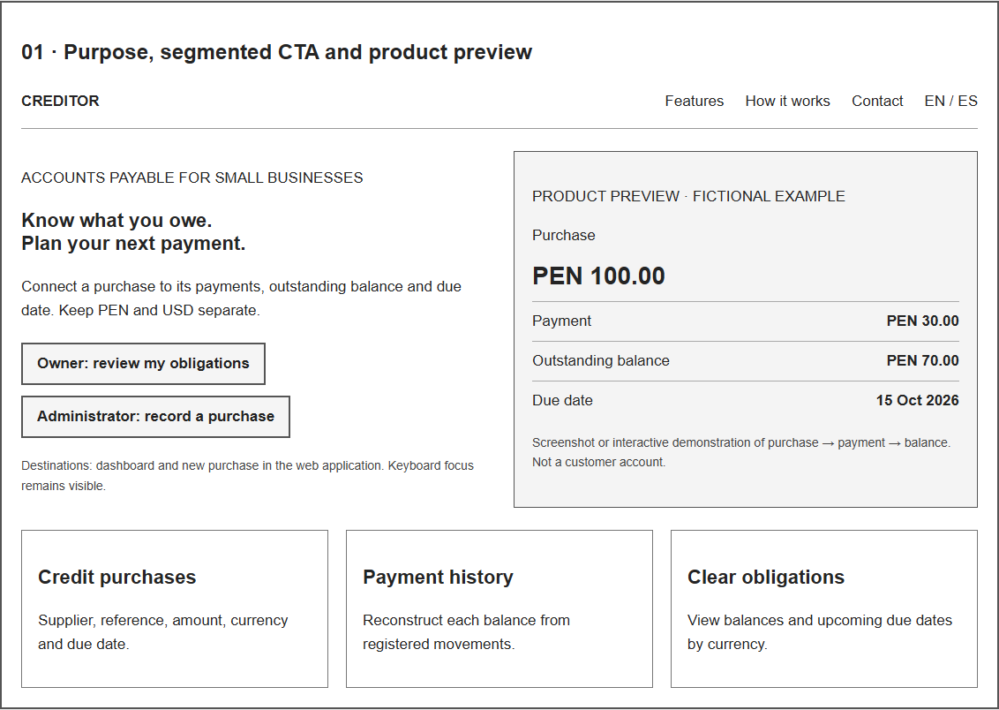

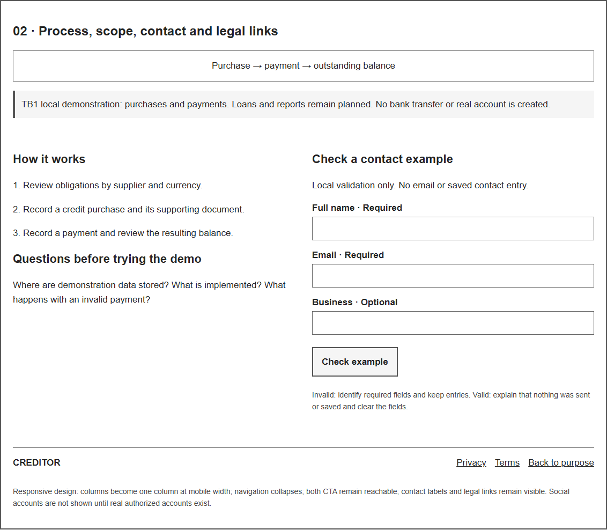

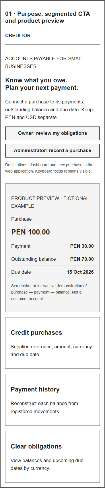

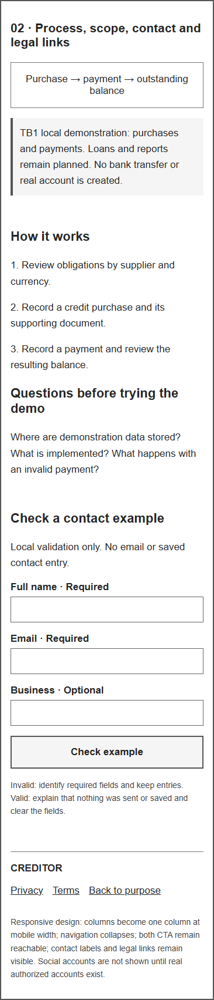

### 4.3.2 Landing Page Mock-ups

Estas capturas son de la nueva landing ejecutada localmente. Sustituyen en la lectura actual los textos históricos sobre cartera de clientes y ofertas sin sustento. Los recursos antiguos se conservan para trazabilidad en `assets/branding/`.

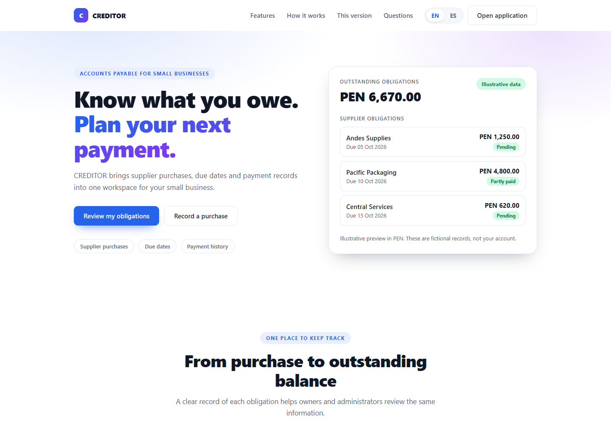

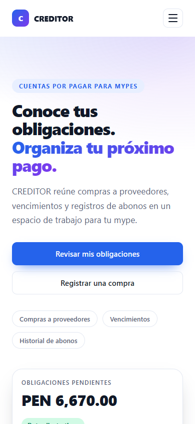

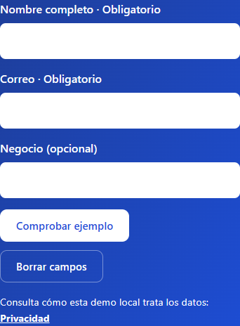

La composición implementada mantiene etiquetas, CTA y enlaces legales en 390 px. La [captura de diseño](assets/ux/tb1/design-execution.json) registra viewport y fecha: no hubo errores JavaScript ni desbordamiento horizontal en la landing revisada. La publicación HTTPS y su prueba de humo siguen siendo evidencias distintas que deben registrarse después de autorizar deployment.

## 4.4 Web Applications UX/UI Design

### 4.4.1 Web Application Wireframes

[Fuente editable local de cinco pantallas](assets/ux/tb1/wireframes.html): dashboard, lista, nueva compra, detalle y abono. Cada pantalla identifica actor, historia y alternativas de vacío/error. El diseño puede abrirse en el navegador y adaptarse a móvil. Son wireframes locales; no se presentan como exportación de Figma.

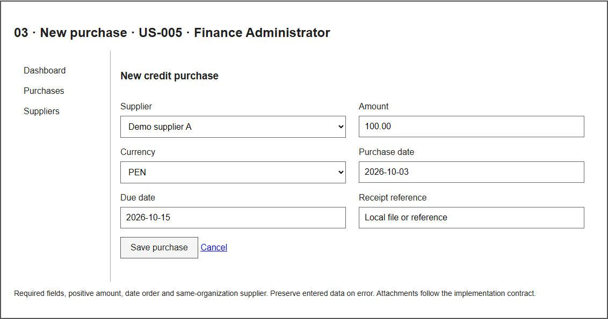

Las siguientes cinco exportaciones muestran explícitamente la composición móvil de los mismos flujos a **390 px**, desde la fuente HTML editable. El menú ocupa una fila compacta, las métricas y campos se apilan y las tablas conservan desplazamiento interno cuando es necesario. Cada imagen identifica historia, datos ilustrativos y estado alternativo; no es una captura de una sesión con participantes.

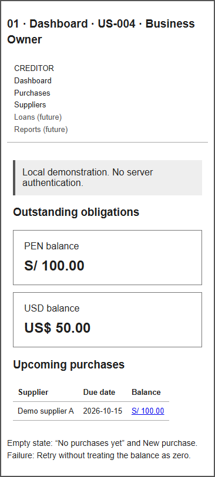

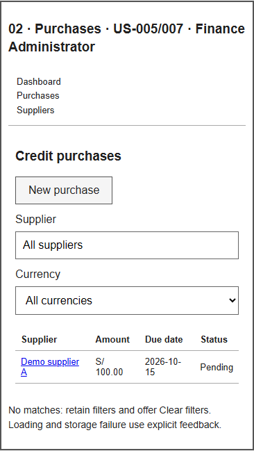

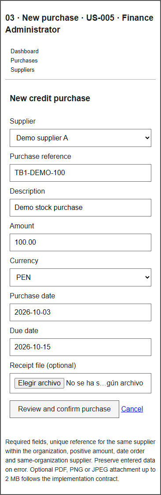

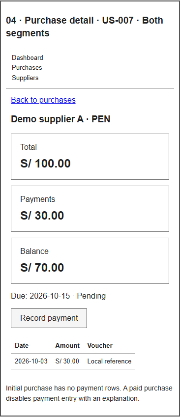

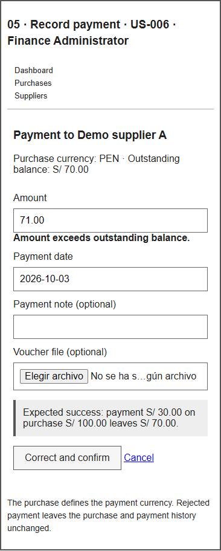

| Pantalla | Historia | Estado alternativo |
|---|---|---|
| Dashboard | US-004 | Sin compras o lectura no disponible. |
| Lista | US-005/007 | Filtros sin coincidencias, limpiar filtros. |
| Nueva compra | US-005 | Importe, proveedor, campos o fechas inválidos; conservar datos. |
| Detalle | US-007 | Sin abonos, compra no encontrada y compra pagada. |
| Registrar abono | US-006 | Importe mayor al saldo, inválido o fallo de persistencia; no alterar movimientos. |

### 4.4.2 Web Application Wireflow Diagrams

[Wireflow local con pantallas y alternativas](assets/ux/tb1/wireflow.html). El recorrido de compra conecta lista, formulario y detalle; el de abono conecta detalle, formulario y saldo actualizado. Debe importarse/recrearse en FigJam, LucidChart u Overflow para el formato exigido. El Mermaid actualizado resume las rutas TB1 y distingue los accesos futuros:


[Fuente de lógica](assets/architecture/web-wireflow.mmd).

### 4.4.3 Web Application Mock-ups

Las siguientes capturas muestran las vistas implementadas con datos ficticios y adaptador local. Permiten revisar composición y consistencia del flujo con las historias. No constituyen una validación con usuarios.

**Evidencia posterior de noviembre:** el flujo actual de compra a crédito se recorre mediante **Cobros y pagos → Anotar una deuda**. Sus tres pasos —proveedor/importe, moneda/vencimiento y revisión— se muestran en el [anexo B.3](#b3-evidencia-posterior-de-us-005-compra-a-crédito). Las imágenes TB1 siguientes se conservan como históricas; las nuevas capturas no son un prototipo final de Figma ni una prueba de usabilidad.


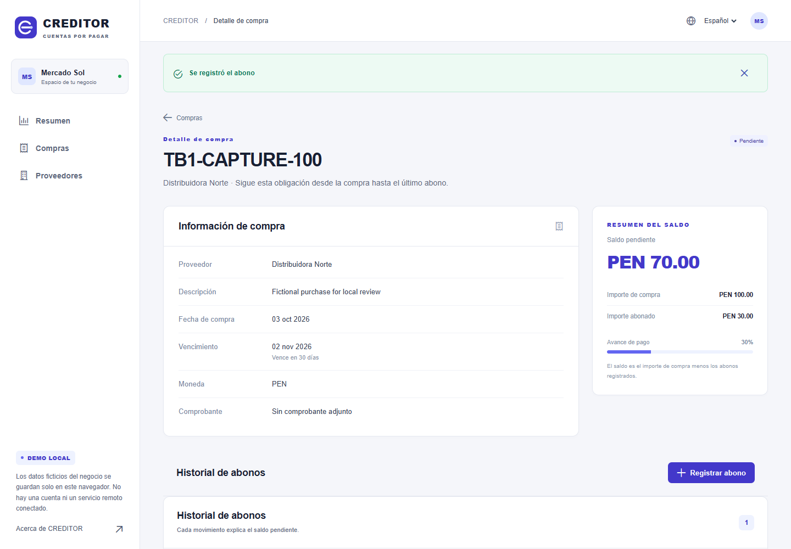


Las cuatro capturas adicionales incorporadas por Sebastián en la referencia local `origin/main` se conservan como evidencia del prototipo TB1, sin presentarlas como pantallas AV2 actuales:

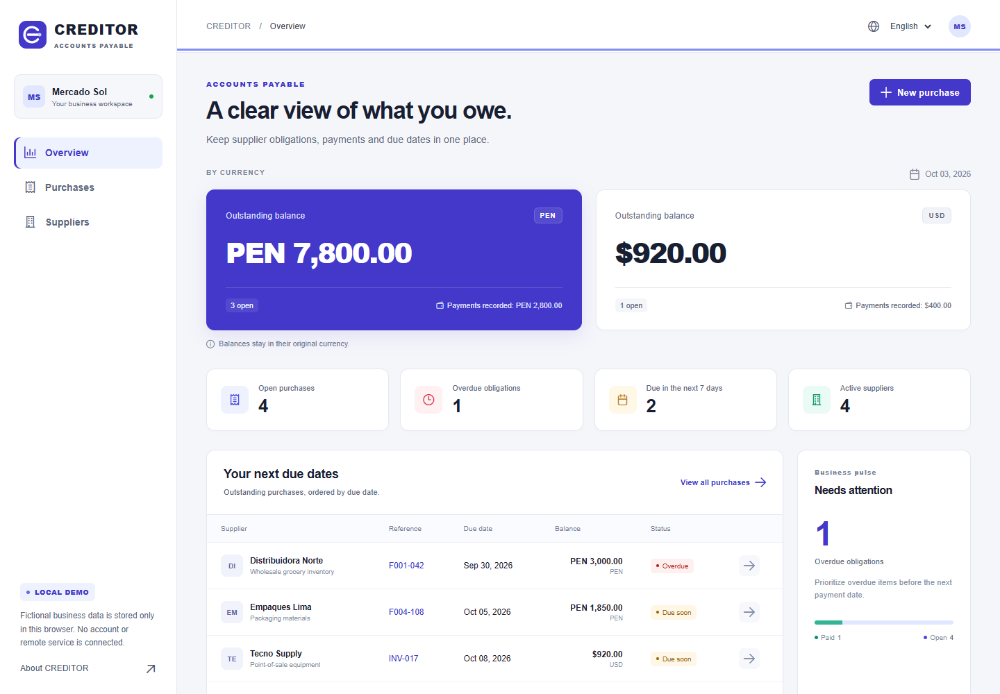

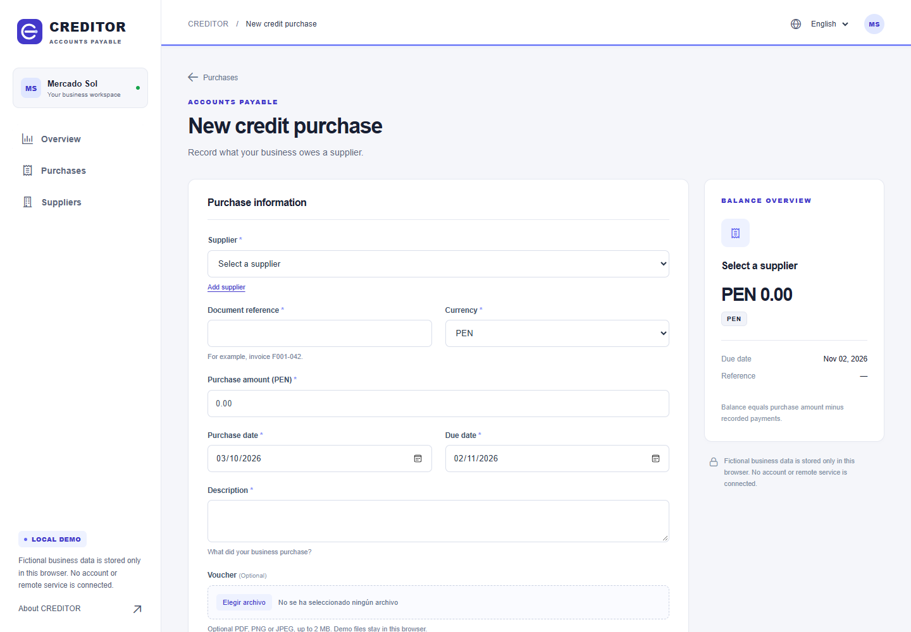


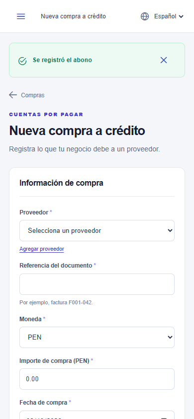

### 4.4.4 Web Application User Flow Diagrams

| Objetivo | Camino esperado | Alternativa |
|---|---|---|
| US-005 registrar compra | Lista, nueva compra, guardar, detalle con saldo inicial. | Datos inválidos: conservar entrada y señalar corrección. |
| US-006 registrar abono | Detalle, importe/fecha/voucher, confirmar, historial y saldo. | Sobreabono o fallo: no guardar y mantener datos. |
| US-004/007 consultar | Dashboard/lista, filtrar, detalle y movimientos. | Sin datos/coincidencias: explicación y nueva compra/limpiar filtros. |
| US-008 reportes | Filtros, consulta y exportación futura. | Roadmap, no operación disponible TB1. |
| US-009 préstamos | Préstamo y cronograma futuro. | Roadmap, no operación disponible TB1. |

Los flujos se presentan en partes conectadas para mantener legibles las decisiones y los retornos en el informe. Cada salida «Continuar en parte» identifica la vista siguiente; los identificadores de escenario coinciden con la matriz de cobertura. El alcance es la organización fija de demostración y su almacenamiento local, sin autenticación ni API desplegada.

**Compra, parte 1: entrada, cancelación del formulario y validación.**


**Compra, parte 2: revisión, confirmación y persistencia.**


**Abono, parte 1: existencia de compra, saldo y formulario.**


**Abono, parte 2: validación y revisión del saldo posterior.**


**Abono, parte 3: confirmación, revalidación y persistencia.**


**Consulta, parte 1: carga y recuperación del almacenamiento.**


**Consulta, parte 2: filtros, estados vacíos y detalle.**


Fuentes completas: [compra](assets/architecture/user-flow-purchase.mmd), [abono](assets/architecture/user-flow-payment.mmd), [obligación](assets/architecture/user-flow-obligation.mmd). Fuentes parciales: compra [1](assets/architecture/user-flow-purchase-part-1.mmd) y [2](assets/architecture/user-flow-purchase-part-2.mmd); abono [1](assets/architecture/user-flow-payment-part-1.mmd), [2](assets/architecture/user-flow-payment-part-2.mmd) y [3](assets/architecture/user-flow-payment-part-3.mmd); consulta [1](assets/architecture/user-flow-obligation-part-1.mmd) y [2](assets/architecture/user-flow-obligation-part-2.mmd). Los diagramas de [reportes](assets/architecture/user-flow-report.mmd) y [préstamos](assets/architecture/user-flow-loan.mmd) conservan el diseño de Sprint 3.

#### Cobertura de caminos alternativos del incremento TB1

Cada identificador aparece en los diagramas y el wireflow. Esta matriz permite revisar el resultado observable y el punto de retorno, incluyendo la diferencia entre cancelar un formulario y cerrar su confirmación. La fuente del comportamiento es el código de `PurchaseFormView`, `PaymentFormView`, `PaymentForm`, `PurchasesView`, `PurchaseDetailView`, `WorkspaceStatus` y el adaptador local del frontend. La cobertura del diseño no implica que todos los escenarios se hayan ejecutado en una prueba de usuario.

| Escenario | Disparador y resultado previsto en el código local | Retorno o continuación |
|---|---|---|
| COMP-01 | Compra válida, revisión y confirmación; guarda una compra y muestra saldo inicial igual al importe. | Detalle de la compra. |
| COMP-02 | Campo obligatorio, importe, moneda, proveedor, fecha, referencia duplicada para el mismo proveedor u archivo inválido; señala error y conserva entrada. | Corregir formulario y volver a revisar. |
| COMP-03 | Cancelar el formulario antes de guardar; no crea una compra. | Lista de compras. |
| COMP-04 | Cerrar/cancelar el diálogo de revisión; no guarda ni borra los campos. | Formulario con la entrada anterior. |
| COMP-05 | Al confirmar falla la escritura o los datos cambiaron en otra pestaña; informa el error y no simula éxito. | Mantener el diálogo; cerrar para corregir o recargar si el mensaje lo requiere. |
| ABO-01 | Abono válido de 30 en compra de 100; agrega movimiento y muestra saldo 70 en la moneda de la compra. | Detalle e historial. |
| ABO-02 | La compra de la ruta no existe; muestra explicación y evita registrar abono. | Volver a la lista. |
| ABO-03 | Saldo cero; informa que la compra está pagada y no ofrece un abono nuevo. | Detalle o lista. |
| ABO-04 | Abono no positivo o mayor al saldo, fecha inválida o voucher inválido/ilegible; explica el error y mantiene los campos. | Corregir y volver a revisar. |
| ABO-05 | Cancelar formulario; no agrega movimiento ni modifica saldo. | Detalle de la compra. |
| ABO-06 | Cancelar el diálogo de revisión; conserva entrada sin registrar abono. | Formulario de abono. |
| ABO-07 | Falla de escritura, cambio de datos o revalidación del saldo al confirmar; muestra el error sin añadir el movimiento. | Diálogo conservado; corregir/recargar según el error. |
| CON-01 | Carga y búsqueda válidas; permite consultar total, abonos, saldo y vencimiento por moneda. | Detalle e historial. |
| CON-02 | Filtros sin coincidencias; conserva filtros y distingue el resultado vacío de un fallo de lectura. | Limpiar o ajustar filtros. |
| CON-03 | No hay compras; muestra estado vacío con acceso al registro. | Nueva compra. |
| CON-04 | Compra inexistente; muestra estado específico, sin inventar saldo cero de una compra válida. | Lista de compras. |
| CON-05 | Datos locales ilegibles o almacenamiento no disponible; informa el fallo en lugar de presentar un dashboard válido. | Reintentar lectura o confirmar restablecimiento de la demo; este último reemplaza los datos ficticios. |

Los casos de importe, fecha, referencia, proveedor, archivo y fallas del adaptador cuentan con pruebas de dominio; la [evidencia de navegador](docs/tb1/evidencia-local.md) registra el recorrido compra–abono–saldo, sobreabono y ruta inexistente. El resto de la matriz conserva su condición de contrato de diseño revisado contra el código, sin afirmar una ejecución no registrada. Préstamos/reportes y autenticación de servidor permanecen fuera de esta matriz TB1.

## 4.5 Web Applications Prototyping

El prototipo funcional local es la primera frontend CREDITOR. Con el servidor en 5174 permite recorrer dashboard, compra, detalle y abono en escritorio/móvil, cambiar idioma y corregir errores. Una compra PEN 100 y abono 30 debe mostrar saldo PEN 70; un abono posterior 71 debe rechazarse. Las comprobaciones y límites se documentan en [Evidencia local](docs/tb1/evidencia-local.md).

La conexión del prototipo Figma desktop/mobile, la revisión del equipo y el video de navegación en Stream quedan pendientes. La preparación local no acredita esas evidencias externas.


**Aporte documental posterior conservado:** Sebastián incorporó la siguiente captura al repositorio en `d1e6ddc` y la explicación de rutas en `4e2fa6e` (03/10/2026). Muestra dashboard, nueva compra y detalle. La captura complementa las vistas locales anteriores; no acredita por sí sola un enlace Figma final navegable, pruebas con usuarios ni video de navegación.

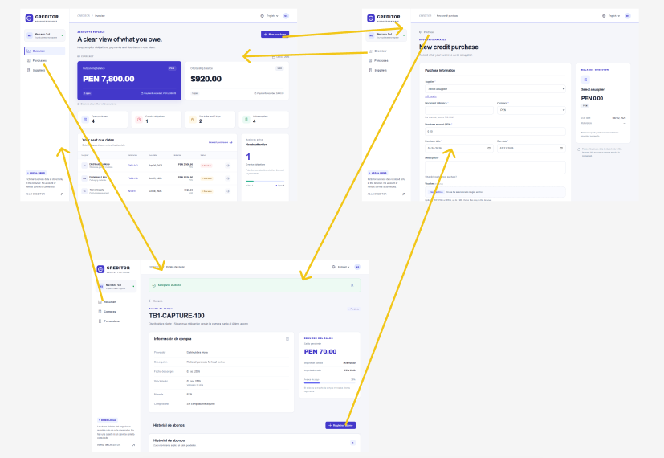

## 4.6 Domain-Driven Software Architecture

La implementación es un monolito modular ASP.NET Core. `Creditor.Domain` no depende de infraestructura; `Creditor.Application` referencia Domain y define puertos; Infrastructure implementa persistencia/integraciones; API compone dependencias y publica contratos. La separación de procesos corresponde a frontend, backend y base de datos, no a un microservicio por contexto.

| Límite | Responsabilidad ejecutable |
|---|---|
| Accounts Payable | Supplier y Purchase; Payment es hijo de Purchase para proteger la invariancia del saldo. |
| Loans | Loan con colección inmutable de LoanInstallment; registro/consulta del acuerdo. |
| Treasury | Party, Project y CashAccount; movimientos, asignaciones y recibos de idempotencia. |
| Identity | Business, usuarios, contraseña hash, roles y JWT. |
| Reporting | Proyecciones de lectura; no mantiene otro saldo ni ejecuta pagos. |
| Attachments | Metadatos privados y acceso al contenido ligado a compras/abonos. |
| Exchange Rates | Adaptador BCRPData con contrato propio y atribución de origen. |

### 4.6.1 Design-Level Event Storming

El EventStorming histórico es una propuesta para discusión. Su correspondencia actual es:

| Intención | Agregado/servicio | Resultado y regla |
|---|---|---|
| Registrar compra | Purchase | Compra persistida; proveedor del mismo negocio y referencia única. |
| Registrar abono | Purchase + Payment | Nueva fila y nueva versión atómicas; saldo no negativo. |
| Adjuntar comprobante | AttachmentService | Metadatos y archivo accesibles solo al negocio autorizado. |
| Registrar préstamo | Loan | Se guarda el cronograma completo con importes pactados. |
| Registrar movimiento | CashAccount | Movimiento manual; referencia única y requestId para reintentos. |
| Asignar fondos | CashAccount | Dueño/responsable/proyecto válidos; no se altera el total de efectivo. |
| Consultar/exportar | Queries | Respuestas por negocio/filtros; sin mutación. |

Los resultados no son eventos publicados en una cola. No hay outbox/event sourcing. El pago de una compra y el movimiento de efectivo son casos separados; la integración automática permanece fuera del incremento. La evidencia de una sesión colaborativa sigue pendiente.

### 4.6.2 Software Architecture Context Diagram


[Fuente editable](assets/architecture/av2/context-av2.mmd).

El proveedor externo implementado es BCRPData/SBS para cotización referencial, no una pasarela bancaria ni un servicio de envío de contacto. Los visitantes no acceden a datos privados por la landing.

### 4.6.3 Software Architecture Container Diagrams


[Fuente editable](assets/architecture/av2/containers-av2.mmd).

MySQL es el proveedor elegido para el entorno local vigente. PostgreSQL conserva su cadena de migraciones para regresión y compatibilidad histórica; SQLite se limita a pruebas/desarrollo auxiliar. Los adjuntos no se publican como URL estática: la API verifica el acceso y transmite el contenido. La demostración local usa otro adaptador y otro almacenamiento.

### 4.6.4 Software Architecture Component Diagrams


[Fuente editable](assets/architecture/av2/components-api-av2.mmd).


[Fuente editable](assets/architecture/av2/components-web-av2.mmd).

Los contextos conectados del frontend separan presentación, coordinación de casos de uso e infraestructura HTTP. Las reglas de dominio de entrada usan valores compartidos; la autoridad final es el dominio y los servicios del backend. La API recibe moneda/importes en unidades monetarias; la representación interna de centavos no exige que el cliente multiplique el payload. El guard de ruta y los botones por rol son complementarios a `[Authorize]` y al BusinessId del token.

## 4.7 Software Object-Oriented Design

### 4.7.1 Class Diagrams


[Fuente editable](assets/architecture/av2/classes-av2.mmd).

El diagrama refleja clases reales, mostrando solo sus miembros relevantes. `PaidAmount` y `Balance` de Purchase son valores derivados e ignorados por EF. `RecordPayment` valida saldo/fecha/moneda y cambia Version; el repositorio agrega explícitamente la nueva entidad Payment. `Loan` se crea con 1–60 cuotas; no existe préstamo vacío esperando generación posterior. La tasa puede ser null y no genera intereses. `CashAccount` protege efectivo y asignaciones; no se confunde con la deuda de proveedores. Las asociaciones por negocio y las claves compuestas están detalladas en el modelo EF.

## 4.8 Database Design

El modelo vigente procede de `CreditorDbContext` y sus configuraciones EF, con migraciones específicas por proveedor. **MySQL 8.4** es el motor del entorno actual; conservar las migraciones PostgreSQL permite comprobar el incremento previo sin alterar esa base. Cambiar el proveedor no transporta automáticamente usuarios, operaciones ni archivos existentes entre motores.

La definición reproducible se explica en [database/README.md](database/README.md). El SQL del diseño inicial se conserva separado como antecedente; no se usa para inicializar el backend actual. El esquema ejecutable debe generarse desde las migraciones del backend, que incluyen Identity, cuentas por pagar, adjuntos, tesorería y préstamos.

### 4.8.1 Database Diagrams


[Fuente editable](assets/architecture/av2/database-core-av2.mmd).


[Fuente editable](assets/architecture/av2/database-treasury-av2.mmd).

Los tipos del ERD representan el modelo CLR y las relaciones principales; el DDL generado precisa tipos físicos, nulabilidad, claves compuestas, tablas auxiliares Identity e índices. `NormalizedReference` es único junto con SupplierId, no globalmente. El modelo no contiene `receipt_url`, `voucher_url`, ni columnas de estado o saldo en Purchase: el estado se deriva de saldo y fecha. Una cuota no contiene estado de pago. `PaymentId`, ProjectId y tasa anual pueden ser nulos según el caso.

| Invariante | Mecanismo actual |
|---|---|
| Negocio aislado | BusinessId desde JWT, consultas acotadas y FK compuestas por negocio. |
| Importe exacto | decimal(14,2) en compras/abonos; enteros de centavos en tesorería/préstamos, más validación de dominio. |
| Abonos concurrentes | Version de Purchase como token de concurrencia y commit transaccional con la fila nueva. |
| Cuotas | PK LoanId + Number; FK con BusinessId; entre 1 y 60 cuotas mensuales completas al registrar. |
| Archivos | Metadata de Attachment separada del contenido privado; vínculo de voucher a compra/abono del mismo negocio. |
| Tesorería | Version de CashAccount y requestId/huella del payload evitan repetir comandos reconocidos. |
| Estado y saldo | Proyecciones calculadas; no se almacena un saldo mutable paralelo. |

Las restricciones de esquema y los casos de migración se contrastan contra MySQL real. La evidencia distingue crear un esquema, reaplicar migraciones, preservar datos ficticios y reiniciar la API. No se afirma que una batería de pruebas garantice todas las migraciones futuras ni que se haya migrado información productiva.

# Capítulo V: Product Implementation, Validation & Deployment

Este capítulo registra el incremento técnico local AV2 al **13 de noviembre de 2026** y conserva Sprint 1/2 como antecedentes fechados. La interfaz Vue se comunica con ASP.NET Core y el motor vigente es MySQL. La evidencia de ejecución y sus límites se reúne en 5.2.3. No se realizó push, release ni despliegue del corte actual.


> **Lectura por fecha:** Sprint 1 y Sprint 2 conservan su corte AV1/TB1. Las expresiones «API futura» dentro de esos sprints son históricas. El anexo B conserva el 02/11; la implementación vigente y la comunicación frontend/API se documentan en Sprint 3 y la matriz AV2. No se reescriben evidencias antiguas para hacerlas parecer pruebas actuales.

## 5.1 Software Configuration Management

### 5.1.1 Software Development Environment Configuration

| Componente | Configuración del código |
|---|---|
| Frontend | Vue 3, PrimeVue, Vite; dependencias exactas en package-lock.json y Node según engines. |
| Backend | C# / ASP.NET Core, EF Core, solución Creditor.sln por capas. |
| Base de datos | MySQL 8.4 local; PostgreSQL como proveedor de regresión, SQLite auxiliar. |
| Contrato | OpenAPI generado y Scalar como interfaz de consulta. |
| Pruebas | Vitest y Playwright; xUnit de dominio/API y pruebas de migración con motor real. |
| Investigación/diseño | Artefactos locales conservados; sincronización y sesiones reales Figma/UXPressia pendientes. |

Los scripts del backend y su README son la fuente de arranque. Ejecutarlos desde la raíz del repo o mediante su ruta absoluta evita el error de buscar `./creditor-backend` desde la carpeta personal. La variable `VITE_API_BASE_URL` debe apuntar a `/api/v1` del backend y CORS debe admitir el origen exacto de Vite. Los puertos de pruebas son distintos del entorno cotidiano.

### 5.1.2 Source Code Management

| Repositorio | Alcance | Estado de este incremento |
|---|---|---|
| upc-project-report | Informe, diagramas y evidencia auditada. | Feature documental integrada localmente en develop. |
| creditor-web-app | Práctica y workspace conectado. | Features por CSV y préstamos; diseño conservado. |
| creditor-backend | API, dominio, persistencia y pruebas. | Fix abonos, feature préstamos y feature MySQL/Scalar. |
| creditor-landing-page | Presentación pública y CTA. | Sin cambios en esta auditoría. |

GitFlow: partir de develop, trabajar en feature/fix, validar, realizar commits lógicos con `MIguelAngelES7 <95198651+MiguelAngel0107@users.noreply.github.com>` y fusionar con `--no-ff` a develop. No se modifica main ni se publica. Los merges locales no constituyen revisión por pares. Se conservan los autores y commits previos; no se reescribe su historia. El [registro AV2](docs/av2/estado-implementacion.md) identifica los cortes comprobados.

### 5.1.3 Source Code Style Guide & Conventions

| Aspecto | Convención verificable |
|---|---|
| DDD | Domain sin dependencias de API/EF; Application define contratos; Infrastructure implementa puertos; API compone. |
| Frontend | Contextos con presentation/application/infrastructure, componentes existentes y valores compartidos. |
| Dinero | PEN/USD separados; decimales exactos o centavos enteros, sin float para saldos. |
| Fechas | Fecha de negocio America/Lima; instantes UTC y calendario explícito de cuotas. |
| Seguridad | JWT en memoria frontend, autorización servidor, BusinessId del principal y archivos privados. |
| Errores | ProblemDetails HTTP y errores por campo; no se convierte un fallo en un éxito visual. |
| Cambios | Conventional Commits por unidad lógica; sin secretos ni archivos de dependencias generados. |
| Evidencia | SHA, comando, entorno, resultado y límite de lo comprobado. |

### 5.1.4 Software Deployment Configuration

`npm run build` produce archivos estáticos de la SPA. ASP.NET Core necesita proceso servidor y MySQL necesita instancia de base de datos; GitHub Pages por sí solo no ejecuta ninguno de esos dos servicios. Scalar documenta la API, no sustituye su alojamiento. Los secretos se configuran fuera del repositorio y el contenido privado requiere almacenamiento persistente.

El alcance solicitado permanece local. La publicación histórica de la landing AV1 corresponde al commit cf734ff y su registro previo; no se interpreta como despliegue de la aplicación/API actuales. Para una entrega con deployment deberán registrarse por separado URL HTTPS de frontend/API, commit, health, CORS, migraciones y pruebas posteriores al despliegue.

## 5.2 Landing Page, Services & Applications Implementation

La landing se conserva como punto de entrada. El workspace conectado implementa US-004–009 y servicios TS-001–003 con los límites descritos en el capítulo III. Sprint 1 y Sprint 2 documentan la evolución histórica; Sprint 3 reúne la preparación técnica actual y sus pendientes de aceptación.

### 5.2.1 Sprint 1


El Sprint 1 produjo la primera landing e insumos de diseño/documentación. La ficha histórica se conserva en [Sprint 1](#521-sprint-1). Su publicación del 18/09 es evidencia de AV1; no se presenta como un nuevo deployment TB1. La redacción extensa original se conserva en el [archivo de AV1](#5211-sprint-planning-1) para mantener trazabilidad de las correcciones.

El incremento inicial incorporó componentes de landing mediante features y merges el 14/09/2026. La versión cf734ff añadió Pages/base de Vite y se publicó el 18/09/2026. El [capítulo original](#5211-sprint-planning-1) conserva la planificación y redacción de AV1 para referencia.

| Evidencia | Registro |
|---|---|
| Fundación Vue | 7579372 |
| Navegación y hero | 0e8b89d |
| Producto y presentación | 5cf922b |
| Simulador de cuota | 31193a9 |
| Conversión y footer | d1c87a5 |
| Configuración de publicación | 076c79d y cf734ff |

[Deployment histórico](https://github.com/Grupo-Desarrollo-Aplicaciones-Web/creditor-landing-page/actions/runs/35305597000). Las estimaciones y tareas redactadas posteriormente no constituyen horas reales ni actas de reuniones. Sprint 2 corrige marca, dominio, idioma, CTA, estados de contacto y evidencia de implementación.

> **Registro histórico AV1:** la redacción siguiente conserva la marca previa CreditFlow y las propuestas del archivo original. Sus pendientes son los de ese registro; la publicación posterior del 18/09 se documenta arriba. No constituye un plan de trabajo recién acordado.


#### 5.2.1.1 Sprint Planning 1

**Naturaleza del registro.** Las fechas, horas, estimaciones y actividades de planificación siguientes se proponen para la semana del 14 al 20 de septiembre de 2026. No existe acta que acredite que la reunión ya ocurrió. La implementación visible tiene commits del 14 de septiembre; el plan organiza su documentación, revisión y preparación de entrega, además de reconstruir el backlog del incremento.

| Sprint # | Sprint 1 |
|---|---|
| Sprint Planning Background | Primera entrega de la landing y organización de la evidencia técnica. |
| Inicio propuesto | Lunes 14/09/2026. |
| Fin propuesto | Domingo 20/09/2026. |
| Planificación propuesta | Lunes 14/09/2026, de 19:00 a 20:00, hora de Lima (UTC−5). |
| Location | Google Meet. |
| Prepared By | Juan Manuel Santos Torres. |
| Attendees previstos | Juan Manuel Santos Torres, Sebastián Gutarra Velapatiño y Miguel Angel Egocheaga Suyo. |
| Sprint n−1 Review Summary | No se dispone de un sprint previo documentado para esta entrega. |
| Sprint n−1 Retrospective Summary | No aplica como reunión previa; se propone iniciar con acuerdos sobre alcance y evidencia. |
| Sprint Goal | Consolidar la landing bilingüe de CreditFlow, documentar sus componentes e interacciones, definir su validación y preparar una configuración de publicación estática. |
| Sprint 1 Velocity | No disponible: no existe una medición de historias aceptadas al cierre. |
| Sum of Story Points propuestos | 34 SP. |
| Esfuerzo de tareas estimado | 61 horas-persona; estimación reconstruida, no horas trabajadas acreditadas. |
| Sprint Review propuesta | Domingo 20/09/2026, 19:00–19:40, Google Meet. |
| Retrospectiva propuesta | Domingo 20/09/2026, 19:40–20:00, Google Meet. |

**Agenda de planificación propuesta**

| Tiempo | Actividad | Salida esperada |
|---|---|---|
| 10 min | Revisar visión y alcance. | Distinguir landing y aplicación futura. |
| 15 min | Revisar código y funcionalidades. | Inventario del incremento disponible. |
| 15 min | Definir historias y criterios. | Backlog y condiciones de aceptación. |
| 10 min | Revisar riesgos y dependencias. | Lista de defectos y publicación pendiente. |
| 10 min | Acordar evidencias y próximos pasos. | Responsables por confirmar y calendario aceptado. |

**Criterios de entrada propuestos**

Cada historia deberá especificar usuario, necesidad, alcance y evidencia esperada. Las tareas de corrección deberán referir el componente afectado. Ninguna tarea de backend o persistencia forma parte de este sprint.

**Definition of Done propuesta**

1. La funcionalidad prevista está implementada dentro del alcance de la landing.
2. Los criterios de aceptación cuentan con una verificación registrada.
3. La compilación finaliza correctamente para el commit de entrega.
4. Los cambios no introducen errores de navegación, recursos faltantes ni regresiones conocidas.
5. Los textos ES/EN y los estados de demostración son coherentes.
6. La documentación identifica archivo, commit y limitaciones.
7. Los defectos críticos de honestidad de la interacción y comprensión del cálculo están corregidos o la entrega queda explícitamente condicionada.

La existencia de un componente no permite asignar automáticamente `Done` a la historia. A fecha de corte, no hay cierre ni velocidad medida.

#### 5.2.1.2 Aspect Leaders and Collaborators

Los aspectos de esta entrega son documentación de producto, documentación técnica, interfaces de la landing, internacionalización e interacciones, validación y preparación de despliegue.

**Matriz histórica de planificación:** L y C conservan los roles propuestos en el registro AV1. Las asignaciones no se consideran ratificadas ni acreditan autoría de código; el equipo debe confirmarlas con evidencia. La redacción y tabla originales permanecen en el archivo histórico.

| Team Member | GitHub Username | Capítulo I | Capítulo V | Implementación Vue/CSS | Idiomas e interacciones | Validación documental | Despliegue |
|---|---|---|---|---|---|---|---|
| Juan Manuel Santos Torres | @JuanManuel312 | L | L | C | C | L | C |
| Sebastián Gutarra Velapatiño | @SebastianGutarra | C | C | L | L | C | C |
| Miguel Angel Egocheaga Suyo | @MiguelAngel0107 | C | C | C | C | C | L |

La responsabilidad de validación documental comprende el protocolo de entrevistas y la inspección heurística; no significa que Juan haya realizado entrevistas o pruebas aún no registradas. Las asignaciones operativas se completarán por acuerdo del equipo.

#### 5.2.1.3 Sprint Backlog 1

**Historias de usuario**

Las historias e IDs se han elaborado para describir el incremento. Sus estimaciones son propuestas y no corresponden a Issues previamente existentes. Se distingue implementación observable de aceptación pendiente.

| ID | Historia de usuario | SP | Evidencia o situación actual |
|---|---|---:|---|
| US-LP-01 | Como visitante, quiero identificar el propósito de CreditFlow y navegar a las secciones para decidir qué información explorar. | 3 | Header y Hero presentes; enlace de login pendiente de corregir. |
| US-LP-02 | Como responsable de cartera, quiero conocer las capacidades y el flujo previsto para evaluar su relación con mi negocio. | 3 | Features, HowItWorks y Stats presentes; afirmaciones por revisar. |
| US-LP-03 | Como visitante, quiero modificar los parámetros de un préstamo para explorar una estimación de cuota. | 5 | Simulador presente; discrepancia entre etiqueta TEA y cálculo. |
| US-LP-04 | Como potencial cliente, quiero comparar planes y períodos para comprender la propuesta comercial. | 3 | Selector y tarjetas presentes; moneda y redondeo por aclarar. |
| US-LP-05 | Como visitante, quiero consultar preguntas frecuentes para resolver dudas iniciales. | 2 | Acordeón implementado. |
| US-LP-06 | Como visitante interesado, quiero explorar una solicitud de acceso con mensajes claros sobre sus límites. | 3 | Validación local presente; confirmación y accesibilidad por mejorar. |
| US-LP-07 | Como visitante, quiero elegir español o inglés y conservar esa selección para leer el contenido. | 3 | Diccionarios y persistencia presentes. |
| US-LP-08 | Como usuario móvil, quiero explorar el contenido y sus controles sin barreras de distribución o navegación. | 5 | CSS responsive presente; verificación visual y de teclado pendiente. |
| US-LP-09 | Como integrante del equipo, quiero documentación trazable para reproducir y revisar la entrega. | 2 | README técnico existente; capítulos y protocolo preparados para incorporar. |
| US-LP-10 | Como evaluador, quiero acceder a una versión publicada para revisar el incremento sin instalarlo. | 5 | Publicación pendiente; configuración propuesta. |
| **Total** | | **34** | **No equivale a velocidad completada.** |

**Criterios de aceptación**

**US-LP-01**

- Dada la sección inicial, el visitante encuentra marca, propósito y dos llamadas a la acción.
- Al seleccionar una sección existente desde el encabezado, llega a su destino.
- En móvil, el menú puede abrirse y cerrarse, y se cierra al seleccionar un enlace de sección.
- Ningún acceso presentado como operativo conduce a una sección inexistente. El enlace `#login` impide dar por cumplido este criterio.

**US-LP-02**

- Se presentan seis capacidades y cuatro pasos en un orden comprensible.
- Los textos están disponibles en ambos idiomas.
- Las capacidades futuras se distinguen de las funciones del prototipo.
- Las cifras promocionales se sustentan o se identifican como ilustrativas antes de la evaluación.

**US-LP-03**

- Monto, tasa y plazo permiten seleccionar los rangos definidos por el componente.
- La cuota, total e interés responden a los valores actuales sin recarga.
- Una tasa cero produce cuota igual a monto/plazo e interés total cero.
- La definición de tasa coincide con la transformación aplicada.
- El usuario comprende que es una estimación sin comisiones ni una operación real.

**US-LP-04**

- Se presentan tres planes y se diferencia el destacado.
- El selector actualiza precios y descripción del período.
- El plan corporativo mantiene la indicación de precio personalizado.
- El precio, la moneda y el descuento se comunican sin ambigüedad.
- El CTA conduce al formulario; no se declara una suscripción contratada.

**US-LP-05**

- Se presentan cinco preguntas y una respuesta visible al inicio.
- Pulsar la pregunta abierta la cierra; pulsar otra cambia la respuesta visible.
- `aria-expanded` corresponde al estado.
- El contenido responde sobre la visión del producto sin fingir servicios ya disponibles.

**US-LP-06**

- Nombre y correo son obligatorios; empresa es opcional.
- Una entrada inválida muestra un mensaje comprensible y conserva los datos.
- Los campos cuentan con nombres accesibles y el error puede identificarse.
- La confirmación informa que la interacción es una demostración local.
- El visitante puede corregir los datos sin tener que recargar toda la página. Los tres últimos criterios requieren mejoras.

**US-LP-07**

- Los botones permiten seleccionar ES o EN.
- El contenido y los metadatos básicos se actualizan.
- La selección persiste al recargar en condiciones normales de almacenamiento.
- El comportamiento de moneda se explica como formato de muestra, no conversión.

**US-LP-08**

- Las pruebas propuestas a 360, 768 y 1440 px no presentan solapamiento o desplazamiento horizontal no intencional.
- Los controles se operan mediante teclado y muestran foco.
- Los títulos de las secciones enlazadas no quedan ocultos por el encabezado.
- La lectura y la interacción se mantienen en ambos idiomas.

**US-LP-09**

- El entorno y los scripts coinciden con el manifest y lockfile.
- La documentación separa hechos, propuestas y pendientes.
- Las capturas se relacionan con el repositorio correcto.
- El protocolo no incluye entrevistas ni resultados inventados.

**US-LP-10**

- La compilación de un commit integrado en `main` finaliza correctamente.
- La URL devuelve el contenido y los recursos bajo el subdirectorio del proyecto.
- Se conservan el enlace de ejecución y el commit desplegado.
- La prueba de humo de navegación e interacciones queda registrada.

**Work Items y estimaciones**

Los tiempos son una estimación académica reconstruida, no una declaración de dedicación histórica. “Código presente” significa que existe una implementación inspeccionable; no equivale a una tarea aceptada. Las asignaciones de implementación se mantienen vacías hasta que el equipo las confirme.

| Sprint | User Story | Work-Item / Task | Description | Estimation (Hours) | Assigned To | Status |
|---|---|---|---|---:|---|---|
| 1 | US-LP-01 | T-LP-01 | Crear encabezado, marca y enlaces de sección. | 3 | Sebastián Gutarra Velapatiño | Código presente; revisión pendiente. |
| 1 | US-LP-01 | T-LP-02 | Construir hero, CTAs y panel ilustrativo. | 2 | Sebastián Gutarra Velapatiño | Código presente; revisión pendiente. |
| 1 | US-LP-02 | T-LP-03 | Presentar seis características y cuatro pasos. | 3 | Miguel Angel Egocheaga Suyo | Código presente. |
| 1 | US-LP-02 | T-LP-04 | Revisar métricas y diferenciar promesas de funciones reales. | 2 | Miguel Angel Egocheaga Suyo | Pendiente de ajuste. |
| 1 | US-LP-03 | T-LP-05 | Implementar entradas reactivas y resultados del simulador. | 4 | Juan Manuel Santos Torres | Código presente. |
| 1 | US-LP-03 | T-LP-06 | Resolver definición de tasa y contrastar casos de cálculo. | 3 | Sebastián Gutarra Velapatiño | Pendiente. |
| 1 | US-LP-04 | T-LP-07 | Implementar tarjetas y selector mensual/anual. | 2 | Sebastián Gutarra Velapatiño | Código presente. |
| 1 | US-LP-04 | T-LP-08 | Aclarar moneda, descuento y facturación. | 2 | Juan Manuel Santos Torres | Pendiente. |
| 1 | US-LP-05 | T-LP-09 | Crear acordeón con estado reactivo y traducciones. | 2 | Miguel Angel Egocheaga Suyo | Código presente. |
| 1 | US-LP-05 | T-LP-10 | Revisar contenido, teclado y estado accesible del FAQ. | 2 | Sebastián Gutarra Velapatiño | Pendiente de verificación. |
| 1 | US-LP-06 | T-LP-11 | Implementar validaciones locales del formulario. | 3 | Sebastián Gutarra Velapatiño | Código presente. |
| 1 | US-LP-06 | T-LP-12 | Corregir confirmación, etiquetas, avisos y regreso a edición. | 3 | Juan Manuel Santos Torres | Pendiente. |
| 1 | US-LP-07 | T-LP-13 | Implementar diccionarios, selector y persistencia. | 3 | Miguel Angel Egocheaga Suyo | Código presente. |
| 1 | US-LP-07 | T-LP-14 | Revisar formatos monetarios y completitud ES/EN. | 2 | Miguel Angel Egocheaga Suyo | Pendiente de verificación. |
| 1 | US-LP-08 | T-LP-15 | Adaptar rejillas, controles y menú a varios anchos. | 4 | Sebastián Gutarra Velapatiño | Reglas CSS presentes. |
| 1 | US-LP-08 | T-LP-16 | Ejecutar pruebas responsive, teclado y destinos de enlaces. | 4 | Sebastián Gutarra Velapatiño | Pendiente de ejecución. |
| 1 | US-LP-09 | T-LP-17 | Adaptar capítulo I y documentar configuración e implementación. | 6 | Juan Manuel Santos Torres | Contenido preparado para incorporar y revisar. |
| 1 | US-LP-09 | T-LP-18 | Diseñar entrevistas, registrar inspección y organizar evidencias. | 5 | Juan Manuel Santos Torres | Contenido preparado; entrevistas pendientes. |
| 1 | US-LP-10 | T-LP-19 | Preparar configuración de ruta base y workflow de Pages. | 4 | Juan Manuel Santos Torres | Propuesta preparada; adopción pendiente. |
| 1 | US-LP-10 | T-LP-20 | Publicar, verificar URL y registrar ejecución. | 2 | Miguel Angel Egocheaga Suyo | Pendiente. |
| | | **Total** | | **61** | | |

**Dependencias y prioridades**

- T-LP-06 debe resolverse antes de considerar correcto el significado del cálculo.
- T-LP-12 debe preceder a una validación donde los participantes puedan interpretar el formulario como un envío real.
- T-LP-16 requiere una versión ejecutable y debe producir evidencia por caso.
- T-LP-20 depende de T-LP-19, de una compilación correcta y de acceso habilitado a Pages.
- El backlog de documentación puede incorporarse sin atribuir a otros integrantes tareas no confirmadas.

Las pruebas y el registro de cierre determinarán qué historias se aceptan. La velocidad se calculará sumando únicamente los SP de historias aceptadas según la Definition of Done.

#### 5.2.1.4 Development Evidence for Sprint Review

**Evidencias disponibles**

| ID | Evidencia | Qué permite afirmar | Límite |
|---|---|---|---|
| DEV-01 | ZIP de `develop` con comentario SHA `7597586799b350cbdeffec3b9fec4a42b1f55f3d`. | Contenido técnico del incremento inspeccionado. | No contiene el directorio `.git` ni ejecuciones de pruebas. |
| DEV-02 | Captura de commits de la landing, 14/09/2026. | Historial visible de incorporación e integración de secciones. | No demuestra aprobación por PR ni la ejecución correcta. |
| DEV-03 | Captura de ramas del informe. | Existencia y divergencia de las ramas mostradas. | Estado de la captura, no comprobación remota actual. |
| DEV-04 | Captura de commits del informe, 08 y 09/09/2026. | Trabajo documental previo de los usuarios visibles. | No acredita que esos contenidos ya estén alineados a esta versión. |
| DEV-05 | Captura de Pull Requests del informe. | Cero abiertos y cero cerrados mostrados. | No describe el repositorio de la landing. |

**Referencia histórica sin archivo local disponible:** Historial de implementación de la landing (`docs/creditflow-documentacion/informe/assets/evidence/landing-commits.png`).

**Historial de la landing visible en la captura**

Todos los registros de esta tabla aparecen el 14/09/2026 asociados al usuario `MiguelAngel0107`. Se transcriben los mensajes visibles sin inventar PR ni tiempos de trabajo.

| Orden lógico | Mensaje | Relación con el incremento |
|---|---|---|
| 1 | `chore: initialize landing page repository` | Base del repositorio. |
| 2 | `feat: add Vue landing foundation` | Estructura inicial Vue. |
| 3 | `merge: integrate landing foundation` | Integración declarada de la base. |
| 4 | `feat: add navigation and hero section` | Encabezado e inicio. |
| 5 | `merge: integrate navigation and hero section` | Integración declarada de navegación e inicio. |
| 6 | `feat: add product overview sections` | Secciones informativas. |
| 7 | `merge: integrate product overview sections` | Integración declarada de presentación. |
| 8 | `feat: add loan installment simulator` | Simulador de cuotas. |
| 9 | `merge: integrate loan installment simulator` | Integración declarada del simulador. |
| 10 | `feat: add conversion and footer sections` | Conversión y pie de página. |
| 11 | `merge: integrate conversion and footer sections` | Último registro visible, SHA abreviado `7597586`. |

La asociación de usuario en una captura acredita ese registro de GitHub, no permite inferir que una sola persona elaboró todas las líneas del cambio ni reconstruir colaboraciones no registradas.

**Evidencia documental previa**

**Referencia histórica sin archivo local disponible:** Historial del informe académico (`docs/creditflow-documentacion/informe/assets/evidence/report-commits.png`).

La captura muestra commits de `JuanManuel312` sobre startup, perfiles, problemática, Lean UX y segmentos el 8 de septiembre. El 9 de septiembre se observan commits de `SebastianGutarra` sobre diseño, branding e imágenes. Esta evidencia se conserva como antecedente. Los nuevos bloques documentales deben registrarse en la fecha real de su incorporación.

**Evidencias que completarán la revisión**

Se deberán añadir enlaces al commit final de cada repositorio, PR si se utilizan, resultado de compilación y capturas de la landing ejecutándose. Cada imagen debe indicar versión, fecha y contexto; una captura del historial no reemplaza una captura funcional.

#### 5.2.1.5 Execution Evidence for Sprint Review

La ejecución funcional no está acreditada con resultados de navegador en el material disponible. Se presenta un plan de verificación reproducible. Todos los casos comienzan como **pendientes**; los resultados esperados se derivan del código y de los criterios propuestos.

**Preparación**

Registrar commit, fecha, sistema operativo, navegador y versión, viewport y versiones de Node/npm. Ejecutar `npm ci`, `npm run build` y `npm run preview`, conservando el resultado. Utilizar datos ficticios para el formulario.

| ID | Historia | Acción | Resultado esperado o condición a comprobar | Estado |
|---|---|---|---|---|
| TC-LP-01 | US-LP-09 | Instalar desde lockfile y compilar. | Comandos finalizan correctamente y se genera `dist/`. | Pendiente. |
| TC-LP-02 | US-LP-01 | Abrir la página y recorrer anclas. | Cada enlace principal lleva a su sección. | Pendiente. |
| TC-LP-03 | US-LP-01/08 | Abrir menú a 360 px y seleccionar Planes. | Menú visible al abrir; se cierra y llega a Planes. | Pendiente. |
| TC-LP-04 | US-LP-07 | Cambiar ES/EN. | Contenido, título, descripción y `html[lang]` cambian. | Pendiente. |
| TC-LP-05 | US-LP-07 | Elegir idioma y recargar. | Conserva selección si almacenamiento está disponible. | Pendiente. |
| TC-LP-06 | US-LP-03 | Usar 10000, 24% y 12 meses. | Fórmula actual: cuota ≈945.60, total ≈11347.15 e interés ≈1347.15; la etiqueta de tasa sigue siendo un hallazgo. | Pendiente. |
| TC-LP-07 | US-LP-03 | Usar 12000, 0% y 12 meses. | Cuota 1000, total 12000, interés 0. | Pendiente. |
| TC-LP-08 | US-LP-03 | Probar mínimos y máximos permitidos. | Salidas finitas; sin valores inválidos ni desbordamiento de layout. | Pendiente. |
| TC-LP-09 | US-LP-03/07 | Cambiar idioma con monto fijo. | Detectar y documentar cambio de símbolo sin cambio numérico. | Pendiente. |
| TC-LP-10 | US-LP-04 | Alternar mensual/anual. | Código actual muestra 39/89 y 31/71; plan a medida no cambia a número. | Pendiente. |
| TC-LP-11 | US-LP-04 | Pulsar CTA de cada plan. | Navega a `#demo`; no contrata un plan. | Pendiente. |
| TC-LP-12 | US-LP-05 | Abrir y cerrar preguntas. | Una o ninguna respuesta visible; ARIA refleja el estado. | Pendiente. |
| TC-LP-13 | US-LP-06 | Enviar nombre/correo vacíos. | Mensaje de campos obligatorios y conservación del formulario. | Pendiente. |
| TC-LP-14 | US-LP-06 | Usar nombre ficticio y `correo-invalido`. | Mensaje de correo inválido. | Pendiente. |
| TC-LP-15 | US-LP-06 | Usar `Persona Demo` y `demo@example.com`. | Confirmación local; comprobar en red que no exista envío de solicitud. | Pendiente. |
| TC-LP-16 | US-LP-06 | Intentar editar después de confirmar. | Registrar ausencia actual de acción de edición como defecto. | Pendiente. |
| TC-LP-17 | US-LP-08 | Recorrer la página con Tab, Enter y flechas en sliders. | Acciones disponibles y foco visible; registrar cualquier bloqueo. | Pendiente. |
| TC-LP-18 | US-LP-08 | Revisar 360, 768 y 1440 px en ES y EN. | Sin solapamientos ni scroll horizontal no previsto. | Pendiente. |
| TC-LP-19 | US-LP-01 | Probar login y enlaces del footer. | Reproducir destinos inexistentes/provisionales y abrir incidencias. | Pendiente. |
| TC-LP-20 | US-LP-10 | Abrir versión publicada y revisar red. | Documento y recursos disponibles; sin 404 bajo subdirectorio. | Pendiente de publicación. |

TC-LP-06 y TC-LP-10 describen el comportamiento actual, no validan su semántica financiera o comercial. Después de corregir tasa o precios, se actualizarán sus oráculos esperados.

**Registro por ejecución**

| Campo | Información a completar |
|---|---|
| Test case ID | TC-LP-xx. |
| Commit y rama | Versión exacta ejecutada. |
| Fecha y ejecutor | Identidad y momento de la prueba. |
| Entorno | Navegador, versión y viewport. |
| Pasos y datos | Entradas utilizadas. |
| Resultado obtenido | Observación factual. |
| Veredicto | Aprobado, fallido o bloqueado. |
| Evidencia | Captura, video o log. |
| Incidencia | Enlace real, si corresponde. |

**Recorrido de Sprint Review propuesto**

Demostrar la comprensión del inicio, cambiar idioma, recorrer características, modificar el simulador, comparar planes, abrir preguntas y probar validaciones. Aclarar antes del formulario que la solicitud es local. Cerrar con defectos conocidos, estado del despliegue y decisiones de aceptación. Duración de demostración propuesta: 10–15 minutos dentro de la reunión de revisión.

#### 5.2.1.6 Services Documentation Evidence for Sprint Review

La denominación de esta sección se conserva por compatibilidad con la plantilla. En esta entrega no hay servicios HTTP propios implementados, por lo que la evidencia se centra en módulos y contratos locales de interfaz.

| Unidad | Entradas | Salidas/efectos | Dependencias |
|---|---|---|---|
| `src/main.js` | Documento con `#app`. | Montaje de Vue y aplicación del idioma. | Vue, App, CSS e i18n. |
| `setLocale(code)` | Código soportado `es` o `en`. | Actualiza estado, almacenamiento y metadatos básicos; ignora códigos no soportados. | DOM y `localStorage`. |
| `t(path, params)` | Ruta de traducción y parámetros opcionales. | Texto, lista u objeto del diccionario, con fallback. | Diccionario y locale reactivo. |
| `money(value)` | Número. | Moneda formateada; valores no finitos se muestran como cero. | `Intl.NumberFormat`. |
| `LoanSimulator` | Monto, tasa anual, meses. | Cuota, total e interés calculados. | `ref`, `computed`, `money`. |
| `PricingSection` | Estado mensual/anual. | Precio calculado, etiqueta del período y CTA. | Datos locales y traducciones. |
| `FaqSection` | Índice de pregunta pulsada. | Actualización del índice abierto. | `ref` y diccionario. |
| `CtaSection.submit` | Nombre, correo y empresa. | Error local o cambio al estado confirmado. | Estado reactivo y traducciones. |

La persistencia del idioma es compartida por el módulo; los estados del menú, FAQ, precios, formulario y simulador son locales a sus componentes. No existe un contrato de API de solicitudes ni un endpoint que pueda probarse con Swagger o Postman.

**Documentos y referencias técnicas**

- `README.md` de la landing: instrucciones de ejecución, estructura, idiomas y nota sobre formulario simulado.
- `package.json` y `package-lock.json`: dependencias y scripts.
- Capítulo V, sección 5.1: configuración y convenciones.
- Sección 5.2: inventario de componentes y comportamiento.
- Esta documentación de sprint: historias, tareas, casos de verificación y evidencia de historial.
- Sección 5.3: protocolo de entrevistas y hallazgos heurísticos.

La mención a una futura integración ASP.NET en el README y un comentario del formulario no acredita backend implementado. No se incorpora como parte de esta entrega ni se redactan endpoints ficticios.

#### 5.2.1.7 Software Deployment Evidence for Sprint Review

**Estado actual: pendiente de publicación.** El equipo ha indicado GitHub Pages como alternativa prevista. No se dispone de URL activa verificada, ejecución exitosa de Actions ni evidencia de despliegue.

| Evidencia | Estado al corte | Requisito para completarla |
|---|---|---|
| Configuración de Vite para Pages | Propuesta en 5.1.4. | Incorporar ruta base y revisar compilación. |
| Workflow de publicación | Propuesta entregada. | Incorporar y ejecutar en el repositorio de la landing. |
| Build del commit de entrega | Sin resultado registrado. | Adjuntar log con finalización correcta. |
| URL pública | No disponible. | Registrar la URL devuelta por Pages. |
| Recursos JS/CSS/favicon | No comprobados en hosting. | Verificar solicitudes y ausencia de errores 404. |
| Prueba de humo | Pendiente. | Ejecutar navegación e interacciones. |
| Versión publicada | No registrada. | Identificar SHA y, si se acuerda, etiqueta de entrega. |

**Ficha de despliegue para completar**

| Campo | Registro |
|---|---|
| Fecha y hora | Pendiente. |
| Responsable | Pendiente. |
| Rama y SHA | Pendiente. |
| Workflow / ejecución | Pendiente. |
| Resultado de build | Pendiente. |
| URL del sitio | Pendiente. |
| Navegador y viewport de validación | Pendiente. |
| Incidencias y decisión de entrega | Pendiente. |

La dirección esperada por el nombre del repositorio no debe etiquetarse como “sitio publicado” hasta comprobarla. La ejecución local con Vite y la publicación en Pages son evidencias distintas.
#### 5.2.1.8 Team Collaboration Insights during Sprint

**Observaciones sustentadas**

El proyecto separa implementación e informe en dos repositorios. Las capturas de la landing agrupan cambios por base, navegación, presentación, simulador y conversión. El informe cuenta con ramas dedicadas a capítulos y antecedentes de trabajo documental. Esta organización ofrece puntos concretos para relacionar cambios con entregables.

La captura de ramas del informe muestra divergencia entre `main` y `develop`; por ello es necesario revisar la base de integración antes de abrir nuevas ramas. La captura de PR del informe no acredita revisión por pares. El código contiene comentarios y un README que hacen visible la condición local del formulario, aunque esa limitación todavía no se expresa correctamente al visitante.

**Acuerdos propuestos**

| Aspecto | Acción propuesta | Evidencia futura |
|---|---|---|
| Reuniones | Usar Google Meet y conservar un acta breve con decisiones. | Fecha, asistentes, acuerdos y tareas. |
| Seguimiento | Crear Issues por historia, defecto o tarea documental. | Enlaces e IDs reales. |
| Integración | Sincronizar ramas y revisar cambios mediante PR. | Diff, revisión y resultado. |
| Documentación | Mantener separados hechos, propuestas y pruebas pendientes. | Capítulos actualizados. |
| Validación | Registrar cada prueba con versión, entrada y resultado. | Matriz completada. |
| Publicación | Asociar URL, workflow y SHA. | Ficha de despliegue. |

**Fortalezas observables**

La separación por componentes facilita localizar responsabilidades técnicas. Los diccionarios concentran contenido bilingüe. Los commits visibles contienen mensajes que permiten relacionar grupos de cambios con secciones de la landing.

**Oportunidades de mejora**

Resolver enlaces provisionales, aclarar el estado de demostración, alinear la etiqueta de tasa con el cálculo y formalizar los criterios de aceptación. También se propone registrar versiones locales, completar asignaciones y evitar confundir afirmaciones promocionales con evidencia de resultados.

**Retrospectiva propuesta**

Durante la reunión de cierre, cada integrante identificará una práctica que convenga mantener, una dificultad concreta y una acción para el siguiente incremento. La acción deberá tener responsable y evidencia de cumplimiento. No se atribuyen comentarios, consensos o reuniones no realizadas.

**Métricas disponibles y pendientes**

Se conoce el alcance propuesto de 34 SP y 61 horas-persona estimadas. No existe velocidad real, tiempo efectivo, tasa de defectos ni porcentaje de pruebas aprobadas medidos. Estas métricas se completarán con el cierre y sus registros.

### 5.2.2 Sprint 2

El documento canónico de esta iteración es [Sprint 2](#522-sprint-2). La preparación local cubre las ocho secciones del índice. Los acuerdos de reunión, tablero externo y evidencias humanas se registran como pendientes cuando no se han proporcionado.

#### 5.2.2.1 Sprint Planning 2

| Campo | Registro |
|---|---|
| Fecha/hora/lugar de reunión | Pendiente de registro del equipo. No se declara una reunión realizada. |
| Prepared by | Miguel Angel Egocheaga Suyo, preparación técnica local del informe. |
| Attendees | Pendiente de confirmar por el equipo. |
| Review Sprint 1 | Landing existente publicada el 18/09; informe y diseño requieren alineación al dominio de cuentas por pagar. |
| Retrospective Sprint 1 | Historial combina features/merges y cargas directas; mantener revisión y commits por bloque en el incremento. La sesión de retrospectiva no está registrada. |
| Sprint Goal propuesto | Propietario consulta saldo/vencimiento por moneda y administrador registra compra/abono conservando la composición del saldo. |
| Comprobación técnica | Compra PEN 100 y abono 30 producen saldo PEN 70; abono 71 se rechaza; importes USD no se suman a PEN. |
| Capacidad/Velocity | El equipo debe confirmar capacidad. No se dispone de velocidad real medida. |
| Historias de frontend | US-004 (8 SP), US-005 (8 SP), US-006 (5 SP), US-007 (5 SP): 26 SP relativos de la planificación existente. |
| Alcance adicional | Corrección de landing, i18n/a11y, términos, pruebas locales y evidencia del report. |

**Ampliación documental conservada de la referencia remota (corte 03–04/10/2026).** Las comprobaciones se citan del registro histórico, no de una nueva ejecución. La agrupación local de siete tareas de 4–8 h y la autoría respaldada por Git prevalecen sobre tablas incompatibles.

**Alcance y criterios de revisión**

- Incluido: US-004–007, ajustes de US-001–003, ES/EN, accesibilidad, reglas de compra/abono, evidencia y documentación.
- Próximo incremento: US-008/009, API propia, autenticación, autorización, transacciones y persistencia de servidor.
- Fechas de inicio/fin, horario, lugar, participantes y capacidad del sprint: el equipo debe confirmarlos; el 03/10 es la fecha de evidencia técnica, no una duración inferida.

**Definition of Done para aceptación del incremento**

1. La historia satisface sus criterios del [capítulo III](#capítulo-iii-requirements-specification).
2. El código y su commit de entrega pueden revisarse y reproducirse.
3. Build y pruebas pertinentes tienen un resultado registrado para la versión evaluada.
4. Monedas, validaciones, errores, navegación e idiomas conservan las reglas del dominio.
5. La documentación diferencia datos de demostración de operaciones de servidor.
6. El equipo registra revisión y aceptación. Si el criterio del hito exige publicación, se añade su URL y evidencia de deployment.

La evidencia técnica disponible permite **To-Review**; no permite declarar velocidad aceptada ni todas las historias Done sin el cierre del equipo.

#### 5.2.2.2 Aspect Leaders and Collaborators

La matriz siguiente propone la revisión del incremento a partir de los roles históricos; no acredita una asignación acordada en reunión. La preparación local nueva usa la identidad de Miguel.

| Integrante | GitHub | Producto/investigación | Diseño/revisión visual | Implementación/integración | Estado de acuerdo |
|---|---|---|---|---|---|
| Santos Torres, Juan Manuel | JuanManuel312 | L | C | C | Por confirmar para TB1. |
| Gutarra Velapatiño, Sebastián | SebastianGutarra | C | L | C | Por confirmar para TB1. |
| Egocheaga Suyo, Miguel Angel | MiguelAngel0107 | C | C | L | Autor de commits locales de preparación. |

L = líder propuesto del aspecto. C = colaborador propuesto. Los aportes realizados se comprueban con el historial; el Performance Report los evalúa por separado.

#### 5.2.2.3 Sprint Backlog 2

El tablero del curso en Trello/Jira/YouTrack queda pendiente de sincronización. Esta tabla local conserva los work-items textuales para revisión, con estimaciones propuestas en horas; no son horas trabajadas.

| Story | Task | Descripción | Est. h | Assigned to | Estado de aceptación |
|---|---|---|---:|---|---|
| US-004 | T2-01 | Dashboard por moneda y vencimientos (4 h), filtros y rutas al detalle (3 h). | 7 | Miguel, preparación local | Implementación local; ver evidencia de ejecución. |
| US-005 | T2-03 | Formulario de compra y comprobante demo (5 h), validación de campos/proveedor y errores (3 h). | 8 | Miguel, preparación local | Implementación local; ver evidencia de ejecución. |
| US-006 | T2-05 | Registro de abono e historial en centavos (4 h), rechazo de sobreabono y conservación del formulario (2 h). | 6 | Miguel, preparación local | Implementación local; ver evidencia de ejecución. |
| US-007 / Calidad | T2-07 | Detalle y voucher (3 h), revisión inglés/es419, teclado, responsive y pruebas del incremento (4 h). | 7 | Miguel, preparación local | Implementación y verificación técnica local. |
| US-001/002/003 | T2-08 | Landing, CTA y legales (4 h), contacto local sin promesa de envío (2 h). | 6 | Miguel, preparación local | Implementación local; ver evidencia de ejecución. |
| Report | T2-11 | Investigación, requisitos, modelos y evidencia de Sprint 2. | 5 | Miguel, preparación local | Preparado; fuentes humanas pendientes identificadas. |
| Entrega | T2-12 | Capturas, PDF, Keynote, formato performance y guion. | 4 | Miguel, preparación local | Artefactos locales; revisión del equipo pendiente. |

Total estimado propuesto: 43 horas. Los estados To-do/In-Process/To-Review/Done del tablero académico se confirmarán con el equipo; la entrega local técnica pasa a To-Review con sus resultados de prueba.

La revisión de la rúbrica agrupa las subtareas originales en **siete Engineering Tasks de 4 a 8 horas**; las horas dentro de la descripción indican su descomposición, no tareas independientes. T2-02 se integra en T2-01, T2-04 en T2-03, T2-06 en T2-05, T2-10 en T2-07 y T2-09 en T2-08. Se conserva el total propuesto de 43 horas y los 26 SP de las historias; no se modifica ni reconstruye tiempo realmente trabajado.

**Ampliación documental conservada de la referencia remota (corte 03–04/10/2026).** Las comprobaciones se citan del registro histórico, no de una nueva ejecución. La agrupación local de siete tareas de 4–8 h y la autoría respaldada por Git prevalecen sobre tablas incompatibles.

**Trazabilidad entre historias y cambios**

| Historia / aspecto | Cambios registrados | Evidencia de aceptación disponible |
|---|---|---|
| US-004: obligaciones | `c545241`, dashboard, proveedores y filtros. | Captura dashboard y registro local de pruebas; revisión del equipo pendiente. |
| US-005: compra | `65d32b9`, `c545241`, reglas y formulario. | Pruebas de dominio y escenario de compra de PEN 100. |
| US-006: abono | `ee71505`, regla de saldo. | Abono de PEN 30 y rechazo de PEN 71 frente a saldo 70. |
| US-007: historial | `8f50367`, `799dbe3`. | Detalle, historial y persistencia después de recargar. |
| US-001–003: landing | `8fdd291`, `099ed12`, `ed3f923`. | CTA a aplicación local, contacto de demostración y páginas legales. |
| Calidad | `62eceff`, `c907c5a`, `fa9155c`. | Pruebas registradas y capturas ES/EN, escritorio/móvil. |
| Informe | `b9a2bb4`, `775efaf`, `967ff5f`. | Sprint, criterios y evidencia publicados en el repositorio del report. |

Los SHA de landing/frontend proceden del inventario local y no se presentan como commits remotos comprobados. Los SP y las horas son estimaciones distintas: **26 SP** para cuatro historias de frontend y **43 horas propuestas** para siete tareas agrupadas, procedentes de las doce subtareas originales e incluyendo trabajos adicionales.

#### 5.2.2.4 Development Evidence for Sprint Review

La tabla completa de commits se guarda en [commits locales](docs/tb1/commits-locales.md). Se genera desde Git con repositorio, feature, hash, mensaje, cuerpo, fecha y autor. Los hashes de nuevos commits permanecen locales y pueden revisarse con git show.

**Ampliación documental conservada de la referencia remota (corte 03–04/10/2026).** Las comprobaciones se citan del registro histórico, no de una nueva ejecución. La agrupación local de siete tareas de 4–8 h y la autoría respaldada por Git prevalecen sobre tablas incompatibles.


El inventario de preparación contiene **41 commits: 18 de report, 8 de landing y 15 de frontend**, incluidos merges. Se conserva cada mensaje, autor y fecha del [registro de origen](docs/tb1/commits-locales.md). El 04/10/2026 se comprobaron individualmente los 18 SHA del informe en GitHub y se añadieron sus enlaces. La consulta de los ocho SHA de landing no devolvió commits accesibles; se mantienen como evidencia local registrada. El frontend no dispone de un remoto identificado en la organización consultada.

Este inventario cubre la preparación TB1 descrita por la fuente, no todo el historial de vida del proyecto. Los merges documentan integración y no se cuentan como funcionalidades adicionales. Las evidencias de otros integrantes se conservan en [información del proyecto](#a-información-académica-y-trazabilidad-histórica).

**Commits del informe**


| SHA | Fecha | Autor y correo | Mensaje | Body |
|---|---|---|---|---|
| [c2b7288](https://github.com/Grupo-Desarrollo-Aplicaciones-Web/upc-project-report/commit/c2b72880dfea0d40c54031579d0a2ab8ae0d3d69) | 2026-10-03 | MIguelAngelES7 <95198651+MiguelAngel0107@users.noreply.github.com> | docs(gitflow): define local TB1 feature and release workflow | Sin body |
| [4bfa283](https://github.com/Grupo-Desarrollo-Aplicaciones-Web/upc-project-report/commit/4bfa2839455010109b987127c54aced3c73a7a1a) | 2026-10-03 | MIguelAngelES7 <95198651+MiguelAngel0107@users.noreply.github.com> | chore(gitflow): integrate local workflow conventions | Sin body |
| [b9a2bb4](https://github.com/Grupo-Desarrollo-Aplicaciones-Web/upc-project-report/commit/b9a2bb410d1927b09e2076edea40d5b5442b363f) | 2026-10-03 | MIguelAngelES7 <95198651+MiguelAngel0107@users.noreply.github.com> | docs(sprint): prepare sprint two and preserve AV1 evidence | Sin body |
| [f16e8bd](https://github.com/Grupo-Desarrollo-Aplicaciones-Web/upc-project-report/commit/f16e8bdcc4bb725871d9c8779861b9b825b0140c) | 2026-10-03 | MIguelAngelES7 <95198651+MiguelAngel0107@users.noreply.github.com> | docs(evidence): define reproducible local TB1 verification | Sin body |
| [6d170fe](https://github.com/Grupo-Desarrollo-Aplicaciones-Web/upc-project-report/commit/6d170fe8f97ac0cedfa0a2fbf45c18aa863a89ec) | 2026-10-03 | MIguelAngelES7 <95198651+MiguelAngel0107@users.noreply.github.com> | chore(gitflow): integrate sprint two preparation | Sin body |
| [d6d1c47](https://github.com/Grupo-Desarrollo-Aplicaciones-Web/upc-project-report/commit/d6d1c47064683e42af6b681610be1ba9d152df7a) | 2026-10-03 | MIguelAngelES7 <95198651+MiguelAngel0107@users.noreply.github.com> | docs(ux): add local purchase and payment wireframes | Sin body |
| [084ad9a](https://github.com/Grupo-Desarrollo-Aplicaciones-Web/upc-project-report/commit/084ad9a599cbcdd588c3477105d3c82108f59062) | 2026-10-03 | MIguelAngelES7 <95198651+MiguelAngel0107@users.noreply.github.com> | docs(research): reconcile Lean UX competitors and interview evidence | Sin body |
| [775efaf](https://github.com/Grupo-Desarrollo-Aplicaciones-Web/upc-project-report/commit/775efaf733ddb1e25a51897dd92df2a4d2adbe5e) | 2026-10-03 | MIguelAngelES7 <95198651+MiguelAngel0107@users.noreply.github.com> | docs(requirements): align epics acceptance rules and TB1 backlog | Sin body |
| [3b5fb45](https://github.com/Grupo-Desarrollo-Aplicaciones-Web/upc-project-report/commit/3b5fb452ad1d7970f64ae45882e80ca87950ed4d) | 2026-10-03 | MIguelAngelES7 <95198651+MiguelAngel0107@users.noreply.github.com> | docs(architecture): align frontend containers classes and database | Sin body |
| [a3afc51](https://github.com/Grupo-Desarrollo-Aplicaciones-Web/upc-project-report/commit/a3afc5151398248704cfc70aa535b90da19d26ef) | 2026-10-03 | MIguelAngelES7 <95198651+MiguelAngel0107@users.noreply.github.com> | docs(design): align TB1 screens flows and local execution captures | Sin body |
| [8154fc5](https://github.com/Grupo-Desarrollo-Aplicaciones-Web/upc-project-report/commit/8154fc597d37710e91bb83e5d08b00f95a58a3a7) | 2026-10-03 | MIguelAngelES7 <95198651+MiguelAngel0107@users.noreply.github.com> | chore(gitflow): integrate local UX corrections | Sin body |
| [1546f42](https://github.com/Grupo-Desarrollo-Aplicaciones-Web/upc-project-report/commit/1546f423c93b59b7e5d92da6134363b10bb4a67e) | 2026-10-03 | MIguelAngelES7 <95198651+MiguelAngel0107@users.noreply.github.com> | chore(gitflow): integrate TB1 research corrections | Sin body |
| [23976e8](https://github.com/Grupo-Desarrollo-Aplicaciones-Web/upc-project-report/commit/23976e8862cb42f8b16e830e6b9bd51bd52b0c65) | 2026-10-03 | MIguelAngelES7 <95198651+MiguelAngel0107@users.noreply.github.com> | chore(gitflow): integrate requirements and model alignment | Sin body |
| [691f63c](https://github.com/Grupo-Desarrollo-Aplicaciones-Web/upc-project-report/commit/691f63c8eec11c2ab4bbeb9895cbecbe647d15cf) | 2026-10-03 | MIguelAngelES7 <95198651+MiguelAngel0107@users.noreply.github.com> | docs(outcome): record verified TB1 contributions and report index | Sin body |
| [2d8dcb2](https://github.com/Grupo-Desarrollo-Aplicaciones-Web/upc-project-report/commit/2d8dcb229883adaa142d38bf540b7c8cde820bbe) | 2026-10-03 | MIguelAngelES7 <95198651+MiguelAngel0107@users.noreply.github.com> | docs(delivery): update TB1 conclusions annexes and submission scope | Sin body |
| [ef18b2b](https://github.com/Grupo-Desarrollo-Aplicaciones-Web/upc-project-report/commit/ef18b2b47f4a42f0f57a69f96cac9ead144e339e) | 2026-10-03 | MIguelAngelES7 <95198651+MiguelAngel0107@users.noreply.github.com> | docs(report): correct profile version table and purchase wireframe | Sin body |
| [967ff5f](https://github.com/Grupo-Desarrollo-Aplicaciones-Web/upc-project-report/commit/967ff5f9d66e18cdfacac9cc964af55b16b3cafa) | 2026-10-03 | MIguelAngelES7 <95198651+MiguelAngel0107@users.noreply.github.com> | docs(evidence): record verified local tests and payment screenshots | Sin body |
| [ca3ee09](https://github.com/Grupo-Desarrollo-Aplicaciones-Web/upc-project-report/commit/ca3ee095fd3c3a736d597b1c32c66892387a8474) | 2026-10-03 | MIguelAngelES7 <95198651+MiguelAngel0107@users.noreply.github.com> | build(delivery): add reproducible local TB1 export and packaging tools |


- `feature/tb1-auditoria-prompt 3f8f34d`
- `feature/tb1-delivery ca3ee09`
- `feature/tb1-requirements-design 3b5fb45`
- `feature/tb1-research 084ad9a`
- `feature/tb1-sprint-evidence f16e8bd`
- `feature/tb1-ux-alignment a3afc51`
- `feature/tb1-workflow c2b7288`

**Commits de landing**


| SHA | Fecha | Autor y correo | Mensaje | Body |
|---|---|---|---|---|
| 8fdd291 | 2026-10-03 | MIguelAngelES7 <95198651+MiguelAngel0107@users.noreply.github.com> | feat: present CREDITOR accounts payable content | Sin body |
| 5bc3d41 | 2026-10-03 | MIguelAngelES7 <95198651+MiguelAngel0107@users.noreply.github.com> | merge: integrate CREDITOR landing content | Sin body |
| 099ed12 | 2026-10-03 | MIguelAngelES7 <95198651+MiguelAngel0107@users.noreply.github.com> | feat: connect segment calls to action to configurable frontend | Sin body |
| 1ba613b | 2026-10-03 | MIguelAngelES7 <95198651+MiguelAngel0107@users.noreply.github.com> | merge: integrate frontend navigation | Sin body |
| ed3f923 | 2026-10-03 | MIguelAngelES7 <95198651+MiguelAngel0107@users.noreply.github.com> | feat: make local contact demo and legal pages accessible | Sin body |
| 410b973 | 2026-10-03 | MIguelAngelES7 <95198651+MiguelAngel0107@users.noreply.github.com> | merge: integrate accessible local contact and legal pages | Sin body |
| 62eceff | 2026-10-03 | MIguelAngelES7 <95198651+MiguelAngel0107@users.noreply.github.com> | fix: validate TB1 loan math and local quality workflow | Sin body |
| cc1b4cf | 2026-10-03 | MIguelAngelES7 <95198651+MiguelAngel0107@users.noreply.github.com> | merge: integrate verified local TB1 quality checks |


- `feature/contact-accessibility ed3f923`
- `feature/creditor-content 8fdd291`
- `feature/frontend-navigation 099ed12`
- `feature/tb1-quality-local 62eceff`

**Commits de frontend**


| SHA | Fecha | Autor y correo | Mensaje | Body |
|---|---|---|---|---|
| e292287 | 2026-10-03 | MIguelAngelES7 <95198651+MiguelAngel0107@users.noreply.github.com> | feat(app): add Vue PrimeVue Material and bilingual application shell | Sin body |
| beeff2a | 2026-10-03 | MIguelAngelES7 <95198651+MiguelAngel0107@users.noreply.github.com> | chore(gitflow): integrate application foundation | Sin body |
| 65d32b9 | 2026-10-03 | MIguelAngelES7 <95198651+MiguelAngel0107@users.noreply.github.com> | feat(purchases): enforce tenant scoped credit purchase rules and local persistence | Sin body |
| c545241 | 2026-10-03 | MIguelAngelES7 <95198651+MiguelAngel0107@users.noreply.github.com> | feat(purchases): add dashboard supplier list filters and purchase registration | Sin body |
| b64c67d | 2026-10-03 | MIguelAngelES7 <95198651+MiguelAngel0107@users.noreply.github.com> | chore(gitflow): integrate accounts payable feature | Sin body |
| ee71505 | 2026-10-03 | MIguelAngelES7 <95198651+MiguelAngel0107@users.noreply.github.com> | feat(payments): add payment history and enforce remaining balance | Sin body |
| 9625af0 | 2026-10-03 | MIguelAngelES7 <95198651+MiguelAngel0107@users.noreply.github.com> | chore(gitflow): integrate purchase payments | Sin body |
| 8f50367 | 2026-10-03 | MIguelAngelES7 <95198651+MiguelAngel0107@users.noreply.github.com> | fix(payments): connect history records and translated heading | Sin body |
| c907c5a | 2026-10-03 | MIguelAngelES7 <95198651+MiguelAngel0107@users.noreply.github.com> | test(tb1): verify browser payment flow and accessible navigation | Sin body |
| f9cda20 | 2026-10-03 | MIguelAngelES7 <95198651+MiguelAngel0107@users.noreply.github.com> | docs(tb1): document local execution contracts and release workflow | Sin body |
| 5895830 | 2026-10-03 | MIguelAngelES7 <95198651+MiguelAngel0107@users.noreply.github.com> | chore(gitflow): integrate local quality checks | Sin body |
| fa9155c | 2026-10-03 | MIguelAngelES7 <95198651+MiguelAngel0107@users.noreply.github.com> | fix(i18n): preserve UTF-8 Spanish and page metadata | Sin body |
| 1cf715d | 2026-10-03 | MIguelAngelES7 <95198651+MiguelAngel0107@users.noreply.github.com> | chore(gitflow): integrate text encoding correction | Sin body |
| 799dbe3 | 2026-10-03 | MIguelAngelES7 <95198651+MiguelAngel0107@users.noreply.github.com> | fix(payments): make payment history readable on desktop and mobile | Sin body |
| f4d367f | 2026-10-03 | MIguelAngelES7 <95198651+MiguelAngel0107@users.noreply.github.com> | chore(gitflow): integrate payment history layout |


- `feature/accounts-payable c545241`
- `feature/app-foundation e292287`
- `feature/payment-history-layout 799dbe3`
- `feature/purchase-payments ee71505`
- `feature/tb1-copy-encoding fa9155c`
- `feature/tb1-quality-local f9cda20`

#### 5.2.2.5 Execution Evidence for Sprint Review

La [evidencia de ejecución](docs/tb1/evidencia-local.md) registra comandos y resultados de build/test y las capturas de escenarios desktop/mobile. Se prueba la regla de saldo, moneda, tenant y validación de formularios. El video de navegación del equipo queda pendiente; las capturas locales no sustituyen ese video.

**Ampliación documental conservada de la referencia remota (corte 03–04/10/2026).** Las comprobaciones se citan del registro histórico, no de una nueva ejecución. La agrupación local de siete tareas de 4–8 h y la autoría respaldada por Git prevalecen sobre tablas incompatibles.


La [evidencia de ejecución](docs/tb1/evidencia-local.md) registra comandos y resultados de build/test y las capturas de escenarios desktop/mobile. Se prueba la regla de saldo, moneda, tenant y validación de formularios. El video de navegación del equipo queda pendiente; las capturas locales no sustituyen ese video.

**Resultados de ejecución registrados el 03/10/2026**

| Producto | Versión evaluada | Comando | Resultado consignado |
|---|---|---|---|
| Landing | `cc1b4cf` | `npm test`; `npm run build`; `npm audit --omit=dev` | 12 pruebas aprobadas, build aprobado y 0 vulnerabilidades de producción. |
| Frontend: dominio | `1cf715d` | `npm ci`; `npm test` | Instalación reproducible y 14 pruebas de dominio aprobadas. |
| Frontend: navegador y build final | `f4d367fa18fab41408a37bda873325078618a2d4` | `npm run test:e2e`; `npm run build` | 2 pruebas de navegador y build aprobados después del ajuste del historial. |

Fuente: [evidencia técnica](docs/tb1/evidencia-local.md). Entorno registrado: Windows, Node.js 24.21.0, npm 11.19.0 y Microsoft Edge para Playwright. Estas versiones corresponden al registro recibido, sin comprobación de instalación en esta revisión.

| Escenario | Resultado registrado | Evidencia |
|---|---|---|
| Compra PEN 100 + abono PEN 30 | Saldo PEN 70 y un movimiento; persiste al recargar. | [Saldo](assets/ux/tb1/frontend-balance-es.png), [historial](assets/ux/tb1/frontend-history-es.png). |
| Intento de abono PEN 71 con saldo 70 | Rechazo, entrada conservada y sin cambio del saldo/historial. | [Error de abono](assets/ux/tb1/frontend-payment-error-form.png). |
| Navegación landing → frontend | CTA a dashboard y registro de compra locales. | [Registro JSON](assets/ux/tb1/execution.json). |
| Formulario de contacto | Errores visibles; confirmación informa que nada fue enviado ni guardado. | [Validación](assets/ux/tb1/landing-contact-errors.png), [confirmación](assets/ux/tb1/landing-contact-demo.png). |
| Escritorio/móvil | 1440 × 1000 y 390 × 844; sin desbordamiento en las vistas registradas. | [Dashboard](assets/ux/tb1/frontend-dashboard-en.png), [móvil](assets/ux/tb1/frontend-mobile-es.png). |

El JSON registra `2026-10-03T19:37:15.375Z`, saldo PEN 70.00, rechazo de sobreabono, ausencia de desbordamiento en ambas páginas y lista vacía de errores de página. No demuestra por sí solo cobertura de todas las rutas ni una auditoría completa de accesibilidad.


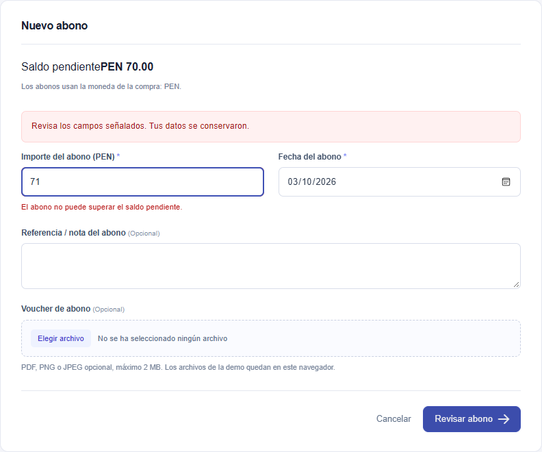

#### 5.2.2.6 Services Documentation Evidence for Sprint Review

La frontend utiliza un repositorio de datos local de demostración. La separación del adaptador permite integrar la API propia en AV2. Contratos previstos: GET/POST /api/v1/purchases, POST /api/v1/purchases/{purchaseId}/payments y consulta de proveedores. No se anuncia OpenAPI disponible ni respuestas de red ejecutadas de esos servicios. La persistencia local no ofrece autenticación real, almacenamiento privado de comprobantes ni concurrencia multiusuario.

**Ampliación documental conservada de la referencia remota (corte 03–04/10/2026).** Las comprobaciones se citan del registro histórico, no de una nueva ejecución. La agrupación local de siete tareas de 4–8 h y la autoría respaldada por Git prevalecen sobre tablas incompatibles.


La frontend utiliza un repositorio de datos local de demostración. La separación del adaptador permite integrar la API propia en AV2. Contratos previstos: GET/POST /api/v1/purchases, POST /api/v1/purchases/{purchaseId}/payments y consulta de proveedores. No se anuncia OpenAPI disponible ni respuestas de red ejecutadas de esos servicios. La persistencia local no ofrece autenticación real, almacenamiento privado de comprobantes ni concurrencia multiusuario.

**Contratos previstos para el siguiente incremento**

| Operación prevista | Finalidad | Respuestas propuestas | Estado Sprint 2 |
|---|---|---|---|
| GET `/api/v1/purchases` | Consultar obligaciones con filtros y paginación por organización. | 200; 401/403 sin autorización. | Diseño, TS-001 pendiente. |
| POST `/api/v1/purchases` | Registrar compra según R-01–06. | 201; 400/422 para datos inválidos; 401/403. | Diseño, TS-001 pendiente. |
| POST `/api/v1/purchases/{purchaseId}/payments` | Registrar abono y actualizar saldo de forma atómica. | 201; 404 compra inaccesible; 422 sobreabono. | Diseño, TS-002 pendiente. |
| OpenAPI | Describir autenticación, parámetros, schemas y respuestas reales. | Contrato concordante con servicio ejecutado. | TS-003 pendiente. |

Fuente: [Technical Stories](#331-technical-stories). El proveedor debe pertenecer a la organización; la compra conserva moneda PEN/USD, referencia, descripción, importe y fechas. El abono hereda la moneda y no supera el saldo. Los errores HTTP son objetivos del diseño; las validaciones del navegador no equivalen a respuestas ejecutadas del backend.

#### 5.2.2.7 Software Deployment Evidence for Sprint Review

| Producto | Versión observada | Resultado |
|---|---|---|
| Landing AV1 | cf734ff, 18/09/2026 | Publicación histórica en Pages, documentada en capítulo V. |
| Landing TB1 | Nuevos commits locales | Build y previsualización local; sin deployment nuevo. |
| Frontend TB1 | Repositorio local creditor-web-app | Build y previsualización local; sin remoto ni deployment. |

El usuario debe publicar las dos versiones para cumplir el criterio de TB1 del curso. Esa acción fue excluida de la preparación actual y no se presenta como pendiente técnico resuelto.

#### 5.2.2.8 Team Collaboration Insights during Sprint

La preparación corrige el dominio de cartera de créditos a cuentas por pagar, reintegra la release anterior y separa implementación, datos locales, pruebas y despliegue. Los commits nuevos usan la cuenta de Miguel. Los insumos de Juan y Sebastián se reconocen en la evidencia histórica del capítulo 00; no se les atribuye el código nuevo sin commits o artefactos propios.

Pendientes del equipo: validar LACX, registrar reuniones/tablero, completar investigación S2/análisis, revisar diseños en herramientas requeridas, grabar navegación/exposición y validar desempeño individual. La revisión técnica local y los límites se detallan en [control TB1](#control-de-entrega-tb1-histórico).

**Ampliación documental conservada de la referencia remota (corte 03–04/10/2026).** Las comprobaciones se citan del registro histórico, no de una nueva ejecución. La agrupación local de siete tareas de 4–8 h y la autoría respaldada por Git prevalecen sobre tablas incompatibles.


La preparación corrige el dominio de cartera de créditos a cuentas por pagar, reintegra la release anterior y separa implementación, datos locales, pruebas y despliegue. Los commits nuevos usan la cuenta de Miguel. Los insumos de Juan y Sebastián se reconocen en la evidencia histórica del capítulo 00; no se les atribuye el código nuevo sin commits o artefactos propios.

Pendientes del equipo: validar LACX, registrar reuniones/tablero, completar investigación S2/análisis, revisar diseños en herramientas requeridas, grabar navegación/exposición y validar desempeño individual. La revisión técnica local y los límites se detallan en [control TB1](#control-de-entrega-tb1-histórico).

**Acuerdos necesarios para cerrar la revisión**

| Información | Situación comprobada | Dato que debe proporcionar el equipo |
|---|---|---|
| Planning y cierre | No hay actas en las fuentes consultadas. | Inicio/fin, fecha/hora/lugar, asistentes y acuerdos. |
| Responsabilidades | Autoría de report comprobada; roles de colaboración propuestos. | Líder y colaboradores acordados por aspecto. |
| Tablero y aceptación | Backlog textual disponible. | URL/captura del tablero e historias aceptadas. |
| Aplicación remota | Frontend descrita como repositorio local. | URL del repositorio y rama, si ya se creó. |
| Deployment nuevo | Solo publicación histórica de AV1 referenciada. | URL, SHA, run/fecha y capturas de landing/frontend nuevas, si existen. |
| Colaboración y video | Documentación técnica e historial disponibles. | Reuniones/revisiones reales y enlace de grabación. |

### 5.2.3 Sprint 3

**Estado: incremento técnico local preparado para revisión AV2.** Las pruebas de código no acreditan una reunión, aceptación del sprint ni despliegue. Se conserva esa separación en los ocho apartados.

#### 5.2.3.1 Sprint Planning 3

Objetivo técnico de esta preparación: cerrar abonos sucesivos, coherencia de filtros/CSV y préstamos; verificar frontend/API, adoptar MySQL y documentar con Scalar. Fecha de auditoría 13/11/2026. Fecha, asistentes, duración de reunión, capacidad y Sprint Goal académico aprobado siguen pendientes de registro real.

#### 5.2.3.2 Aspect Leaders and Collaborators

Los nuevos commits utilizan la identidad Git de Miguel por instrucción del propietario. Juan y Sebastián conservan sus aportes históricos de producto/diseño/documentación. No se atribuye participación de esta implementación a terceros sin evidencia. La asignación de líderes/colaboradores y aprobación del equipo debe registrarse en la revisión real.

#### 5.2.3.3 Sprint Backlog 3

| Bloque | Historias | Trabajo técnico | Criterio de revisión |
|---|---|---|---|
| Abonos | US-006/007, TS-002 | Inserción explícita de cada Payment y pruebas secuenciales/concurrentes. | Dos abonos persistidos y saldo coherente tras recargar. |
| Filtros | US-004/008 | Mismos parámetros para lista, summary y CSV; no exportar criterios sin aplicar. | CSV leído por el test, con inclusión/exclusión verificadas. |
| Préstamos | US-009 | Loan/Installments, migraciones, contratos, adapter/use case/view Vue. | Crear/consultar tras iniciar nueva sesión, fechas/roles/negocio correctos. |
| Persistencia | Extensión AV2 | MySQL, cadena propia, pruebas reales y script de arranque. | Esquema, reintento, datos ficticios y arranque comprobados. |
| Contrato | TS-003 | Scalar con OpenAPI y rutas de salud. | Documento legible y endpoints comprobados. |
| Informe | Todos | Revisar capítulo por capítulo y modelos contra código. | Matriz de correspondencia, enlaces y evidencia sin afirmaciones inventadas. |

Este inventario registra bloques realizados; no inventa duración ni horas trabajadas. La descomposición en Engineering Tasks de 4–8 h, responsables acordados y estado del tablero académico debe confirmarse con el equipo. [Ficha Sprint 3](docs/sprints/sprint-03.md).

#### 5.2.3.4 Development Evidence for Sprint Review

Los commits por repositorio, rama y usuario se registran en [evidencia AV2](docs/av2/estado-implementacion.md). La feature del informe conserva los commits de la rama unificada local y las aportaciones de main antes de corregir el contenido. Las referencias remotas ya guardadas se usan como antecedentes; no hubo push ni reescritura de autores.

#### 5.2.3.5 Execution Evidence for Sprint Review

La matriz AV2 distingue pruebas de dominio/API, migraciones PostgreSQL previas al cambio, migraciones MySQL y escenarios de navegador contra backend real. El escenario conectado usa datos ficticios, comprueba respuesta HTTP y persistencia; el test de demo usa almacenamiento independiente. Los archivos TRX/JUnit y registros que se adjunten son evidencia del comando ejecutado, no garantía de ausencia total de defectos.

Se revisan saldo tras dos abonos, rechazo de exceso/concurrencia, archivos privados, selección CSV, cronograma, roles, negocio ajeno, tesorería y persistencia tras reinicio. Las suites y cantidades finales se consignan únicamente después de observar su resultado. La validación de uso con personas permanece en 5.3.

#### 5.2.3.6 Services Documentation Evidence for Sprint Review

La API publica un contrato OpenAPI generado, presentado mediante Scalar. Sus direcciones de ejecución se registran en la matriz AV2; no se afirma una URL de producción. Rutas relevantes:

| Ruta | Operación |
|---|---|
| `/api/v1/auth/register`, `/login`, `/me` | Crear negocio, autenticar y consultar identidad. |
| `/api/v1/users` | Crear miembro, exclusivo Owner. No existe pantalla de administración de usuarios conectada. |
| `/api/v1/suppliers` | Registro y consulta de proveedores del negocio. |
| `/api/v1/purchases`, `/summary`, `/export` | Registro, listado, saldos por moneda y CSV filtrado. |
| `/api/v1/purchases/{id}/payments` | Abonos e historial; voucher y receipt en subrutas protegidas. |
| `/api/v1/loans` y `/{id}` | Registro, listado y cronograma del acuerdo. |
| `/api/v1/treasury/*` | Partes, proyectos, cuentas, movimientos, asignaciones y fondos. |
| `/api/v1/exchange-rates/reference` | Cotización referencial BCRPData/SBS, sin consumo desde la UI vigente. |
| `/health/live`, `/health/ready` | Proceso disponible y disponibilidad de esquema/base. |

Registro correcto devuelve 201; lectura 200; solicitud mal formada 400, sin sesión 401, rol no admitido 403, dato inaccesible 404, conflicto 409 y regla de dominio inválida 422. Los códigos concretos se comprueban por endpoint, sin asumir que todos devuelven todos los estados. No hay endpoints de facturación tributaria, conciliación bancaria, promesas, transferencias vinculadas ni pago de cuotas.

#### 5.2.3.7 Software Deployment Evidence for Sprint Review

**Sin deployment nuevo.** La ejecución local con MySQL no cumple por sí sola el criterio de Web Services publicado. No se añadieron push, release ni URLs inventadas. Se deberán documentar hosting, HTTPS, conexión segura, almacenamiento de archivos, CORS y pruebas después de publicar por autorización del usuario.

#### 5.2.3.8 Team Collaboration Insights during Sprint

Se preservó la identidad de los commits, las ramas por alcance y el historial de main. El reporte reconoce las diferencias entre el diseño y el código, separa demo de backend y conserva pendientes humanos. Revisión por otro integrante, tablero, actas, analíticos y aceptación quedan por registrar con evidencia real; un merge local no acredita esas actividades.

### 5.2.4 Sprint 4

**Estado: pendiente de documentación y aceptación del sprint TB2.** El código local posterior no permite afirmar por sí solo que este sprint ocurrió o fue aceptado.

#### 5.2.4.1 Sprint Planning 4

Pendiente: fecha, duración, asistentes, revisión/retrospectiva previa y Sprint Goal aprobados. No se reconstruyen actas ni velocidad.

#### 5.2.4.2 Aspect Leaders and Collaborators

Pendiente: acordar líderes y colaboradores por aspecto con los tres integrantes. La autoría técnica existente se conserva; no se inventan asignaciones.

#### 5.2.4.3 Sprint Backlog 4

Pendiente: vincular historias y Engineering Tasks de 4–8 horas al tablero y registrar estado/aceptación. No son horas trabajadas.

#### 5.2.4.4 Development Evidence for Sprint Review

Existe un incremento técnico local de noviembre, conservado en el anexo B. Pendiente: vincular su versión y commits aceptados al sprint real; no se crea un cierre retrospectivo.

#### 5.2.4.5 Execution Evidence for Sprint Review

Se conservan resultados técnicos locales existentes en el anexo B. Pendiente: recorrido grabado de Sprint Review, fecha, versión y aceptación del equipo.

#### 5.2.4.6 Services Documentation Evidence for Sprint Review

El backend local tiene contrato y pruebas separados del frontend. Pendiente: contrastar OpenAPI del commit de entrega e integrar consumidores reales; el anexo B delimita lo verificado.

#### 5.2.4.7 Software Deployment Evidence for Sprint Review

Pendiente: URL HTTPS, proveedor, versión/SHA, ejecución de despliegue y prueba de humo. Ningún build local acredita este criterio.

#### 5.2.4.8 Team Collaboration Insights during Sprint

Pendiente: analíticos de todos los integrantes, reflexión y revisión del equipo. No se derivan desempeño ni reuniones de los conteos de commits.

## 5.3 Validation Interviews

**Estado: pendiente de ejecución y evidencia verificable.** Los registros de Needfinding de 2.2 y las pruebas automatizadas de software cumplen propósitos diferentes; no acreditan entrevistas de validación. El enunciado (p. 27 y Anexos C–D) requiere 3–5 participantes por segmento y evaluación de usabilidad, arquitectura de información e inclusión.

### 5.3.1 Diseño de entrevistas

Protocolo por completar y revisar con el equipo: consentimiento, perfil y segmento, tareas sobre la versión identificada, preguntas de comprensión, observación de errores y cierre. Evaluar navegación, compra/abono, lectura de moneda/saldo y recuperación de errores con usuarios objetivo. Registrar hallazgos contra las heurísticas del Anexo D, sin asignar resultados ni porcentajes antes de observarlos.

### 5.3.2 Registro de entrevistas

Pendiente: nombre, edad, distrito, segmento, captura representativa, enlace privado Stream, inicio hh:mm:ss, duración y resumen por participante. El registro final consolidará el MP4 de entrevistas con los cortes indicados por el curso; no se sustituyen con guiones o capturas técnicas. No se han inventado participantes ni grabaciones.

### 5.3.3 Evaluaciones según heurísticas

Pendiente: observación, heurística, severidad justificada, evidencia temporal, cambio propuesto y verificación posterior por hallazgo. El análisis debe separar resultados por segmento y distinguir problemas detectados de mejoras todavía propuestas. No existe una evaluación heurística final ejecutada que esta reorganización pueda declarar aprobada.

## 5.4 Video About-the-Product

**Estado: enlace histórico aportado en main, pendiente de verificación y correspondencia con el incremento actual.** Se conserva [Video About-the-Product](https://youtu.be/LGV7hN8I4No), registrado por Juan; no se comprobó aquí su contenido, duración, disponibilidad ni autorización. Para AV2 se requiere la primera versión y para TB2 la final. El Anexo C indica 1–3 minutos, demostración de uso y al menos una opinión por segmento objetivo. Completar resumen, pauta hh:mm:ss, captura y enlaces reales de Stream y YouTube; incorporar el video en la landing de la versión entregada. Los guiones y las pruebas locales existentes no constituyen este video.

# Conclusiones y recomendaciones

## Conclusiones

1. El núcleo CREDITOR conserva el objetivo de cuentas por pagar: proveedores, compras, abonos, saldo, documentos y exportación por negocio/moneda. Las rutas conectadas usan la API ASP.NET Core y el diseño visual existente.
2. Los abonos sucesivos se persisten como entidades nuevas. Los filtros de lista, resumen y CSV comparten criterios aplicados. Loans guarda cuotas mensuales acordadas; la tasa no activa una fórmula de amortización ni pago de cuotas.
3. El proveedor actual es MySQL. PostgreSQL conserva regresión histórica y SQLite un uso auxiliar. Las pruebas documentadas permiten revisar migraciones y datos ficticios; no demuestran transferencia de datos de motores anteriores ni garantizan casos no ejecutados.
4. DDD se refleja en capas, agregados y puertos. Payments pertenece a Purchase, Reporting es lectura y Treasury es otro contexto. Un abono no se convierte automáticamente en salida de efectivo.
5. La demo del navegador tiene funciones más amplias que la API. Facturas, cobros, promesas, transferencias, reversos y conciliación no se anuncian como backend terminado. La administración de usuarios y cotización externa tienen API, pero no pantalla conectada específica.
6. Investigación, pruebas de usabilidad, evidencia de colaboración y deployment tienen pendientes explícitos. La preparación técnica local y el informe coherente no sustituyen esas evidencias de AV2.

## Recomendaciones

1. Revisar los resultados y commits locales de develop, aceptar el alcance y probar la aplicación con el equipo antes de preparar una release.
2. Confirmar con el curso el uso de MySQL en lugar del diseño PostgreSQL anterior. Si se requieren datos previos, planificar una importación explícita y respaldos; cambiar la conexión no migra registros.
3. Completar las entrevistas y la validación por segmento, incluyendo comprensión de cuota/saldo/efectivo y filtros de exportación.
4. Registrar reuniones, tablero, revisión por pares y aportes con evidencia real. Los formatos preparados no sustituyen un Performance Report evaluado por el líder.
5. Decidir por backlog qué funciones de la demo pasarán al servidor; no sumar sus capacidades a las del workspace conectado en una exposición.
6. Publicar únicamente con autorización, documentando SHA, HTTPS, migraciones, salud, CORS y archivos privados. Los binarios PDF/PPTX anteriores conservan contenido histórico y deben regenerarse tras la revisión final si se usarán para AV2.

## Video About-the-Team

**Estado: enlace histórico aportado en main, pendiente de verificación y correspondencia con AV2.** Se conserva [Video About-the-Team](https://youtu.be/RItoiUdxaiA), registrado por Juan; no se comprobó aquí su disponibilidad, duración ni contenido. Debe mostrar sesiones reales, colaboración y testimonio de cada integrante. El Anexo C sugiere cinco minutos de retrospectiva más un minuto por integrante. Completar resumen, pauta de secuencias hh:mm:ss, captura, enlaces Stream/YouTube e incorporación en landing. La mera existencia del enlace no acredita que sea la versión final requerida; los guiones de exposición no reemplazan su revisión.

# Bibliografía

Las fuentes de competencia, planes y mercado se consultaron el 03/10/2026 en sitios oficiales. [Registro detallado y límites de comparación](assets/research/tb1/source-register.md). No se suman precios de países/planes distintos como si fueran cotizaciones equivalentes.

1. Alegra. (s. f.). *Planes y precios de contabilidad en Perú*. https://www.alegra.com/peru/contabilidad/precios/
2. Alegra. (s. f.). *Cuentas por pagar*. https://ayuda.alegra.com/es/cuentas-por-pagar
3. Odoo. (s. f.). *Planes y precios*. https://www.odoo.com/es/pricing
4. Odoo. (2026). *Vendor bills*. https://www.odoo.com/documentation/19.0/applications/finance/accounting/vendor_bills.html
5. Odoo. (2026). *Loans*. https://www.odoo.com/documentation/19.0/applications/finance/accounting/payables/loans.html
6. Zoho. (s. f.). *Zoho Books pricing, US edition*. https://www.zoho.com/us/books/pricing/
7. Zoho. (s. f.). *Vendor bills*. https://www.zoho.com/books/help/bills/
8. Ministerio de la Producción, OGEIEE. (2025). *Las Mipyme en cifras 2024*. https://www.producempresarial.pe/las-mipyme-en-cifras-2024/
9. Universidad Peruana de Ciencias Aplicadas. (2026). *Final project statement, Applications Web, versión 1.0*. Documento del curso 1ASI0730, periodo 202620, 43 páginas. TB1 pp. 31–32, Anexos A–C pp. 37–39.
10. Vue.js. (s. f.). *Vue documentation*. https://vuejs.org/guide/introduction.html
11. PrimeTek. (s. f.). *PrimeVue documentation*. https://primevue.org/introduction/

12. Allpatek / TerraNova. (2026). *Project report*. [Repositorio de referencia del esquema](https://github.com/upc-pre-202620-1asi0729-7753-Terranova/allpatek-report). Copia local Open-Source/allpatek-report/README.md consultada el 02/11/2026. Se reutiliza la organización documental, sin trasladar contenidos ni atribuciones de Open Source a CREDITOR.


### Fuentes internas de implementación y Sprint 2

Se conservan las fuentes adicionales incorporadas por la revisión remota: [evidencia técnica TB1](docs/tb1/evidencia-local.md), [inventario de commits](docs/tb1/commits-locales.md), [registro de ejecución de interfaz](assets/ux/tb1/execution.json) y [historias/reglas del capítulo III](#capítulo-iii-requirements-specification). La referencia de una comprobación en GitHub el 04/10 es un antecedente de esa versión; esta reorganización inspeccionó objetos Git locales y no volvió a verificar disponibilidad remota ni repitió las pruebas.

# Anexos

| Anexo | Evidencia local | Estado y pendiente |
|---|---|---|
| A Student Outcome | [Acciones y conclusiones por integrante](#student-outcome-5). | Histórico y TB1 delimitados; reflexión/revisión del equipo pendiente. |
| B Investigación | [Entrevistas y guion](#capítulo-ii-requirements-elicitation--analysis), [plantilla de codificación](assets/research/tb1/interview-coding-template.csv). | 4 registros existentes; faltan 2 S2, consentimientos/Stream y análisis codificado. |
| C Mapas y diseño | [Fuentes locales](assets/research/tb1/README.md), [wireframes/flows/capturas](assets/ux/tb1/README.md). | Propuestas locales y ejecución real; sincronización UXPressia/Figma/FigJam pendiente. |
| D Implementación | [Pruebas, versiones y capturas](docs/tb1/evidencia-local.md), [commits por feature](docs/tb1/commits-locales.md). | Solo local; no deployment TB1 ni API propia. |
| E Sprint | [Sprint 2 y sus ocho apartados](#522-sprint-2). | Preparación técnica; reunión, tablero, aceptación y analíticos del equipo pendientes. |
| F Paquete TB1 | [Inventario de archivos](deliverables/tb1/README.md). | Report PDF, Keynote PPTX/PDF, Performance DOCX/PDF y ZIP locales. Performance sin calificación. |
| G Videos de Exposiciones | [Guion y tiempos](docs/tb1/guion-exposicion.md). | Grabación MP4 y enlace privado Stream pendientes. No se sustituye con capturas. |
| H Videos de producto/equipo | Alcance AV2. | Preparar About-the-Product/About-the-Team en su hito, sin declarar grabaciones inexistentes. |
| I Revisión de retroalimentación | [Mejoras y pendientes por observación](docs/tb1/feedback-resolution.md). | Diseño móvil/flujos/maquetación locales revisados; investigación, publicación y video requieren evidencia adicional. |

## A. Información académica y trazabilidad histórica

Los apartados 00.x conservan la numeración y el contenido del informe anterior. Versiones e Insights fueron trasladados al inicio, siguiendo el esquema de Allpatek.

### 00.1 Datos académicos

| Dato | Valor del informe |
|---|---|
| Universidad/carrera | Universidad Peruana de Ciencias Aplicadas, Ingeniería de Software. |
| Curso | 1ASI0730 Aplicaciones Web. |
| Periodo/NRC | 202620 / 16127. |
| Docente | Villafuerte Bazan, Oscar Ivan. |
| Equipo/proyecto | Grupo 2 / CREDITOR. |
| Hito/corte | TB1 Stage Review, preparación local al 03/10/2026. |
| Report | [Organización y repositorio](https://github.com/Grupo-Desarrollo-Aplicaciones-Web/upc-project-report). |
| Fecha de presentación | Confirmar horario: 24 horas antes de la segunda sesión sincrónica semanal. |

### 00.2 Integrantes e identidades de Git

El historial de `develop` permite vincular los aportes con las identidades que cada integrante utilizó. Los conteos corresponden al corte del **18 de septiembre de 2026** y sirven como referencia de trazabilidad; la calidad del aporte se evalúa por los artefactos producidos y no solo por la cantidad de commits.

| Código | Integrante | Usuario de GitHub | Identidades observadas en Git | Commits en `develop` al corte |
|---|---|---|---|---:|
| u20221a371 | Juan Manuel Santos Torres | [@JuanManuel312](https://github.com/JuanManuel312) | `JuanManuel312 <103543254+JuanManuel312@users.noreply.github.com>` | 34 |
| u20241a314 | Sebastián Gutarra Velapatiño | [@SebastianGutarra](https://github.com/SebastianGutarra) | `SebastianGutarra <166082725+SebastianGutarra@users.noreply.github.com>` y `Sebastián Gutarra <u20241a314@upc.edu.pe>` | 26 |
| u202215188 | Miguel Angel Egocheaga Suyo | [@MiguelAngel0107](https://github.com/MiguelAngel0107) | `MIguelAngelES7` y `Miguel Angel`, ambos con `95198651+MiguelAngel0107@users.noreply.github.com` | 53 |

### 00.4 Resumen de aportes por integrante

#### 00.4.1 Juan Manuel Santos Torres

1. **Introducción y enfoque Lean UX.** Elaboró contenido del Startup Profile, antecedentes, problemática, análisis 5W2H, supuestos, hipótesis y segmentos objetivo.
2. **Planificación del Sprint 1.** Documentó el Sprint Goal, las historias de la landing, criterios de aceptación, estimaciones y matriz de colaboración.
3. **Validación.** Preparó el protocolo de entrevistas de validación, tareas de usabilidad, reglas de medición e inspección de las diez heurísticas.
4. **Seguimiento de la entrega.** Registró evidencia del desarrollo, criterios de ejecución de la landing y pendientes de publicación.

Evidencias principales: [`6d5670c`](https://github.com/Grupo-Desarrollo-Aplicaciones-Web/upc-project-report/commit/6d5670c), [`d8db0dd`](https://github.com/Grupo-Desarrollo-Aplicaciones-Web/upc-project-report/commit/d8db0dd), [`a6d8e49`](https://github.com/Grupo-Desarrollo-Aplicaciones-Web/upc-project-report/commit/a6d8e49) y [`d053c0b`](https://github.com/Grupo-Desarrollo-Aplicaciones-Web/upc-project-report/commit/d053c0b).

#### 00.4.2 Sebastián Gutarra Velapatiño

1. **Identidad visual.** Incorporó el logotipo, la paleta, la muestra tipográfica y las primeras reglas de estilo de CREDITOR.
2. **Landing Page UI Design.** Avanzó el capítulo IV hasta la sección 4.3.2 con wireframes, mock-ups y el patrón visual de navegación.
3. **Diseño de la aplicación web.** Añadió el wireframe y mock-up de “Mis operaciones / Nueva operación”, posteriormente revisados dentro del alcance de CREDITOR.
4. **Investigación y personas.** Actualizó datos del registro de entrevistas e incorporó imágenes y correcciones de enlace para las User Personas.

Evidencias principales: [`7e990fb`](https://github.com/Grupo-Desarrollo-Aplicaciones-Web/upc-project-report/commit/7e990fb), [`ff39563`](https://github.com/Grupo-Desarrollo-Aplicaciones-Web/upc-project-report/commit/ff39563), [`7c41cda`](https://github.com/Grupo-Desarrollo-Aplicaciones-Web/upc-project-report/commit/7c41cda) y [`25f9923`](https://github.com/Grupo-Desarrollo-Aplicaciones-Web/upc-project-report/commit/25f9923).

#### 00.4.3 Miguel Angel Egocheaga Suyo

1. **Estructura y configuración del informe.** Inicializó el repositorio, organizó capítulos, ramas de trabajo, convenciones y control de entrega.
2. **Elicitación y especificación de requisitos.** Desarrolló el análisis competitivo, diseño de entrevistas, Needfinding preliminar, User Stories, Impact Mapping y Product Backlog.
3. **Arquitectura y diseño técnico.** Documentó arquitectura de información, flujos, EventStorming, C4, clases, modelo ER y reglas de integridad respaldadas por `database/schema.sql`.
4. **Integración GitFlow.** Preparó ramas documentales y Pull Requests hacia `develop`, verificó enlaces y diagramas, y mantuvo las fuentes Mermaid junto con sus exportaciones.

Evidencias principales: [`a4e85c6`](https://github.com/Grupo-Desarrollo-Aplicaciones-Web/upc-project-report/commit/a4e85c6), [`fcaf13a`](https://github.com/Grupo-Desarrollo-Aplicaciones-Web/upc-project-report/commit/fcaf13a), [`3086a32`](https://github.com/Grupo-Desarrollo-Aplicaciones-Web/upc-project-report/commit/3086a32) y [Pull Request #1](https://github.com/Grupo-Desarrollo-Aplicaciones-Web/upc-project-report/pull/1).

### 00.5 Matriz de responsabilidad de AV1

La tabla resume la responsabilidad que puede demostrarse con el contenido actual. “Responsable principal” identifica a quien produjo la mayor parte de la evidencia del bloque; “colaborador” reconoce aportes complementarios visibles en el historial.

| Bloque de AV1 | Responsable principal | Colaborador(es) | Evidencia en el informe |
|---|---|---|---|
| Startup Profile, problemática y Lean UX | Juan Manuel | Miguel | `docs/01-introduction.md` |
| Análisis competitivo y diseño de entrevistas | Miguel | Juan y Sebastián | `docs/02-requirements-elicitation-analysis.md` |
| Registro de entrevistas y User Personas | Sebastián | Juan | `docs/02-requirements-elicitation-analysis.md` y `assets/research/` |
| User Stories, Impact Map y Product Backlog | Miguel | Juan | `docs/03-requirements-specification.md` |
| Style Guidelines y Landing Page UI Design | Sebastián | Miguel | `docs/04-product-design.md` y `assets/branding/` |
| UX de aplicación, diagramas y prototipo especificado | Miguel | Sebastián | `docs/04-product-design.md` y `assets/architecture/` |
| Sprint 1, validación e inspección heurística | Juan Manuel | Miguel | `docs/05-implementation-validation-deployment.md` |
| Arquitectura de software y base de datos | Miguel | Sebastián, mediante insumos visuales | `docs/04-product-design.md`, `assets/architecture/` y `database/schema.sql` |
| Control de entrega y trazabilidad del informe | Miguel | Juan y Sebastián | `docs/08-av1-delivery-checklist.md` e historial Git |

### 00.7 Criterio de actualización

Este capítulo atribuye únicamente aportes respaldados por commits o artefactos presentes en el repositorio. Las entrevistas, pruebas con usuarios, despliegues, reuniones o revisiones que ocurran fuera de Git deben añadirse con su fecha, responsable y enlace de evidencia. Antes de entregar, el equipo debe revisar esta matriz y confirmar que describe su trabajo real.

### 00.12 Collaboration Insights de la preparación TB1

La nueva preparación se registra con la identidad de Miguel y conserva los aportes históricos de Juan y Sebastián. No se atribuyen los nuevos commits a otros integrantes. Las features se integraron localmente con merges `--no-ff`, sin cambiar el historial remoto ni publicar una release. El análisis de colaboración se puede reproducir con `git log --format='%h %an <%ae> %s'` en cada repositorio.

| Integrante | Evidencia histórica utilizada | Acción TB1 comprobada | Revisión siguiente |
|---|---|---|---|
| Juan Manuel | Problema, Lean UX y planificación/validación de Sprint 1. | Insumos reutilizados. Nuevas acciones TB1 no confirmadas. | Confirmar objetivo/LACX y contrastar hipótesis con entrevistas. |
| Sebastián | Marca, bocetos y registros de entrevista de AV1. | Insumos reutilizados. Nuevas acciones TB1 no confirmadas. | Revisar las pantallas actuales y trasladarlas a Figma. |
| Miguel Angel | Requisitos, arquitectura e integración del informe. | Nuevos commits personales de report, landing y frontend, pruebas y paquete local. | Coordinar revisión cruzada, grabación y publicación autorizada. |

Las tablas de commits locales son evidencia de control de versiones. Analíticos GitHub de TB1 y aprobaciones del equipo requieren publicación y participación real posterior; no se incluyen capturas reconstruidas.

## B. Evidencia local posterior al corte TB1: 02/11/2026

Este apartado actualiza la lectura del avance real sin alterar los cortes AV1/TB1. Se inspeccionaron archivos locales ya existentes; **esta revisión documental no volvió a ejecutar las pruebas de producto**. Se conservaron copias de evidencia con [manifiesto de origen y SHA-256](assets/evidence/2026-11-02/manifest.json). Los resultados documentan ejecución local con datos ficticios; no acreditan integración completa, validación con usuarios ni despliegue.

| Producto/criterio | Evidencia existente inspeccionada | Alcance y pendiente |
|---|---|---|
| Frontend financiero Vue/PrimeVue | [Validación del 02/11](assets/evidence/2026-11-02/frontend-validation.txt): 39 pruebas unitarias y 8 escenarios de navegador registrados; [contrato y límites de la demo](assets/evidence/2026-11-02/frontend-financial-demo.txt). | Adaptador asíncrono `createFakeApi`, datos ficticios en navegador. La conexión HTTP con la API propia y la autorización del servidor siguen pendientes. La demo financiera posterior usa español inicialmente; el inglés por defecto descrito en TB1 corresponde al corte anterior. |
| Backend ASP.NET Core | [Verificación local](assets/evidence/2026-11-02/backend-local-verification.txt), [arquitectura](assets/evidence/2026-11-02/backend-architecture.txt) y [contrato de tesorería](assets/evidence/2026-11-02/backend-treasury-api.txt). | Identidad, compras, abonos, documentos privados, CSV, adaptador BCRP y una vertical de tesorería manual implementados localmente. Transferencias, conciliación, facturas, préstamos y promesas del frontend no se declaran integrados al backend. |
| Pruebas del backend | TRX [dominio](assets/evidence/2026-11-02/backend-domain.trx) e [integración](assets/evidence/2026-11-02/backend-integration.trx): contadores inspeccionados, 33 + 106 = **139 aprobadas**, cero fallidas. | Registros existentes del 02/11. Pruebas aisladas con SQLite; no equivalen a ejecución PostgreSQL de producción. |
| HTTP real local | [32 comprobaciones Kestrel](assets/evidence/2026-11-02/treasury-http-smoke.json), registradas a 2026-11-02T14:02:31.634196+00:00. | Compra PEN 100 − abono PEN 30 = saldo PEN 70. Tesorería USD 1 000 − 250 = 750: Andes 350, Marina 400 y titular 0. Datos sintéticos; no son operaciones bancarias reales. |
| PostgreSQL | El registro de backend documenta comprobación modelo/migraciones y SQL idempotente generado. | Migración, operaciones financieras y concurrencia contra PostgreSQL real pendientes; Docker estaba detenido en esa verificación. |
| Servicio externo BCRP | El registro histórico del 27/10 documenta HTTP 200 y observación del 26/10; pruebas del adaptador con respuestas controladas. | Evidencia de referencia cambiaria local; no implica conversión monetaria ejecutada, conexión bancaria ni integración del frontend. No se hizo una nueva consulta externa en esta revisión. |
| Despliegue e integración | Se conserva el deployment histórico de la landing AV1 como corte separado. | Sin evidencia verificada de nuevos frontend/backend desplegados o flujo integrado. Los criterios de TB1/AV2/TB2 que lo requieren siguen abiertos. |

### B.1 Consulta y descarga de información financiera

| Lugar actual | Acción/salida | Límite comprobado en código |
|---|---|---|
| Frontend → Mi dinero → Entradas y salidas, `#/finance/movements` | **Exportar CSV** descarga `creditor-demo-movements.csv` con movimientos demo filtrados. | `src/finance/FinanceWorkspace.vue`; exportación local del navegador. |
| Frontend → Ayuda y actividad, `#/finance/guide` | Exporta una copia JSON del conjunto local. | Copia de datos demo; no es un estado de cuenta bancario. |
| API propia separada, `GET /api/v1/purchases/export` | Descarga autenticada `creditor-obligations.csv`. | `src/Creditor.Api/Controllers/PurchasesController.cs`; aún sin conexión desde la UI financiera. |

No se acreditó un estado de cuenta bancario completo ni PDF operativo integrado. La conciliación de la demo importa extractos CSV ficticios y no conecta bancos. Estos reportes de producto son distintos del informe académico de este repositorio.

### B.2 Autorías y cortes de evidencia

Se conserva el [registro original de crédito y autoría del frontend](assets/evidence/2026-11-02/frontend-authorship-allocation.txt). Distingue planificación compartida, `Author`, `Committer` y programación/validación realizadas por Miguel. Los seis commits por autor del corte histórico no acreditan seis aportes equivalentes de programación ni horas reales. No se reasignaron contribuciones en esta reorganización. Los hashes y artefactos históricos del informe se mantienen con su corte original.

### B.3 Evidencia posterior de US-005: compra a crédito

Evidencia local suministrada después de la reorganización del informe, con corte del **02/11/2026**. La revisión documental inspeccionó las tres capturas y conservó sus bytes originales en el repositorio. El recorrido vigente es **Cobros y pagos → Anotar una deuda → Por pagar**: proveedor, importe y concepto; moneda, vencimiento y dueño económico; revisión y guardado de la cuenta por pagar.

El ejemplo de las capturas utiliza **Paper House · DEMO**, **USD 123.45**, concepto «Compra a crédito de mercadería — US-005» y vencimiento **2026-11-09**. La revisión muestra que anotar la deuda no cambia el dinero y que el pago se registra cuando ocurre. El resultado de la prueba local comunicado para este recorrido fue el registro de una cuenta por pagar **sin generar movimiento de efectivo**. Esta revisión del informe no repitió esa prueba; las capturas conservadas muestran el formulario y la revisión previa al guardado.

**Paso 1 — Proveedor e importe de la compra a crédito.**

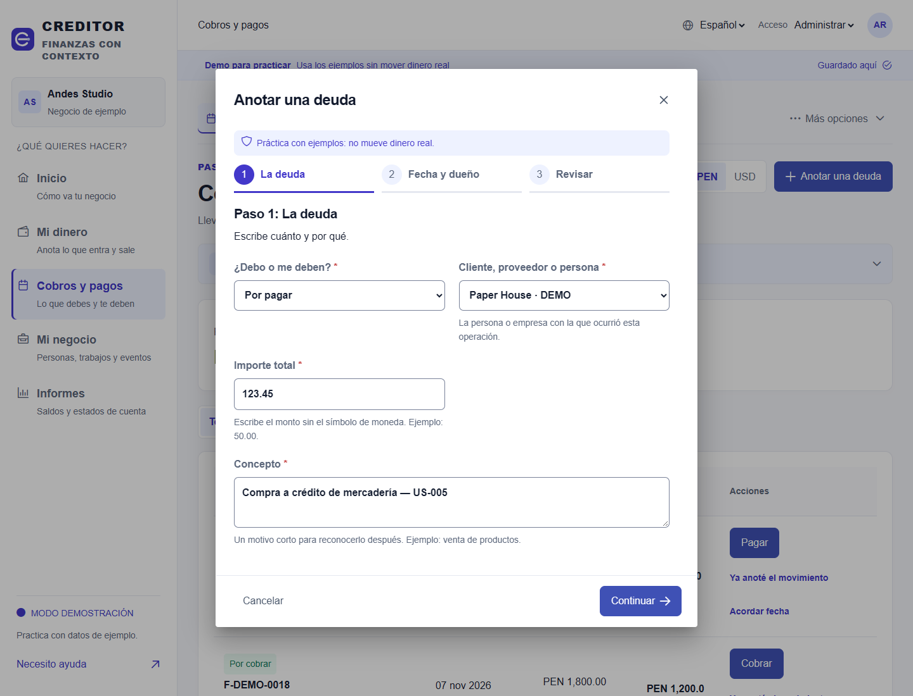

**Paso 2 — Moneda y fecha de vencimiento.**

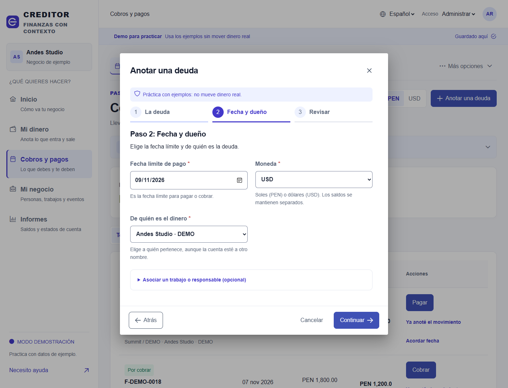

**Paso 3 — Revisión de la obligación antes de guardar.**

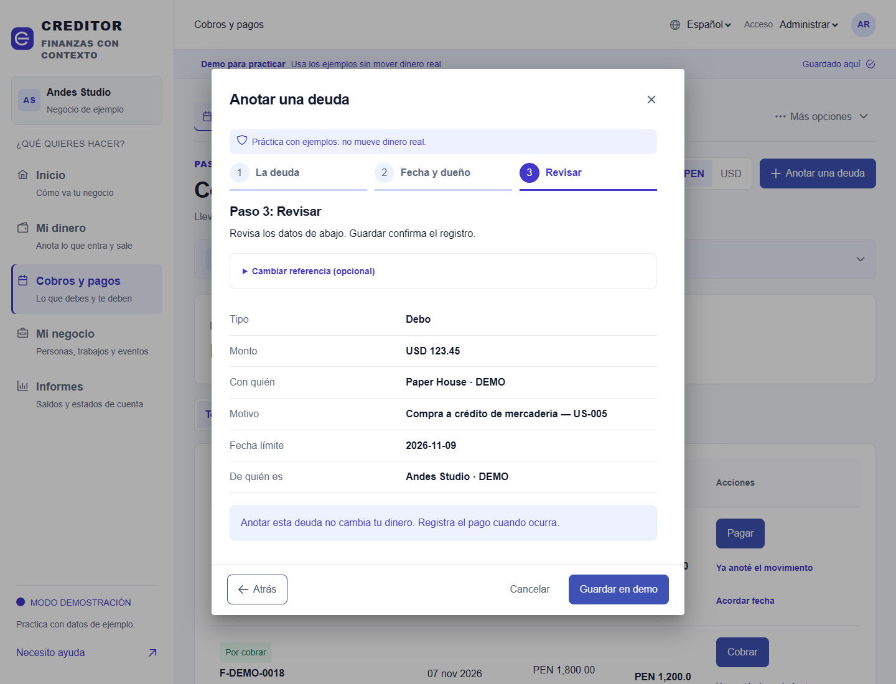

**Estado de la observación: parcial.** Existe evidencia del flujo funcional local de compra a crédito como cuenta por pagar; no acredita el enlace final de Figma, RUC, adjunto ni detalle de productos en este registro directo. Tampoco acredita aceptación por pares, validación con usuarios, integración con la API ni despliegue. Las fuentes y SHA-256 de las tres imágenes figuran en el [manifiesto de evidencia](assets/evidence/2026-11-02/manifest.json).

## C. Control de integridad y correspondencia con el enunciado

El informe se lee completo en **README.md**, con la jerarquía visual y navegación de Allpatek: carátula → versiones → colaboración → contenido → Student Outcome → capítulos → conclusiones/video de equipo → bibliografía → anexos. Las fuentes anteriores en `docs/`, diagramas, entregables y autorías se conservan como respaldo histórico. El README es ahora la versión documental principal; los PDF/PPTX/ZIP existentes conservan su fecha y no se anuncian regenerados por este cambio.

| Requisito del enunciado de Aplicaciones Web | Ubicación y lectura del estado |
|---|---|
| Índice y formato, pp. 4–8 | Portada, versiones, Insights e índice interno de hasta cuatro niveles. |
| Student Outcome 5, Anexo A, p. 37 | Párrafo y tabla de tres columnas, con acciones por integrante/hito y evidencia histórica conservada. Revisión/reflexión del equipo pendientes. |
| Needfinding, p. 12 | Capítulo II: tres registros S1 y uno S2 existentes. Para el mínimo de tres por segmento faltan dos S2 y completar la revisión, resúmenes, consentimiento, metadatos/capturas/Stream y análisis; no se equipara registro con entrevista validada. |
| Diseño y herramientas, pp. 29–30 | Capítulo IV: artefactos locales conservados. Sincronización UXPressia/Figma pendiente donde se exige; Mermaid/PlantUML/Structurizr DSL están permitidos para arquitectura, EventStorming, UML y datos. |
| Implementación por sprint, pp. 4–7 y 31–33 | Capítulo V conserva ocho apartados para Sprint 1/2 y reserva los ocho de Sprint 3/4 como pendientes. El backend local de noviembre tiene evidencia propia, sin cierre de sprint inventado. |
| Entrevistas de validación, p. 27 y Anexo D | 5.3.1–5.3.3: protocolo/registro/evaluaciones pendientes; 3–5 por segmento. Las pruebas automáticas no las sustituyen. |
| About-the-Product / About-the-Team, pp. 28 y 39 | 5.4 y sección de conclusiones: grabaciones, testimonios y enlaces reales pendientes. |
| Entregables e integración, pp. 2 y 31–33 | El anexo B delimita avances locales. Integración frontend/API propia y verificación del servicio tercero en el flujo final, PostgreSQL real y despliegues permanecen pendientes. |

Fuente: *Final project statement*, 1ASI0730, 202620, versión 1.0, 43 páginas. El archivo revisado es `upc-pre-202620-1asi0730-final_project-statement-abet_v1.pdf`. El enunciado fija requisitos y hitos; no contiene una tabla numérica de puntajes que permita declarar una calificación alcanzada.

### C.1 Matriz de observaciones del profesor

Las observaciones se contrastaron con el contenido actual y el registro histórico de retroalimentación. **Corregido** indica una corrección documental verificable; **parcial** exige todavía evidencia externa; **pendiente** no tiene respaldo suficiente para cerrarse. Este cuadro no cambia una calificación.

| Observación | Estado | Evidencia y corrección documental | Lo que falta para cerrarla |
|---|---|---|---|
| Omisión de frontend y Sprint 2 / 5.2.2 | **Parcial** | El informe incorpora la frontend local, Planning, LACX, siete tareas 4–8 h/43 h propuestas, desarrollo, capturas, servicios, deployment e Insights. Se rescata la ampliación documental remota de Juan y se conserva el inventario original de commits. | Acta/asignaciones aceptadas, tablero, revisión del equipo, video y despliegue real de nueva landing/frontend. |
| Marca CreditFlow mezclada con CREDITOR | **Corregido en el alcance documental actual; antecedente histórico identificado** | Portada, capítulos actuales y demo financiera se identifican como CREDITOR. El Sprint 1 archivado conserva CreditFlow con una advertencia explícita de versión previa; sus fuentes no se reescriben. | Revisar cualquier exportación histórica antes de utilizarla como una nueva entrega; los PDF/PPTX existentes no se regeneraron aquí. |
| Mockup de préstamo no corresponde a US-005 compra a crédito | **Parcial: flujo local de compra a crédito evidenciado** | [Anexo B.3](#b3-evidencia-posterior-de-us-005-compra-a-crédito): Cobros y pagos → Anotar una deuda → Por pagar, con proveedor, importe, moneda y vencimiento. Tres capturas inspeccionadas y resultado de prueba local comunicado: registro de cuenta por pagar sin movimiento de efectivo. Se conserva el prototipado histórico de Sebastián. | Enlace final Figma desktop/mobile, revisión del equipo y criterios completos. La evidencia nueva no acredita RUC, adjunto ni detalle de productos en el registro directo, ni validación con usuarios. |
| Falta PR y revisión por pares | **Pendiente para este incremento** | Se conserva la referencia histórica a PR #1 y los commits/merges existentes. El README no presenta una rama o merge local como revisión de otro integrante. | PR real, revisión identificable de otro integrante, observaciones resueltas y aprobación; no se fabricaron comentarios ni PR. |
| Fecha incorrecta y encabezados AV1 | **Corregido documentalmente** | Carátula de revisión local de noviembre de 2026, curso/periodo/equipo conservados; fechas AV1/TB1 se mantienen únicamente como cortes históricos. Se distinguen portada actual y evidencia anterior. | Confirmar fecha/horario de presentación y el hito de entrega real con el equipo. |
| Entrevistas incompletas | **Pendiente** | 2.2 conserva tres registros S1 y uno S2, con guion y controles de evidencia; no se declara completado el mínimo por segmento. | Al menos dos S2 adicionales y revisión de los cuatro registros, consentimiento, resúmenes, capturas, metadatos, Stream y análisis con citas/minutos. |
| Pruebas de usabilidad / validación | **Pendiente** | 5.3.1–5.3.3 organizan protocolo, registro y heurísticas. Se distinguen resultados automáticos existentes de sesiones con usuarios. | 3–5 entrevistas de validación por segmento, tareas observadas, hallazgos y evidencia audiovisual auténtica. |
| Integración, publicación y videos | **Actualizado técnicamente; pendientes externos** | El anexo B conserva el corte 02/11. La integración actual se documenta en Sprint 3; enlaces históricos de Product/Team se conservaron sin presumir validación. | El estado técnico actual sustituye este pendiente histórico en la matriz AV2: integración frontend/API y cambio a MySQL. Publicación HTTPS, grabaciones vigentes y aceptación continúan requiriendo evidencia. |

Herramientas locales: `python tools/report/validate_report.py` valida estructura, enlaces/recursos locales y copias de evidencia; `python tools/tb1/update_index.py` actualiza únicamente el índice interno del documento. La exportación histórica usa ahora el README completo para evitar duplicar los capítulos.

## Evidencia de publicación futura

Para cerrar TB1 después de autorización se incorporarán URL HTTPS de la nueva landing y primera frontend, SHA, fecha/run y capturas verificadas. El registro histórico observó el report como privado; su visibilidad actual no fue revalidada y no se modificó durante esta preparación local.

## D. Preparación y entregables TB1 históricos


Informe actualizado para revisión local al 03/10/2026. La nueva landing y primera frontend se encuentran en repositorios locales independientes. [Evidencia técnica](docs/tb1/evidencia-local.md), [commits por feature](docs/tb1/commits-locales.md), [control de entrega](#control-de-entrega-tb1-histórico) y [archivos TB1](deliverables/tb1/README.md).

Preparación de la exposición: [prompt detallado para crear el PPT](docs/tb1/prompt-crear-ppt.md) y [guion por diapositiva](docs/tb1/guion-ppt-detallado.md), con video de 27:30 y ruta de sustentación de 12:00. Estos documentos no sustituyen la presentación y grabación reales.

[Presentación ampliada de 40 diapositivas](deliverables/tb1/keynote-expanded/README.md): PPTX editable con notas y recorridos personalizados, más PDF de lectura. Se conserva la presentación anterior.

[Guiones individuales de Juan, Sebastián y Miguel](docs/tb1/expositores/README.md): parlamentos completos, tiempos y acciones por expositor, con versiones Word y PDF para ensayar en clase o grabar el video.

La preparación no incluye push ni deployment. Las entrevistas adicionales, revisión en herramientas externas, acuerdos del equipo, desempeño y video permanecen pendientes cuando no existe evidencia.

## Control de entrega AV1 histórico

Esta ficha conserva pendientes del corte histórico AV1, no describe el avance actual TB1. Consultar el [control TB1](#control-de-entrega-tb1-histórico) y [ejecución local](docs/tb1/evidencia-local.md).

Esta lista organiza los entregables de AV1. Un ítem solo se marca como listo al tener su archivo, enlace o evidencia verificable.

| Entregable | Evidencia esperada | Estado actual |
|---|---|---|
| Project Report | Informe completo, PDF exportado y repositorio Markdown actualizado. | Estructura y borradores avanzados; faltan evidencias de investigación, prototipos y datos académicos. |
| Keynote | Archivo editable y PDF con producto, equipo, avance y fotos autorizadas. | Pendiente. |
| Individual Member Performance Report | Documento del líder con aportes verificables de cada integrante. | Pendiente. |
| Supporting files | ZIP con artefactos necesarios para la evaluación. | Pendiente de definir contenido final. |
| Landing Page | URL HTTPS, commit desplegado, captura y verificación. | Publicación histórica del 18/09/2026, commit `cf734ff`. Correcciones TB1 locales documentadas aparte. |
| Video About-the-Product (hito AV2) | Video privado de Microsoft Stream y MP4, enlazado en anexos. | Pendiente. |
| Video About-the-Team (hito AV2) | Video privado de Microsoft Stream y MP4, enlazado en anexos. | Pendiente. |

### Revisión previa a publicación

1. Confirmar NRC, docente, fecha y perfiles de GitHub de todos los integrantes.
2. Completar seis o más entrevistas autorizadas, sus enlaces privados y el análisis por segmento.
3. Sustituir los borradores de personas, journey maps, empathy maps, EventStorming e Impact Map por artefactos con fuentes y capturas.
4. Revisar User Stories, prioridades y Sprint Backlog con los resultados de investigación.
5. Crear y enlazar wireframes, mock-ups y prototipo navegable reales.
6. Publicar la landing CREDITOR y registrar URL, proveedor, commit y verificación.
7. Verificar que cada integrante tenga contribuciones propias antes de preparar el PDF final.
8. Crear una rama `release/av1.0.0` solo cuando la lista esté completa y la versión sea revisable.

### Revisión del índice del capítulo IV frente al enunciado

El capítulo IV es parte de AV1. «Diseño documentado» significa que hay una especificación y un diagrama revisable; no equivale a prototipo aprobado, implementación o evidencia de una sesión de equipo.

| Ítem | Estado del informe | Evidencia que falta para cerrar AV1 |
|---|---|---|
| 4.1 Style Guidelines | Guías generales y web documentadas con marca, tipografía, colores y reglas de accesibilidad. | Verificar su aplicación en la landing final. |
| 4.2 Information Architecture | Mapa visual, organización, etiquetas, metadatos, búsqueda y navegación definidos. | Validar etiquetas y destinos de CTA con usuarios y aplicación real. |
| 4.3 Landing Page UI Design | Wireframes y mock-ups de referencia adjuntos; se identifican textos de CreditFlow que no corresponden a CREDITOR. | Actualizar y enlazar las vistas finales en Figma. |
| 4.4 Web Applications UX/UI Design | Pantallas, wireflow y cinco User Flows visuales especificados. Se conservaron el wireframe y mock-up aportados por el equipo. | Ajustar el mock-up de préstamo al flujo de compra prioritario, completar pantallas y revisar los flujos en Figma o herramienta equivalente. |
| 4.5 Web Applications Prototyping | Recorridos y criterios de interacción definidos. | Prototipo navegable de escritorio/móvil, enlace y video de navegación. |
| 4.6 Domain-Driven Software Architecture | EventStorming de diseño propuesto y diagramas de contexto, contenedores y componentes renderizados. | Sesión colaborativa documentada; revisión de límites de dominio y servicio externo elegido. |
| 4.7 Software Object-Oriented Design | Diagrama de clases con atributos, métodos, enumeraciones, relaciones y multiplicidades. | Revisión contra las clases C# cuando exista el backend. |
| 4.8 Database Design | Diagrama general y diagramas por contexto, con tablas, columnas, claves y restricciones respaldadas por SQL. | Aplicar migraciones en PostgreSQL y comprobar integridad con datos de prueba cuando exista la API. |

El enunciado permite Mermaid como Diagram-as-Code para UML, C4, ERD y EventStorming. Los SVG del capítulo IV se generaron desde fuentes `.mmd` editables. Las capturas de Figma, UXPressia, entrevistas, despliegue y colaboración solo se incorporarán cuando el equipo las produzca realmente.

## Control de entrega TB1 histórico

Corte: 3 de octubre de 2026. La preparación solicitada permanece local. Para cada criterio se distingue el artefacto técnico y la evidencia académica requerida.

| Criterio del hito | Preparación local | Pendiente para entrega |
|---|---|---|
| Registro de versiones, Insights y Student Outcome | Actualización TB1 con autoría real. | Validación de aportes/revisión del equipo y analíticos. |
| Artefactos previos corregidos | Lean UX, entrevistas, requisitos, dominio y fuentes revisados. | Entrevistas S2, codificación, evidencia UXPressia/Figma y sesiones reales. |
| Nueva landing | Código, legal, i18n/a11y y CTA preparados. | Publicación de versión nueva y verificación HTTPS. |
| Primera frontend | Flujos US-004–007 y datos demo locales. | Publicación, revisión del equipo e integración API futura AV2. |
| Sprint 2: ocho apartados | Ficha, backlog textual, commits y pruebas locales. | Acta/horario, acuerdos LACX, tablero y video navegación. |
| Project Report PDF | Exportación integral local. | Revisión final y contenido humano pendiente. |
| Keynote PPTX/PDF | Presentación TB1 local. | Ensayo y validación del equipo. |
| Performance DOCX/PDF | Formato por integrante y responsabilidades. | Team Leader y calificación/cumplimiento validados. |
| ZIP complementario | Fuentes/artefactos pertinentes, sin dependencias ni secretos. | Selección final acorde a las versiones entregadas. |
| Exposición | Guion y distribución temporal. | Grabación real MP4, Stream y anexo de enlace. |

El criterio de deployment del curso no queda cerrado por build local. Se respetó la excepción solicitada. Backend desplegado y videos About-the-Product/About-the-Team pertenecen a AV2.

### Comprobaciones finales

- Enlaces e imágenes locales resuelven.
- Modelos, historias y campos del incremento son consistentes.
- npm ci/test/build y escenarios de navegación registran resultados reales.
- Se conservan inglés por defecto, español latinoamericano y moneda propia del dato.
- Features y commits personales permiten revisar cambios sin modificar main.
- El PDF completo, presentación y formatos abren correctamente.
- Se identifican fuentes humanas pendientes sin atribuir reuniones/pruebas no realizadas.

La [revisión de retroalimentación](docs/tb1/feedback-resolution.md) identifica las correcciones posteriores: wireframes móviles explícitos, flujos con errores/cancelaciones, tareas de 4–8 horas y PDF con cada sección numerada en página nueva. Completar una mejora documental no cambia por sí solo la calificación del curso ni cierra entrevistas, prototipo en Figma, deployment público o grabación.

## E. Reconciliación de las versiones local y remota

Se utilizó `develop` local `1da2d25` como base y se contrastó la referencia remota ya guardada `origin/develop` en `fda83ad` (09/10/2026). Al iniciar había 19 commits exclusivos locales y 23 de esa referencia. No se hizo fetch, pull ni sustitución global: esa comparación eliminaba numerosos recursos, guiones, controles de entrevistas y correcciones móviles.

Se incorporaron selectivamente la ampliación coherente de Sprint 2, sus fuentes internas y la captura de prototipado. Se conservaron las siete tareas de 4–8 horas, controles de investigación, caminos alternativos, presentaciones y guiones locales. Las referencias de Git originales se mantienen sin reescritura.

Las versiones remotas de los capítulos y su README se conservan como [copias exactas con manifiesto SHA-256](assets/history/origin-develop-fda83ad/manifest.json). Son evidencia histórica de lo recibido, no una ratificación de todas sus afirmaciones. La tabla de commits del capítulo V remoto contiene etiquetas/enlaces/autores incompatibles con algunos objetos Git; para el contenido actual se utiliza el inventario canónico de Sprint 2 y la identidad del objeto, sin reproducir esas reasignaciones. Las propuestas de responsables no se convierten en aportes realizados. Los enlaces históricos a capturas inexistentes no se presentan como imágenes disponibles.

La rama de revisión incorpora contenido de ambos conjuntos; la divergencia de `develop` frente al remoto no se resolvió mediante una fusión global ni publicación. El checkout original y sus ramas de entrega se conservan. Esta organización permite revisar el documento y decidir la integración posterior con todo el historial disponible.

### E.1 Aportes posteriores disponibles en origin/main

La referencia remota ya guardada `origin/main` termina en `42e2d96` (27/10/2026) y contiene 18 commits de Sebastián posteriores a main local `0e68b7a`. Se revisó sin fetch y se conserva su historia en la integración local. Aporta cuatro capturas, ampliaciones documentales de Sprint 2 y correcciones de marca. Las capturas se incorporan en 4.4.3; las ampliaciones de sprint se cotejan con las fuentes ya conservadas.

Los archivos exactos de esa referencia se preservan con [manifiesto SHA-256](assets/history/origin-main-42e2d96/manifest.json). Algunas filas pasan a «Realizado» sin adjuntar una prueba nueva; ese estado se registra como declaración de la versión y no como resultado verificado del incremento AV2. La tabla de commits contiene etiquetas, repositorios, autores y hashes cruzados, por lo que el inventario vigente utiliza objetos Git y conserva la tabla original solo como antecedente.

La referencia contiene un archivo de texto en `assets/ux/tb1`, mientras el documento integrado usa allí un directorio con capturas y recursos. Se conserva el archivo histórico dentro del snapshot y se mantiene el directorio de recursos operativo. No se borran esos artefactos para resolver el conflicto. Los cambios de fecha, marca y enlaces válidos se incorporan; las entrevistas, sesiones y revisiones no se dan por realizadas solamente por el cambio de una etiqueta.

## F. Auditoría de coherencia AV2: 13/11/2026

Se revisaron todas las secciones numeradas del documento contra el código y se mantuvo el corte histórico de las evidencias anteriores. El [barrido por sección](docs/av2/auditoria-por-seccion.md) especifica fuente, corrección y límite para cada apartado. La [matriz del incremento](docs/av2/estado-implementacion.md) distingue funciones conectadas, demo, API sin pantalla, resultados de prueba y pendientes. Los capítulos III–V y los diagramas AV2 son la especificación vigente; los PDF/PPTX históricos no fueron regenerados por esta revisión.

La rama de actualización se crea desde develop y preserva `feature/report-unified-allpatek` y los aportes locales de main mediante merges. La incorporación no publica nada, no altera main y no transforma una contribución histórica en trabajo realizado por otro autor.
