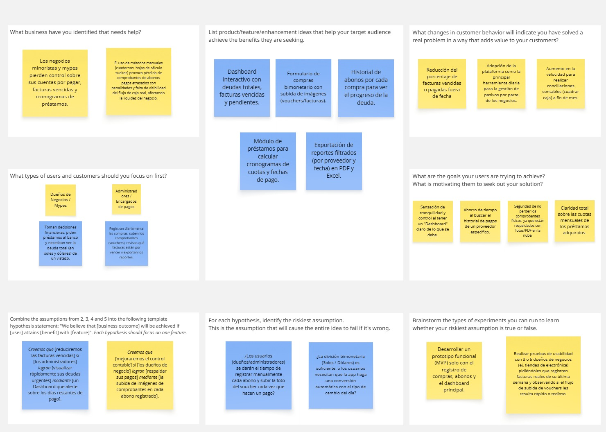

# Capítulo I: Introducción

## 1.1 Startup Profile

### 1.1.1 Descripción de la startup

CREDITOR es una propuesta de plataforma web para mypes que necesitan organizar sus compras a crédito, cuentas por pagar, abonos parciales, comprobantes y préstamos. Busca reunir en un mismo espacio la información que normalmente se distribuye entre cuadernos, hojas de cálculo, mensajes y archivos, para facilitar la consulta de saldos y vencimientos.

La propuesta contempla un panel de deuda consolidada, registro de compras con proveedor, moneda, fecha límite y comprobante; registro de abonos con voucher; seguimiento de préstamos; y reportes filtrables. Estas capacidades son hipótesis de producto y no deben confundirse con funciones ya validadas o implementadas.

**Misión.** Desarrollar una herramienta clara y accesible que ayude a las mypes a mantener un control transparente de sus obligaciones financieras.

**Visión.** Ser una alternativa de apoyo para la gestión diaria de cuentas por pagar de las mypes de la región.

### 1.1.2 Perfiles de integrantes del equipo

Cada perfil se acompaña de una fotografía autorizada y de una descripción revisada por el integrante antes de la entrega. Las fotografías y confirmaciones personales se incorporarán en `assets/team/` cuando el equipo las autorice.

| Integrante | Código | Perfil y responsabilidad propuesta | Evidencia pendiente |
|---|---|---|---|
| Juan Manuel Santos Torres | u20221a371 | Estudiante de Ingeniería de Software. Aporta perspectiva de producto e interfaces web a partir de su experiencia en la operación de negocios comerciales. | Foto autorizada y confirmación de responsabilidades. |
| Sebastián Gutarra Velapatiño | u20241A314 | Estudiante de Ingeniería de Software. Aportaré con mis conocimientos en frontend para esta primera entrega. Mi responsabilidad fue el capítulo 4 Product Design | Foto, perfil y evidencia de contribución. |
| Azabache Bregante Christopher | u20231b188 | Estudiante de Ingeniería de Software. Su perfil técnico, habilidades y responsabilidad en AV1 deben ser redactados y validados por el integrante. | Foto, perfil y evidencia de contribución. |
| Miguel Angel Egocheaga Suyo | u202215188 | Estudiante de Ingeniería de Software. Organiza avances locales de documentación y landing mediante GitFlow; sus aportes finales se contrastarán con el historial publicado. | Foto autorizada y evidencia publicada tras aprobación del equipo. |

## 1.2 Solution Profile

### 1.2.1 Antecedentes y problemática

Las mypes comerciales realizan compras frecuentes a proveedores y, en algunos casos, administran créditos o préstamos para sostener su operación. Cuando las fechas, importes, comprobantes y abonos se registran en medios separados, consultar un saldo o reconstruir una operación puede requerir buscar en múltiples fuentes.

CREDITOR parte de este problema como una hipótesis. La investigación de campo definirá qué prácticas ocurren realmente, qué información se necesita conservar y qué tareas deben priorizarse.

#### Análisis 5W2H

| Pregunta | Hipótesis inicial que debe validarse |
|---|---|
| **What** | Los responsables de negocio pueden carecer de una vista unificada de compras a crédito, abonos y obligaciones pendientes. |
| **When** | Al registrar una compra, ejecutar un pago parcial, revisar una fecha de vencimiento o preparar una conciliación. |
| **Where** | En la administración financiera cotidiana de una mype y en la comunicación con proveedores, contadores o entidades financieras. |
| **Who** | Dueños de negocio y administradores o encargados de finanzas que intervienen directamente en compras o pagos. |
| **Why** | La información dispersa podría dificultar conocer el saldo vigente, sustentar un pago o priorizar obligaciones. |
| **How** | Mediante búsquedas manuales en cuadernos, hojas de cálculo, mensajes o carpetas de comprobantes. |
| **How much** | El impacto económico y de tiempo no se cuantificará hasta contar con datos de entrevistas y fuentes secundarias verificables. |

La validación incluirá entrevistas por segmento y una revisión de fuentes secundarias. No se publicarán cifras de frecuencia, ahorro o morosidad sin indicar su fuente, fecha y alcance.

### 1.2.2 Lean UX Process

#### 1.2.2.1 Lean UX Problem Statement

**Brand New Initiative.** CREDITOR busca lograr que los responsables de una mype puedan identificar sus obligaciones próximas y consultar el saldo de una compra sin reconstruir la información desde varias fuentes. Está diseñada para dueños de negocio y administradores o encargados de finanzas que registran compras, abonos o pagos a proveedores. Actualmente, estas personas pueden depender de apuntes, hojas de cálculo, mensajes o archivos separados, lo que puede volver lenta la consulta de un saldo o la verificación de un comprobante.

CREDITOR propone centralizar compras a crédito, abonos, comprobantes, vencimientos y reportes. El primer segmento de evaluación estará formado por dueños de mypes y administradores que hayan participado recientemente en compras o pagos. Se considerará una señal inicial de valor si, durante una prueba posterior con tareas definidas, las personas pueden localizar una obligación y su saldo con menor cantidad de pasos que en su método actual. La métrica, muestra y comparación se definirán después de las entrevistas; no existe todavía una medición de resultado.

#### 1.2.2.2 Lean UX Assumptions

| Tipo | Supuesto |
|---|---|
| Business Assumption | Las mypes con compras a crédito considerarán útil una herramienta enfocada en la consulta de cuentas por pagar. |
| Business Outcome Assumption | Una vista clara de vencimientos y saldos podría favorecer el uso recurrente de la plataforma para revisar obligaciones. |
| User Assumption | Los dueños y administradores participan de forma distinta en la decisión, el registro y la ejecución de pagos. |
| User Outcome & Benefit Assumption | Las personas podrían beneficiarse de consultar la compra, sus abonos y comprobantes en un mismo registro. |
| Feature Assumption F-01 | Un dashboard con deuda por moneda y estado de vencimiento facilitaría priorizar la revisión de obligaciones. |
| Feature Assumption F-02 | Un registro de compra con proveedor, importe, moneda, fecha límite y comprobante permitiría conservar información básica de la obligación. |
| Feature Assumption F-03 | Un historial de abonos con fecha, importe y voucher permitiría reconstruir el saldo de una compra. |
| Feature Assumption F-04 | Un módulo de préstamos con cuotas y fechas permitiría consultar obligaciones financieras adicionales cuando el segmento las utilice. |
| Feature Assumption F-05 | Un reporte filtrable por fecha, proveedor y moneda facilitaría preparar una revisión o compartir información con contabilidad. |

Estos supuestos se contrastarán en entrevistas y pruebas de usabilidad. Ninguno representa todavía una afirmación validada sobre comportamiento, intención de compra o impacto económico.

#### 1.2.2.3 Lean UX Hypothesis Statements

| ID | Hipótesis |
|---|---|
| **H-01** | Creemos que lograremos una revisión más rápida de las obligaciones pendientes si los propietarios y administradores financieros obtienen visibilidad de los saldos y las fechas de vencimiento mediante un panel consolidado de deudas. |
| **H-02** | Creemos que lograremos registros de compras más completos si los propietarios y administradores financieros obtienen trazabilidad de una compra a crédito mediante un formulario de compra estructurado y la posibilidad de adjuntar el comprobante. |
| **H-03** | Creemos que lograremos una verificación más sencilla de los saldos si los propietarios y administradores financieros obtienen un registro cronológico de los pagos parciales mediante un historial de cuotas y la posibilidad de adjuntar el comprobante de pago. |
| **H-04** | Creemos que lograremos una consulta más clara de los compromisos financieros si los propietarios de negocios obtienen acceso a las fechas y montos de las cuotas mediante un módulo de cronograma de préstamos. |
| **H-05** | Creemos que lograremos una preparación más rápida de las revisiones de deudas si los administradores financieros obtienen información filtrada sobre las obligaciones mediante reportes exportables por proveedor, fecha y moneda. |

Cada hipótesis relaciona una feature assumption con un resultado que deberá medirse en una iteración posterior. La investigación inicial podrá confirmar relevancia y lenguaje del problema, pero no probará por sí misma los resultados de uso propuestos.

#### 1.2.2.4 Lean UX Canvas

El Lean UX Canvas existente resume el problema, los segmentos, los supuestos y las soluciones iniciales.

## 1.3 Segmentos objetivo

CREDITOR trabajará inicialmente con dos segmentos definidos por responsabilidades, no por tamaño de mercado estimado. La pertenencia al segmento se verificará en la entrevista mediante participación reciente en compras, pagos o revisión de obligaciones.

| Segmento | Perfil demográfico y operativo | Necesidad por contrastar | Criterio de inclusión para investigación |
|---|---|---|---|
| S1. Dueños de mypes comerciales | Personas adultas que dirigen un negocio comercial y toman o supervisan decisiones de compra, endeudamiento o pago. | Consultar obligaciones y decidir qué pago revisar o autorizar. | Haber participado durante los últimos tres meses en una compra a crédito, pago a proveedor o préstamo del negocio. |
| S2. Administradores o encargados de finanzas | Personas adultas responsables de registrar compras, preparar pagos, conciliar saldos o conservar comprobantes en una mype. | Registrar operaciones, recuperar vouchers y preparar información para una revisión financiera. | Haber realizado durante los últimos tres meses al menos una tarea directa de registro, pago o conciliación. |

La investigación secundaria para caracterizar el contexto de las mypes se incorporará con fuentes oficiales, año y universo de medición. Hasta entonces, el informe no atribuye porcentajes, niveles de digitalización ni frecuencia de deuda a estos segmentos.

### Relación entre segmentos y propuesta inicial

| Segmento | Tarea principal | Funcionalidad a explorar | Riesgo a validar |
|---|---|---|---|
| S1 | Revisar obligaciones y decidir prioridades. | Dashboard, consulta por proveedor y cronograma de préstamos. | Que la consulta no sea una tarea frecuente o que se delegue por completo. |
| S2 | Registrar y verificar operaciones. | Registro de compras, abonos, comprobantes y reportes. | Que el registro se realice en otra herramienta obligatoria o por otra persona. |
