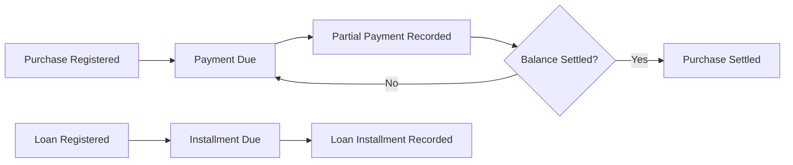

# Capítulo II: Requirements Elicitation & Analysis

## 2.1 Competidores

CREDITOR propone centralizar las compras a crédito, los abonos y los préstamos de las mypes, con énfasis en dueños de negocios y administradores o encargados de finanzas. Para analizar su entorno competitivo se seleccionaron tres soluciones que cubren necesidades similares de control de obligaciones con proveedores: Alegra Contabilidad, Odoo y Zoho Books. La selección responde a la coincidencia funcional con el problema descrito en el capítulo I; no constituye un ranking de participación de mercado.

| ID | Competidor | Descripción general | Propuesta de valor y características relevantes | Canal de acceso y fuente |
|---|---|---|---|---|
| C-01 | Alegra Contabilidad | Software contable y de facturación con una oferta dirigida a pymes en Perú. | Integra facturación, inventario y contabilidad. Su documentación describe la consulta de obligaciones con proveedores y sus vencimientos. | Plataforma web; [oferta para Perú][alegra-peru] y [cuentas por pagar][alegra-cxp]. |
| C-02 | Odoo | Sistema de gestión empresarial cuyo módulo contable incluye facturas de proveedores y préstamos. | Permite registrar pagos parciales, consultar deudas pendientes y gestionar cronogramas de amortización. | Aplicación empresarial; [facturas de proveedores][odoo-facturas] y [préstamos][odoo-prestamos]. |
| C-03 | Zoho Books | Software de gestión contable que incorpora compras, pagos a proveedores y reportes. | Relaciona las facturas con los pagos registrados y permite consultar saldos por proveedor. | Plataforma web; [gestión de facturas][zoho-facturas] y [reportes de obligaciones][zoho-reportes]. |

También se consideran alternativas sustitutas los cuadernos, las hojas de cálculo y el almacenamiento de comprobantes en carpetas o conversaciones. Su uso por los segmentos de CREDITOR es un supuesto del capítulo I que se explorará en las entrevistas; todavía no representa un hallazgo de campo.

### 2.1.1 Análisis competitivo

**Propósito del análisis:** identificar capacidades compartidas, oportunidades de diferenciación y riesgos para una solución centrada en el control cotidiano de deudas de mypes.

**Pregunta guía:** ¿qué valor podría aportar CREDITOR a un dueño o administrador que necesita conocer cuánto debe, cuándo debe pagar y qué abonos ya realizó, frente a las alternativas disponibles?

**Método y alcance:** revisión documental de fuentes oficiales consultadas el 10 de septiembre de 2026. Se analiza Alegra con su oferta peruana y una guía internacional, Odoo con su documentación de la versión 19.0 y Zoho Books con su documentación de la edición estadounidense. Las funciones pueden depender de la edición, configuración o plan; la revisión de Zoho no acredita adecuación tributaria al Perú. No se realizaron pruebas comparativas de uso ni se contrataron planes. Las capacidades de CREDITOR son propuestas del proyecto, todavía no funcionalidades implementadas.

#### Competitive Analysis Landscape

| Dimensión | CREDITOR — propuesta | Alegra Contabilidad | Odoo 19.0 | Zoho Books |
|---|---|---|---|---|
| Enfoque del producto | Control operativo de compras, abonos y préstamos de mypes. | Gestión contable y facturación para pymes. [Fuente][alegra-peru] | Gestión de facturas y préstamos dentro del módulo contable. [Fuentes][odoo-facturas] y [préstamos][odoo-prestamos] | Gestión de compras y pagos integrada al registro contable. [Fuente][zoho-facturas] |
| Registro de compras y vencimientos | Proveedor, importe, moneda, comprobante y fecha límite. | Consulta de facturas de compra, montos adeudados y vencimientos. [Fuente][alegra-cxp] | Facturas con proveedor, fecha y condiciones de pago. [Fuente][odoo-facturas] | Facturas con proveedor, fecha límite y condiciones de pago. [Fuente][zoho-facturas] |
| Abonos e historial | Asociar cada abono con la compra y mostrar el saldo restante. | La guía contempla abonos que afectan los saldos reportados. [Fuente][alegra-cxp] | Pagos parciales y saldo pendiente de la factura. [Fuente][odoo-facturas] | Pagos parciales y consulta de pagos registrados por factura. [Fuente][zoho-facturas] |
| Evidencias digitales | Adjuntar comprobantes de compras y vouchers de abonos. | El vínculo de un archivo con cada abono no se verificó en las fuentes consultadas. | Carga de facturas en PDF; no se verificó aquí el adjunto por abono. [Fuente][odoo-facturas] | Adjuntos y notas en el registro del pago. [Fuente][zoho-facturas] |
| Consulta de deuda | Dashboard con saldos separados en soles y dólares y estado de vencimientos. | Reporte de cuentas por pagar con filtros de consulta. [Fuente][alegra-cxp] | Reporte de antigüedad de deuda con detalle por proveedor. [Fuente][odoo-facturas] | Reporte por proveedor con importes facturados, pagados y saldo. [Fuente][zoho-reportes] |
| Préstamos y cuotas | Registro de préstamos y visualización de cronogramas. | No verificado en las fuentes consultadas. | Cronogramas importados, calculados o registrados manualmente, con capital e intereses. [Fuente][odoo-prestamos] | No verificado en las fuentes consultadas. |
| Salida de información | Reportes filtrados exportables a PDF y Excel. | Descarga de reportes y exportación de facturas de proveedor. [Fuente][alegra-cxp] | Exportación del reporte de deuda a PDF y XLSX. [Fuente][odoo-facturas] | Reporte de saldos con rango de fechas y filtros; formatos de exportación no verificados aquí. [Fuente][zoho-reportes] |

**Criterio de lectura:** “no verificado” identifica una limitación de esta revisión; no significa que el competidor carezca de esa función. Tampoco se atribuye exclusividad a CREDITOR por proponer abonos, adjuntos o cronogramas, ya que existen capacidades equivalentes documentadas.

#### Posicionamiento, canales y condiciones de comparación

| Solución | Segmento y estrategia visible | Servicios, precios y canales observados | Logo y evidencia pendiente |
|---|---|---|---|
| CREDITOR | Mypes que requieren concentrarse en obligaciones con proveedores, abonos y consulta de saldos. La propuesta de diferenciación se validará con los segmentos. | Landing, futura aplicación web y API REST. El precio no ha sido definido ni comunicado. | Usar el logotipo propio disponible en `assets/branding/creditorlogo.jpg`. |
| Alegra Contabilidad | Pymes que requieren contabilidad, facturación y gestión empresarial. | Oferta web y planes mostrados en su sitio oficial; los precios, planes y condiciones deben citarse con fecha al preparar la entrega. | Incorporar logo desde la fuente oficial o un recurso con autorización de uso. |
| Odoo | Organizaciones que requieren módulos configurables de gestión empresarial. | Aplicación web, módulos de contabilidad y documentación oficial de funcionalidades. | Incorporar logo desde la fuente oficial o un recurso con autorización de uso. |
| Zoho Books | Pequeños negocios que buscan una herramienta de contabilidad y gestión de proveedores. | Plataforma web y documentación oficial de facturas, pagos y reportes. | Incorporar logo desde la fuente oficial o un recurso con autorización de uso. |

El análisis no compara precios ni afirma una ventaja comercial mientras no se documenten planes equivalentes, país, moneda, fecha de consulta y condiciones de cada oferta. Los logos de terceros no se descargarán ni republicarán sin una fuente o licencia apropiada; la versión final debe mostrar la fuente junto a cada recurso.
#### Fortalezas, limitaciones y oportunidades para CREDITOR

Las fortalezas siguientes se apoyan en las capacidades documentadas. Las limitaciones de encaje y las oportunidades son interpretaciones del equipo que deberán contrastarse con usuarios; no son defectos demostrados de los competidores.

| Alternativa | Fortaleza relevante | Limitación de encaje o cuestión por validar | Oportunidad propuesta para CREDITOR |
|---|---|---|---|
| Alegra Contabilidad | Reúne distintas tareas de gestión y ofrece una propuesta para el mercado peruano. | Determinar si el usuario necesita esa amplitud o busca resolver principalmente el seguimiento de sus pagos. | Evaluar una experiencia centrada en las tareas de consultar deuda y registrar abonos. |
| Odoo | Cubre tanto obligaciones con proveedores como cronogramas de préstamos. | Evaluar cuánto acompañamiento requiere el segmento para configurar y utilizar el flujo contable descrito. | Probar un registro guiado que emplee el vocabulario cotidiano del comerciante. |
| Zoho Books | Conecta facturas, pagos y documentos de respaldo. | Comprobar el encaje del flujo y de la edición disponible con la operación concreta del negocio. | Validar una navegación por compra que permita recuperar rápidamente cada voucher y saldo. |
| Registros manuales y hojas de cálculo | Pueden adaptarse a la forma de trabajo que el negocio ya conoce. | Investigar cómo mantienen consistentes los saldos, fechas y comprobantes cuando participan varias personas. | Comprobar si centralizar los registros reduce búsquedas y conciliaciones manuales. |

CREDITOR parte con una propuesta de alcance específico, pero aún debe demostrar utilidad y facilidad de uso. La principal oportunidad planteada es facilitar un flujo continuo de consulta de deuda, registro de abono y recuperación del comprobante. Sus riesgos iniciales son la falta de validación con usuarios, el esfuerzo necesario para mantener los registros al día y la preferencia por herramientas ya adoptadas. No se plantea competir por un precio menor hasta conocer los costos del proyecto y la disposición de pago del segmento.

#### Fuentes del análisis

- Alegra. (s. f.). [Software contable y de facturación para Pymes en Perú][alegra-peru].
- Alegra. (s. f.). [Genera el reporte de cuentas por pagar en Alegra][alegra-cxp]. Guía internacional.
- Odoo. (s. f.). [Vendor bills][odoo-facturas]. Documentación oficial 19.0, archivo fuente.
- Odoo. (s. f.). [Loans management][odoo-prestamos]. Documentación oficial 19.0, archivo fuente.
- Zoho. (s. f.). [Basic Functions in Bills][zoho-facturas]. Ayuda de Zoho Books, edición estadounidense.
- Zoho. (s. f.). [Payables Reports][zoho-reportes]. Ayuda de Zoho Books, edición estadounidense.

Todas las fuentes fueron consultadas el 10 de septiembre de 2026.

[alegra-peru]: https://www.alegra.com/peru/contabilidad/
[alegra-cxp]: https://ayuda.alegra.com/int/genera-el-reporte-de-cuentas-por-pagar-en-alegra
[odoo-facturas]: https://github.com/odoo/documentation/blob/19.0/content/applications/finance/accounting/vendor_bills.rst
[odoo-prestamos]: https://github.com/odoo/documentation/blob/19.0/content/applications/finance/accounting/bank/loans.rst
[zoho-facturas]: https://www.zoho.com/us/books/help/bills/basic-functions.html
[zoho-reportes]: https://www.zoho.com/us/books/help/reports/payables.html

### 2.1.2 Estrategias y tácticas frente a competidores

Las estrategias se plantean a partir del análisis anterior y de las hipótesis del capítulo I. Sus resultados se evaluarán durante la investigación y las pruebas posteriores del prototipo.

| Estrategia | Fundamento | Tácticas propuestas | Evidencia para evaluarla |
|---|---|---|---|
| Especialización en control de obligaciones | Los competidores cubren tareas contables más amplias; debe comprobarse si un flujo acotado aporta valor al segmento. | Priorizar la consulta de saldos y vencimientos, el registro de compras y abonos y el seguimiento de préstamos. Mostrar soles y dólares por separado. | Problemas recurrentes identificados en entrevistas y tareas que los usuarios consideran prioritarias. |
| Facilidad de registro y consulta | La existencia de una función no demuestra que su uso encaje con la rutina del negocio. | Diseñar un formulario guiado con proveedor, fecha, importe, moneda y comprobante; usar términos como compra, abono y saldo pendiente. | En pruebas posteriores: tareas completadas, errores, tiempo empleado y necesidad de ayuda. |
| Trazabilidad de pagos | Recuperar el respaldo de un abono forma parte del problema planteado para CREDITOR. | Vincular cada voucher con su abono y compra; permitir consultar el historial y el saldo desde el mismo contexto. | Casos reales de búsqueda o discrepancia relatados; posteriormente, capacidad de recuperar un comprobante en el prototipo. |
| Adopción gradual | El usuario puede preferir mantener sus herramientas actuales si cambiar implica duplicar trabajo. | Proponer un piloto con pocas compras, orientación inicial y reportes exportables para compartir con el contador. | Barreras de adopción relatadas y continuidad de uso observada durante un futuro piloto. |
| Captación por demostraciones del flujo | El beneficio propuesto debe resultar comprensible para dueños y administradores. | Mostrar en la landing page ejemplos de consulta de deuda y registro de abonos; solicitar comentarios a negocios de los rubros objetivo. | Comprensión de la propuesta e interés en participar en pruebas, diferenciados de una intención de compra. |

#### Criterios para revisar la estrategia

| Decisión propuesta | Evidencia que la respalda o falta | Criterio de revisión |
|---|---|---|
| Hablar de control de obligaciones y no de contabilidad integral. | Análisis documental; falta validación con entrevistas. | Confirmar que el segmento reconoce el problema y no requiere primero una suite contable completa. |
| Priorizar compras, abonos, saldos y vencimientos. | Hipótesis Lean UX; falta evaluación de frecuencia e importancia. | Ordenar el backlog después de analizar tareas y entrevistas. |
| Mantener el precio fuera de la landing inicial. | No existe investigación de disposición de pago. | Definir precio únicamente tras comparar alternativas y recoger criterios de los participantes. |
| Comunicar una propuesta clara y comprobable. | La landing actual debe ser reescrita para CREDITOR. | Eliminar métricas promocionales sin fuente y vincular los CTA a flujos reales. |
## 2.2 Entrevistas

Se propone realizar entrevistas para comprender cómo los usuarios gestionan actualmente las compras a crédito, los pagos a proveedores y los préstamos. La investigación permitirá contrastar los supuestos del capítulo I y las oportunidades del análisis competitivo antes de definir requisitos detallados.

Esta sección presenta el diseño de la investigación. Las entrevistas aún deben ejecutarse; sus registros y hallazgos se documentarán posteriormente en las secciones 2.2.2 y 2.2.3.

### 2.2.1 Diseño de entrevistas

#### Objetivo general

Comprender las prácticas, dificultades y criterios de decisión de dueños y administradores de mypes al registrar obligaciones, programar pagos y consultar comprobantes, para orientar el alcance y la experiencia de CREDITOR.

#### Objetivos específicos

- Reconstruir el proceso desde una compra a crédito hasta su cancelación y conciliación.
- Identificar cómo se consultan saldos y vencimientos y cómo se priorizan los pagos.
- Explorar el registro de abonos, la conservación de vouchers y el tratamiento de discrepancias.
- Conocer cómo se gestionan préstamos y operaciones en soles o dólares, cuando correspondan.
- Identificar información necesaria para reportes, barreras de adopción y criterios para elegir una herramienta.

#### Segmentos y selección de participantes

Se propone un muestreo intencional inicial de seis personas: tres dueños de negocio y tres administradores o encargados de finanzas. Es una meta de reclutamiento, no una cantidad de entrevistas realizadas ni una muestra estadísticamente representativa. Se buscarán participantes de al menos tres negocios y dos rubros comerciales; si los relatos revelan procesos distintos o vacíos relevantes, se ampliará la convocatoria.

| Segmento | Perfil y criterios de inclusión | Necesidades que se busca explorar |
|---|---|---|
| S1. Dueños de negocios | Persona adulta que dirige una mype comercial, decide o supervisa sus pagos y ha intervenido en una compra a crédito o préstamo del negocio durante los últimos tres meses. | Visibilidad de obligaciones, priorización de pagos, gestión de liquidez y seguimiento de préstamos. |
| S2. Administradores o encargados de finanzas | Persona adulta que registra compras, procesa abonos o concilia saldos de una mype y ha realizado al menos una de estas tareas durante los últimos tres meses. | Registro cotidiano, control de vencimientos, recuperación de comprobantes y preparación de reportes. |

Se buscará diversidad de herramientas actuales: cuadernos, hojas de cálculo o software. No será obligatorio usar dólares ni tener préstamos, ya que su ausencia también ayuda a delimitar el alcance. Quien cumpla ambos roles se registrará una sola vez, con un rol principal y sus responsabilidades adicionales. Se excluirá a personas sin participación directa reciente en estas tareas.

#### Modalidad y procedimiento

Las entrevistas serán individuales, semiestructuradas y en español, de aproximadamente 30 a 40 minutos, presencialmente o por videollamada según disponibilidad. Un integrante conducirá la conversación y otro tomará notas, cuando sea posible.

| Momento | Duración aproximada | Actividad |
|---|---|---|
| Apertura | 5 minutos | Explicar el propósito académico, confirmar el perfil y solicitar consentimiento para participar y, por separado, para grabar. |
| Experiencia actual | 15 a 20 minutos | Aplicar las preguntas comunes y reconstruir una operación reciente mediante repreguntas. |
| Profundización por segmento | 5 a 10 minutos | Explorar decisiones del dueño o tareas operativas del administrador. |
| Cierre | 5 minutos | Resumir lo entendido, pedir correcciones y explorar la reacción a la propuesta de CREDITOR. |

La conversación comenzará por experiencias concretas sin presentar primero la solución. Se evitarán preguntas que presupongan errores o que sugieran una respuesta favorable. Se utilizarán repreguntas como “¿qué ocurrió después?”, “¿cómo lo comprobaste?” y “¿puedes contarme un ejemplo reciente?”. Si una pregunta no corresponde a la experiencia del participante, se registrará como no aplicable.

#### Presentación y consentimiento

“Somos estudiantes de Aplicaciones Web de la UPC y queremos comprender cómo se administran las compras y los pagos en los negocios. La entrevista es voluntaria: puedes omitir preguntas o terminar cuando desees. No necesitamos montos exactos, datos bancarios ni documentos identificables. ¿Aceptas participar? ¿Autorizas que grabemos la conversación para analizarla con el equipo del curso?”

Si no se autoriza la grabación, se tomarán notas con permiso. Los participantes se identificarán mediante códigos, por ejemplo S1-01 o S2-01. Los registros originales se conservarán en una carpeta de acceso restringido al equipo; en el repositorio se incluirán únicamente resúmenes anonimizados y evidencias autorizadas. No se publicarán vouchers reales, números de cuenta ni información identificable de clientes o proveedores.

#### Guion común

| ID | Pregunta | Propósito |
|---|---|---|
| G-01 | ¿A qué se dedica el negocio y qué responsabilidades tienes en sus compras y pagos? | Ubicar el contexto y confirmar el rol. |
| G-02 | Cuéntame la última compra a crédito en la que participaste, desde que se acordó hasta el último pago o su estado actual. ¿Qué registraron y quién intervino? | Reconstruir el flujo real. |
| G-03 | Si hoy necesitas conocer lo que el negocio debe a un proveedor, ¿cómo lo averiguas y cómo verificas que el saldo sea correcto? | Explorar consulta y confiabilidad de saldos. |
| G-04 | ¿Cómo identifican los pagos que se acercan? Cuéntame una ocasión reciente en la que tuvieron que decidir qué pagar primero. | Comprender vencimientos y priorización. |
| G-05 | Cuando una compra se paga en partes, ¿cómo registran cada abono y el saldo restante? ¿Dónde guardan y cómo buscan sus comprobantes? | Explorar pagos parciales y trazabilidad. |
| G-06 | ¿Alguna vez el saldo que tenían registrado fue distinto al indicado por un proveedor? Si ocurrió, ¿cómo lo resolvieron? Si no, ¿cómo lo comprueban habitualmente? | Investigar conciliación sin presuponer fallas. |
| G-07 | ¿En qué monedas compran y pagan? Si utilizan soles y dólares, ¿cómo llevan los saldos y qué hacen cuando pagan en una moneda diferente a la compra? | Explorar la necesidad bimonetaria. |
| G-08 | ¿El negocio ha recibido o concedido préstamos? Si corresponde, ¿cómo consultan las cuotas, intereses y fechas de pago? | Delimitar los tipos de préstamo y su seguimiento. |
| G-09 | ¿Qué información preparan para revisar las deudas o compartirla con el contador? ¿Cómo la obtienen, en qué formato y cuánto tiempo les tomó la última vez? | Identificar reportes y esfuerzo actual. |

#### Preguntas para S1: dueños de negocios

| ID | Pregunta | Propósito |
|---|---|---|
| D-01 | Antes de aceptar una nueva compra a crédito o un préstamo, ¿qué información revisas? Cuéntame una decisión reciente. | Comprender decisiones de endeudamiento. |
| D-02 | ¿Cómo distribuyes la revisión, autorización y ejecución de pagos entre las personas del negocio? | Identificar responsabilidades y controles. |
| D-03 | ¿Qué parte del control de las deudas te resulta más difícil o te toma más tiempo? ¿Qué consecuencias tuvo la última vez? | Priorizar problemas según experiencias. |
| D-04 | ¿Has evaluado o usado una herramienta para estas tareas? ¿Qué determinó tu elección y qué tendría que ocurrir para cambiarla? | Explorar alternativas y barreras de cambio. |
| D-05 | ¿El negocio paga actualmente por alguna herramienta de gestión? Sin indicar importes si no deseas, ¿cómo deciden si ese gasto vale la pena? | Explorar criterios económicos sin proponer un precio. |

#### Preguntas para S2: administradores o encargados de finanzas

| ID | Pregunta | Propósito |
|---|---|---|
| A-01 | ¿Qué datos necesitas para registrar una compra y qué haces cuando falta alguno o el comprobante llega después? | Identificar campos y excepciones. |
| A-02 | ¿Qué sucede cuando registran un importe incorrecto, duplican una compra o se revierte un pago? ¿Quién puede corregirlo? | Explorar correcciones y permisos. |
| A-03 | Si otra persona registra o paga la misma compra, ¿cómo te enteras y cómo evitan duplicar el trabajo? | Comprender coordinación entre usuarios. |
| A-04 | ¿Desde qué dispositivo y en qué momento registras los pagos? ¿Qué haces si no puedes registrarlos inmediatamente? | Reconocer condiciones de uso y barreras de registro. |
| A-05 | En el último cierre o revisión de cuentas, ¿qué tuviste que buscar o volver a registrar? ¿Qué información te habría facilitado esa tarea? | Identificar oportunidades de consulta y exportación. |

#### Cierre y exploración de la propuesta

Después de explorar el proceso actual, se presentará brevemente CREDITOR como una propuesta web para reunir compras, abonos y préstamos, consultar saldos por moneda y generar reportes. Se aclarará que todavía está en desarrollo.

1. De las tareas que describiste, ¿cuáles encajarían en esta propuesta y cuáles quedarían sin resolver?
2. ¿En qué situaciones preferirías seguir usando tu herramienta actual?
3. ¿Qué necesitarías comprobar antes de registrar información del negocio en una herramienta como esta?
4. ¿Qué aspecto importante de tu trabajo no hemos tratado?

La reacción a esta descripción se registrará como opinión sobre el concepto. No se interpretará como validación de usabilidad, intención de compra confirmada ni evidencia de reducción de errores.

#### Relación del guion con las hipótesis del capítulo I

| Hipótesis | Preguntas relacionadas | Evidencia que se buscará |
|---|---|---|
| H1. Dashboard de deudas | G-03, G-04, D-01, D-03 | Cómo consultan obligaciones, priorizan pagos y detectan vencimientos. |
| H2. Registro de abonos | G-02, G-05, G-06, A-01, A-02, A-03, A-04 | Cómo mantienen saldos y comprobantes, resuelven diferencias y actualizan registros. |
| H3. Control de préstamos | G-08, D-01 | Tipos de préstamos utilizados y dificultades de seguimiento de cuotas. |
| H4. Exportación y reportes | G-09, A-05 | Información, filtros, formatos y destinatarios de los reportes. |

Por cada entrevista se registrarán el código, segmento, rubro, fecha, modalidad, duración, consentimiento y notas por pregunta. El análisis posterior distinguirá hechos relatados, opiniones e interpretaciones del equipo; incluirá coincidencias y casos que contradigan las hipótesis. Las entrevistas ayudarán a refinar necesidades y prioridades, mientras que la evaluación de facilidad de uso y resultados requerirá pruebas posteriores.

### 2.2.2 Registro de entrevistas

La meta de AV1 es registrar entre tres y cinco entrevistas por segmento. Cada entrevista debe tener consentimiento, captura autorizada y enlace del video con minuto de inicio y duración. Los datos personales no necesarios se anonimizan.

| Código | Segmento | Rol y rubro | Fecha | Evidencia requerida | Estado |
|---|---|---|---|---|---|
| S1-01 | Dueños de mypes | Carlos Mendoza — Propietario y Gerente General (Distribuidora y Ferretería Mendoza — Venta mayorista y minorista de herramientas y materiales de construcción) | 14/09/2026 | [Video de la entrevista](https://youtu.be/Ka9AmFZM3Js) (Inicio: 00:00, Duración: 07:25 min) | Completada |
| S1-02 | Dueños de mypes | Rocío Paredes — Fundadora y Gerente Comercial (Calzados & Moda Vía Nova — Comercialización de calzado femenino y carteras) | 15/09/2026 | [Video de la entrevista](https://youtu.be/sIYtHGlNyWI) (Inicio: 00:00, Duración: 07:36 min) | Completada |
| S1-03 | Dueños de mypes | Ernesto Gutarra — Dueño de una tienda de artículos de primera necesidad | 17/09/2026 | [Video de la entrevista](https://youtu.be/NuDAKMMTmaY) (Inicio: 00:00, Duración: 07:58 min) | Completada |
| S2-01 | Administradores o finanzas | Fernando Terry — Administrador y Encargado de Finanzas (Distribuidora de Alimentos del Sur S.A.C. — Distribución mayorista de abarrotes y consumo masivo) | 16/09/2026 | [Video de la entrevista](https://youtu.be/AkhgaNd8Few) (Inicio: 00:00, Duración: 08:13 min) | Completada |
| S2-02 | Administradores o finanzas | Pendiente de reclutamiento | Pendiente | Captura autorizada, URL del video, minuto y duración. | Pendiente |
| S2-03 | Administradores o finanzas | Pendiente de reclutamiento | Pendiente | Captura autorizada, URL del video, minuto y duración. | Pendiente |

No se han registrado entrevistas reales en esta versión; por ello no se presentan nombres, hallazgos, porcentajes ni enlaces ficticios.

### 2.2.3 Análisis de entrevistas

El análisis se realizará después de completar los registros. Para cada respuesta se distinguirán: **hecho relatado**, **opinión**, **necesidad**, **dolor** y **oportunidad**. Se calcularán porcentajes solo sobre el número de entrevistas válidas por segmento y se indicará el denominador.

| Tema | Código de análisis | Preguntas relacionadas | Resultado por registrar |
|---|---|---|---|
| Consulta de saldos | SALDO | G-03, G-06 | Herramienta actual, pasos y dificultad relatada. |
| Vencimientos y prioridad | VENCIMIENTO | G-04, D-01, D-03 | Método de seguimiento y criterio de decisión. |
| Registro de compras y abonos | REGISTRO | G-02, G-05, A-01 a A-04 | Datos requeridos, errores y comprobantes. |
| Préstamos | PRESTAMO | G-08, D-01 | Uso, frecuencia y necesidad de cronograma. |
| Reportes | REPORTE | G-09, A-05 | Destinatario, filtros, formato y esfuerzo. |

La síntesis final incluirá coincidencias, diferencias entre segmentos y evidencia que contradiga las hipótesis iniciales. Solo entonces se actualizarán Personas, Task Matrix, Journey Maps, historias y backlog.

#### Criterios de calidad y resguardo

- Confirmar que cada participante cumple los criterios del segmento antes de incluirlo en el análisis.
- Registrar la fecha, modalidad, duración y consentimiento de cada entrevista.
- Citar un hallazgo con el código de entrevista y conservar una nota que permita rastrearlo sin revelar datos sensibles.
- Evitar concluir causalidad, intención de compra o tamaños de mercado con una muestra cualitativa.
- Reemplazar los registros pendientes por evidencia real antes de exportar el informe final.
## 2.3 Needfinding

### 2.3.1 User Personas

Las siguientes personas son borradores basados en los criterios de segmento del capítulo I. No representan personas investigadas y deberán actualizarse con citas de las entrevistas antes de la entrega.

| Persona provisional | Objetivo | Contexto y conducta por validar | Necesidades iniciales |
|---|---|---|---|
| **Rosa, dueña de mype** | Conocer sus compromisos antes de autorizar o priorizar pagos. | Puede supervisar compras y pagos sin registrar cada operación personalmente. | Resumen de deuda, vencimientos, consulta por proveedor y préstamos. | 

| Persona provisional | Objetivo | Contexto y conducta por validar | Necesidades iniciales |
|---|---|---|---|
| **Diego, encargado de finanzas** | Registrar una compra o abono y recuperar su comprobante al conciliar. | Puede operar con información entregada por otras personas y registrar desde distintos dispositivos. | Campos consistentes, historial de pagos, saldo y reportes filtrables. | 

### 2.3.2 User Task Matrix

La matriz usa una valoración inicial para orientar la discusión del backlog; la frecuencia e importancia deben recalibrarse con entrevistas. Escala: 1 = baja, 3 = media, 5 = alta.

| Tarea | Rosa: frecuencia | Rosa: importancia | Diego: frecuencia | Diego: importancia | Validación necesaria |
|---|---:|---:|---:|---:|---|
| Consultar saldo por proveedor | 3 | 5 | 4 | 5 | Confirmar frecuencia y momento de consulta. |
| Revisar próximos vencimientos | 3 | 5 | 4 | 5 | Identificar método actual de priorización. |
| Registrar una compra a crédito | 2 | 4 | 5 | 5 | Confirmar campos mínimos y responsables. |
| Registrar un abono y voucher | 2 | 5 | 5 | 5 | Validar evidencia disponible y excepciones. |
| Consultar préstamo y cuotas | 2 | 3 | 2 | 3 | Determinar si es una necesidad real de ambos segmentos. |
| Exportar o compartir un reporte | 2 | 4 | 3 | 4 | Conocer destinatario y formato requerido. |

### 2.3.3 User Journey Mapping

El recorrido **As-Is** se documentará en UXPressia a partir de operaciones relatadas. Esta versión identifica puntos a validar, no una secuencia confirmada.

| Etapa | Acción que se investigará | Posible fricción | Evidencia a recoger |
|---|---|---|---|
| Compra | Acordar una compra a crédito y recibir comprobante. | Datos incompletos o comprobante fuera del registro principal. | Relato de una compra reciente. |
| Registro | Anotar importe, proveedor, moneda y fecha límite. | Duplicación, olvido o uso de fuentes separadas. | Herramienta actual y responsable. |
| Seguimiento | Revisar saldo, vencimiento y prioridad de pago. | Dificultad para reunir información actualizada. | Pasos realizados y tiempo aproximado. |
| Abono | Ejecutar pago parcial y conservar voucher. | Pérdida de trazabilidad entre pago y compra. | Método de registro y recuperación. |
| Conciliación | Confirmar saldo o preparar información para revisión. | Búsqueda manual o discrepancia con proveedor. | Ejemplo y resultado relatado. |

La captura o enlace de UXPressia se agregará cuando el recorrido use evidencia real de los participantes.

### 2.3.4 Empathy Mapping

Los mapas de empatía se construirán después de codificar entrevistas; no se atribuirán pensamientos o emociones a los segmentos sin una cita de evidencia.

| Área | Pregunta de análisis |
|---|---|
| Dice y hace | ¿Qué describe la persona que realiza al registrar o revisar una obligación? |
| Piensa y siente | ¿Qué preocupación o criterio expresa al decidir un pago? |
| Ve | ¿Qué documentos, pantallas o canales intervienen en su proceso actual? |
| Escucha | ¿Qué indicaciones recibe de proveedores, dueños, contadores u otras personas? |
| Dolores | ¿Qué obstáculo, riesgo o esfuerzo se repite en su relato? |
| Ganancias | ¿Qué resultado concreto espera al completar una tarea? |

### 2.3.5 As-Is Scenario Mapping

El escenario As-Is final distinguirá actores, acciones, información y sistemas utilizados. La matriz anterior será reemplazada o complementada por una captura de la herramienta elegida y por referencias a los códigos de entrevista.

## 2.4 Big Picture Event Storming

El EventStorming inicial delimita conversaciones del dominio; no representa todavía eventos observados en producción. La sesión definitiva debe conservar una captura de FigJam u otra herramienta, participantes, fecha y decisiones tomadas.

| Evento de dominio | Comando o actor relacionado | Pregunta abierta |
|---|---|---|
| Purchase Registered | Registrar compra / administrador | ¿Qué campos y validaciones son indispensables? |
| Payment Due | Consultar vencimientos / dueño o administrador | ¿Cómo se calcula o prioriza la fecha? |
| Partial Payment Recorded | Registrar abono / administrador | ¿Qué evidencia del pago se permite adjuntar? |
| Purchase Settled | Confirmar saldo / administrador | ¿Cómo se resuelven ajustes o reversos? |
| Loan Registered | Registrar préstamo / dueño | ¿Qué tipos de préstamos usan realmente los segmentos? |
| Loan Installment Recorded | Registrar cuota / administrador | ¿Cómo se relaciona con el saldo de préstamo? |

## 2.5 Ubiquitous Language

Los términos de dominio se nombran en inglés para mantener consistencia futura entre interfaz, API y modelo de datos. La definición se revisará con el equipo y con hallazgos de investigación.

| Término | Definición | Contexto |
|---|---|---|
| **Supplier** | Persona o empresa a la que la mype compra bienes o servicios y a la que puede deber un saldo. | Accounts Payable |
| **Credit Purchase** | Compra cuya obligación no se cancela por completo en el momento del registro. | Accounts Payable |
| **Due Date** | Fecha límite acordada para cumplir con una obligación. | Accounts Payable |
| **Partial Payment** | Abono que reduce, pero no liquida, el saldo de una compra o préstamo. | Payments |
| **Payment Voucher** | Evidencia digital asociada a un pago registrado. | Payments |
| **Outstanding Balance** | Importe pendiente luego de considerar los pagos aplicados. | Accounts Payable |
| **Loan** | Obligación financiera registrada con principal, tasa, frecuencia y cronograma cuando aplique. | Loans |
| **Installment** | Cuota programada de un préstamo. | Loans |
| **Debt Report** | Consulta filtrada de obligaciones para revisión, seguimiento o exportación. | Reporting |
