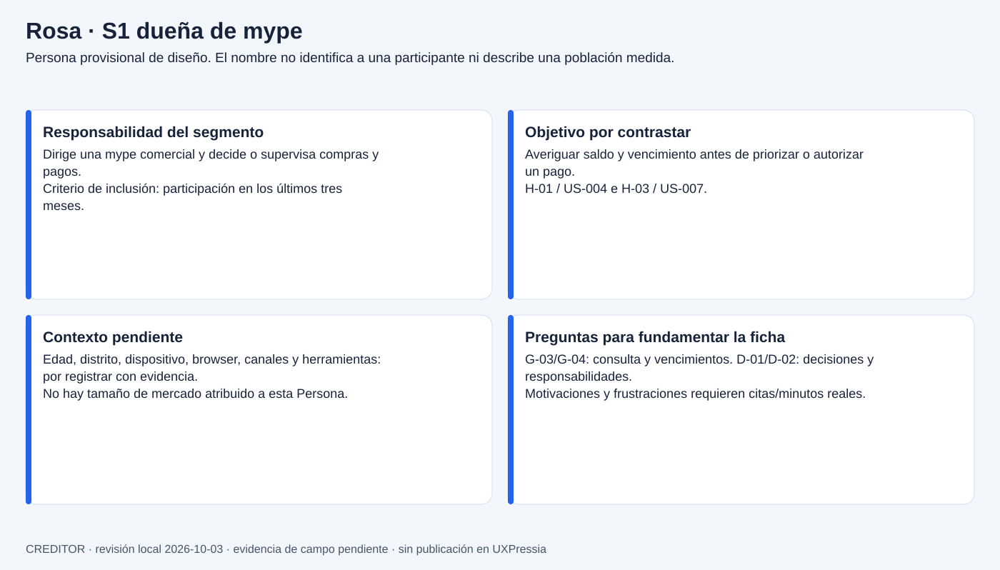
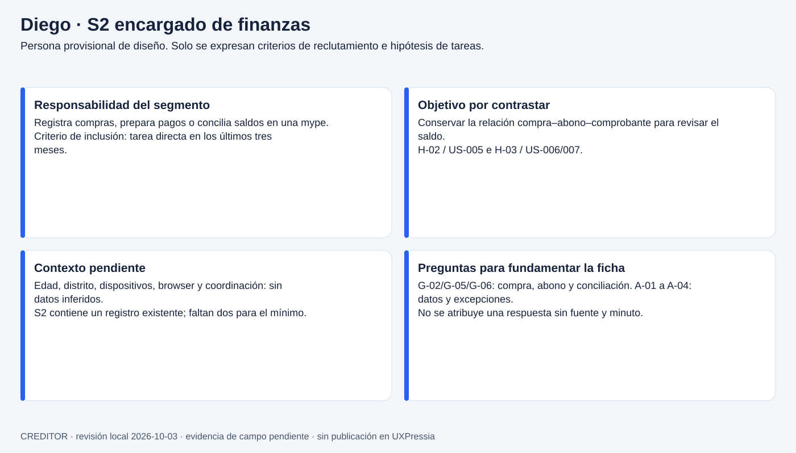
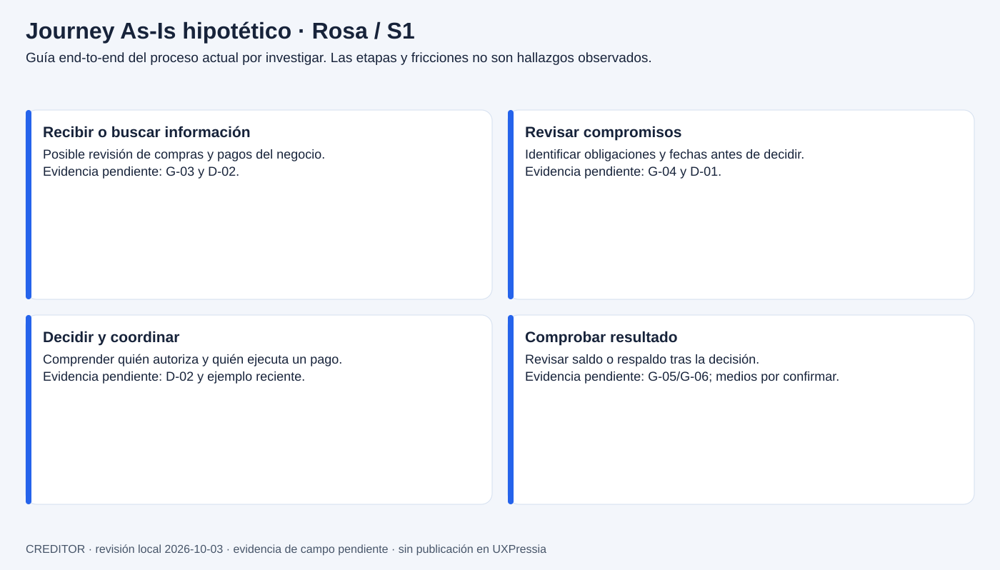
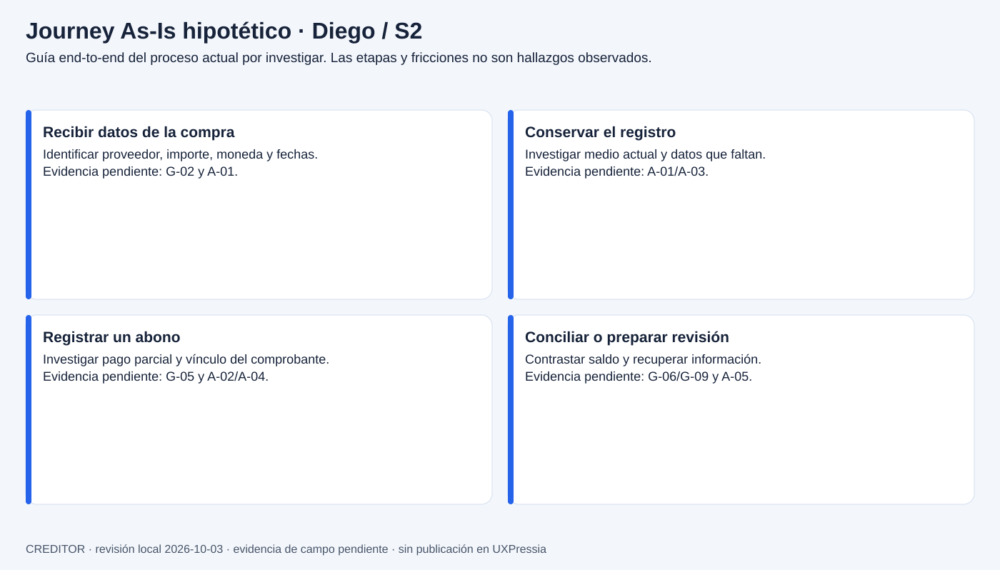
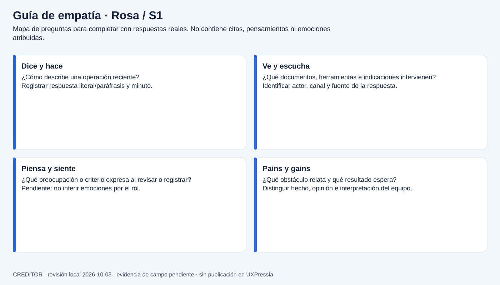
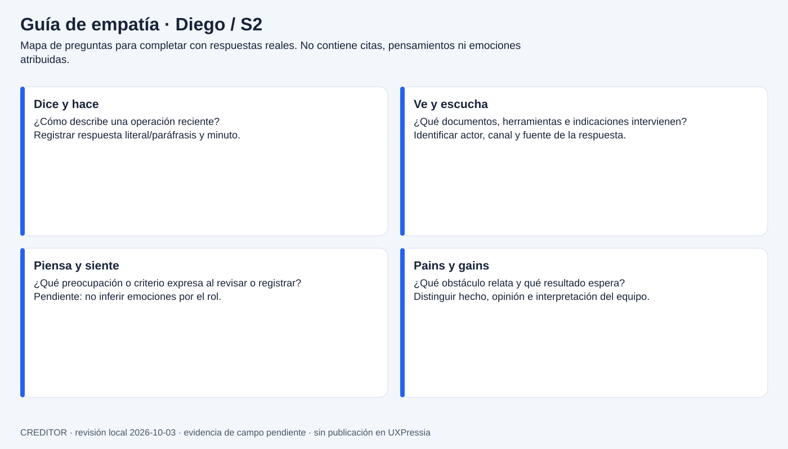

> Vista sincronizada del [informe canónico](../README.md), corte AV2 13/11/2026. Para editar contenido, modificar README y ejecutar `python tools/report/sync_chapters.py`.

# Capítulo II: Requirements Elicitation & Analysis

La implementación AV2 se contrasta con esta investigación, pero no modifica sus fechas ni convierte las hipótesis en entrevistas realizadas. Precios y prestaciones de competidores corresponden al registro de fuentes de octubre; no son cotizaciones actualizadas al 13/11. La auditoría técnica revisa coherencia de alcance, no revalida el mercado.

## 2.1 Competidores

CREDITOR propone centralizar las compras a crédito, los abonos y los préstamos de las mypes, con énfasis en dueños de negocios y administradores o encargados de finanzas. Para analizar su entorno competitivo se seleccionaron tres soluciones que cubren necesidades similares de control de obligaciones con proveedores: Alegra Contabilidad, Odoo y Zoho Books. La selección responde a la coincidencia funcional con el problema descrito en el capítulo I; no constituye un ranking de participación de mercado.

| ID | Competidor | Descripción general | Propuesta de valor y características relevantes | Canal de acceso y fuente |
|---|---|---|---|---|
| C-01 | Alegra Contabilidad | Software contable y de facturación con una oferta dirigida a pymes en Perú. | Integra facturación, inventario y contabilidad. Su documentación describe la consulta de obligaciones con proveedores y sus vencimientos. | Plataforma web; [oferta para Perú][alegra-peru] y [cuentas por pagar][alegra-cxp]. |
| C-02 | Odoo | Sistema de gestión empresarial cuyo módulo contable incluye facturas de proveedores y préstamos. | Permite registrar pagos parciales, consultar deudas pendientes y gestionar cronogramas de amortización. | Aplicación empresarial; [facturas de proveedores][odoo-facturas] y [préstamos][odoo-prestamos]. |
| C-03 | Zoho Books | Software de gestión contable que incorpora compras, pagos a proveedores y reportes. | Relaciona las facturas con los pagos registrados y permite consultar saldos por proveedor. | Plataforma web; [gestión de facturas][zoho-facturas] y [reportes de obligaciones][zoho-reportes]. |

También se consideran alternativas sustitutas los cuadernos, las hojas de cálculo y el almacenamiento de comprobantes en carpetas o conversaciones. Su uso por los segmentos de CREDITOR es un supuesto del capítulo I que se explorará en las entrevistas; todavía no representa un hallazgo de campo.

### 2.1.1 Análisis competitivo

**Propósito del análisis:** identificar capacidades compartidas, oportunidades de diferenciación y riesgos para una solución centrada en el control cotidiano de deudas de mypes.

**Pregunta guía:** ¿qué valor podría aportar CREDITOR a un dueño o administrador que necesita conocer cuánto debe, cuándo debe pagar y qué abonos ya realizó, frente a las alternativas disponibles?

**Método y alcance:** revisión documental de fuentes oficiales consultadas el 10 de septiembre de 2026. Se analiza Alegra con su oferta peruana y una guía internacional, Odoo con su documentación de la versión 19.0 y Zoho Books con su documentación de la edición estadounidense. Las funciones pueden depender de la edición, configuración o plan; la revisión de Zoho no acredita adecuación tributaria al Perú. No se realizaron pruebas comparativas de uso ni se contrataron planes. La comparación de competidores conserva su fecha de fuente. La columna CREDITOR se actualiza al corte AV2: compras, abonos, historial, consulta por moneda, exportación CSV y préstamos de cuotas pactadas. Las pruebas técnicas locales no acreditan adopción ni una ventaja frente a los competidores.

#### Competitive Analysis Landscape

| Dimensión | CREDITOR — incremento local AV2 | Alegra Contabilidad | Odoo 19.0 | Zoho Books |
|---|---|---|---|---|
| Enfoque del producto | Control operativo de compras, abonos y préstamos de mypes. | Gestión contable y facturación para pymes. [Fuente][alegra-peru] | Gestión de facturas y préstamos dentro del módulo contable. [Fuentes][odoo-facturas] y [préstamos][odoo-prestamos] | Gestión de compras y pagos integrada al registro contable. [Fuente][zoho-facturas] |
| Registro de compras y vencimientos | AV2: proveedor, referencia, descripción, importe, moneda y fechas, persistidos por negocio. | Consulta de facturas de compra, montos adeudados y vencimientos. [Fuente][alegra-cxp] | Facturas con proveedor, fecha y condiciones de pago. [Fuente][odoo-facturas] | Facturas con proveedor, fecha límite y condiciones de pago. [Fuente][zoho-facturas] |
| Abonos e historial | AV2: abonos sucesivos e historial persistidos, saldo derivado y control de concurrencia. | La guía contempla abonos que afectan los saldos reportados. [Fuente][alegra-cxp] | Pagos parciales y saldo pendiente de la factura. [Fuente][odoo-facturas] | Pagos parciales y consulta de pagos registrados por factura. [Fuente][zoho-facturas] |
| Evidencias digitales | AV2: PDF, PNG o JPEG opcional hasta 2 MiB, metadatos en BD y descarga autorizada desde almacenamiento privado. | El vínculo de un archivo con cada abono no se verificó en las fuentes consultadas. | Carga de facturas en PDF; no se verificó aquí el adjunto por abono. [Fuente][odoo-facturas] | Adjuntos y notas en el registro del pago. [Fuente][zoho-facturas] |
| Consulta de deuda | AV2: listado y resumen por negocio con filtros y saldos separados PEN/USD. | Reporte de cuentas por pagar con filtros de consulta. [Fuente][alegra-cxp] | Reporte de antigüedad de deuda con detalle por proveedor. [Fuente][odoo-facturas] | Reporte por proveedor con importes facturados, pagados y saldo. [Fuente][zoho-reportes] |
| Préstamos y cuotas | AV2: registro/consulta de importes mensuales pactados; sin cálculo de amortización ni pago de cuotas. | No verificado en las fuentes consultadas. | Cronogramas importados, calculados o registrados manualmente, con capital e intereses. [Fuente][odoo-prestamos] | No verificado en las fuentes consultadas. |
| Salida de información | AV2: CSV de obligaciones filtradas; estado de cuenta de tesorería exportable/imprimible en navegador. No exporta XLSX ni PDF desde servidor. | Descarga de reportes y exportación de facturas de proveedor. [Fuente][alegra-cxp] | Exportación del reporte de deuda a PDF y XLSX. [Fuente][odoo-facturas] | Reporte de saldos con rango de fechas y filtros; formatos de exportación no verificados aquí. [Fuente][zoho-reportes] |

**Criterio de lectura:** “no verificado” identifica una limitación de esta revisión; no significa que el competidor carezca de esa función. Tampoco se atribuye exclusividad a CREDITOR por proponer abonos, adjuntos o cronogramas, ya que existen capacidades equivalentes documentadas.

#### Landscape comercial, identidad visual y condiciones

La revisión funcional de septiembre se conserva. La siguiente ampliación consulta fuentes comerciales oficiales el **03/10/2026**. Los precios son referencias públicas de distintos mercados y unidades; no son una cotización para el mismo negocio ni permiten concluir que una alternativa sea más barata. El precio de CREDITOR permanece sin definir.

| Dimensión | CREDITOR — propuesta | Alegra Contabilidad | Odoo | Zoho Books |
|---|---|---|---|---|
| Identidad visual |  |  |  |  |
| Overview / mercado objetivo | Mypes comerciales, roles de revisión y registro; alcance a validar. | Gestión contable y facturación para pymes peruanas. | Suite empresarial modular, con contabilidad y compras. | Contabilidad para pequeños negocios; se revisa edición US. |
| Valor y ventaja por explorar | Flujo compra–abono–saldo por moneda. No se acredita exclusividad ni superioridad. | Conjunto integrado de tareas contables y comerciales. | Aplicaciones de gestión bajo una misma suscripción. | Compras, pagos, documentos y reportes conectados. |
| Marketing observado/propuesto | Propuesto: demostraciones de compra/abono y piloto acotado; sin campañas ejecutadas. | Prueba de 15 días, planes por crecimiento y contenido de ayuda. | Oferta de una aplicación gratis, planes y demostraciones/consultoría. | Prueba, comparación de planes, documentación y recursos de aprendizaje. |
| Productos y servicios | Landing, frontend conectado, API ASP.NET Core y MySQL locales; préstamos y reportes con alcance descrito. | Contabilidad, facturación y POS, con alcance variable por plan. | Todas las aplicaciones en planes Standard/Custom; opciones de hosting por plan. | Books y ecosistema de aplicaciones; Professional incluye multimoneda y órdenes de compra. |
| Precios y costos observados | Sin precio; soporte, infraestructura y almacenamiento deben estimarse antes de monetizar. | Perú, PEN, mensual: Emprendedor **S/105**, Pyme **S/152**, IGV incluido. Límite y usuarios dependen del plan. [Fuente oficial](https://www.alegra.com/peru/contabilidad/precios/). | URL pública en USD: Standard **USD24.90/usuario/mes** cobrado anualmente, promoción inicial de 12 meses; regular mostrado **USD31.10**, más impuestos. Región de contratación debe confirmarse. [Planes](https://www.odoo.com/es/pricing), [configurador oficial](https://www.odoo.com/pricing-configurator?plan=standard). | Edición US, USD/organización: Professional **USD50/mes** mensual o **USD40/mes** con cobro anual, 5 usuarios. No acredita adecuación tributaria peruana. [Fuente oficial](https://www.zoho.com/us/books/pricing/). |
| Canales | Landing y frontend responsive implementados localmente; publicación TB1 pendiente. | Web y acceso a aplicaciones; ver oferta Perú y ayuda. | Odoo Online y canales/partners; Custom contempla otras opciones. | Web y aplicaciones móviles publicitadas en la oferta oficial. |

Los logos se conservan como recursos identificativos de sus titulares para este análisis académico; su origen y fecha figuran en [registro de fuentes locales](../assets/research/tb1/source-register.md). Su inclusión no expresa respaldo comercial ni una licencia general de marca. Los importes no se convierten entre monedas ni se presentan como condiciones comerciales de CREDITOR.

#### Fortalezas, debilidades, oportunidades y amenazas

Las capacidades documentadas sustentan las fortalezas. Debilidades de encaje, oportunidades y amenazas son **interpretaciones estratégicas del equipo por contrastar**, no defectos demostrados mediante pruebas comparativas.

| Alternativa | Fortalezas | Debilidades o limitaciones de encaje por validar | Oportunidades | Amenazas |
|---|---|---|---|---|
| CREDITOR | Alcance propuesto centrado en compras/abonos y vocabulario de la mype. | Investigación incompleta; falta API operativa, despliegue TB1 y evidencia de adopción. | Probar un flujo acotado con negocios que necesitan consultar obligaciones. | Competidores ya ofrecen funciones equivalentes y el usuario puede mantener su herramienta actual. |
| Alegra | Oferta dirigida a Perú y combinación de contabilidad/facturación. | Para un negocio que solo necesita obligaciones, evaluar el encaje de una oferta más amplia y sus condiciones. | Adoptar gestión integrada cuando el negocio necesita varias tareas. | Otras suites y métodos ya conocidos compiten por costo y esfuerzo de cambio. |
| Odoo | Suite modular con facturas, pagos y gestión de préstamos documentada. | Configuración e implementación requieren evaluar el acompañamiento necesario para este segmento. | Extender procesos empresariales sobre una plataforma integrada. | Alternativas más acotadas pueden atraer a usuarios que prefieren un flujo reducido. |
| Zoho Books | Relación entre compras, pagos y reportes; Professional publica multimoneda. | La revisión US no demuestra encaje tributario ni de procesos con una mype peruana. | Integración contable y con su ecosistema cuando existe ese requerimiento. | Productos localizados y herramientas actuales pueden ser preferidos por el negocio. |

Los cuadernos/hojas de cálculo siguen siendo sustitutos por investigar, no medios confirmados de todos los participantes. No se afirma una ventaja comercial de CREDITOR hasta comprobar el flujo y la adopción.

#### Fuentes del análisis

- Alegra. (s. f.). [Software contable y de facturación para Pymes en Perú][alegra-peru].
- Alegra. (s. f.). [Genera el reporte de cuentas por pagar en Alegra][alegra-cxp]. Guía internacional.
- Odoo. (s. f.). [Vendor bills][odoo-facturas]. Documentación oficial 19.0, archivo fuente.
- Odoo. (s. f.). [Loans management][odoo-prestamos]. Documentación oficial 19.0, archivo fuente.
- Zoho. (s. f.). [Basic Functions in Bills][zoho-facturas]. Ayuda de Zoho Books, edición estadounidense.
- Zoho. (s. f.). [Payables Reports][zoho-reportes]. Ayuda de Zoho Books, edición estadounidense.

Las fuentes funcionales anteriores fueron consultadas el 10 de septiembre de 2026. Precios, logos y contexto secundario se ampliaron el 03/10/2026 con fuentes oficiales; ver registro local de fuentes.

[alegra-peru]: https://www.alegra.com/peru/contabilidad/
[alegra-cxp]: https://ayuda.alegra.com/int/genera-el-reporte-de-cuentas-por-pagar-en-alegra
[odoo-facturas]: https://github.com/odoo/documentation/blob/19.0/content/applications/finance/accounting/vendor_bills.rst
[odoo-prestamos]: https://github.com/odoo/documentation/blob/19.0/content/applications/finance/accounting/bank/loans.rst
[zoho-facturas]: https://www.zoho.com/us/books/help/bills/basic-functions.html
[zoho-reportes]: https://www.zoho.com/us/books/help/reports/payables.html

### 2.1.2 Estrategias y tácticas frente a competidores

Las estrategias se plantean a partir del análisis anterior y de las hipótesis del capítulo I. Sus resultados se evaluarán durante la investigación y las pruebas posteriores del prototipo.

| Estrategia | Fundamento | Tácticas propuestas | Evidencia para evaluarla |
|---|---|---|---|
| Especialización en control de obligaciones | Los competidores cubren tareas contables más amplias; debe comprobarse si un flujo acotado aporta valor al segmento. | Priorizar la consulta de saldos y vencimientos, el registro de compras y abonos y el seguimiento de préstamos. Mostrar soles y dólares por separado. | Problemas recurrentes identificados en entrevistas y tareas que los usuarios consideran prioritarias. |
| Facilidad de registro y consulta | La existencia de una función no demuestra que su uso encaje con la rutina del negocio. | Diseñar un formulario guiado con proveedor, fecha, importe, moneda y comprobante; usar términos como compra, abono y saldo pendiente. | En pruebas posteriores: tareas completadas, errores, tiempo empleado y necesidad de ayuda. |
| Trazabilidad de pagos | Recuperar el respaldo de un abono forma parte del problema planteado para CREDITOR. | Vincular cada voucher con su abono y compra; permitir consultar el historial y el saldo desde el mismo contexto. | Casos reales de búsqueda o discrepancia relatados; posteriormente, capacidad de recuperar un comprobante en el prototipo. |
| Adopción gradual | El usuario puede preferir mantener sus herramientas actuales si cambiar implica duplicar trabajo. | Proponer un piloto con pocas compras, orientación inicial y reportes exportables para compartir con el contador. | Barreras de adopción relatadas y continuidad de uso observada durante un futuro piloto. |
| Captación por demostraciones del flujo | El beneficio propuesto debe resultar comprensible para dueños y administradores. | Mostrar en la landing page ejemplos de consulta de deuda y registro de abonos; solicitar comentarios a negocios de los rubros objetivo. | Comprensión de la propuesta e interés en participar en pruebas, diferenciados de una intención de compra. |

#### Criterios para revisar la estrategia

| Decisión propuesta | Evidencia que la respalda o falta | Criterio de revisión |
|---|---|---|
| Hablar de control de obligaciones y no de contabilidad integral. | Análisis documental; falta validación con entrevistas. | Confirmar que el segmento reconoce el problema y no requiere primero una suite contable completa. |
| Priorizar compras, abonos, saldos y vencimientos. | Hipótesis Lean UX; falta evaluación de frecuencia e importancia. | Ordenar el backlog después de analizar tareas y entrevistas. |
| Mantener el precio fuera de la landing inicial. | No existe investigación de disposición de pago. | Definir precio únicamente tras comparar alternativas y recoger criterios de los participantes. |
| Comunicar una propuesta clara y comprobable. | La landing TB1 ya presenta cuentas por pagar y CTA hacia dashboard/nueva compra locales. | Revisar comprensión con participantes y comprobar los enlaces públicos cuando se autorice el despliegue. |
## 2.2 Entrevistas

Se propone realizar entrevistas para comprender cómo los usuarios gestionan actualmente las compras a crédito, los pagos a proveedores y los préstamos. La investigación permitirá contrastar los supuestos del capítulo I y las oportunidades del análisis competitivo antes de definir requisitos detallados.

Esta sección presenta el diseño de la investigación y cuatro registros existentes: tres de S1 y uno de S2. La revisión local verifica la presencia de los enlaces y metadatos declarados, no el contenido ni consentimiento de las grabaciones. Faltan al menos dos participantes S2 y el análisis de respuestas de todos los registros.

### 2.2.1 Diseño de entrevistas

#### Objetivo general

Comprender las prácticas, dificultades y criterios de decisión de dueños y administradores de mypes al registrar obligaciones, programar pagos y consultar comprobantes, para orientar el alcance y la experiencia de CREDITOR.

#### Objetivos específicos

- Reconstruir el proceso desde una compra a crédito hasta su cancelación y conciliación.
- Identificar cómo se consultan saldos y vencimientos y cómo se priorizan los pagos.
- Explorar el registro de abonos, la conservación de vouchers y el tratamiento de discrepancias.
- Conocer cómo se gestionan préstamos y operaciones en soles o dólares, cuando correspondan.
- Identificar información necesaria para reportes, barreras de adopción y criterios para elegir una herramienta.

#### Segmentos y selección de participantes

La meta mínima es un muestreo intencional de seis personas: tres dueños de negocio y tres administradores o encargados de finanzas. El registro actual contiene tres S1 y un S2; faltan dos S2 para la meta mínima. No constituye una muestra estadísticamente representativa. Se buscarán participantes de al menos tres negocios y dos rubros comerciales; si los relatos revelan procesos distintos o vacíos relevantes, se ampliará la convocatoria.

| Segmento | Perfil y criterios de inclusión | Necesidades que se busca explorar |
|---|---|---|
| S1. Dueños de negocios | Persona adulta que dirige una mype comercial, decide o supervisa sus pagos y ha intervenido en una compra a crédito o préstamo del negocio durante los últimos tres meses. | Visibilidad de obligaciones, priorización de pagos, gestión de liquidez y seguimiento de préstamos. |
| S2. Administradores o encargados de finanzas | Persona adulta que registra compras, procesa abonos o concilia saldos de una mype y ha realizado al menos una de estas tareas durante los últimos tres meses. | Registro cotidiano, control de vencimientos, recuperación de comprobantes y preparación de reportes. |

Se buscará diversidad de herramientas actuales: cuadernos, hojas de cálculo o software. No será obligatorio usar dólares ni tener préstamos, ya que su ausencia también ayuda a delimitar el alcance. Quien cumpla ambos roles se registrará una sola vez, con un rol principal y sus responsabilidades adicionales. Se excluirá a personas sin participación directa reciente en estas tareas.

#### Modalidad y procedimiento

Las entrevistas serán individuales, semiestructuradas y en español, de aproximadamente 30 a 40 minutos, presencialmente o por videollamada según disponibilidad. Un integrante conducirá la conversación y otro tomará notas, cuando sea posible.

| Momento | Duración aproximada | Actividad |
|---|---|---|
| Apertura | 5 minutos | Explicar el propósito académico, confirmar el perfil y solicitar consentimiento para participar y, por separado, para grabar. |
| Experiencia actual | 15 a 20 minutos | Aplicar las preguntas comunes y reconstruir una operación reciente mediante repreguntas. |
| Profundización por segmento | 5 a 10 minutos | Explorar decisiones del dueño o tareas operativas del administrador. |
| Cierre | 5 minutos | Resumir lo entendido, pedir correcciones y explorar la reacción a la propuesta de CREDITOR. |

La conversación comenzará por experiencias concretas sin presentar primero la solución. Se evitarán preguntas que presupongan errores o que sugieran una respuesta favorable. Se utilizarán repreguntas como “¿qué ocurrió después?”, “¿cómo lo comprobaste?” y “¿puedes contarme un ejemplo reciente?”. Si una pregunta no corresponde a la experiencia del participante, se registrará como no aplicable.

#### Presentación y consentimiento

“Somos estudiantes de Aplicaciones Web de la UPC y queremos comprender cómo se administran las compras y los pagos en los negocios. La entrevista es voluntaria: puedes omitir preguntas o terminar cuando desees. No necesitamos montos exactos, datos bancarios ni documentos identificables. ¿Aceptas participar? ¿Autorizas que grabemos la conversación para analizarla con el equipo del curso?”

Si no se autoriza la grabación, se tomarán notas con permiso. Los participantes se identificarán mediante códigos, por ejemplo S1-01 o S2-01. Los registros originales se conservarán en una carpeta de acceso restringido al equipo; en el repositorio se incluirán únicamente resúmenes anonimizados y evidencias autorizadas. No se publicarán vouchers reales, números de cuenta ni información identificable de clientes o proveedores.

#### Guion común

| ID | Pregunta | Propósito |
|---|---|---|
| G-01 | ¿A qué se dedica el negocio y qué responsabilidades tienes en sus compras y pagos? | Ubicar el contexto y confirmar el rol. |
| G-02 | Cuéntame la última compra a crédito en la que participaste, desde que se acordó hasta el último pago o su estado actual. ¿Qué registraron y quién intervino? | Reconstruir el flujo real. |
| G-03 | Si hoy necesitas conocer lo que el negocio debe a un proveedor, ¿cómo lo averiguas y cómo verificas que el saldo sea correcto? | Explorar consulta y confiabilidad de saldos. |
| G-04 | ¿Cómo identifican los pagos que se acercan? Cuéntame una ocasión reciente en la que tuvieron que decidir qué pagar primero. | Comprender vencimientos y priorización. |
| G-05 | Cuando una compra se paga en partes, ¿cómo registran cada abono y el saldo restante? ¿Dónde guardan y cómo buscan sus comprobantes? | Explorar pagos parciales y trazabilidad. |
| G-06 | ¿Alguna vez el saldo que tenían registrado fue distinto al indicado por un proveedor? Si ocurrió, ¿cómo lo resolvieron? Si no, ¿cómo lo comprueban habitualmente? | Investigar conciliación sin presuponer fallas. |
| G-07 | ¿En qué monedas compran y pagan? Si utilizan soles y dólares, ¿cómo llevan los saldos y qué hacen cuando pagan en una moneda diferente a la compra? | Explorar la necesidad bimonetaria. |
| G-08 | ¿El negocio ha recibido o concedido préstamos? Si corresponde, ¿cómo consultan las cuotas, intereses y fechas de pago? | Delimitar los tipos de préstamo y su seguimiento. |
| G-09 | ¿Qué información preparan para revisar las deudas o compartirla con el contador? ¿Cómo la obtienen, en qué formato y cuánto tiempo les tomó la última vez? | Identificar reportes y esfuerzo actual. |

#### Preguntas para S1: dueños de negocios

| ID | Pregunta | Propósito |
|---|---|---|
| D-01 | Antes de aceptar una nueva compra a crédito o un préstamo, ¿qué información revisas? Cuéntame una decisión reciente. | Comprender decisiones de endeudamiento. |
| D-02 | ¿Cómo distribuyes la revisión, autorización y ejecución de pagos entre las personas del negocio? | Identificar responsabilidades y controles. |
| D-03 | ¿Qué parte del control de las deudas te resulta más difícil o te toma más tiempo? ¿Qué consecuencias tuvo la última vez? | Priorizar problemas según experiencias. |
| D-04 | ¿Has evaluado o usado una herramienta para estas tareas? ¿Qué determinó tu elección y qué tendría que ocurrir para cambiarla? | Explorar alternativas y barreras de cambio. |
| D-05 | ¿El negocio paga actualmente por alguna herramienta de gestión? Sin indicar importes si no deseas, ¿cómo deciden si ese gasto vale la pena? | Explorar criterios económicos sin proponer un precio. |

#### Preguntas para S2: administradores o encargados de finanzas

| ID | Pregunta | Propósito |
|---|---|---|
| A-01 | ¿Qué datos necesitas para registrar una compra y qué haces cuando falta alguno o el comprobante llega después? | Identificar campos y excepciones. |
| A-02 | ¿Qué sucede cuando registran un importe incorrecto, duplican una compra o se revierte un pago? ¿Quién puede corregirlo? | Explorar correcciones y permisos. |
| A-03 | Si otra persona registra o paga la misma compra, ¿cómo te enteras y cómo evitan duplicar el trabajo? | Comprender coordinación entre usuarios. |
| A-04 | ¿Desde qué dispositivo y en qué momento registras los pagos? ¿Qué haces si no puedes registrarlos inmediatamente? | Reconocer condiciones de uso y barreras de registro. |
| A-05 | En el último cierre o revisión de cuentas, ¿qué tuviste que buscar o volver a registrar? ¿Qué información te habría facilitado esa tarea? | Identificar oportunidades de consulta y exportación. |

#### Cierre y exploración de la propuesta

Después de explorar el proceso actual, se presentará brevemente CREDITOR como una propuesta web para reunir compras, abonos y préstamos, consultar saldos por moneda y generar reportes. Se aclarará que todavía está en desarrollo.

1. De las tareas que describiste, ¿cuáles encajarían en esta propuesta y cuáles quedarían sin resolver?
2. ¿En qué situaciones preferirías seguir usando tu herramienta actual?
3. ¿Qué necesitarías comprobar antes de registrar información del negocio en una herramienta como esta?
4. ¿Qué aspecto importante de tu trabajo no hemos tratado?

La reacción a esta descripción se registrará como opinión sobre el concepto. No se interpretará como validación de usabilidad, intención de compra confirmada ni evidencia de reducción de errores.

#### Relación del guion con las hipótesis del capítulo I

| Hipótesis | Preguntas | Evidencia buscada | Historia |
|---|---|---|---|
| H-01 / F-01, dashboard | G-03, G-04, D-01, D-03 | Pasos actuales de consulta y criterios de prioridad. | US-004 |
| H-02 / F-02, registro de compra | G-02, A-01, A-02, A-03 | Datos mínimos, responsable y manejo de datos faltantes. | US-005 |
| H-03 / F-03, abonos e historial | G-05, G-06, A-02, A-03, A-04 | Relación pago–compra, comprobantes y resolución de diferencias. | US-006/007 |
| H-04 / F-04, préstamos | G-08, D-01 | Tipo de préstamo y condiciones/cronograma usados. | US-009, implementación AV2; utilidad por validar |
| H-05 / F-05, reportes | G-09, A-05 | Destinatario, filtros, formato y esfuerzo de preparación. | US-008, implementación AV2; utilidad por validar |

La matriz no contiene hallazgos. Cada respuesta debe vincularse a código de participante, pregunta y minuto antes de derivar una necesidad. Se distinguirán hechos relatados, opiniones e interpretaciones, incluyendo casos que contradigan las hipótesis.

### 2.2.2 Registro de entrevistas

La exigencia de investigación es **3 a 5 entrevistas por segmento**. Hay cuatro entradas existentes (S1: 3; S2: 1). Se conserva la información y los enlaces incorporados por el equipo; la etiqueta **registro existente** evita equiparar una URL con evidencia completa. El paquete final debe añadir captura de video, resúmenes y enlace autorizado en Microsoft Stream con inicio y duración.

| Código | Segmento | Rol y rubro declarados | Fecha declarada | Video y timing existentes | Estado de revisión |
|---|---|---|---|---|---|
| S1-01 | Dueños de mypes | Carlos Mendoza — Propietario y Gerente General; Distribuidora y Ferretería Mendoza. | 14/09/2026 | [YouTube](https://youtu.be/Ka9AmFZM3Js), 00:00, 07:25. | Registro existente; contenido, captura, consentimiento y Stream pendientes de revisión. |
| S1-02 | Dueños de mypes | Rocío Paredes — Fundadora y Gerente Comercial; Calzados & Moda Vía Nova. | 15/09/2026 | [YouTube](https://youtu.be/sIYtHGlNyWI), 00:00, 07:36. | Registro existente; contenido, captura, consentimiento y Stream pendientes de revisión. |
| S1-03 | Dueños de mypes | Ernesto Gutarra — Dueño de tienda de artículos de primera necesidad. | 17/09/2026 | [YouTube](https://youtu.be/NuDAKMMTmaY), 00:00, 07:58. | Registro existente; contenido, captura, consentimiento y Stream pendientes de revisión. |
| S2-01 | Administradores o finanzas | Fernando Terry — Administrador y Encargado de Finanzas; Distribuidora de Alimentos del Sur S.A.C. | 16/09/2026 | [YouTube](https://youtu.be/AkhgaNd8Few), 00:00, 08:13. | Registro existente; contenido, captura, consentimiento y Stream pendientes de revisión. |
| S2-02 | Administradores o finanzas | Participante no incorporado. | Pendiente | Sin evidencia. | Entrevista real pendiente. |
| S2-03 | Administradores o finanzas | Participante no incorporado. | Pendiente | Sin evidencia. | Entrevista real pendiente. |

#### Resúmenes individuales y metadatos por completar

| Código | Resumen descriptivo de respuestas | Edad/distrito/dispositivo/browser/canales | Evidencia de origen necesaria |
|---|---|---|---|
| S1-01 | Pendiente: no se transcriben respuestas que no se han revisado. | Pendiente de registro autorizado. | Respuestas por G/D, minuto, captura y consentimiento. |
| S1-02 | Pendiente: no se transcriben respuestas que no se han revisado. | Pendiente de registro autorizado. | Respuestas por G/D, minuto, captura y consentimiento. |
| S1-03 | Pendiente: no se transcriben respuestas que no se han revisado. | Pendiente de registro autorizado. | Respuestas por G/D, minuto, captura y consentimiento. |
| S2-01 | Pendiente: no se transcriben respuestas que no se han revisado. | Pendiente de registro autorizado. | Respuestas por G/A, minuto, captura y consentimiento. |

El 03/10/2026 se intentó consultar captions públicos automáticos de los cuatro videos únicamente en lectura. La metadata ofreció una pista de subtítulos en español, pero timedtext devolvió contenido vacío; no se obtuvo una transcripción utilizable. Esto no acredita ni invalida las respuestas del video. No se generaron resúmenes, capturas o citas a partir de esa metadata. La revisión humana de los videos originales y la evidencia de Microsoft Stream continúan pendientes. No se subió contenido a servicios externos durante esta ejecución local.

#### Revisión de los registros existentes

El [control de revisión de entrevistas](../assets/research/tb1/interview-review-checklist.csv) concentra las cuatro entradas existentes y las dos entrevistas S2 pendientes. Registra revisor, fecha, comprobaciones y siguiente acción por participante, sin repetir toda la codificación. Cada comprobación se actualizará a **CUMPLE**, **REQUIERE COMPLEMENTO** o **NO VERIFICADO**, indicando la evidencia en el resumen individual. Las dos filas sin participante no se contabilizan como entrevistas realizadas.

| Comprobación | Condición para cerrar la revisión |
|---|---|
| Perfil y consentimiento | Confirmar responsabilidad reciente en compras/pagos, segmento principal y autorización de participación, grabación y uso académico de la evidencia. |
| Grabación y abordaje | Abrir el registro completo; revisar audio/video comprensibles, ambiente, interrupciones y preguntas que no induzcan una respuesta. Registrar incidencias y su efecto en la interpretación. |
| Cobertura y timing | Relacionar las preguntas efectivamente respondidas con los objetivos del guion y conservar el minuto de cada fragmento útil. La duración declarada de 7–8 minutos exige revisar profundidad; no demuestra por sí sola cobertura suficiente ni invalidez. |
| Resumen y codificación | Redactar un resumen individual fiel al registro, codificar respuestas con fuente/minuto y revisar inferencias con otro integrante. No convertir ausencia de respuesta en ausencia del problema. |
| Evidencia de entrega | Añadir captura autorizada y acceso de revisión en Stream con inicio/duración, conservando la relación con el registro original. |

Si una grabación deja objetivos sin responder, se realizará una entrevista complementaria o una repregunta autorizada. Se registrará como continuación del mismo participante para evitar contar dos veces a una persona.

### 2.2.3 Análisis de entrevistas

Se conserva el esquema de codificación como **base reutilizable**. Hasta disponer de respuestas rastreables no se calculan porcentajes ni se atribuyen hallazgos a S1/S2. Las proporciones futuras usarán solo entrevistas válidas, explicitarán `n/N por segmento` y no se extrapolarán a la población de mypes.

| Tema | Código | Preguntas | Dato concreto que se codificará |
|---|---|---|---|
| Consulta de saldos | SALDO | G-03, G-06 | Fuentes consultadas, pasos, contraste con proveedor. |
| Vencimientos y prioridad | VENCIMIENTO | G-04, D-01, D-03 | Señal de vencimiento y criterio de decisión. |
| Registro de compra | COMPRA | G-02, A-01, A-02 | Campos, responsable y manejo de información incompleta. |
| Abonos y comprobantes | ABONO | G-05, G-06, A-02 a A-04 | Asociación pago–compra, recuperación y correcciones. |
| Préstamos | PRESTAMO | G-08, D-01 | Condiciones, frecuencia y uso de cronograma. |
| Reportes | REPORTE | G-09, A-05 | Destinatario, filtros, formato y esfuerzo. |
| Condiciones de uso | CONTEXTO | G-01, A-03, A-04, D-04 | Dispositivo, coordinación y herramienta actual. |

[Plantilla CSV de codificación](../assets/research/tb1/interview-coding-template.csv) contiene filas por participante registrado y tema, con evidencia y resultado marcados **pendientes**. [Matriz de trazabilidad de investigación](../assets/research/tb1/research-traceability.csv) conecta las cinco hipótesis con el guion y las historias; no reemplaza el análisis de respuestas.

| Segmento | Registros existentes | Mínimo requerido | Estado del contenido analizado | Síntesis y porcentajes |
|---|---:|---:|---|---|
| S1 | 3 | 3 | No hay contenido codificado verificable en esta revisión. | Pendientes. |
| S2 | 1 | 3 | No hay contenido codificado verificable; faltan 2 registros. | Pendientes. |

El criterio de cierre exige resúmenes, citas/minutos y síntesis por segmento antes de convertir hipótesis de Personas y tareas en resultados investigados. No se asigna causalidad ni intención de compra a una muestra cualitativa.

#### Método de análisis y agrupación de participantes

1. **Revisar el material de origen.** Completar el control de revisión y confirmar el rol principal mediante G-01. S1 agrupa a quienes deciden o supervisan obligaciones; S2, a quienes registran o concilian. Los códigos actuales mantienen el segmento declarado hasta revisar esa respuesta. Si una persona cumple ambos roles, se conserva un único código y se anotan responsabilidades secundarias.
2. **Codificar fragmentos verificables.** En la plantilla de codificación, cada fila corresponde a una respuesta o fragmento, con participante, pregunta equivalente del guion, tema, minuto de inicio/fin y cita breve o paráfrasis anonimizada. Distinguir **RELATO**, **OPINIÓN** e **INFERENCIA DEL EQUIPO**; una inferencia debe conservar los fragmentos que la sustentan. Usar **SIN RESPUESTA** cuando el registro no cubra la pregunta y **NO APLICA** solo cuando la experiencia declarada lo justifique. Los identificadores G/D/A son una equivalencia analítica: no se afirma que los videos antiguos hayan usado literalmente este guion.
3. **Comparar dentro de cada segmento.** Agrupar por las variables operacionales siguientes y conservar la referencia al fragmento que justifica cada valor. Primero comparar experiencias S1 entre sí y S2 entre sí; después contrastar patrones comunes y diferencias de responsabilidades. Mantener casos discrepantes y revisar si requieren otra Persona o un escenario alternativo.
4. **Derivar necesidades y decisiones.** Expresar la necesidad como una tarea o resultado del negocio, antes de proponer una función. Relacionarla con una Persona candidata y una historia existente; si no hay encaje, registrar la brecha para revisar el backlog. Un caso individual puede justificar una excepción, pero no se describe como patrón del segmento. Una coincidencia entre al menos dos relatos permite proponer un patrón recurrente del grupo revisado, con sus límites y casos contrarios; no demuestra saturación ni prevalencia poblacional.

| Variable de agrupación | Valores que se registrarán desde las respuestas | Origen de evidencia |
|---|---|---|
| Responsabilidad principal | Decide/supervisa; registra/ejecuta; concilia; combinación y rol principal. | G-01, D-02, A-03. |
| Forma de consultar y conservar datos | Herramienta o fuente nombrada, pasos y personas consultadas; no verificado si no se relata. | G-02, G-03, G-05, D-04. |
| Frecuencia y criticidad de la tarea | Frecuencia explícita, último caso concreto y consecuencia descrita. No inferir frecuencia por el cargo. | G-04, G-09, D-03, A-05. |
| Tratamiento de pagos y discrepancias | Pago parcial/completo, vínculo al comprobante y pasos de comprobación/corrección. | G-05, G-06, A-02, A-03. |
| Condiciones de uso y coordinación | Dispositivo, momento de registro, participantes, delegación y barreras descritas. | A-03, A-04, D-02, D-04. |
| Complejidad aplicable | Moneda(s), presencia/ausencia declarada de préstamos, destinatario y formato de reporte. | G-07, G-08, G-09, A-05. |

La [matriz de evidencia de Personas](../assets/research/tb1/persona-evidence-matrix.csv) conecta **participante → pregunta → cita/minuto → necesidad → Persona → historia**. Contiene una fila de revisión planificada por registro existente; las preguntas y destinos candidatos orientan dónde buscar evidencia, sin atribuir respuestas ni confirmar asignaciones. Al revisar los videos, se completará o descartará esa relación y se añadirá una fila por necesidad sustentada; no se multiplicarán filas vacías por cada pregunta.

En esa matriz, `question_to_review` indica la pregunta equivalente que se busca, `variable` el tema de codificación, `minute_start`/`minute_end` el intervalo verificable, `quote_or_paraphrase` el fragmento anonimizado y `need` la interpretación del equipo. `persona_candidate` y `story_candidate` solo se confirman tras contrastar el fragmento con el grupo. `reviewer`/`review_date` y `analysis_status` permiten revisar quién cerró o descartó la relación. **PENDIENTE DE REVISIÓN** no es un hallazgo.

La síntesis final de cada segmento debe describir las tareas compartidas, diferencias, excepciones y efecto en el diseño, citando los códigos de participantes. Los conteos se expresarán como `n/N de registros válidos revisados` y se mantendrán separados de la prioridad estimada por el equipo. Las tareas sin una frecuencia explícita permanecerán sin valor observado.

## 2.3 Needfinding

### 2.3.1 User Personas

Rosa y Diego se conservan como nombres de referencia de los dos segmentos. Las fichas actuales son **Personas provisionales de diseño**, sin porcentajes de mercado, edad, género, marcas, emociones o conducta atribuidos a los entrevistados. Los gráficos locales son SVG declarativos preparados para revisión; **no son exportaciones UXPressia ni evidencia de investigación**. Las fichas finales del curso deben elaborarse en UXPressia después de analizar las entrevistas.

Los PNG históricos `Rosa Vargas.png` y `Diego Gutiérrez.png` se preservan sin alteración. Sus valores de “market size 80 %” y demografía no cuentan con sustento en esta revisión y se excluyen de las fichas vigentes; no deben usarse para caracterizar el mercado o a los participantes.

#### Criterios para cerrar las Personas investigadas

| Criterio | Evidencia necesaria y decisión |
|---|---|
| Base del segmento | Alcanzar 3–5 participantes revisados por segmento y confirmar su responsabilidad principal. Tener tres URLs S1 no equivale a tres entrevistas analizadas. |
| Conjunto de participantes | Identificar los códigos que sustentan cada Persona y las variables por las que se agrupan. Documentar casos distintos; Rosa/Diego pueden cambiar o dividirse si la evidencia no corresponde a los grupos previstos. |
| Objetivos y necesidades | Cada objetivo, tarea prioritaria, dificultad y condición de uso debe enlazar al menos una necesidad sustentada en la matriz. Distinguir patrones compartidos de casos individuales y conservar contraejemplos. |
| Contenido de la ficha | Incluir solo datos relatados o síntesis justificadas. Mantener sin dato la demografía, emociones o frecuencia no recogidas; no completar esos campos con estereotipos del rol. |
| Coherencia entre artefactos | Actualizar User Task Matrix, Journey As-Is y Empathy con los mismos códigos/fuentes; revisar Lean UX e historias cuando contradigan la evidencia. Las emociones requieren una expresión del participante o una observación claramente identificada. |
| Revisión y formato | Un segundo integrante revisa correspondencia fuente–necesidad–Persona. Registrar fecha, revisor y enlace/exportación UXPressia con acceso para el curso. |

El [control de entrevistas](../assets/research/tb1/interview-review-checklist.csv) permite comprobar la base válida y la [matriz de evidencia](../assets/research/tb1/persona-evidence-matrix.csv) permite comprobar el contenido de cada ficha. Hasta completar ambos, las Personas conservan su condición provisional. La mejora pendiente consiste en incorporar investigación real y actualizar los artefactos con ella.

### 2.3.2 User Task Matrix

La matriz existente se conserva como **base reutilizable** de hipótesis. Los valores 1 a 5 son prioridades iniciales del equipo (1 baja, 3 media, 5 alta), no frecuencias medidas. Las tareas se redactan como actividades del negocio que pueden existir sin CREDITOR.

| Tarea del negocio | Rosa: frecuencia hipotética | Rosa: importancia hipotética | Diego: frecuencia hipotética | Diego: importancia hipotética | Evidencia por recoger |
|---|---:|---:|---:|---:|---|
| Averiguar el saldo pendiente con un proveedor | 3 | 5 | 4 | 5 | G-03/G-06, momento y pasos. |
| Revisar compromisos y decidir próximos pagos | 3 | 5 | 4 | 5 | G-04/D-01, criterio real. |
| Conservar los datos de una compra a crédito | 2 | 4 | 5 | 5 | G-02/A-01, datos y responsables. |
| Registrar un pago parcial y conservar el comprobante | 2 | 5 | 5 | 5 | G-05/A-02, respaldo y excepciones. |
| Revisar cuotas de un préstamo | 2 | 3 | 2 | 3 | G-08, existencia y condiciones. |
| Preparar información para una revisión contable | 2 | 4 | 3 | 4 | G-09/A-05, destinatario/formato. |

Según esta valoración inicial, ambos roles comparten alta importancia de saldos, vencimientos y pagos. Diego tendría mayor participación en conservación de compras y abonos; Rosa en revisión y decisión. Son diferencias **por comprobar**, no resultados del estudio. Ese criterio priorizó compras/abonos/historial en TB1. Préstamos y reportes se implementan en AV2; su prioridad de negocio todavía puede cambiar con evidencia.

### 2.3.3 User Journey Mapping

Se representan dos recorridos **As-Is hipotéticos**, uno por Persona, para orientar la revisión de experiencias actuales. No muestran pantallas de CREDITOR ni una emoción observada. Cada etapa indica preguntas y evidencia faltante; las rutas finales deben documentarse en UXPressia y vincularse a la Persona del mismo proyecto.

### 2.3.4 Empathy Mapping

Los dos mapas locales son guías de preguntas. “Dice”, “piensa”, “siente”, “pains” y “gains” no contienen citas fabricadas. El cierre exige reemplazar preguntas por observaciones/citas rastreables y exportar los mapas de UXPressia.

### 2.3.5 As-Is Scenario Mapping

| Persona | Escenario de negocio hipotético | Actores e información por verificar | Origen de evidencia previsto |
|---|---|---|---|
| Rosa / S1 | Averiguar obligaciones pendientes antes de autorizar un pago. | Dueño, responsable del registro y proveedor; compra, vencimiento, abonos y saldo. | G-03/G-04, D-01/D-02 y cita/minuto. |
| Diego / S2 | Conservar una compra y registrar un abono para una revisión posterior. | Administrador, dueño y proveedor; comprobante de compra y pago, importe, moneda y fecha. | G-02/G-05/G-06 y A-01 a A-04. |

Los medios concretos utilizados y las rutas alternativas se dejan pendientes; no se afirma que las seis experiencias de la meta mínima ya hayan sido observadas.

## 2.4 Big Picture Event Storming

El mapa de dominio es una propuesta local que permite discutir compra, abono y revisión de obligaciones. No es acta de una sesión colaborativa realizada. Se exige registrar participantes, fecha, captura y decisiones de la sesión para cerrar la evidencia del curso. Mermaid es una herramienta permitida para EventStorming; el archivo editable y su exportación local representan el modelado, sin sustituir la sesión.

[Fuente Mermaid completa](../assets/architecture/big-picture-event-storming.mmd). Vistas parciales del mismo modelado: [proveedores y compras](../assets/architecture/big-picture-event-storming-part-1.mmd), [abono y saldo](../assets/architecture/big-picture-event-storming-part-2.mmd), [consulta y alcance futuro](../assets/architecture/big-picture-event-storming-part-3.mmd). Las referencias entre partes representan la continuidad del mapa propuesto, sin acreditar una sesión ni eventos observados.

| Evento propuesto | Actor o comando | Regla/pregunta abierta |
|---|---|---|
| Supplier Registered | Administrador / Register Supplier | Proveedor de la misma organización que la compra. |
| Credit Purchase Registered | Administrador / Register Credit Purchase | Importe positivo, PEN/USD y vencimiento. |
| Payment Recorded | Administrador / Record Payment | Abono positivo, no mayor al saldo; moneda heredada. |
| Purchase Settled | Consecuencia de saldo cero | Saldo = total menos suma de abonos válidos. |
| Obligations Reviewed | Dueño o administrador / Query Obligations | Es observación de consulta propuesta; no crea una deuda por transcurso de fecha. |
| Loan Registered / Schedule Configured | Owner o FinanceAdmin / registrar acuerdo | Cuotas explícitas mensuales; importe total al menos igual al principal. |

Se debe contrastar si los pasos y excepciones corresponden a la operación real del segmento; no se atribuyen estos eventos a los videos aún no codificados.

**Correspondencia AV2.** El mapa conserva la discusión de negocio histórica. `Payment` pertenece al agregado `Purchase` en el código: un abono guarda el nuevo movimiento y la versión de compra en una transacción. Loans registra importes de cuotas acordados, y Reporting consulta sin mantener un saldo paralelo. Treasury es un contexto adicional para efectivo; el abono a proveedor no genera por sí mismo un movimiento de caja. Los nombres de eventos describen resultados de comandos; no se implementó un broker ni un almacén de eventos.

## 2.5 Ubiquitous Language

Los términos de dominio se nombran en inglés para mantener consistencia entre interfaz, API y modelo de datos. La definición se revisará con el equipo y con hallazgos de investigación.

| Término | Definición | Contexto |
|---|---|---|
| **Supplier** | Persona o empresa a la que la mype compra bienes o servicios y a la que puede deber un saldo. | Accounts Payable |
| **Credit Purchase** | Compra cuya obligación no se cancela por completo en el momento del registro. | Accounts Payable |
| **Due Date** | Fecha límite acordada para cumplir con una obligación. | Accounts Payable |
| **Partial Payment** | Abono que reduce el saldo de una compra, pudiendo liquidarlo; el pago de préstamos requiere un modelo futuro separado. | Accounts Payable |
| **Payment Voucher** | Evidencia digital asociada a un pago registrado. | Accounts Payable |
| **Outstanding Balance** | Importe pendiente luego de considerar los pagos aplicados. | Accounts Payable |
| **Loan** | Acuerdo de préstamo con principal, moneda, tasa anual opcional informativa y 1–60 cuotas mensuales de importe explícito. | Loans |
| **Installment** | Importe y vencimiento pactados, numerados dentro de un préstamo; no tiene estado de pago en la API actual. | Loans |
| **Debt Report** | Consulta filtrada de obligaciones para revisión, seguimiento o exportación. | Reporting |

| Término adicional | Definición | Contexto |
|---|---|---|
| **Business** | Organización a la que pertenecen proveedores, compras y obligaciones. | Transversal |
| **Currency** | Moneda de la obligación; PEN y USD se consultan por separado. | Accounts Payable |
| **Payment** | Registro de un abono de compra; hijo del agregado Purchase. No ejecuta transferencia ni salida automática de caja. | Accounts Payable |
| **CashAccount / CashMovement** | Cuenta y movimiento de efectivo registrados manualmente; saldo en centavos y moneda propia. | Treasury |
| **Holder / Economic Owner** | Titular de la cuenta y dueño económico de una asignación; pueden ser distintos. El rol Owner de acceso no equivale al dueño del dinero. | Treasury / Identity |
| **BusinessId** | Identificador obtenido del usuario autenticado para limitar consultas y relaciones; no lo elige el cuerpo de una compra. | Identity y todos los contextos |
| **Reference exchange rate** | Cotización atribuida a BCRPData/SBS con fecha de observación; no ejecuta conversión ni liquidación. | Exchange Rates |
| **Purchase Settled** | Compra cuyo saldo restante es cero tras aplicar abonos válidos. | Accounts Payable |
