> Vista sincronizada del [informe canónico](../README.md), corte AV2 13/11/2026. Para editar contenido, modificar README y ejecutar `python tools/report/sync_chapters.py`.

# Capítulo IV: Product Design

El capítulo conserva wireframes/mock-ups de AV1/TB1 y actualiza navegación, arquitectura, clases y base de datos al código AV2. Los diagramas actuales representan la API implementada y el workspace conectado. Los artefactos locales no acreditan una sesión de investigación ni una entrega creada en Figma, UXPressia o FigJam.

> **Corte de diseño:** 4.1–4.2 y 4.6–4.8 describen código vigente AV2; 4.3–4.5 preservan recursos históricos identificados. Se mantiene la paleta índigo y la composición del frontend. No se declara sustituido ni validado el prototipo Figma pendiente.

## 4.1 Style Guidelines

### 4.1.1 General Style Guidelines

CREDITOR comunica claridad sobre obligaciones de la mype con sus proveedores. No ofrece rentabilidad, crédito al público ni un servicio financiero de producción.

| Elemento | Dirección visual y aplicación |
|---|---|
| Marca | Índigo de la interfaz establecida, fondos claros y jerarquía centrada en saldo/vencimiento. |
| Tipografía de referencia | Montserrat para títulos e Inter para texto en el diseño histórico. La implementación usa la pila de fuentes declarada en cada CSS, con alternativa de sistema. |
| Acción principal | Índigo `#4338CA`; se conserva el preset y los tokens de `src/styles.css`/`src/finance`. |
| Texto y superficies | Texto `#172033`, fondo `#F5F6FA`, superficies blancas, bordes `#E5E8F0`, secundario `#5D687C`. |
| Estados | Éxito, advertencia y error acompañados de texto. El color no sustituye su significado. |
| Iconografía | Proveedor, documento, fecha y pago con nombre accesible cuando el icono ejecuta una acción. |
| Tono | Acciones concretas, datos de demostración identificados, mensajes sin promesas comerciales. |

### 4.1.2 Web Style Guidelines

La frontend usa Vue y componentes PrimeVue con tema Material. La aplicación ofrece inglés y español latinoamericano; la preferencia se conserva en el navegador. Sin API configurada, la primera visita adopta español; con API configurada, inglés. La preferencia guardada prevalece en ambos casos. La landing conserva su propia configuración. El idioma controla el texto y formato; cada compra conserva su moneda PEN o USD. Se mantienen foco visible, etiquetas persistentes, errores asociados y navegación por teclado.

Los layouts locales permiten revisar escritorio y móvil. Los formularios preservan sus campos ante un error. Una ausencia de datos se distingue de un fallo al leer o guardar, sin presentar un saldo desconocido como cero.

## 4.2 Information Architecture

El diseño vigente conserva el menú del proyecto y añade las capacidades conectadas dentro de sus tareas. Las capturas históricas de TB1 siguen siendo referencias del corte de octubre.

### 4.2.1 Organization Systems

| Área | Ruta conectada | Responsabilidad |
|---|---|---|
| Inicio | `/#/workspace` | Resumen del negocio autenticado. |
| Mi dinero | `/#/workspace/treasury` | Cuentas, movimientos y asignaciones. |
| Cobros y pagos | `/#/workspace/payables` | Proveedores, compras, abonos, documentos y CSV de obligaciones. El alcance conectado es por pagar. |
| Préstamos y cuotas | `/#/workspace/loans` | Acuerdos mensuales dentro de Cobros y pagos. |
| Mi negocio | `/#/workspace/business` | Personas/empresas y proyectos. |
| Informes | `/#/workspace/reports` | Estado de cuenta derivado de movimientos/asignaciones de tesorería. |
| Acceso | `/#/workspace/sign-in` | Registro de negocio e inicio de sesión. |
| Práctica | `/#/finance/overview` | Demostración local independiente; no se importa al servidor al autenticar. |

### 4.2.2 Labeling Systems

Compras/Purchases, Proveedores/Suppliers, Abonos/Payments, Saldo pendiente/Outstanding balance y Vencimiento/Due date mantienen su significado de negocio. El grupo «Cobros y pagos» pertenece al diseño general; en la vista conectada se aclara que se gestionan obligaciones con proveedores. «Titular de cuenta» y «dueño económico» son conceptos distintos, y ninguno equivale al rol de autorización Owner.

### 4.2.3 SEO Tags and Meta Tags

Los metadatos efectivos están en `index.html` y en la actualización de idioma del frontend/landing. El área autenticada no publica información de negocio en metadatos. Las URLs canonical, la indexación y el HTTPS de producción deberán validarse cuando exista un despliegue autorizado del corte actual.

### 4.2.4 Searching Systems

En cuentas por pagar, el usuario aplica texto, proveedor, moneda, estado y límites inclusivos de vencimiento. El mismo conjunto viaja al listado, resumen y exportación. Un cambio sin aplicar invalida la descarga, y limpiar filtros vuelve a la selección completa del negocio. La API paginada conserva la moneda de cada fila y separa totales PEN/USD. Los préstamos ofrecen lista y detalle; no se les atribuyen los filtros de compras.

### 4.2.5 Navigation Systems

La navegación usa Vue Router con hash. Las rutas heredadas `/dashboard` y `/purchases/new` redirigen a la práctica; no equivalen a autenticación. Con `VITE_API_BASE_URL` configurada aparece el acceso al negocio. Las rutas `/workspace` requieren sesión salvo acceso/legales; cerrar sesión o recargar por completo elimina el token en memoria. Los menús y acciones conservan el diseño, colores y estructura establecidos; las funciones nuevas se integran en esos componentes.

## 4.3 Landing Page UI Design

Las subsecciones 4.3–4.5 conservan wireframes, mock-ups y evidencia de prototipo del corte TB1. La implementación conectada actual se describe en 4.2 y 5.2.3; estas imágenes no se presentan como capturas de MySQL ni de la nueva pantalla de préstamos. No se modificó el diseño del frontend en esta actualización documental.

### 4.3.1 Landing Page Wireframes

El recorrido actual comprende propuesta, obligaciones ilustrativas, funcionalidades, proceso compra/abono, alcance TB1, preguntas, contacto de demostración y legales. Los [bocetos de AV1](../assets/branding/wiref1.png) y el [archivo Figma histórico](https://www.figma.com/design/OQWWAsxRTtOPJcWfFUtCq3/Sin-t%C3%ADtulo?node-id=12-2) se conservan como referencia. La revisión TB1 debe trasladarse a Figma para cumplir el formato del curso.

La [fuente de wireframes TB1](../assets/ux/tb1/landing-wireframes.html) define la estructura vigente en escritorio y móvil. El primer panel reúne propósito, CTA por segmento y vista ilustrativa del producto; el segundo reúne proceso, alcance, preguntas, contacto y legales. Las columnas se apilan en móvil, la navegación se contrae y ambos CTA siguen visibles. Las cuentas sociales solo se incorporarán cuando el equipo tenga cuentas reales autorizadas; no se enlazan perfiles supuestos.

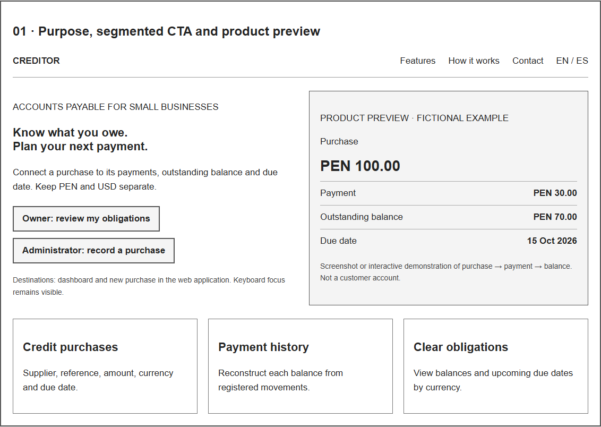

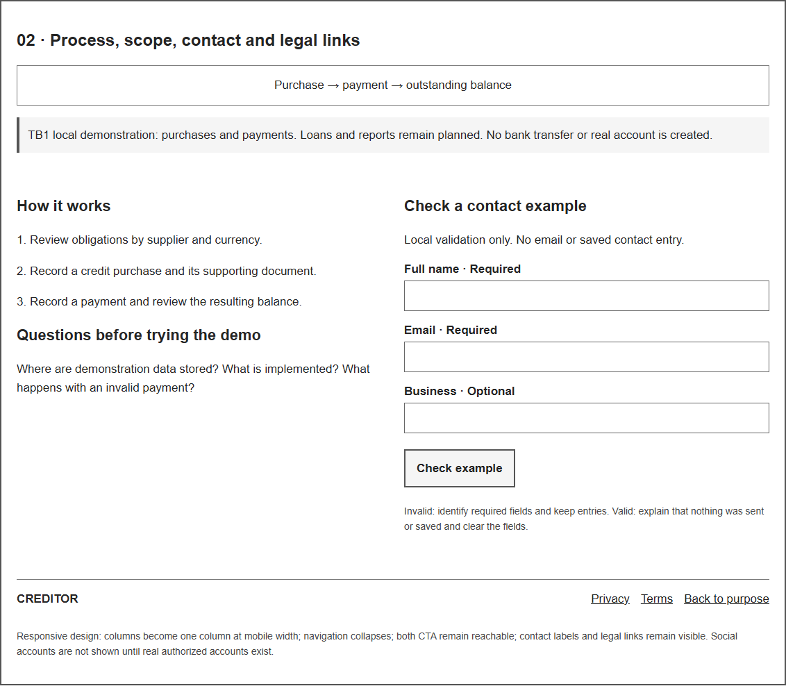

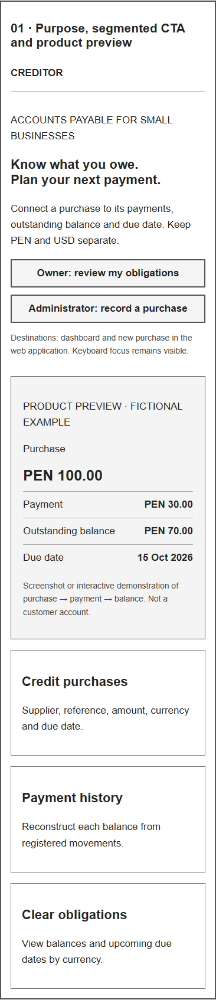

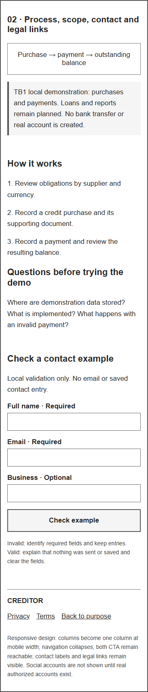

### 4.3.2 Landing Page Mock-ups

Estas capturas son de la nueva landing ejecutada localmente. Sustituyen en la lectura actual los textos históricos sobre cartera de clientes y ofertas sin sustento. Los recursos antiguos se conservan para trazabilidad en `assets/branding/`.

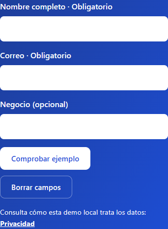

La composición implementada mantiene etiquetas, CTA y enlaces legales en 390 px. La [captura de diseño](../assets/ux/tb1/design-execution.json) registra viewport y fecha: no hubo errores JavaScript ni desbordamiento horizontal en la landing revisada. La publicación HTTPS y su prueba de humo siguen siendo evidencias distintas que deben registrarse después de autorizar deployment.

## 4.4 Web Applications UX/UI Design

### 4.4.1 Web Application Wireframes

[Fuente editable local de cinco pantallas](../assets/ux/tb1/wireframes.html): dashboard, lista, nueva compra, detalle y abono. Cada pantalla identifica actor, historia y alternativas de vacío/error. El diseño puede abrirse en el navegador y adaptarse a móvil. Son wireframes locales; no se presentan como exportación de Figma.

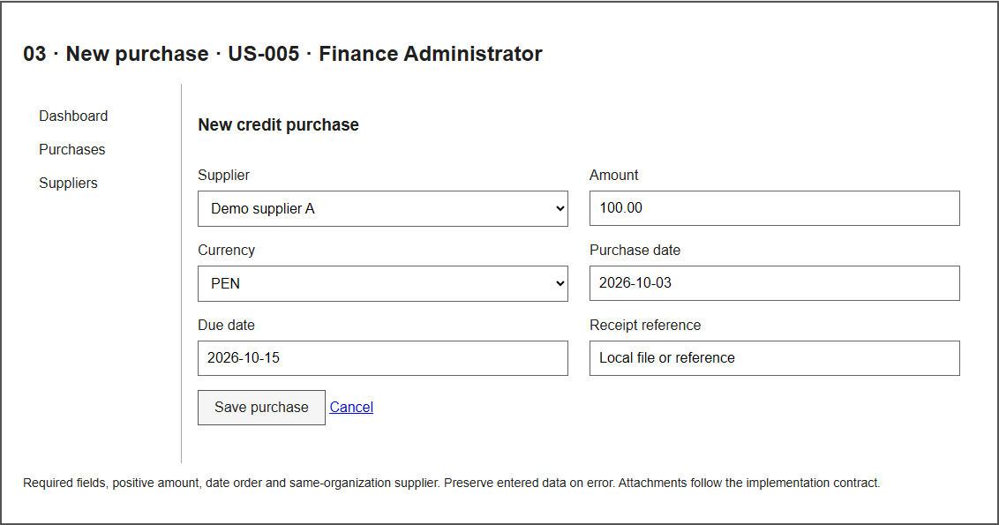

Las siguientes cinco exportaciones muestran explícitamente la composición móvil de los mismos flujos a **390 px**, desde la fuente HTML editable. El menú ocupa una fila compacta, las métricas y campos se apilan y las tablas conservan desplazamiento interno cuando es necesario. Cada imagen identifica historia, datos ilustrativos y estado alternativo; no es una captura de una sesión con participantes.

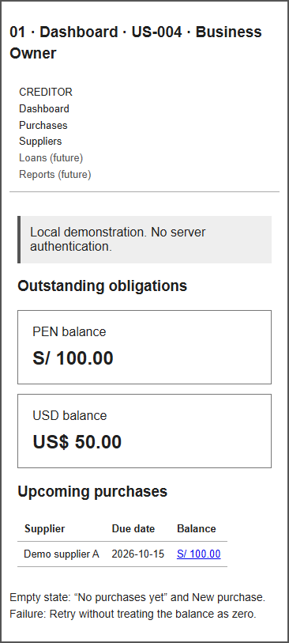

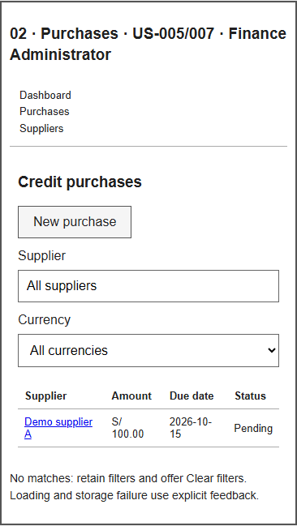

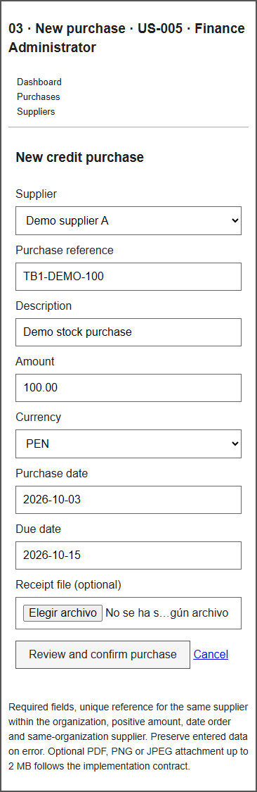

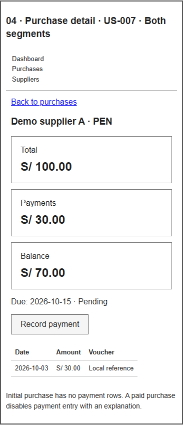

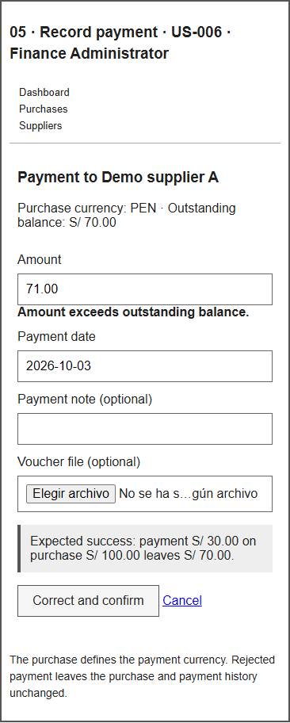

| Pantalla | Historia | Estado alternativo |
|---|---|---|
| Dashboard | US-004 | Sin compras o lectura no disponible. |
| Lista | US-005/007 | Filtros sin coincidencias, limpiar filtros. |
| Nueva compra | US-005 | Importe, proveedor, campos o fechas inválidos; conservar datos. |
| Detalle | US-007 | Sin abonos, compra no encontrada y compra pagada. |
| Registrar abono | US-006 | Importe mayor al saldo, inválido o fallo de persistencia; no alterar movimientos. |

### 4.4.2 Web Application Wireflow Diagrams

[Wireflow local con pantallas y alternativas](../assets/ux/tb1/wireflow.html). El recorrido de compra conecta lista, formulario y detalle; el de abono conecta detalle, formulario y saldo actualizado. Debe importarse/recrearse en FigJam, LucidChart u Overflow para el formato exigido. El Mermaid actualizado resume las rutas TB1 y distingue los accesos futuros:

[Fuente de lógica](../assets/architecture/web-wireflow.mmd).

### 4.4.3 Web Application Mock-ups

Las siguientes capturas muestran las vistas implementadas con datos ficticios y adaptador local. Permiten revisar composición y consistencia del flujo con las historias. No constituyen una validación con usuarios.

**Evidencia posterior de noviembre:** el flujo actual de compra a crédito se recorre mediante **Cobros y pagos → Anotar una deuda**. Sus tres pasos —proveedor/importe, moneda/vencimiento y revisión— se muestran en el [anexo B.3](../README.md#b3-evidencia-posterior-de-us-005-compra-a-crédito). Las imágenes TB1 siguientes se conservan como históricas; las nuevas capturas no son un prototipo final de Figma ni una prueba de usabilidad.

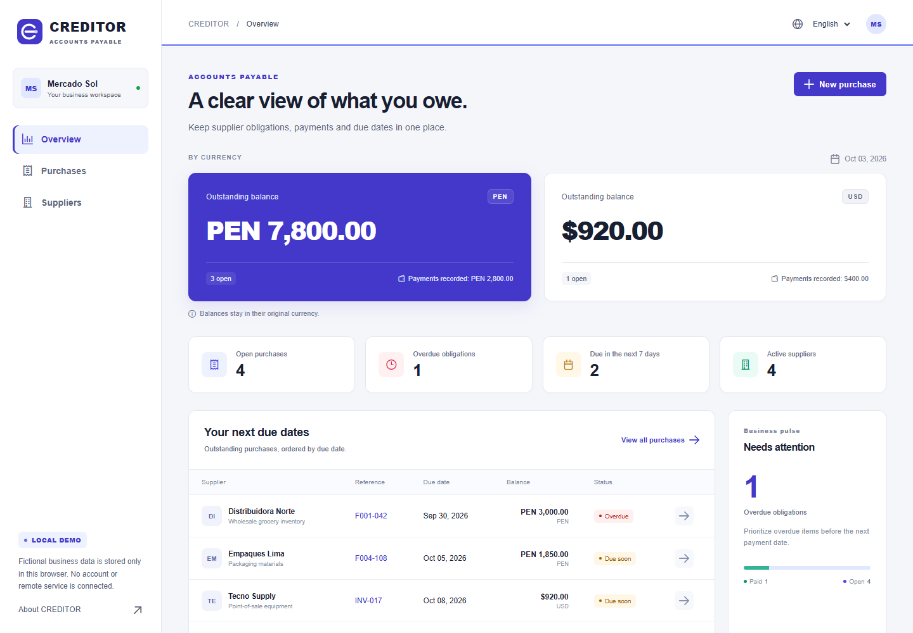

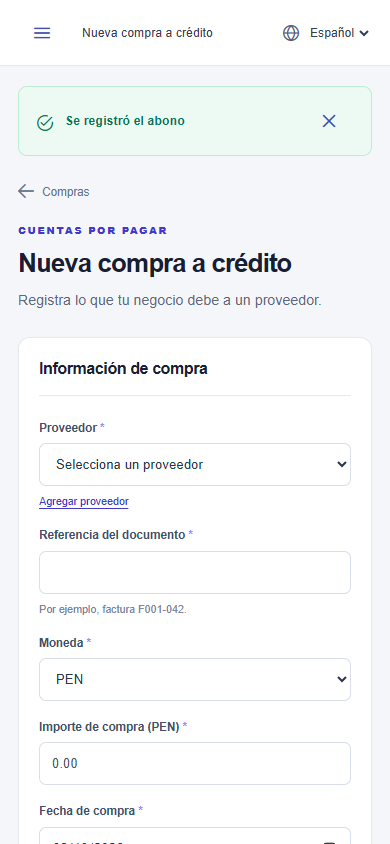

Las cuatro capturas adicionales incorporadas por Sebastián en la referencia local `origin/main` se conservan como evidencia del prototipo TB1, sin presentarlas como pantallas AV2 actuales:

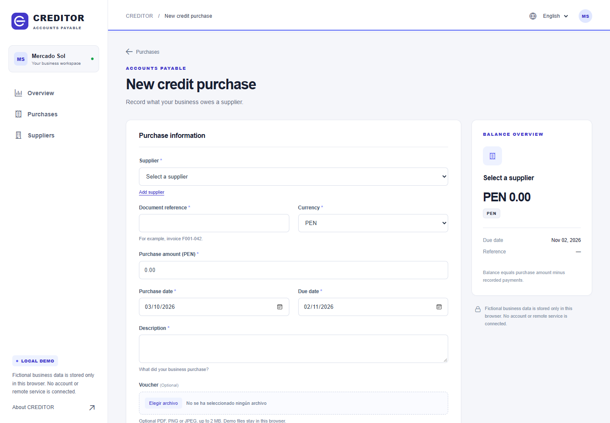

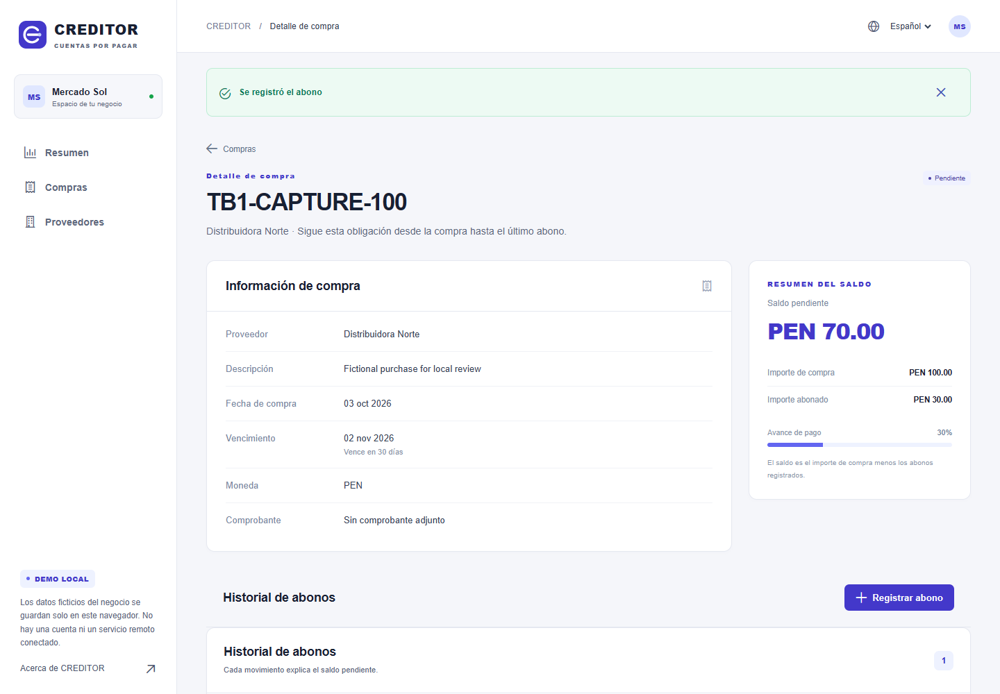

### 4.4.4 Web Application User Flow Diagrams

| Objetivo | Camino esperado | Alternativa |
|---|---|---|
| US-005 registrar compra | Lista, nueva compra, guardar, detalle con saldo inicial. | Datos inválidos: conservar entrada y señalar corrección. |
| US-006 registrar abono | Detalle, importe/fecha/voucher, confirmar, historial y saldo. | Sobreabono o fallo: no guardar y mantener datos. |
| US-004/007 consultar | Dashboard/lista, filtrar, detalle y movimientos. | Sin datos/coincidencias: explicación y nueva compra/limpiar filtros. |
| US-008 reportes | Filtros, consulta y exportación futura. | Roadmap, no operación disponible TB1. |
| US-009 préstamos | Préstamo y cronograma futuro. | Roadmap, no operación disponible TB1. |

Los flujos se presentan en partes conectadas para mantener legibles las decisiones y los retornos en el informe. Cada salida «Continuar en parte» identifica la vista siguiente; los identificadores de escenario coinciden con la matriz de cobertura. El alcance es la organización fija de demostración y su almacenamiento local, sin autenticación ni API desplegada.

**Compra, parte 1: entrada, cancelación del formulario y validación.**

**Compra, parte 2: revisión, confirmación y persistencia.**


**Abono, parte 1: existencia de compra, saldo y formulario.**

**Abono, parte 2: validación y revisión del saldo posterior.**

**Abono, parte 3: confirmación, revalidación y persistencia.**


**Consulta, parte 1: carga y recuperación del almacenamiento.**

**Consulta, parte 2: filtros, estados vacíos y detalle.**

Fuentes completas: [compra](../assets/architecture/user-flow-purchase.mmd), [abono](../assets/architecture/user-flow-payment.mmd), [obligación](../assets/architecture/user-flow-obligation.mmd). Fuentes parciales: compra [1](../assets/architecture/user-flow-purchase-part-1.mmd) y [2](../assets/architecture/user-flow-purchase-part-2.mmd); abono [1](../assets/architecture/user-flow-payment-part-1.mmd), [2](../assets/architecture/user-flow-payment-part-2.mmd) y [3](../assets/architecture/user-flow-payment-part-3.mmd); consulta [1](../assets/architecture/user-flow-obligation-part-1.mmd) y [2](../assets/architecture/user-flow-obligation-part-2.mmd). Los diagramas de [reportes](../assets/architecture/user-flow-report.mmd) y [préstamos](../assets/architecture/user-flow-loan.mmd) conservan el diseño de Sprint 3.

#### Cobertura de caminos alternativos del incremento TB1

Cada identificador aparece en los diagramas y el wireflow. Esta matriz permite revisar el resultado observable y el punto de retorno, incluyendo la diferencia entre cancelar un formulario y cerrar su confirmación. La fuente del comportamiento es el código de `PurchaseFormView`, `PaymentFormView`, `PaymentForm`, `PurchasesView`, `PurchaseDetailView`, `WorkspaceStatus` y el adaptador local del frontend. La cobertura del diseño no implica que todos los escenarios se hayan ejecutado en una prueba de usuario.

| Escenario | Disparador y resultado previsto en el código local | Retorno o continuación |
|---|---|---|
| COMP-01 | Compra válida, revisión y confirmación; guarda una compra y muestra saldo inicial igual al importe. | Detalle de la compra. |
| COMP-02 | Campo obligatorio, importe, moneda, proveedor, fecha, referencia duplicada para el mismo proveedor u archivo inválido; señala error y conserva entrada. | Corregir formulario y volver a revisar. |
| COMP-03 | Cancelar el formulario antes de guardar; no crea una compra. | Lista de compras. |
| COMP-04 | Cerrar/cancelar el diálogo de revisión; no guarda ni borra los campos. | Formulario con la entrada anterior. |
| COMP-05 | Al confirmar falla la escritura o los datos cambiaron en otra pestaña; informa el error y no simula éxito. | Mantener el diálogo; cerrar para corregir o recargar si el mensaje lo requiere. |
| ABO-01 | Abono válido de 30 en compra de 100; agrega movimiento y muestra saldo 70 en la moneda de la compra. | Detalle e historial. |
| ABO-02 | La compra de la ruta no existe; muestra explicación y evita registrar abono. | Volver a la lista. |
| ABO-03 | Saldo cero; informa que la compra está pagada y no ofrece un abono nuevo. | Detalle o lista. |
| ABO-04 | Abono no positivo o mayor al saldo, fecha inválida o voucher inválido/ilegible; explica el error y mantiene los campos. | Corregir y volver a revisar. |
| ABO-05 | Cancelar formulario; no agrega movimiento ni modifica saldo. | Detalle de la compra. |
| ABO-06 | Cancelar el diálogo de revisión; conserva entrada sin registrar abono. | Formulario de abono. |
| ABO-07 | Falla de escritura, cambio de datos o revalidación del saldo al confirmar; muestra el error sin añadir el movimiento. | Diálogo conservado; corregir/recargar según el error. |
| CON-01 | Carga y búsqueda válidas; permite consultar total, abonos, saldo y vencimiento por moneda. | Detalle e historial. |
| CON-02 | Filtros sin coincidencias; conserva filtros y distingue el resultado vacío de un fallo de lectura. | Limpiar o ajustar filtros. |
| CON-03 | No hay compras; muestra estado vacío con acceso al registro. | Nueva compra. |
| CON-04 | Compra inexistente; muestra estado específico, sin inventar saldo cero de una compra válida. | Lista de compras. |
| CON-05 | Datos locales ilegibles o almacenamiento no disponible; informa el fallo en lugar de presentar un dashboard válido. | Reintentar lectura o confirmar restablecimiento de la demo; este último reemplaza los datos ficticios. |

Los casos de importe, fecha, referencia, proveedor, archivo y fallas del adaptador cuentan con pruebas de dominio; la [evidencia de navegador](../docs/tb1/evidencia-local.md) registra el recorrido compra–abono–saldo, sobreabono y ruta inexistente. El resto de la matriz conserva su condición de contrato de diseño revisado contra el código, sin afirmar una ejecución no registrada. Préstamos/reportes y autenticación de servidor permanecen fuera de esta matriz TB1.

## 4.5 Web Applications Prototyping

El prototipo funcional local es la primera frontend CREDITOR. Con el servidor en 5174 permite recorrer dashboard, compra, detalle y abono en escritorio/móvil, cambiar idioma y corregir errores. Una compra PEN 100 y abono 30 debe mostrar saldo PEN 70; un abono posterior 71 debe rechazarse. Las comprobaciones y límites se documentan en [Evidencia local](../docs/tb1/evidencia-local.md).

La conexión del prototipo Figma desktop/mobile, la revisión del equipo y el video de navegación en Stream quedan pendientes. La preparación local no acredita esas evidencias externas.

**Aporte documental posterior conservado:** Sebastián incorporó la siguiente captura al repositorio en `d1e6ddc` y la explicación de rutas en `4e2fa6e` (03/10/2026). Muestra dashboard, nueva compra y detalle. La captura complementa las vistas locales anteriores; no acredita por sí sola un enlace Figma final navegable, pruebas con usuarios ni video de navegación.

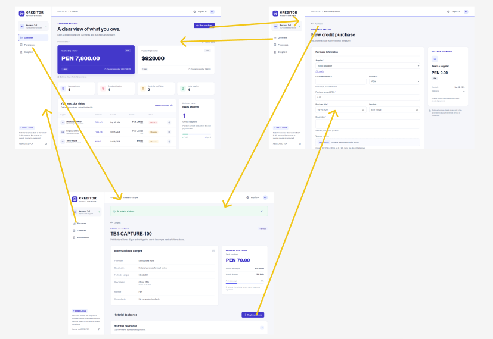

## 4.6 Domain-Driven Software Architecture

La implementación es un monolito modular ASP.NET Core. `Creditor.Domain` no depende de infraestructura; `Creditor.Application` referencia Domain y define puertos; Infrastructure implementa persistencia/integraciones; API compone dependencias y publica contratos. La separación de procesos corresponde a frontend, backend y base de datos, no a un microservicio por contexto.

| Límite | Responsabilidad ejecutable |
|---|---|
| Accounts Payable | Supplier y Purchase; Payment es hijo de Purchase para proteger la invariancia del saldo. |
| Loans | Loan con colección inmutable de LoanInstallment; registro/consulta del acuerdo. |
| Treasury | Party, Project y CashAccount; movimientos, asignaciones y recibos de idempotencia. |
| Identity | Business, usuarios, contraseña hash, roles y JWT. |
| Reporting | Proyecciones de lectura; no mantiene otro saldo ni ejecuta pagos. |
| Attachments | Metadatos privados y acceso al contenido ligado a compras/abonos. |
| Exchange Rates | Adaptador BCRPData con contrato propio y atribución de origen. |

### 4.6.1 Design-Level Event Storming

El EventStorming histórico es una propuesta para discusión. Su correspondencia actual es:

| Intención | Agregado/servicio | Resultado y regla |
|---|---|---|
| Registrar compra | Purchase | Compra persistida; proveedor del mismo negocio y referencia única. |
| Registrar abono | Purchase + Payment | Nueva fila y nueva versión atómicas; saldo no negativo. |
| Adjuntar comprobante | AttachmentService | Metadatos y archivo accesibles solo al negocio autorizado. |
| Registrar préstamo | Loan | Se guarda el cronograma completo con importes pactados. |
| Registrar movimiento | CashAccount | Movimiento manual; referencia única y requestId para reintentos. |
| Asignar fondos | CashAccount | Dueño/responsable/proyecto válidos; no se altera el total de efectivo. |
| Consultar/exportar | Queries | Respuestas por negocio/filtros; sin mutación. |

Los resultados no son eventos publicados en una cola. No hay outbox/event sourcing. El pago de una compra y el movimiento de efectivo son casos separados; la integración automática permanece fuera del incremento. La evidencia de una sesión colaborativa sigue pendiente.

### 4.6.2 Software Architecture Context Diagram


[Fuente editable](../assets/architecture/av2/context-av2.mmd).

El proveedor externo implementado es BCRPData/SBS para cotización referencial, no una pasarela bancaria ni un servicio de envío de contacto. Los visitantes no acceden a datos privados por la landing.

### 4.6.3 Software Architecture Container Diagrams


[Fuente editable](../assets/architecture/av2/containers-av2.mmd).

MySQL es el proveedor elegido para el entorno local vigente. PostgreSQL conserva su cadena de migraciones para regresión y compatibilidad histórica; SQLite se limita a pruebas/desarrollo auxiliar. Los adjuntos no se publican como URL estática: la API verifica el acceso y transmite el contenido. La demostración local usa otro adaptador y otro almacenamiento.

### 4.6.4 Software Architecture Component Diagrams


[Fuente editable](../assets/architecture/av2/components-api-av2.mmd).


[Fuente editable](../assets/architecture/av2/components-web-av2.mmd).

Los contextos conectados del frontend separan presentación, coordinación de casos de uso e infraestructura HTTP. Las reglas de dominio de entrada usan valores compartidos; la autoridad final es el dominio y los servicios del backend. La API recibe moneda/importes en unidades monetarias; la representación interna de centavos no exige que el cliente multiplique el payload. El guard de ruta y los botones por rol son complementarios a `[Authorize]` y al BusinessId del token.

## 4.7 Software Object-Oriented Design

### 4.7.1 Class Diagrams


[Fuente editable](../assets/architecture/av2/classes-av2.mmd).

El diagrama refleja clases reales, mostrando solo sus miembros relevantes. `PaidAmount` y `Balance` de Purchase son valores derivados e ignorados por EF. `RecordPayment` valida saldo/fecha/moneda y cambia Version; el repositorio agrega explícitamente la nueva entidad Payment. `Loan` se crea con 1–60 cuotas; no existe préstamo vacío esperando generación posterior. La tasa puede ser null y no genera intereses. `CashAccount` protege efectivo y asignaciones; no se confunde con la deuda de proveedores. Las asociaciones por negocio y las claves compuestas están detalladas en el modelo EF.

## 4.8 Database Design

El modelo vigente procede de `CreditorDbContext` y sus configuraciones EF, con migraciones específicas por proveedor. **MySQL 8.4** es el motor del entorno actual; conservar las migraciones PostgreSQL permite comprobar el incremento previo sin alterar esa base. Cambiar el proveedor no transporta automáticamente usuarios, operaciones ni archivos existentes entre motores.

La definición reproducible se explica en [database/README.md](../database/README.md). El SQL del diseño inicial se conserva separado como antecedente; no se usa para inicializar el backend actual. El esquema ejecutable debe generarse desde las migraciones del backend, que incluyen Identity, cuentas por pagar, adjuntos, tesorería y préstamos.

### 4.8.1 Database Diagrams


[Fuente editable](../assets/architecture/av2/database-core-av2.mmd).


[Fuente editable](../assets/architecture/av2/database-treasury-av2.mmd).

Los tipos del ERD representan el modelo CLR y las relaciones principales; el DDL generado precisa tipos físicos, nulabilidad, claves compuestas, tablas auxiliares Identity e índices. `NormalizedReference` es único junto con SupplierId, no globalmente. El modelo no contiene `receipt_url`, `voucher_url`, ni columnas de estado o saldo en Purchase: el estado se deriva de saldo y fecha. Una cuota no contiene estado de pago. `PaymentId`, ProjectId y tasa anual pueden ser nulos según el caso.

| Invariante | Mecanismo actual |
|---|---|
| Negocio aislado | BusinessId desde JWT, consultas acotadas y FK compuestas por negocio. |
| Importe exacto | decimal(14,2) en compras/abonos; enteros de centavos en tesorería/préstamos, más validación de dominio. |
| Abonos concurrentes | Version de Purchase como token de concurrencia y commit transaccional con la fila nueva. |
| Cuotas | PK LoanId + Number; FK con BusinessId; entre 1 y 60 cuotas mensuales completas al registrar. |
| Archivos | Metadata de Attachment separada del contenido privado; vínculo de voucher a compra/abono del mismo negocio. |
| Tesorería | Version de CashAccount y requestId/huella del payload evitan repetir comandos reconocidos. |
| Estado y saldo | Proyecciones calculadas; no se almacena un saldo mutable paralelo. |

Las restricciones de esquema y los casos de migración se contrastan contra MySQL real. La evidencia distingue crear un esquema, reaplicar migraciones, preservar datos ficticios y reiniciar la API. No se afirma que una batería de pruebas garantice todas las migraciones futuras ni que se haya migrado información productiva.
