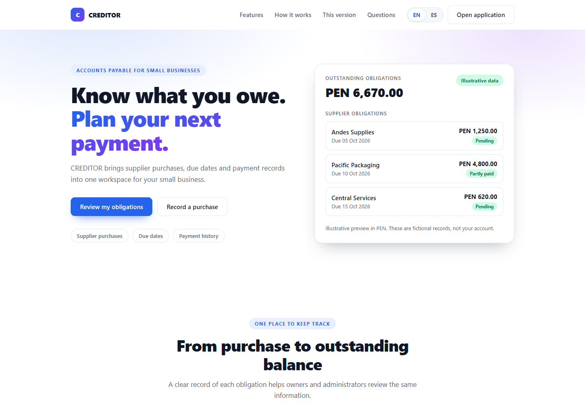
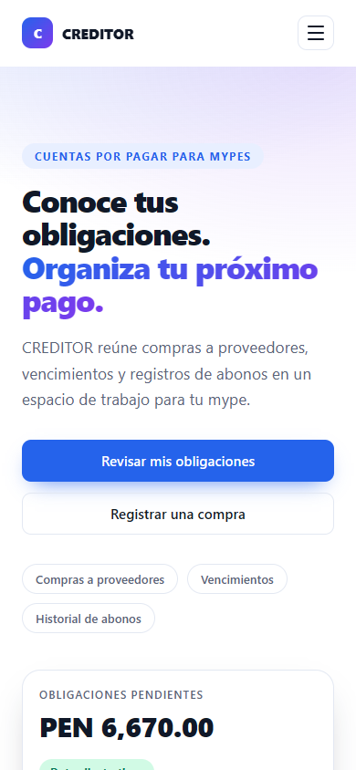

# Capítulo IV: Product Design

El diseño TB1 conecta las historias US-004–007 con la frontend local. Los wireframes son fuentes editables y las capturas muestran la implementación de demostración. La arquitectura de API y base de datos continúa como diseño de AV2. Los artefactos locales no acreditan una sesión de investigación ni una entrega creada en Figma, UXPressia o FigJam.

## 4.1 Style Guidelines

### 4.1.1 General Style Guidelines

CREDITOR comunica claridad sobre obligaciones de la mype con sus proveedores. No ofrece rentabilidad, crédito al público ni un servicio financiero de producción.

| Elemento | Dirección visual y aplicación |
|---|---|
| Marca | Azul como acción principal, fondos claros, jerarquía centrada en saldo y vencimiento. |
| Tipografía de referencia | Montserrat para títulos e Inter para texto en el diseño histórico. La implementación usa la pila de fuentes declarada en cada CSS, con alternativa de sistema. |
| Acción principal | `#2563EB`; hover `#1D4ED8`; fondo suave `#E8EFFF`. |
| Texto y superficies | Texto `#111827`, superficies blancas y bordes legibles. |
| Estados | Éxito, advertencia y error acompañados de texto. El color no sustituye su significado. |
| Iconografía | Proveedor, documento, fecha y pago con nombre accesible cuando el icono ejecuta una acción. |
| Tono | Acciones concretas, datos de demostración identificados, mensajes sin promesas comerciales. |

### 4.1.2 Web Style Guidelines

La frontend usa Vue y componentes PrimeVue con tema Material. Landing y aplicación ofrecen inglés por defecto (`en-US`) y español latinoamericano (`es-419`). El idioma controla el texto y formato; cada compra conserva su moneda PEN o USD. Se mantienen foco visible, etiquetas persistentes, errores asociados y navegación por teclado.

Los layouts locales permiten revisar escritorio y móvil. Los formularios preservan sus campos ante un error. Una ausencia de datos se distingue de un fallo al leer o guardar, sin presentar un saldo desconocido como cero.

## 4.2 Information Architecture

[Fuente editable](../assets/architecture/information-architecture.mmd). El mapa expresa el producto completo; no implica que Loans, Reports o Identity estén implementados en TB1.

### 4.2.1 Organization Systems

| Área | Información | Estado local TB1 |
|---|---|---|
| Landing | Propuesta, recorrido, alcance de demostración, contacto y legales. | Nueva versión local. |
| Dashboard | Saldo por moneda, vencimientos y enlace al detalle. | US-004, demostración. |
| Purchases | Lista, filtros, registro y detalle de compra a crédito. | US-005/007, demostración. |
| Suppliers | Catálogo de la organización usado por las compras. | Soporte del flujo local. |
| Payments | Abonos en detalle, historial y saldo derivado. | US-006, demostración. |
| Loans y Reports | Préstamos, cuotas y exportaciones. | Roadmap Sprint 3, US-008/009. |
| Identity y API | Autorización y persistencia centralizada. | Diseño AV2. |

### 4.2.2 Labeling Systems

Se conserva la equivalencia estable con el Ubiquitous Language: Purchases/Compras, Suppliers/Proveedores, Payments/Abonos, Outstanding Balance/Saldo pendiente y Due Date/Fecha de vencimiento. La mype paga sus obligaciones. Los textos no describen cobrar a una cartera de clientes.

### 4.2.3 SEO Tags and Meta Tags

Landing y frontend incluyen título, descripción, viewport e idioma. La landing se identifica como CREDITOR y cuentas por pagar; los metadatos no publican métricas comerciales sin fuente. El `index.html` y la actualización de idioma en ejecución son la fuente de los valores efectivos. Los enlaces de producción y canonical se revisarán cuando se autorice la publicación.

### 4.2.4 Searching Systems

La lista permite localizar obligaciones por proveedor, moneda, vencimiento y estado dentro del contexto de demostración. La búsqueda conserva filtros ante ausencia de coincidencias y permite limpiarlos. Un saldo agrupado siempre indica su moneda.

### 4.2.5 Navigation Systems

| Actor/origen | Acción | Destino local |
|---|---|---|
| Propietario en landing | Review my obligations | `http://localhost:5174/#/dashboard` |
| Administrador en landing | Record a purchase | `http://localhost:5174/#/purchases/new` |
| Dashboard/lista | Seleccionar compra | `#/purchases/{id}` |
| Detalle | Registrar abono | Formulario de abono y retorno al historial. |
| Landing/aplicación | Privacidad y términos | Vistas legales de demostración. |

Los CTA son configurables mediante `VITE_APP_URL`; requieren el servidor local del frontend. Hash routing permite refrescar las rutas de la aplicación. El contexto de demostración no equivale a iniciar sesión.

## 4.3 Landing Page UI Design

### 4.3.1 Landing Page Wireframes

El recorrido actual comprende propuesta, obligaciones ilustrativas, funcionalidades, proceso compra/abono, alcance TB1, preguntas, contacto de demostración y legales. Los [bocetos de AV1](../assets/branding/wiref1.png) y el [archivo Figma histórico](https://www.figma.com/design/OQWWAsxRTtOPJcWfFUtCq3/Sin-t%C3%ADtulo?node-id=12-2) se conservan como referencia. La revisión TB1 debe trasladarse a Figma para cumplir el formato del curso.

### 4.3.2 Landing Page Mock-ups

Estas capturas son de la nueva landing ejecutada localmente. Sustituyen en la lectura actual los textos históricos sobre cartera de clientes y ofertas sin sustento. Los recursos antiguos se conservan para trazabilidad en `assets/branding/`.

## 4.4 Web Applications UX/UI Design

### 4.4.1 Web Application Wireframes

[Fuente editable local de cinco pantallas](../assets/ux/tb1/wireframes.html): dashboard, lista, nueva compra, detalle y abono. Cada pantalla identifica actor, historia y alternativas de vacío/error. El diseño puede abrirse en el navegador y adaptarse a móvil. Son wireframes locales; no se presentan como exportación de Figma.

| Pantalla | Historia | Estado alternativo |
|---|---|---|
| Dashboard | US-004 | Sin compras o lectura no disponible. |
| Lista | US-005/007 | Filtros sin coincidencias, limpiar filtros. |
| Nueva compra | US-005 | Importe, proveedor, campos o fechas inválidos; conservar datos. |
| Detalle | US-007 | Sin abonos, compra no encontrada y compra pagada. |
| Registrar abono | US-006 | Importe mayor al saldo, inválido o fallo de persistencia; no alterar movimientos. |

### 4.4.2 Web Application Wireflow Diagrams

[Wireflow local con pantallas y alternativas](../assets/ux/tb1/wireflow.html). El recorrido de compra conecta lista, formulario y detalle; el de abono conecta detalle, formulario y saldo actualizado. Debe importarse/recrearse en FigJam, LucidChart u Overflow para el formato exigido. El Mermaid anterior se mantiene como lógica complementaria:

[Fuente de lógica](../assets/architecture/web-wireflow.mmd).

### 4.4.3 Web Application Mock-ups

Las siguientes capturas muestran las vistas implementadas con datos ficticios y adaptador local. Permiten revisar composición y consistencia del flujo con las historias. No constituyen una validación con usuarios.

### 4.4.4 Web Application User Flow Diagrams

| Objetivo | Camino esperado | Alternativa |
|---|---|---|
| US-005 registrar compra | Lista, nueva compra, guardar, detalle con saldo inicial. | Datos inválidos: conservar entrada y señalar corrección. |
| US-006 registrar abono | Detalle, importe/fecha/voucher, confirmar, historial y saldo. | Sobreabono o fallo: no guardar y mantener datos. |
| US-004/007 consultar | Dashboard/lista, filtrar, detalle y movimientos. | Sin datos/coincidencias: explicación y nueva compra/limpiar filtros. |
| US-008 reportes | Filtros, consulta y exportación futura. | Roadmap, no operación disponible TB1. |
| US-009 préstamos | Préstamo y cronograma futuro. | Roadmap, no operación disponible TB1. |

Fuentes: [compra](../assets/architecture/user-flow-purchase.mmd), [abono](../assets/architecture/user-flow-payment.mmd), [obligación](../assets/architecture/user-flow-obligation.mmd). Los diagramas de [reportes](../assets/architecture/user-flow-report.mmd) y [préstamos](../assets/architecture/user-flow-loan.mmd) conservan el diseño de Sprint 3.

## 4.5 Web Applications Prototyping

A continuación se presenta el prototyping de algunas de las vistas principales de la aplicación web mostradas anteriormente en la sección web mock-ups, las cuales son detalle de compra, purchase new y dashboard. Desde la pantalla de dashboard se puede acceder a cualquier vista y particularmente se puede navegar de la vista purchase new a detalle de compra. Como puede observar en la imagen, se han modelado las rutas.

## 4.6 Domain-Driven Software Architecture

Se propone un monolito modular con una API REST propia y una base relacional. Los límites de dominio separan **Accounts Payable** (proveedores y compras), **Payments** (abonos), **Loans** (préstamos y cuotas), **Reporting** (consultas) e **Identity** (acceso a la organización). La separación es lógica; no se presentan microservicios implementados. El diseño se basa en US-004 a US-009 y deberá revisarse con el EventStorming del equipo.

### 4.6.1 Design-Level Event Storming

El siguiente recorrido es una **propuesta de modelado**, no el acta de una sesión colaborativa. Cada evento está escrito en pasado y cada comando expresa una intención del usuario o una política del sistema.

| Contexto / agregado | Comando | Evento | Regla que debe comprobarse |
|---|---|---|---|
| Accounts Payable / Supplier | Registrar proveedor | Proveedor registrado | El proveedor pertenece a una organización. |
| Accounts Payable / Purchase | Registrar compra a crédito | Compra a crédito registrada | Importe positivo, moneda admitida, proveedor de la misma organización y vencimiento informado. |
| Payments / Purchase | Registrar abono | Abono registrado; saldo actualizado | Importe positivo y no mayor que el saldo pendiente; la moneda se hereda de la compra. |
| Payments / Payment | Asociar voucher | Voucher asociado al abono | Tipo, tamaño y acceso del archivo deben validarse. |
| Loans / Loan | Registrar préstamo | Préstamo registrado; cuotas programadas | Principal, tasa, número de cuotas y fecha inicial válidos. |
| Reporting / proyección de lectura | Consultar obligaciones | Reporte consultado | Filtrar solo datos de la organización y conservar moneda de cada obligación. |

[Fuente Mermaid editable](../assets/architecture/design-event-storming.mmd).

La consulta de deuda toma el saldo como `total de compra - suma de abonos válidos`. El vencimiento se clasifica con la fecha y el saldo restante; no se genera una deuda nueva por el simple paso del tiempo. La evidencia de la sesión de EventStorming (participantes, fecha, decisiones y captura) sigue pendiente en `assets/architecture/eventstorming/`.

### 4.6.2 Software Architecture Context Diagram

[Fuente Mermaid editable](../assets/architecture/c4-context.mmd).

En el nivel de contexto, CREDITOR es un solo sistema. El propietario consulta obligaciones y préstamos; el administrador registra compras, abonos y reportes; el visitante conoce la propuesta y solicita contacto. El servicio externo es una dependencia **prevista** para cumplir el requisito de integración con terceros, sin proveedor ni contrato confirmados. No se atribuye envío real al formulario de AV1.

### 4.6.3 Software Architecture Container Diagrams

[Fuente Mermaid editable](../assets/architecture/c4-containers.mmd).

| Contenedor | Tecnología objetivo | Responsabilidad |
|---|---|---|
| Landing | HTML5, CSS3, JavaScript | Comunicar la propuesta, dirigir al frontend local y ofrecer contacto de demostración. |
| Web Application | Vue, HTML, CSS, JavaScript, PrimeVue | Presentar flujos de cuentas por pagar en escritorio/móvil. TB1 usa contexto fijo de demostración; autenticación prevista AV2. |
| REST API | ASP.NET Core, C#, Entity Framework Core, OpenAPI | Validar reglas de dominio, aislamiento por organización y contratos HTTP. |
| Database | PostgreSQL como objetivo de diseño | Persistir organizaciones, proveedores, compras, abonos, préstamos y cuotas. |
| Servicio externo | Proveedor aún no elegido | Procesar solicitudes de contacto cuando exista integración y consentimiento. |

Las flechas discontinuas son dependencias pendientes. El adaptador local TB1 persiste en navegador; no se comunica con la API prevista. Los comprobantes se representan en el esquema como referencias URL; antes de implementarlos se definirá un almacenamiento privado, política de acceso y retención. La landing inspeccionada utiliza Vue/Vite según el capítulo V; la fila HTML/CSS/JavaScript expresa las tecnologías requeridas, no un cambio de implementación ya efectuado.

### 4.6.4 Software Architecture Component Diagrams

La frontend implementada se descompone en vistas, componentes de formulario/historial, store, validadores de dominio y adaptador local. No simula permisos de Owner/Administrator.

[Fuente editable de componentes web](../assets/architecture/c4-web-components.mmd).

El diagrama siguiente descompone la **API propuesta**, no un repositorio de backend ya existente. Los controladores llaman a servicios de aplicación; estos aplican reglas de dominio y acceden a repositorios. Reporting consulta datos del mismo tenant y no altera saldos.

[Fuente Mermaid editable](../assets/architecture/c4-components.mmd).

| Componente | Responsabilidad | Contrato inicial relacionado |
|---|---|---|
| Accounts Payable | Registrar y consultar proveedores y compras; calcular saldos a partir de abonos. | `GET/POST /api/v1/purchases` (TS-001). |
| Payments | Validar y registrar abonos, asociar vouchers, devolver saldo resultante. | `POST /api/v1/purchases/{purchaseId}/payments` (TS-002). |
| Loans | Gestionar préstamos y cronogramas de cuotas. | US-009; ruta por definir. |
| Reporting | Filtrar obligaciones por proveedor, fecha, moneda y estado. | US-008; formato de exportación por definir. |
| Identity | Identificar al usuario y restringir los datos a su organización. | Contrato y proveedor de identidad por definir. |

La actualización del saldo y el registro del abono deben ocurrir en una misma transacción. El diseño exige autorización en la API, aun cuando la interfaz oculte una acción. Los endpoints pendientes no se anuncian como implementados.

## 4.7 Software Object-Oriented Design

### 4.7.1 Class Diagrams

[Fuente Mermaid editable](../assets/architecture/class-diagram.mmd).

`Purchase` es el agregado que protege la regla de abono máximo y calcula el saldo; `Payment` conserva cada movimiento. `Loan` controla la secuencia de cuotas, inicialmente de frecuencia `MONTHLY`. La multiplicidad `0..*` permite un préstamo antes de generar cronograma; publicar el cronograma exige cuotas válidas. Los métodos del diagrama describen responsabilidades de dominio previstas, no clases C# existentes. El catálogo `Supplier` está acotado a `Business`, y una compra solo puede referenciar un proveedor de la misma organización. El modelo de usuarios/roles se detallará cuando exista un contrato de Identity; no se inventa una implementación de autenticación.

## 4.8 Database Design

Se adopta **PostgreSQL como objetivo de diseño** para concretar el modelo inicial. La definición editable está en [`database/schema.sql`](../database/schema.sql). El saldo de una compra no se almacena como columna independiente: se obtiene de `purchases.total_amount - SUM(payments.amount)`. Así se evita que un abono y el saldo queden desincronizados. Las tablas de Identity y los archivos físicos requieren decisiones posteriores de implementación.

### 4.8.1 Database Diagrams

[Fuente Mermaid editable](../assets/architecture/database-er-diagram.mmd).

[Versión PNG para la exposición](../assets/architecture/database-er-diagram.png).

Para revisar cada límite de persistencia sin perder legibilidad, el modelo se presenta también por contexto. **Accounts Payable y Payments** comparten la compra como referencia del abono; **Loans** conserva un cronograma separado. `BUSINESSES` aparece en ambos dibujos porque delimita los datos de una misma organización, no porque se duplique la tabla.

[Fuente Mermaid editable de compras y abonos](../assets/architecture/database-accounts-payable.mmd).

[Fuente Mermaid editable de préstamos y cuotas](../assets/architecture/database-loans.mmd).

**Lectura del diagrama.** Una organización puede tener proveedores, compras y préstamos. Cada compra pertenece a un proveedor y admite cero o más abonos. Un préstamo puede existir antes de que se configure su cronograma; el flujo publicado deberá exigir al menos una cuota. `receipt_url` y `voucher_url` son referencias a comprobantes, no el contenido binario ni prueba de que exista almacenamiento de archivos. La relación `purchases(business_id, supplier_id)` debe impedir que una compra de una organización use un proveedor de otra; el esquema SQL incluye una clave externa compuesta para ello.

| Regla de integridad | Implementación en el diseño |
|---|---|
| Identidad de fila | Clave primaria UUID en cada tabla. |
| Pertenencia y relaciones | Claves externas hacia organización, proveedor, compra o préstamo; proveedor y compra comparten organización. |
| Valores financieros | `CHECK` para importes positivos y tasa no negativa; monedas iniciales `PEN` y `USD`. |
| Cronograma | `UNIQUE(loan_id, installment_number)` impide repetir un número de cuota en un préstamo. |
| Consulta operativa | Índices por organización, vencimiento y estado; por compra/fecha de abono; por préstamo/vencimiento. |
| Regla transaccional | La API debe impedir abonos superiores al saldo y registrar el abono de manera atómica. Un `CHECK` aislado no puede sumar otras filas. |

`status` de compras y cuotas requiere una política de actualización o cálculo al consultar, porque el paso de la fecha puede cambiar «pendiente» a «vencido». Antes de implementar, se definirán migraciones, autorización por organización, almacenamiento privado de comprobantes y tratamiento de pagos de cuotas. El esquema incorpora referencia, descripción y fecha de compra, referencia única por proveedor sin distinguir mayúsculas y frecuencia de préstamo `MONTHLY`. La fecha del abono respecto a compra y la validación de archivos requieren la capa de aplicación. El diagrama es un **diseño inicial trazable al SQL**, no evidencia de una base desplegada.
