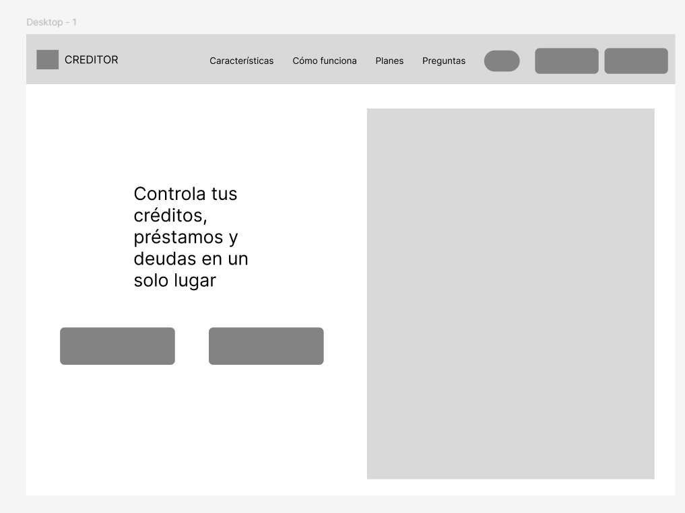
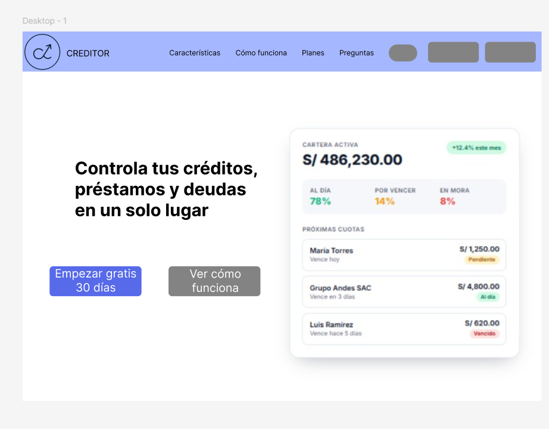

# Capítulo IV: Product Design

## 4.1 Style Guidelines

Esta sección establece los lineamientos visuales y comunicacionales que guiarán el diseño de CREDITOR en todos sus entornos.

### 4.1.1 General Style Guidelines

#### a. Branding

El logotipo de Creditor representa la perpetuidad de los flujos de dinero con el símbolo de infinito, además una flecha hacia arriba que da a entender que el dinero del usuario aumentará porque este sacará mejor provecho de sus finanzas, al no olvidar pagar sus deudas a tiempo gracias a nuestra aplicación web.

  

#### b. Tipografía

Primaria: Montserrat - para títulos y subtítulos

Secundaria: Inter - por su legilibilidad para textos explicativos

#### c. Colores

* Azul: Primario marca #2563eb, hover #1d4ed8, fondo suave de marca #e8efff.
* Verde #10b981: Éxito, pagos al día, pagos completados.
* Amarillo #f59e0b: Alerta, cuota por vencer. 
* Rojo #ef4444: Peligro, mora, vencido.

El azul elegido como primario está reservado solo para acciones y marca. El semáforo verde/ámbar/rojo será usado exclusivamente para estados de deuda, no de forma decorativa.

#### d. Iconografía

* Estilo actual: pictogramas planos monocromos dentro de un contenedor redondeado con fondo --brand-soft.
* Criterio: línea uniforme (~1.5–2px), esquinas redondeadas, metáfora literal y financiera (documento, tarjeta, reloj, campana, recibo, gráfico).
* Tamaño 24px en tarjetas, 20px inline; siempre acompañados de texto.

#### e. Tono de comunicación

El tono elegido para la página es un punto medio entre cercano y profesional; por ejemplo "tutea" al usuario, en frases tales como "controla tus préstamos". 
Así también el lenguaje será claro, al consistir de frases cortas comprensibles para el usuario, y concreto, al estar orientadas a la acción con sus respectivas cifras verificables.
Por último será bilingüe consistente, ya que se implementó el boton de i18n inglés/español, trtando de mantener mismas longitudes de frases para no romper el layout.

### 4.1.2 Web Style Guidelines

Esta sección explica los principios de diseño de CREDITOR en su experiencia web, asegurando que todos los elementos de la interfaz sean consistentes y funcionales. El objetivo es crear un sistema de diseño que facilite el trabajo de los desarrolladores y mantenga una identidad visual coherente.

#### **Diseño Responsive**

Para asegurar que la página se ajuste correctamente a distintos tamaños de pantalla y que el contenido siga siendo comprensible y visualmente atractivo, se empleará CSS junto con media queries. Estas herramientas permitirán definir estilos específicos según la resolución del dispositivo. Elementos fundamentales, como la barra de navegación y el pie de página, se adaptarán automáticamente para garantizar una experiencia óptima en diversos dispositivos. Siguiendo los siguientes breakpoints:

| Dispositivo | Ancho mínimo | Ejemplo de uso           |
| ----------- | ------------ | ------------------------ |
| Mobile      | ≥ 320px      | Teléfonos                |
| Tablet      | ≥ 768px      | iPad / tablets genéricas |
| Laptop      | ≥ 1024px     | Monitores y laptops      |
| Wide Screen | ≥ 1440px     | Pantallas grandes o TV   |

#### Patrón de Diseño para la Landing Page (Patrón Z)
Para el diseño de nuestra página de inicio, se utilizará el Patrón Z. Este es un patrón visual que guía la mirada del usuario de manera intencionada, similar al recorrido de la letra "Z". A continuación, te explico los elementos clave de este patrón que se aplican en tu diseño:

- Punto de partida (Superior Izquierda): La mirada del usuario se posa primero en el logotipo de WARISMART, que está estratégicamente colocado en la esquina superior izquierda. Esto establece inmediatamente la identidad de la marca.

- Movimiento horizontal (Superior Derecha): Desde el logo, el ojo se mueve de forma natural hacia la derecha, donde se encuentran los elementos del menú de navegación (Inicio, Nosotros, Servicios, Contacto). Esta línea horizontal permite que el usuario escanee rápidamente las opciones disponibles.

- Diagonal descendente: La vista desciende en diagonal hacia la sección principal del contenido. En tu landing page, esto se evidencia en el bloque hero-blue y el texto "Impulsa tu negocio con tecnología que entiende el retail", que capta la atención con su mensaje principal y una llamada a la acción.

- Movimiento horizontal final (Inferior): Finalmente, la mirada se mueve a través de la sección inferior, donde se encuentran elementos de prueba social como los testimonios de clientes y los logotipos de los socios. Este punto final refuerza la credibilidad y anima al usuario a tomar una decisión, como el registro o el inicio de sesión.
Este patrón Z es muy efectivo porque respeta el proceso de escaneo natural del ojo y asegura que la información más importante—la marca, la navegación, la propuesta de valor y la prueba social—sea vista en un orden lógico, guiando al usuario de forma clara a través de la página.

## 4.2 Information Architecture

### 4.2.1 Organization Systems

### 4.2.2 Labeling Systems

### 4.2.3 SEO Tags and Meta Tags

### 4.2.4 Searching Systems

### 4.2.5 Navigation Systems

## 4.3 Landing Page UI Design

A continuación presentamos los diseños de wireframes y mock ups de la landing page hechos en Figma, puede visualizarlo mediante este link: https://www.figma.com/design/OQWWAsxRTtOPJcWfFUtCq3/Sin-t%C3%ADtulo?node-id=12-2&t=mUB6VBiUbwbcGxJq-1

### 4.3.1 Landing Page Wireframes

### 4.3.2 Landing Page Mock-ups

## 4.4 Web Applications UX/UI Design

### 4.4.1 Web Application Wireframes

### 4.4.2 Web Application Wireflow Diagrams

### 4.4.3 Web Application Mock-ups

### 4.4.4 Web Application User Flow Diagrams

## 4.5 Web Applications Prototyping

## 4.6 Domain-Driven Software Architecture

### 4.6.1 Design-Level Event Storming

### 4.6.2 Software Architecture Context Diagram

### 4.6.3 Software Architecture Container Diagram

### 4.6.4 Software Architecture Component Diagrams

## 4.7 Software Object-Oriented Design

### 4.7.1 Class Diagrams

## 4.8 Database Design

### 4.8.1 Database Diagrams

El esquema ejecutable se mantiene en [`database/schema.sql`](../database/schema.sql).

