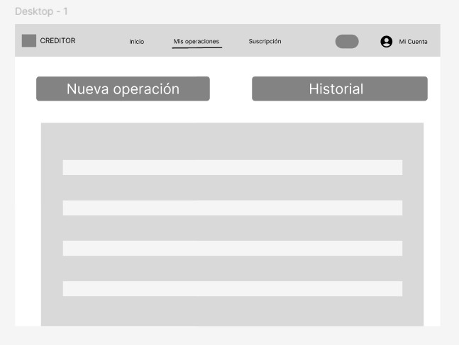

# Capítulo IV: Product Design

Este capítulo especifica el diseño **propuesto** para CREDITOR. Los diagramas expresan decisiones de diseño y no prueban que la aplicación, la API o la base de datos estén implementadas. Los artefactos visuales que requieren sesiones con usuarios o enlaces de Figma se identifican como pendientes de validación.

## 4.1 Style Guidelines

### 4.1.1 General Style Guidelines

#### Branding

CREDITOR comunica control de obligaciones y claridad operativa. El símbolo de infinito y la flecha ascendente del logotipo representan continuidad de la información financiera y mejora en la toma de decisiones; no representan una promesa de rentabilidad.

  

#### Tipografía

| Uso | Familia | Regla |
|---|---|---|
| Títulos | Montserrat | Usar pesos semibold o bold y una jerarquía semántica de encabezados. |
| Texto y controles | Inter | Mantener tamaño legible, alto contraste y oraciones breves. |

#### Colores

| Token | Valor | Uso |
|---|---|---|
| `brand-primary` | `#2563EB` | Marca, acciones principales y enlaces activos. |
| `brand-primary-hover` | `#1D4ED8` | Estado hover o activo de acción primaria. |
| `brand-soft` | `#E8EFFF` | Fondo de marca de baja intensidad. |
| `success` | `#10B981` | Pago al día o operación completada. |
| `warning` | `#F59E0B` | Vencimiento cercano o acción que requiere revisión. |
| `danger` | `#EF4444` | Obligación vencida o error que requiere corrección. |
| `text-primary` | `#111827` | Texto principal. |
| `surface` | `#FFFFFF` | Fondo de tarjetas y formularios. |

Los estados no dependen únicamente del color: se acompañan de etiqueta, icono o texto equivalente.

#### Iconografía y tono

Los iconos usan metáforas claras —documento, proveedor, calendario, recibo y reporte— y siempre incluyen una etiqueta accesible cuando no son decorativos. El tono es profesional, directo y comprensible: explica acciones y estados sin usar promesas financieras sin sustento.

### 4.1.2 Web Style Guidelines

- Usar una cuadrícula responsive, espaciado basado en múltiplos de 4 px y objetivos táctiles adecuados.
- Asociar cada campo de formulario con una etiqueta visible; los placeholders no reemplazan labels.
- Mantener contraste suficiente, foco visible, navegación por teclado y atributos ARIA cuando el control lo requiera.
- La interfaz y mensajes de API usarán inglés como idioma base (`en_US`) y español latinoamericano como alternativa (`es_419`).
- Las cifras comerciales o métricas de beneficio deberán indicar su fuente; de lo contrario se eliminan del contenido público.
- La landing aplica un patrón Z para ordenar marca, navegación, propuesta de valor y llamada a la acción.

## 4.2 Information Architecture

El mapa separa el contenido público de la aplicación. El enlace de acceso se muestra como destino **futuro** porque la aplicación todavía no está publicada.

[Fuente Mermaid editable del mapa](../assets/architecture/information-architecture.mmd).

### 4.2.1 Organization Systems

| Área | Contenido | Usuarios |
|---|---|---|
| Landing | Propuesta, beneficios, contacto y contenido legal. | Visitor |
| Dashboard | Resumen de saldos, vencimientos y estados. | Business Owner, Finance Administrator |
| Purchases | Compras a crédito, proveedor, vencimiento y comprobantes. | Finance Administrator |
| Payments | Abonos, vouchers e historial de movimientos. | Finance Administrator, Business Owner |
| Loans | Préstamos y cuotas. | Business Owner |
| Reports | Filtros y exportaciones de obligaciones. | Finance Administrator |

### 4.2.2 Labeling Systems

Los rótulos privilegian términos de negocio consistentes: **Purchases**, **Suppliers**, **Payments**, **Outstanding Balance**, **Due Date**, **Loans** y **Reports**. La interfaz en español debe mantener equivalencias estables con el Ubiquitous Language del capítulo II.

### 4.2.3 SEO Tags and Meta Tags

| Etiqueta | Valor inicial propuesto |
|---|---|
| `title` | CREDITOR \| Control de cuentas por pagar para mypes |
| `description` | Centraliza compras a crédito, abonos y obligaciones de tu mype. |
| `keywords` | cuentas por pagar, compras a crédito, proveedores, mypes, CREDITOR |
| `author` | Equipo CREDITOR |
| `lang` | `en-US` o `es-419` según la versión renderizada |

### 4.2.4 Searching Systems

La primera versión prioriza filtros por proveedor, rango de fechas, moneda y estado antes que una búsqueda global. Las entrevistas definirán si una búsqueda textual aporta valor al flujo cotidiano.

### 4.2.5 Navigation Systems

La landing usa navegación por secciones. El CTA para propietarios debe conducir al acceso o vista de **resumen de obligaciones** y el de administradores al acceso o vista de **registro de compras** cuando la aplicación exista. En AV1, ninguno debe simular un ingreso operativo: si solo funciona el contacto, el texto del CTA debe decirlo. La aplicación propuesta usa navegación lateral para Dashboard, Compras, Proveedores, Abonos, Préstamos y Reportes; las vistas de detalle incluyen ruta de retorno a la lista.

| Origen | Acción | Destino previsto | Estado AV1 |
|---|---|---|---|
| Landing, propietario | Revisar mis obligaciones | Acceso y luego Dashboard | Pendiente de aplicación web y autenticación. |
| Landing, administrador | Registrar una compra | Acceso y luego formulario de compra | Pendiente de aplicación web y autenticación. |
| Dashboard | Seleccionar obligación | Detalle de compra y movimientos | Diseño propuesto. |
| Detalle de compra | Registrar abono | Formulario de abono, confirmación y retorno al detalle | Diseño propuesto. |

En escritorio se mostrará la navegación lateral con la sección activa. En móvil, un control con nombre accesible abrirá el menú y devolverá el foco al activador al cerrarlo. Las acciones críticas deberán poder completarse con teclado, y el estado activo no dependerá solo del color.

## 4.3 Landing Page UI Design

Los wireframes y mock-ups se elaboraron en Figma: [archivo de diseño](https://www.figma.com/design/OQWWAsxRTtOPJcWfFUtCq3/Sin-t%C3%ADtulo?node-id=12-2&t=mUB6VBiUbwbcGxJq-1).

### 4.3.1 Landing Page Wireframes

El recorrido propuesto presenta, en este orden, navegación, problema de las cuentas por pagar, propuesta de CREDITOR, flujo de compra y abono, beneficios verificables, contacto y enlaces legales. La cabecera, el CTA y el pie deben usar el mismo vocabulario que la aplicación. Las siguientes imágenes son bocetos existentes; su contenido todavía requiere revisión frente al alcance de CREDITOR y no acredita una prueba con usuarios.

### 4.3.2 Landing Page Mock-ups

Los mock-ups adjuntos muestran la dirección visual, pero contienen textos sobre cartera de créditos, préstamos a clientes, cifras y promesas que no representan la propuesta actual de **cuentas por pagar de la mype**. Son referencia de composición, no diseño final aprobado. La revisión debe cambiar el encabezado por una propuesta como «Organiza tus compras a crédito y abonos», sustituir la cartera de clientes por obligaciones con proveedores y retirar importes, porcentajes o plazos comerciales sin fuente. Los CTA finales se ajustarán a los destinos indicados en 4.2.5.

## 4.4 Web Applications UX/UI Design

### 4.4.1 Web Application Wireframes

El conjunto de pantallas se deriva de las historias US-004 a US-009. La siguiente especificación permite producir los wireframes en Figma sin inventar una captura que aún no existe.

| Vista | Actor e historia | Información y acción principal | Estado alternativo obligatorio |
|---|---|---|---|
| Dashboard | Propietario, US-004 | Saldos separados por PEN y USD, vencimientos próximos, enlace a obligación. | Sin compras: explicación y enlace a registrar la primera. |
| Compras | Administrador, US-005 | Lista con proveedor, importe, moneda, vencimiento, estado y filtros. | Sin resultados: conservar filtros visibles y permitir limpiarlos. |
| Nueva compra | Administrador, US-005 | Proveedor, importe, moneda, fecha, comprobante y confirmación. | Errores asociados al campo y preservación de datos ingresados. |
| Detalle de compra | Propietario y administrador, US-004/US-007 | Total, abonos, saldo calculado, vencimiento e historial. | Error de carga con opción de reintento. |
| Registrar abono | Administrador, US-006 | Importe, fecha y voucher; resumen de saldo antes y después. | Rechazar importe mayor al saldo sin perder la entrada. |
| Préstamos | Propietario, US-009 | Principal, moneda, tasa informada, cuotas y próximos vencimientos. | Sin préstamos: estado vacío explicativo. |
| Reportes | Administrador, US-008 | Filtros por proveedor, fecha, moneda y estado; exportación. | Sin coincidencias: distinguirlo de fallo del servicio. |

En móvil, las tablas extensas se transformarán en filas apiladas con nombre de campo visible; el saldo y la fecha de vencimiento deben permanecer legibles sin desplazamiento horizontal.

El equipo incorporó un wireframe de «Mis operaciones». Representa la estructura de navegación y un formulario genérico; todavía no identifica todos los campos de una compra a crédito ni los estados alternativos de la tabla anterior.

### 4.4.2 Web Application Wireflow Diagrams

[Fuente Mermaid editable](../assets/architecture/web-wireflow.mmd).

El wireflow representa la navegación y los puntos de decisión de US-005 y US-006. El error permanece en el formulario con datos conservados. Los recorridos de reportes y préstamos parten del dashboard, pero requieren sus propios estados de carga, vacío y error en el prototipo.

### 4.4.3 Web Application Mock-ups

Las siguientes capturas muestran las vistas implementadas con datos ficticios y adaptador local. Permiten revisar composición y consistencia del flujo con las historias. No constituyen una validación con usuarios.

### 4.4.4 Web Application User Flow Diagrams

| User goal e historia | Camino esperado | Camino alternativo |
|---|---|---|
| Registrar una compra, US-005 | Compras → Nueva compra → Confirmar → Detalle con saldo inicial. | Campo inválido o comprobante no admitido → mensaje específico → corregir y reenviar. |
| Registrar un abono, US-006 | Detalle → Registrar abono → Confirmar → Historial y saldo recalculado. | Abono supera saldo o falla el servicio → conservar datos y explicar la corrección/reintento. |
| Localizar una obligación, US-004/US-007 | Dashboard → proveedor/compra → detalle y movimientos. | Sin coincidencia → revisar o limpiar filtros; fallo de carga → reintentar. |
| Exportar deuda, US-008 | Reportes → filtrar → revisar resultado → exportar. | Sin datos → indicar que el archivo estaría vacío y permitir ajustar filtros. |
| Consultar préstamo, US-009 | Préstamos → detalle → cuotas y vencimientos. | Sin cronograma → indicar que el préstamo aún no está configurado. |

Los siguientes diagramas convierten esos recorridos en flujos visuales **propuestos**. Incluyen la salida esperada y al menos un camino alternativo; no representan pruebas con usuarios ni pantallas implementadas.

**US-005, registrar una compra.**

[Fuente Mermaid editable](../assets/architecture/user-flow-purchase.mmd).

**US-006, registrar un abono.**

[Fuente Mermaid editable](../assets/architecture/user-flow-payment.mmd).

**US-004/US-007, localizar una obligación.**

[Fuente Mermaid editable](../assets/architecture/user-flow-obligation.mmd).

**US-008, consultar y exportar un reporte.**

[Fuente Mermaid editable](../assets/architecture/user-flow-report.mmd).

**US-009, consultar un préstamo.**

[Fuente Mermaid editable](../assets/architecture/user-flow-loan.mmd).

La revisión del equipo debe contrastar estos recorridos con entrevistas y con los wireframes finales antes de convertirlos en un prototipo interactivo.

## 4.5 Web Applications Prototyping

El prototipo navegable de escritorio y móvil debe conectar las vistas de 4.4 con las rutas exitosas y alternativas de 4.4.4. Como mínimo permitirá localizar una compra, registrar una compra y simular un abono con error recuperable. El flujo de navegación debe registrar actor, historia, ancho de pantalla, versión del prototipo y fecha. Después se adjuntarán enlace de Figma, capturas y video de navegación con permisos de revisión. La versión actual **no declara un prototipo terminado ni una validación realizada**.

## 4.6 Domain-Driven Software Architecture

Se propone un monolito modular con una API REST propia y una base relacional. Los límites de dominio separan **Accounts Payable** (proveedores y compras), **Payments** (abonos), **Loans** (préstamos y cuotas), **Reporting** (consultas) e **Identity** (acceso a la organización). La separación es lógica; no se presentan microservicios implementados. El diseño se basa en US-004 a US-009 y deberá revisarse con el EventStorming del equipo.

### 4.6.1 Design-Level Event Storming

El siguiente recorrido es una **propuesta de modelado**, no el acta de una sesión colaborativa. Cada evento está escrito en pasado y cada comando expresa una intención del usuario o una política del sistema.

| Contexto / agregado | Comando | Evento | Regla que debe comprobarse |
|---|---|---|---|
| Accounts Payable / Supplier | Registrar proveedor | Proveedor registrado | El proveedor pertenece a una organización. |
| Accounts Payable / Purchase | Registrar compra a crédito | Compra a crédito registrada | Importe positivo, moneda admitida, proveedor de la misma organización y vencimiento informado. |
| Payments / Purchase | Registrar abono | Abono registrado; saldo actualizado | Importe positivo y no mayor que el saldo pendiente; la moneda se hereda de la compra. |
| Payments / Payment | Asociar voucher | Voucher asociado al abono | Tipo, tamaño y acceso del archivo deben validarse. |
| Loans / Loan | Registrar préstamo | Préstamo registrado; cuotas programadas | Principal, tasa, número de cuotas y fecha inicial válidos. |
| Reporting / proyección de lectura | Consultar obligaciones | Reporte consultado | Filtrar solo datos de la organización y conservar moneda de cada obligación. |

[Fuente Mermaid editable](../assets/architecture/design-event-storming.mmd).

La consulta de deuda toma el saldo como `total de compra - suma de abonos válidos`. El vencimiento se clasifica con la fecha y el saldo restante; no se genera una deuda nueva por el simple paso del tiempo. La evidencia de la sesión de EventStorming (participantes, fecha, decisiones y captura) sigue pendiente en `assets/architecture/eventstorming/`.

### 4.6.2 Software Architecture Context Diagram

[Fuente Mermaid editable](../assets/architecture/c4-context.mmd).

En el nivel de contexto, CREDITOR es un solo sistema. El propietario consulta obligaciones y préstamos; el administrador registra compras, abonos y reportes; el visitante conoce la propuesta y solicita contacto. El servicio externo es una dependencia **prevista** para cumplir el requisito de integración con terceros, sin proveedor ni contrato confirmados. No se atribuye envío real al formulario de AV1.

### 4.6.3 Software Architecture Container Diagrams

[Fuente Mermaid editable](../assets/architecture/c4-containers.mmd).

| Contenedor | Tecnología objetivo | Responsabilidad |
|---|---|---|
| Landing | HTML5, CSS3, JavaScript | Comunicar la propuesta, mostrar CTA honestos y dirigir a contacto o al acceso futuro. |
| Web Application | Vue, HTML, CSS, JavaScript, PrimeVue | Presentar flujos de cuentas por pagar a usuarios autenticados, en escritorio y móvil. |
| REST API | ASP.NET Core, C#, Entity Framework Core, OpenAPI | Validar reglas de dominio, aislamiento por organización y contratos HTTP. |
| Database | PostgreSQL como objetivo de diseño | Persistir organizaciones, proveedores, compras, abonos, préstamos y cuotas. |
| Servicio externo | Proveedor aún no elegido | Procesar solicitudes de contacto cuando exista integración y consentimiento. |

Las flechas discontinuas son dependencias pendientes. Los comprobantes se representan en el esquema como referencias URL; antes de implementarlos se definirá un almacenamiento privado, política de acceso y retención. La landing inspeccionada utiliza Vue/Vite según el capítulo V; la fila HTML/CSS/JavaScript expresa las tecnologías requeridas, no un cambio de implementación ya efectuado.

### 4.6.4 Software Architecture Component Diagrams

El diagrama descompone la **API propuesta**, no un repositorio de backend ya existente. Los controladores llaman a servicios de aplicación; estos aplican reglas de dominio y acceden a repositorios. Reporting consulta datos del mismo tenant y no altera saldos.

[Fuente Mermaid editable](../assets/architecture/c4-components.mmd).

| Componente | Responsabilidad | Contrato inicial relacionado |
|---|---|---|
| Accounts Payable | Registrar y consultar proveedores y compras; calcular saldos a partir de abonos. | `GET/POST /api/v1/purchases` (TS-001). |
| Payments | Validar y registrar abonos, asociar vouchers, devolver saldo resultante. | `POST /api/v1/purchases/{purchaseId}/payments` (TS-002). |
| Loans | Gestionar préstamos y cronogramas de cuotas. | US-009; ruta por definir. |
| Reporting | Filtrar obligaciones por proveedor, fecha, moneda y estado. | US-008; formato de exportación por definir. |
| Identity | Identificar al usuario y restringir los datos a su organización. | Contrato y proveedor de identidad por definir. |

La actualización del saldo y el registro del abono deben ocurrir en una misma transacción. El diseño exige autorización en la API, aun cuando la interfaz oculte una acción. Los endpoints pendientes no se anuncian como implementados.

## 4.7 Software Object-Oriented Design

### 4.7.1 Class Diagrams

[Fuente Mermaid editable](../assets/architecture/class-diagram.mmd).

`Purchase` es el agregado que protege la regla de abono máximo y calcula el saldo; `Payment` conserva cada movimiento. `Loan` controla la secuencia de cuotas. Los métodos del diagrama describen responsabilidades de dominio previstas, no clases C# existentes. El catálogo `Supplier` está acotado a `Business`, y una compra solo puede referenciar un proveedor de la misma organización. El modelo de usuarios/roles se detallará cuando exista un contrato de Identity; no se inventa una implementación de autenticación.

## 4.8 Database Design

Se adopta **PostgreSQL como objetivo de diseño** para concretar el modelo inicial. La definición editable está en [`database/schema.sql`](../database/schema.sql). El saldo de una compra no se almacena como columna independiente: se obtiene de `purchases.total_amount - SUM(payments.amount)`. Así se evita que un abono y el saldo queden desincronizados. Las tablas de Identity y los archivos físicos requieren decisiones posteriores de implementación.

### 4.8.1 Database Diagrams

[Fuente Mermaid editable](../assets/architecture/database-er-diagram.mmd).

[Versión PNG para la exposición](../assets/architecture/database-er-diagram.png).

Para revisar cada límite de persistencia sin perder legibilidad, el modelo se presenta también por contexto. **Accounts Payable y Payments** comparten la compra como referencia del abono; **Loans** conserva un cronograma separado. `BUSINESSES` aparece en ambos dibujos porque delimita los datos de una misma organización, no porque se duplique la tabla.

[Fuente Mermaid editable de compras y abonos](../assets/architecture/database-accounts-payable.mmd).

[Fuente Mermaid editable de préstamos y cuotas](../assets/architecture/database-loans.mmd).

**Lectura del diagrama.** Una organización puede tener proveedores, compras y préstamos. Cada compra pertenece a un proveedor y admite cero o más abonos. Un préstamo puede existir antes de que se configure su cronograma; el flujo publicado deberá exigir al menos una cuota. `receipt_url` y `voucher_url` son referencias a comprobantes, no el contenido binario ni prueba de que exista almacenamiento de archivos. La relación `purchases(business_id, supplier_id)` debe impedir que una compra de una organización use un proveedor de otra; el esquema SQL incluye una clave externa compuesta para ello.

| Regla de integridad | Implementación en el diseño |
|---|---|
| Identidad de fila | Clave primaria UUID en cada tabla. |
| Pertenencia y relaciones | Claves externas hacia organización, proveedor, compra o préstamo; proveedor y compra comparten organización. |
| Valores financieros | `CHECK` para importes positivos y tasa no negativa; monedas iniciales `PEN` y `USD`. |
| Cronograma | `UNIQUE(loan_id, installment_number)` impide repetir un número de cuota en un préstamo. |
| Consulta operativa | Índices por organización, vencimiento y estado; por compra/fecha de abono; por préstamo/vencimiento. |
| Regla transaccional | La API debe impedir abonos superiores al saldo y registrar el abono de manera atómica. Un `CHECK` aislado no puede sumar otras filas. |

`status` de compras y cuotas requiere una política de actualización o cálculo al consultar, porque el paso de la fecha puede cambiar «pendiente» a «vencido». Antes de implementar, se definirán migraciones, autorización por organización, almacenamiento privado de comprobantes y tratamiento de pagos de cuotas. El diagrama es un **diseño inicial trazable al SQL**, no evidencia de una base desplegada.
