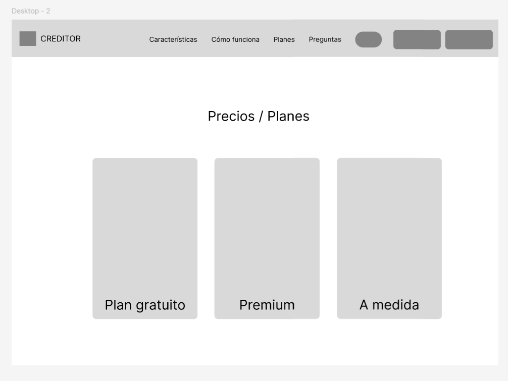
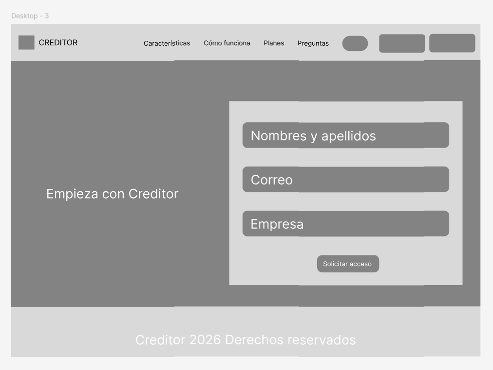
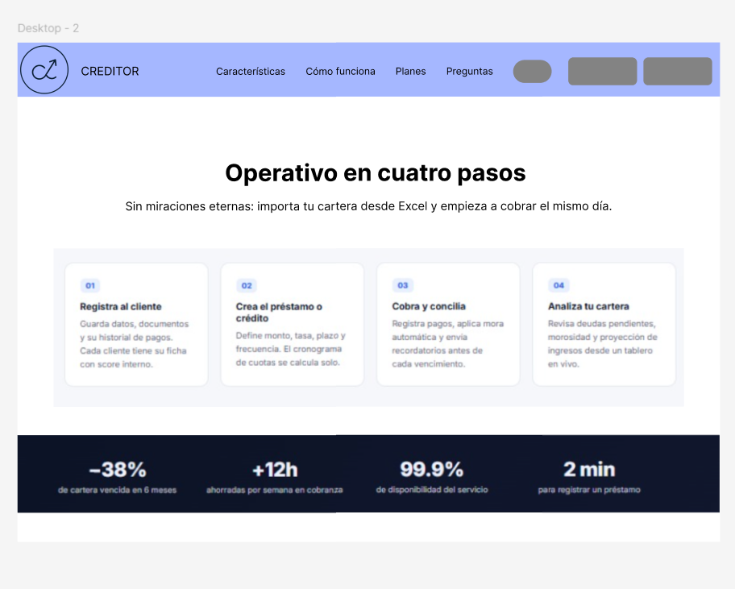
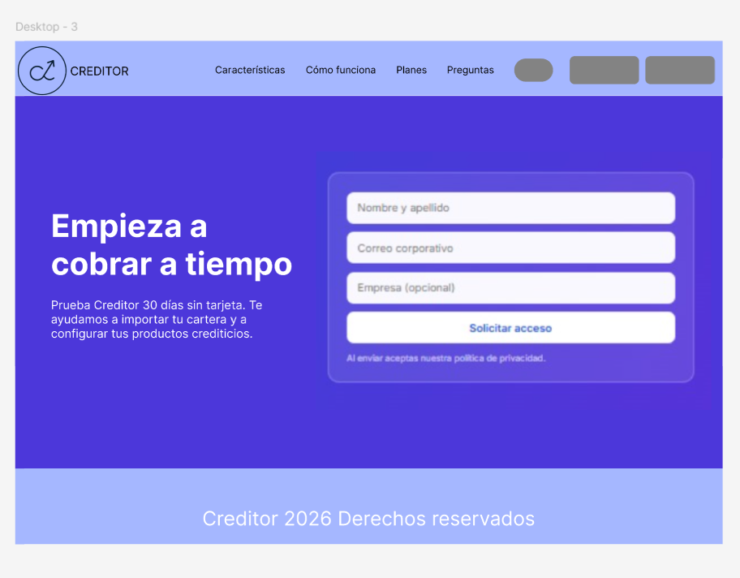
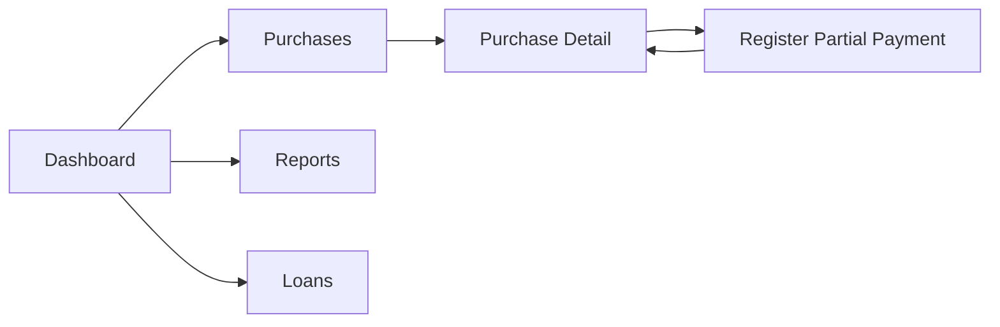
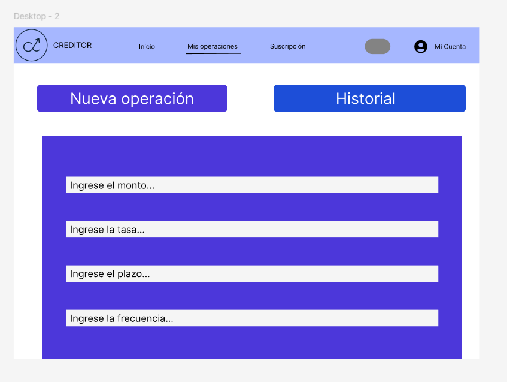
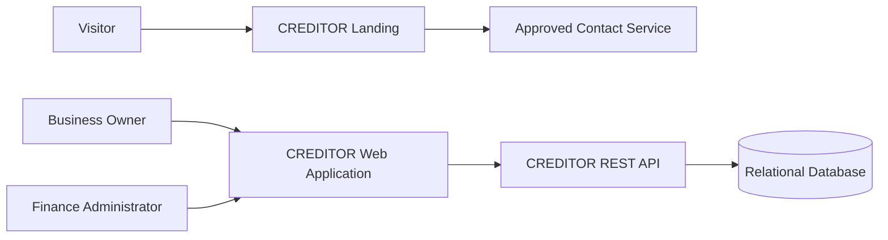
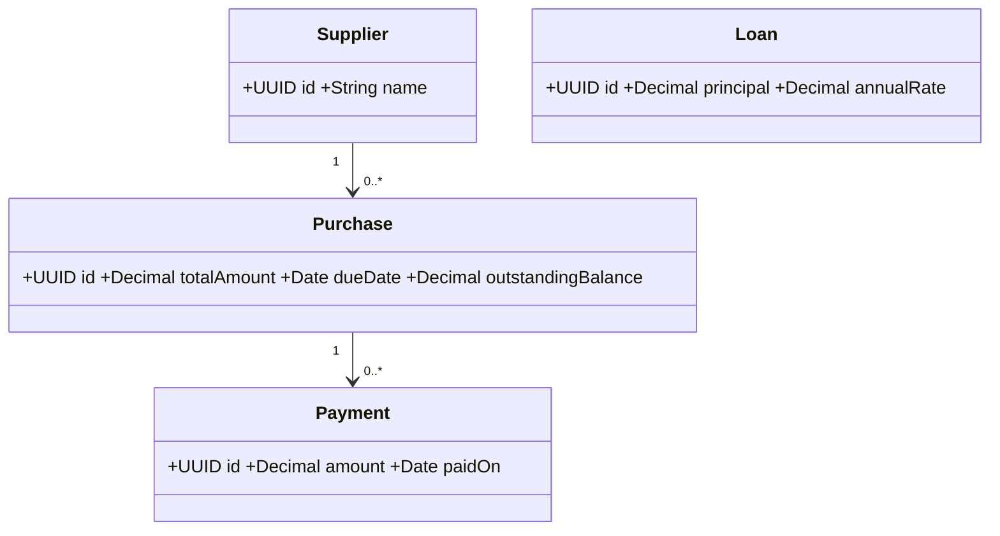

# Capítulo IV: Product Design

## 4.1 Style Guidelines

### 4.1.1 General Style Guidelines

#### Branding

CREDITOR comunica control de obligaciones y claridad operativa. El símbolo de infinito y la flecha ascendente del logotipo representan continuidad de la información financiera y mejora en la toma de decisiones; no representan una promesa de rentabilidad.

  

#### Tipografía

| Uso | Familia | Regla |
|---|---|---|
| Títulos | Montserrat | Usar pesos semibold o bold y una jerarquía semántica de encabezados. |
| Texto y controles | Inter | Mantener tamaño legible, alto contraste y oraciones breves. |

#### Colores

| Token | Valor | Uso |
|---|---|---|
| `brand-primary` | `#2563EB` | Marca, acciones principales y enlaces activos. |
| `brand-primary-hover` | `#1D4ED8` | Estado hover o activo de acción primaria. |
| `brand-soft` | `#E8EFFF` | Fondo de marca de baja intensidad. |
| `success` | `#10B981` | Pago al día o operación completada. |
| `warning` | `#F59E0B` | Vencimiento cercano o acción que requiere revisión. |
| `danger` | `#EF4444` | Obligación vencida o error que requiere corrección. |
| `text-primary` | `#111827` | Texto principal. |
| `surface` | `#FFFFFF` | Fondo de tarjetas y formularios. |

Los estados no dependen únicamente del color: se acompañan de etiqueta, icono o texto equivalente.

#### Iconografía y tono

Los iconos usan metáforas claras —documento, proveedor, calendario, recibo y reporte— y siempre incluyen una etiqueta accesible cuando no son decorativos. El tono es profesional, directo y comprensible: explica acciones y estados sin usar promesas financieras sin sustento.

### 4.1.2 Web Style Guidelines

- Usar una cuadrícula responsive, espaciado basado en múltiplos de 4 px y objetivos táctiles adecuados.
- Asociar cada campo de formulario con una etiqueta visible; los placeholders no reemplazan labels.
- Mantener contraste suficiente, foco visible, navegación por teclado y atributos ARIA cuando el control lo requiera.
- La interfaz y mensajes de API usarán inglés como idioma base (`en_US`) y español latinoamericano como alternativa (`es_419`).
- Las cifras comerciales o métricas de beneficio deberán indicar su fuente; de lo contrario se eliminan del contenido público.
- La landing aplica un patrón Z para ordenar marca, navegación, propuesta de valor y llamada a la acción.

## 4.2 Information Architecture

### 4.2.1 Organization Systems

| Área | Contenido | Usuarios |
|---|---|---|
| Landing | Propuesta, beneficios, contacto y contenido legal. | Visitor |
| Dashboard | Resumen de saldos, vencimientos y estados. | Business Owner, Finance Administrator |
| Purchases | Compras a crédito, proveedor, vencimiento y comprobantes. | Finance Administrator |
| Payments | Abonos, vouchers e historial de movimientos. | Finance Administrator, Business Owner |
| Loans | Préstamos y cuotas. | Business Owner |
| Reports | Filtros y exportaciones de obligaciones. | Finance Administrator |

### 4.2.2 Labeling Systems

Los rótulos privilegian términos de negocio consistentes: **Purchases**, **Suppliers**, **Payments**, **Outstanding Balance**, **Due Date**, **Loans** y **Reports**. La interfaz en español debe mantener equivalencias estables con el Ubiquitous Language del capítulo II.

### 4.2.3 SEO Tags and Meta Tags

| Etiqueta | Valor inicial propuesto |
|---|---|
| `title` | CREDITOR \| Control de cuentas por pagar para mypes |
| `description` | Centraliza compras a crédito, abonos y obligaciones de tu mype. |
| `keywords` | cuentas por pagar, compras a crédito, proveedores, mypes, CREDITOR |
| `author` | Equipo CREDITOR |
| `lang` | `en-US` o `es-419` según la versión renderizada |

### 4.2.4 Searching Systems

La primera versión prioriza filtros por proveedor, rango de fechas, moneda y estado antes que una búsqueda global. Las entrevistas definirán si una búsqueda textual aporta valor al flujo cotidiano.

### 4.2.5 Navigation Systems

La landing usa navegación por secciones y CTA hacia contacto o la futura aplicación. La aplicación usa navegación lateral para módulos de dominio, migas de pan en vistas de detalle y enlaces explícitos para regresar a una lista.

## 4.3 Landing Page UI Design

Los wireframes y mock-ups se elaboraron en Figma: [archivo de diseño](https://www.figma.com/design/OQWWAsxRTtOPJcWfFUtCq3/Sin-t%C3%ADtulo?node-id=12-2&t=mUB6VBiUbwbcGxJq-1).

### 4.3.1 Landing Page Wireframes

El wireframe de la landing debe presentar, en este orden: navegación, propuesta de valor, problema, beneficios relacionados con cuentas por pagar, explicación del flujo, formulario de contacto y pie con enlaces legales.

### 4.3.2 Landing Page Mock-ups

El mock-up debe emplear los tokens de marca, mantener CTA accesibles y utilizar contenido de CREDITOR. Antes de publicar se verificará que la landing no conserve referencias a CreditFlow, préstamos a clientes o métricas sin fuente.

## 4.4 Web Applications UX/UI Design

### 4.4.1 Web Application Wireframes

Los wireframes previstos cubren dashboard, lista y detalle de compras, registro de compra, historial de abonos, préstamos y reportes.

### 4.4.2 Web Application Wireflow Diagrams

### 4.4.3 Web Application Mock-ups

A continuación mostramos la pantalla que obtendrá el usuario cuando esté por registrar una nueva operación. Se le indicará con un texto lo que debe completar en cada campo.

### 4.4.4 Web Application User Flow Diagrams

| Flujo | Inicio | Resultado |
|---|---|---|
| Registrar compra | Lista de compras | Compra pendiente con proveedor, importe, moneda y vencimiento. |
| Registrar abono | Detalle de compra | Abono asociado, voucher y saldo actualizado. |
| Consultar obligación | Dashboard o proveedor | Saldo, estado y movimientos visibles. |
| Exportar reporte | Reportes | Resultado filtrado disponible en el formato habilitado. |

## 4.5 Web Applications Prototyping

El prototipo navegable se construirá después de las entrevistas. La evidencia final incluirá enlace de Figma, fecha de validación y tareas usadas en la prueba. Esta versión no declara un prototipo terminado.

## 4.6 Domain-Driven Software Architecture

### 4.6.1 Design-Level Event Storming

El diseño detallado ampliará el Big Picture EventStorming con comandos, políticas, agregados y eventos. La evidencia colaborativa debe guardarse en `assets/architecture/eventstorming/`.

### 4.6.2 Software Architecture Context Diagram

### 4.6.3 Software Architecture Container Diagram

| Contenedor | Tecnología objetivo | Responsabilidad |
|---|---|---|
| Landing | HTML5, CSS3, JavaScript | Comunicar propuesta, captar consultas y enlazar al producto. |
| Web Application | Vue, HTML, CSS, JavaScript, PrimeVue | Presentar flujos de cuentas por pagar a usuarios autenticados. |
| REST API | ASP.NET Core, C#, Entity Framework Core, OpenAPI | Aplicar reglas de dominio y exponer contratos HTTP. |
| Database | PostgreSQL o MySQL | Persistir organizaciones, proveedores, compras, pagos y préstamos. |

### 4.6.4 Software Architecture Component Diagrams

La API se separará inicialmente en componentes de Accounts Payable, Payments, Loans, Reporting e Identity. El diseño definitivo dependerá de las historias priorizadas y de los límites confirmados en el EventStorming.

## 4.7 Software Object-Oriented Design

### 4.7.1 Class Diagrams

## 4.8 Database Design

### 4.8.1 Database Diagrams

El modelo relacional inicial se mantiene en [`database/schema.sql`](../database/schema.sql). Antes de implementar, se debe decidir el motor, aplicar migraciones y revisar restricciones con las historias de usuario validadas.

