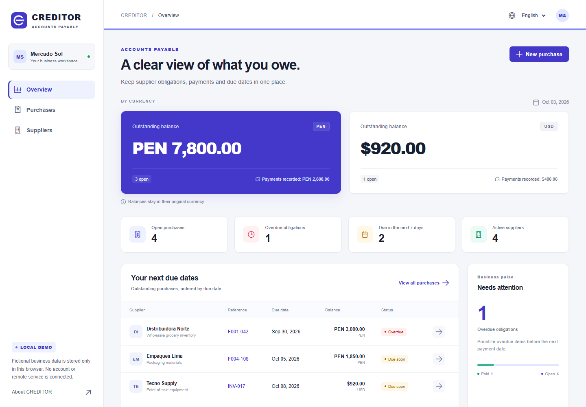
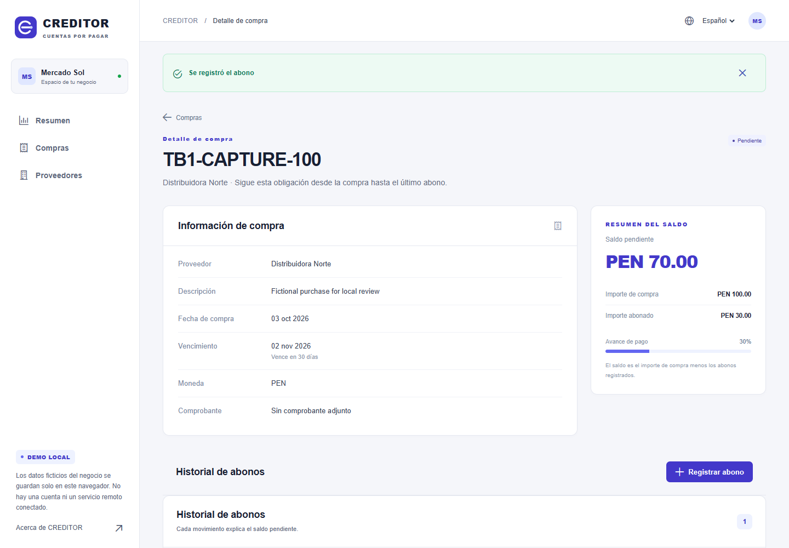
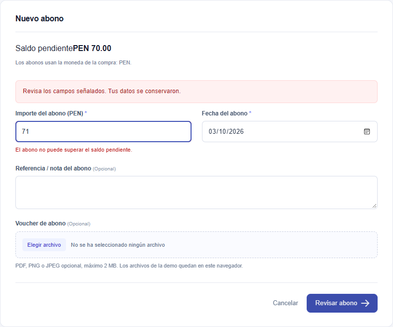

> Vista sincronizada del [informe canónico](../README.md), corte AV2 13/11/2026. Para editar contenido, modificar README y ejecutar `python tools/report/sync_chapters.py`.

# Capítulo V: Product Implementation, Validation & Deployment

Este capítulo registra el incremento técnico local AV2 al **13 de noviembre de 2026** y conserva Sprint 1/2 como antecedentes fechados. La interfaz Vue se comunica con ASP.NET Core y el motor vigente es MySQL. La evidencia de ejecución y sus límites se reúne en 5.2.3. No se realizó push, release ni despliegue del corte actual.

> **Lectura por fecha:** Sprint 1 y Sprint 2 conservan su corte AV1/TB1. Las expresiones «API futura» dentro de esos sprints son históricas. El anexo B conserva el 02/11; la implementación vigente y la comunicación frontend/API se documentan en Sprint 3 y la matriz AV2. No se reescriben evidencias antiguas para hacerlas parecer pruebas actuales.

## 5.1 Software Configuration Management

### 5.1.1 Software Development Environment Configuration

| Componente | Configuración del código |
|---|---|
| Frontend | Vue 3, PrimeVue, Vite; dependencias exactas en package-lock.json y Node según engines. |
| Backend | C# / ASP.NET Core, EF Core, solución Creditor.sln por capas. |
| Base de datos | MySQL 8.4 local; PostgreSQL como proveedor de regresión, SQLite auxiliar. |
| Contrato | OpenAPI generado y Scalar como interfaz de consulta. |
| Pruebas | Vitest y Playwright; xUnit de dominio/API y pruebas de migración con motor real. |
| Investigación/diseño | Artefactos locales conservados; sincronización y sesiones reales Figma/UXPressia pendientes. |

Los scripts del backend y su README son la fuente de arranque. Ejecutarlos desde la raíz del repo o mediante su ruta absoluta evita el error de buscar `./creditor-backend` desde la carpeta personal. La variable `VITE_API_BASE_URL` debe apuntar a `/api/v1` del backend y CORS debe admitir el origen exacto de Vite. Los puertos de pruebas son distintos del entorno cotidiano.

### 5.1.2 Source Code Management

| Repositorio | Alcance | Estado de este incremento |
|---|---|---|
| upc-project-report | Informe, diagramas y evidencia auditada. | Feature documental integrada localmente en develop. |
| creditor-web-app | Práctica y workspace conectado. | Features por CSV y préstamos; diseño conservado. |
| creditor-backend | API, dominio, persistencia y pruebas. | Fix abonos, feature préstamos y feature MySQL/Scalar. |
| creditor-landing-page | Presentación pública y CTA. | Sin cambios en esta auditoría. |

GitFlow: partir de develop, trabajar en feature/fix, validar, realizar commits lógicos con `MIguelAngelES7 <95198651+MiguelAngel0107@users.noreply.github.com>` y fusionar con `--no-ff` a develop. No se modifica main ni se publica. Los merges locales no constituyen revisión por pares. Se conservan los autores y commits previos; no se reescribe su historia. El [registro AV2](../docs/av2/estado-implementacion.md) identifica los cortes comprobados.

### 5.1.3 Source Code Style Guide & Conventions

| Aspecto | Convención verificable |
|---|---|
| DDD | Domain sin dependencias de API/EF; Application define contratos; Infrastructure implementa puertos; API compone. |
| Frontend | Contextos con presentation/application/infrastructure, componentes existentes y valores compartidos. |
| Dinero | PEN/USD separados; decimales exactos o centavos enteros, sin float para saldos. |
| Fechas | Fecha de negocio America/Lima; instantes UTC y calendario explícito de cuotas. |
| Seguridad | JWT en memoria frontend, autorización servidor, BusinessId del principal y archivos privados. |
| Errores | ProblemDetails HTTP y errores por campo; no se convierte un fallo en un éxito visual. |
| Cambios | Conventional Commits por unidad lógica; sin secretos ni archivos de dependencias generados. |
| Evidencia | SHA, comando, entorno, resultado y límite de lo comprobado. |

### 5.1.4 Software Deployment Configuration

`npm run build` produce archivos estáticos de la SPA. ASP.NET Core necesita proceso servidor y MySQL necesita instancia de base de datos; GitHub Pages por sí solo no ejecuta ninguno de esos dos servicios. Scalar documenta la API, no sustituye su alojamiento. Los secretos se configuran fuera del repositorio y el contenido privado requiere almacenamiento persistente.

El alcance solicitado permanece local. La publicación histórica de la landing AV1 corresponde al commit cf734ff y su registro previo; no se interpreta como despliegue de la aplicación/API actuales. Para una entrega con deployment deberán registrarse por separado URL HTTPS de frontend/API, commit, health, CORS, migraciones y pruebas posteriores al despliegue.

## 5.2 Landing Page, Services & Applications Implementation

La landing se conserva como punto de entrada. El workspace conectado implementa US-004–009 y servicios TS-001–003 con los límites descritos en el capítulo III. Sprint 1 y Sprint 2 documentan la evolución histórica; Sprint 3 reúne la preparación técnica actual y sus pendientes de aceptación.

### 5.2.1 Sprint 1

El Sprint 1 produjo la primera landing e insumos de diseño/documentación. La ficha histórica se conserva en [Sprint 1](../README.md#521-sprint-1). Su publicación del 18/09 es evidencia de AV1; no se presenta como un nuevo deployment TB1. La redacción extensa original se conserva en el [archivo de AV1](../README.md#5211-sprint-planning-1) para mantener trazabilidad de las correcciones.

El incremento inicial incorporó componentes de landing mediante features y merges el 14/09/2026. La versión cf734ff añadió Pages/base de Vite y se publicó el 18/09/2026. El [capítulo original](../README.md#5211-sprint-planning-1) conserva la planificación y redacción de AV1 para referencia.

| Evidencia | Registro |
|---|---|
| Fundación Vue | 7579372 |
| Navegación y hero | 0e8b89d |
| Producto y presentación | 5cf922b |
| Simulador de cuota | 31193a9 |
| Conversión y footer | d1c87a5 |
| Configuración de publicación | 076c79d y cf734ff |

[Deployment histórico](https://github.com/Grupo-Desarrollo-Aplicaciones-Web/creditor-landing-page/actions/runs/35305597000). Las estimaciones y tareas redactadas posteriormente no constituyen horas reales ni actas de reuniones. Sprint 2 corrige marca, dominio, idioma, CTA, estados de contacto y evidencia de implementación.

> **Registro histórico AV1:** la redacción siguiente conserva la marca previa CreditFlow y las propuestas del archivo original. Sus pendientes son los de ese registro; la publicación posterior del 18/09 se documenta arriba. No constituye un plan de trabajo recién acordado.

#### 5.2.1.1 Sprint Planning 1

**Naturaleza del registro.** Las fechas, horas, estimaciones y actividades de planificación siguientes se proponen para la semana del 14 al 20 de septiembre de 2026. No existe acta que acredite que la reunión ya ocurrió. La implementación visible tiene commits del 14 de septiembre; el plan organiza su documentación, revisión y preparación de entrega, además de reconstruir el backlog del incremento.

| Sprint # | Sprint 1 |
|---|---|
| Sprint Planning Background | Primera entrega de la landing y organización de la evidencia técnica. |
| Inicio propuesto | Lunes 14/09/2026. |
| Fin propuesto | Domingo 20/09/2026. |
| Planificación propuesta | Lunes 14/09/2026, de 19:00 a 20:00, hora de Lima (UTC−5). |
| Location | Google Meet. |
| Prepared By | Juan Manuel Santos Torres. |
| Attendees previstos | Juan Manuel Santos Torres, Sebastián Gutarra Velapatiño y Miguel Angel Egocheaga Suyo. |
| Sprint n−1 Review Summary | No se dispone de un sprint previo documentado para esta entrega. |
| Sprint n−1 Retrospective Summary | No aplica como reunión previa; se propone iniciar con acuerdos sobre alcance y evidencia. |
| Sprint Goal | Consolidar la landing bilingüe de CreditFlow, documentar sus componentes e interacciones, definir su validación y preparar una configuración de publicación estática. |
| Sprint 1 Velocity | No disponible: no existe una medición de historias aceptadas al cierre. |
| Sum of Story Points propuestos | 34 SP. |
| Esfuerzo de tareas estimado | 61 horas-persona; estimación reconstruida, no horas trabajadas acreditadas. |
| Sprint Review propuesta | Domingo 20/09/2026, 19:00–19:40, Google Meet. |
| Retrospectiva propuesta | Domingo 20/09/2026, 19:40–20:00, Google Meet. |

**Agenda de planificación propuesta**

| Tiempo | Actividad | Salida esperada |
|---|---|---|
| 10 min | Revisar visión y alcance. | Distinguir landing y aplicación futura. |
| 15 min | Revisar código y funcionalidades. | Inventario del incremento disponible. |
| 15 min | Definir historias y criterios. | Backlog y condiciones de aceptación. |
| 10 min | Revisar riesgos y dependencias. | Lista de defectos y publicación pendiente. |
| 10 min | Acordar evidencias y próximos pasos. | Responsables por confirmar y calendario aceptado. |

**Criterios de entrada propuestos**

Cada historia deberá especificar usuario, necesidad, alcance y evidencia esperada. Las tareas de corrección deberán referir el componente afectado. Ninguna tarea de backend o persistencia forma parte de este sprint.

**Definition of Done propuesta**

1. La funcionalidad prevista está implementada dentro del alcance de la landing.
2. Los criterios de aceptación cuentan con una verificación registrada.
3. La compilación finaliza correctamente para el commit de entrega.
4. Los cambios no introducen errores de navegación, recursos faltantes ni regresiones conocidas.
5. Los textos ES/EN y los estados de demostración son coherentes.
6. La documentación identifica archivo, commit y limitaciones.
7. Los defectos críticos de honestidad de la interacción y comprensión del cálculo están corregidos o la entrega queda explícitamente condicionada.

La existencia de un componente no permite asignar automáticamente `Done` a la historia. A fecha de corte, no hay cierre ni velocidad medida.

#### 5.2.1.2 Aspect Leaders and Collaborators

Los aspectos de esta entrega son documentación de producto, documentación técnica, interfaces de la landing, internacionalización e interacciones, validación y preparación de despliegue.

**Matriz histórica de planificación:** L y C conservan los roles propuestos en el registro AV1. Las asignaciones no se consideran ratificadas ni acreditan autoría de código; el equipo debe confirmarlas con evidencia. La redacción y tabla originales permanecen en el archivo histórico.

| Team Member | GitHub Username | Capítulo I | Capítulo V | Implementación Vue/CSS | Idiomas e interacciones | Validación documental | Despliegue |
|---|---|---|---|---|---|---|---|
| Juan Manuel Santos Torres | @JuanManuel312 | L | L | C | C | L | C |
| Sebastián Gutarra Velapatiño | @SebastianGutarra | C | C | L | L | C | C |
| Miguel Angel Egocheaga Suyo | @MiguelAngel0107 | C | C | C | C | C | L |

La responsabilidad de validación documental comprende el protocolo de entrevistas y la inspección heurística; no significa que Juan haya realizado entrevistas o pruebas aún no registradas. Las asignaciones operativas se completarán por acuerdo del equipo.

#### 5.2.1.3 Sprint Backlog 1

**Historias de usuario**

Las historias e IDs se han elaborado para describir el incremento. Sus estimaciones son propuestas y no corresponden a Issues previamente existentes. Se distingue implementación observable de aceptación pendiente.

| ID | Historia de usuario | SP | Evidencia o situación actual |
|---|---|---:|---|
| US-LP-01 | Como visitante, quiero identificar el propósito de CreditFlow y navegar a las secciones para decidir qué información explorar. | 3 | Header y Hero presentes; enlace de login pendiente de corregir. |
| US-LP-02 | Como responsable de cartera, quiero conocer las capacidades y el flujo previsto para evaluar su relación con mi negocio. | 3 | Features, HowItWorks y Stats presentes; afirmaciones por revisar. |
| US-LP-03 | Como visitante, quiero modificar los parámetros de un préstamo para explorar una estimación de cuota. | 5 | Simulador presente; discrepancia entre etiqueta TEA y cálculo. |
| US-LP-04 | Como potencial cliente, quiero comparar planes y períodos para comprender la propuesta comercial. | 3 | Selector y tarjetas presentes; moneda y redondeo por aclarar. |
| US-LP-05 | Como visitante, quiero consultar preguntas frecuentes para resolver dudas iniciales. | 2 | Acordeón implementado. |
| US-LP-06 | Como visitante interesado, quiero explorar una solicitud de acceso con mensajes claros sobre sus límites. | 3 | Validación local presente; confirmación y accesibilidad por mejorar. |
| US-LP-07 | Como visitante, quiero elegir español o inglés y conservar esa selección para leer el contenido. | 3 | Diccionarios y persistencia presentes. |
| US-LP-08 | Como usuario móvil, quiero explorar el contenido y sus controles sin barreras de distribución o navegación. | 5 | CSS responsive presente; verificación visual y de teclado pendiente. |
| US-LP-09 | Como integrante del equipo, quiero documentación trazable para reproducir y revisar la entrega. | 2 | README técnico existente; capítulos y protocolo preparados para incorporar. |
| US-LP-10 | Como evaluador, quiero acceder a una versión publicada para revisar el incremento sin instalarlo. | 5 | Publicación pendiente; configuración propuesta. |
| **Total** | | **34** | **No equivale a velocidad completada.** |

**Criterios de aceptación**

**US-LP-01**

- Dada la sección inicial, el visitante encuentra marca, propósito y dos llamadas a la acción.
- Al seleccionar una sección existente desde el encabezado, llega a su destino.
- En móvil, el menú puede abrirse y cerrarse, y se cierra al seleccionar un enlace de sección.
- Ningún acceso presentado como operativo conduce a una sección inexistente. El enlace `#login` impide dar por cumplido este criterio.

**US-LP-02**

- Se presentan seis capacidades y cuatro pasos en un orden comprensible.
- Los textos están disponibles en ambos idiomas.
- Las capacidades futuras se distinguen de las funciones del prototipo.
- Las cifras promocionales se sustentan o se identifican como ilustrativas antes de la evaluación.

**US-LP-03**

- Monto, tasa y plazo permiten seleccionar los rangos definidos por el componente.
- La cuota, total e interés responden a los valores actuales sin recarga.
- Una tasa cero produce cuota igual a monto/plazo e interés total cero.
- La definición de tasa coincide con la transformación aplicada.
- El usuario comprende que es una estimación sin comisiones ni una operación real.

**US-LP-04**

- Se presentan tres planes y se diferencia el destacado.
- El selector actualiza precios y descripción del período.
- El plan corporativo mantiene la indicación de precio personalizado.
- El precio, la moneda y el descuento se comunican sin ambigüedad.
- El CTA conduce al formulario; no se declara una suscripción contratada.

**US-LP-05**

- Se presentan cinco preguntas y una respuesta visible al inicio.
- Pulsar la pregunta abierta la cierra; pulsar otra cambia la respuesta visible.
- `aria-expanded` corresponde al estado.
- El contenido responde sobre la visión del producto sin fingir servicios ya disponibles.

**US-LP-06**

- Nombre y correo son obligatorios; empresa es opcional.
- Una entrada inválida muestra un mensaje comprensible y conserva los datos.
- Los campos cuentan con nombres accesibles y el error puede identificarse.
- La confirmación informa que la interacción es una demostración local.
- El visitante puede corregir los datos sin tener que recargar toda la página. Los tres últimos criterios requieren mejoras.

**US-LP-07**

- Los botones permiten seleccionar ES o EN.
- El contenido y los metadatos básicos se actualizan.
- La selección persiste al recargar en condiciones normales de almacenamiento.
- El comportamiento de moneda se explica como formato de muestra, no conversión.

**US-LP-08**

- Las pruebas propuestas a 360, 768 y 1440 px no presentan solapamiento o desplazamiento horizontal no intencional.
- Los controles se operan mediante teclado y muestran foco.
- Los títulos de las secciones enlazadas no quedan ocultos por el encabezado.
- La lectura y la interacción se mantienen en ambos idiomas.

**US-LP-09**

- El entorno y los scripts coinciden con el manifest y lockfile.
- La documentación separa hechos, propuestas y pendientes.
- Las capturas se relacionan con el repositorio correcto.
- El protocolo no incluye entrevistas ni resultados inventados.

**US-LP-10**

- La compilación de un commit integrado en `main` finaliza correctamente.
- La URL devuelve el contenido y los recursos bajo el subdirectorio del proyecto.
- Se conservan el enlace de ejecución y el commit desplegado.
- La prueba de humo de navegación e interacciones queda registrada.

**Work Items y estimaciones**

Los tiempos son una estimación académica reconstruida, no una declaración de dedicación histórica. “Código presente” significa que existe una implementación inspeccionable; no equivale a una tarea aceptada. Las asignaciones de implementación se mantienen vacías hasta que el equipo las confirme.

| Sprint | User Story | Work-Item / Task | Description | Estimation (Hours) | Assigned To | Status |
|---|---|---|---|---:|---|---|
| 1 | US-LP-01 | T-LP-01 | Crear encabezado, marca y enlaces de sección. | 3 | Sebastián Gutarra Velapatiño | Código presente; revisión pendiente. |
| 1 | US-LP-01 | T-LP-02 | Construir hero, CTAs y panel ilustrativo. | 2 | Sebastián Gutarra Velapatiño | Código presente; revisión pendiente. |
| 1 | US-LP-02 | T-LP-03 | Presentar seis características y cuatro pasos. | 3 | Miguel Angel Egocheaga Suyo | Código presente. |
| 1 | US-LP-02 | T-LP-04 | Revisar métricas y diferenciar promesas de funciones reales. | 2 | Miguel Angel Egocheaga Suyo | Pendiente de ajuste. |
| 1 | US-LP-03 | T-LP-05 | Implementar entradas reactivas y resultados del simulador. | 4 | Juan Manuel Santos Torres | Código presente. |
| 1 | US-LP-03 | T-LP-06 | Resolver definición de tasa y contrastar casos de cálculo. | 3 | Sebastián Gutarra Velapatiño | Pendiente. |
| 1 | US-LP-04 | T-LP-07 | Implementar tarjetas y selector mensual/anual. | 2 | Sebastián Gutarra Velapatiño | Código presente. |
| 1 | US-LP-04 | T-LP-08 | Aclarar moneda, descuento y facturación. | 2 | Juan Manuel Santos Torres | Pendiente. |
| 1 | US-LP-05 | T-LP-09 | Crear acordeón con estado reactivo y traducciones. | 2 | Miguel Angel Egocheaga Suyo | Código presente. |
| 1 | US-LP-05 | T-LP-10 | Revisar contenido, teclado y estado accesible del FAQ. | 2 | Sebastián Gutarra Velapatiño | Pendiente de verificación. |
| 1 | US-LP-06 | T-LP-11 | Implementar validaciones locales del formulario. | 3 | Sebastián Gutarra Velapatiño | Código presente. |
| 1 | US-LP-06 | T-LP-12 | Corregir confirmación, etiquetas, avisos y regreso a edición. | 3 | Juan Manuel Santos Torres | Pendiente. |
| 1 | US-LP-07 | T-LP-13 | Implementar diccionarios, selector y persistencia. | 3 | Miguel Angel Egocheaga Suyo | Código presente. |
| 1 | US-LP-07 | T-LP-14 | Revisar formatos monetarios y completitud ES/EN. | 2 | Miguel Angel Egocheaga Suyo | Pendiente de verificación. |
| 1 | US-LP-08 | T-LP-15 | Adaptar rejillas, controles y menú a varios anchos. | 4 | Sebastián Gutarra Velapatiño | Reglas CSS presentes. |
| 1 | US-LP-08 | T-LP-16 | Ejecutar pruebas responsive, teclado y destinos de enlaces. | 4 | Sebastián Gutarra Velapatiño | Pendiente de ejecución. |
| 1 | US-LP-09 | T-LP-17 | Adaptar capítulo I y documentar configuración e implementación. | 6 | Juan Manuel Santos Torres | Contenido preparado para incorporar y revisar. |
| 1 | US-LP-09 | T-LP-18 | Diseñar entrevistas, registrar inspección y organizar evidencias. | 5 | Juan Manuel Santos Torres | Contenido preparado; entrevistas pendientes. |
| 1 | US-LP-10 | T-LP-19 | Preparar configuración de ruta base y workflow de Pages. | 4 | Juan Manuel Santos Torres | Propuesta preparada; adopción pendiente. |
| 1 | US-LP-10 | T-LP-20 | Publicar, verificar URL y registrar ejecución. | 2 | Miguel Angel Egocheaga Suyo | Pendiente. |
| | | **Total** | | **61** | | |

**Dependencias y prioridades**

- T-LP-06 debe resolverse antes de considerar correcto el significado del cálculo.
- T-LP-12 debe preceder a una validación donde los participantes puedan interpretar el formulario como un envío real.
- T-LP-16 requiere una versión ejecutable y debe producir evidencia por caso.
- T-LP-20 depende de T-LP-19, de una compilación correcta y de acceso habilitado a Pages.
- El backlog de documentación puede incorporarse sin atribuir a otros integrantes tareas no confirmadas.

Las pruebas y el registro de cierre determinarán qué historias se aceptan. La velocidad se calculará sumando únicamente los SP de historias aceptadas según la Definition of Done.

#### 5.2.1.4 Development Evidence for Sprint Review

**Evidencias disponibles**

| ID | Evidencia | Qué permite afirmar | Límite |
|---|---|---|---|
| DEV-01 | ZIP de `develop` con comentario SHA `7597586799b350cbdeffec3b9fec4a42b1f55f3d`. | Contenido técnico del incremento inspeccionado. | No contiene el directorio `.git` ni ejecuciones de pruebas. |
| DEV-02 | Captura de commits de la landing, 14/09/2026. | Historial visible de incorporación e integración de secciones. | No demuestra aprobación por PR ni la ejecución correcta. |
| DEV-03 | Captura de ramas del informe. | Existencia y divergencia de las ramas mostradas. | Estado de la captura, no comprobación remota actual. |
| DEV-04 | Captura de commits del informe, 08 y 09/09/2026. | Trabajo documental previo de los usuarios visibles. | No acredita que esos contenidos ya estén alineados a esta versión. |
| DEV-05 | Captura de Pull Requests del informe. | Cero abiertos y cero cerrados mostrados. | No describe el repositorio de la landing. |

**Referencia histórica sin archivo local disponible:** Historial de implementación de la landing (`docs/creditflow-documentacion/informe/assets/evidence/landing-commits.png`).

**Historial de la landing visible en la captura**

Todos los registros de esta tabla aparecen el 14/09/2026 asociados al usuario `MiguelAngel0107`. Se transcriben los mensajes visibles sin inventar PR ni tiempos de trabajo.

| Orden lógico | Mensaje | Relación con el incremento |
|---|---|---|
| 1 | `chore: initialize landing page repository` | Base del repositorio. |
| 2 | `feat: add Vue landing foundation` | Estructura inicial Vue. |
| 3 | `merge: integrate landing foundation` | Integración declarada de la base. |
| 4 | `feat: add navigation and hero section` | Encabezado e inicio. |
| 5 | `merge: integrate navigation and hero section` | Integración declarada de navegación e inicio. |
| 6 | `feat: add product overview sections` | Secciones informativas. |
| 7 | `merge: integrate product overview sections` | Integración declarada de presentación. |
| 8 | `feat: add loan installment simulator` | Simulador de cuotas. |
| 9 | `merge: integrate loan installment simulator` | Integración declarada del simulador. |
| 10 | `feat: add conversion and footer sections` | Conversión y pie de página. |
| 11 | `merge: integrate conversion and footer sections` | Último registro visible, SHA abreviado `7597586`. |

La asociación de usuario en una captura acredita ese registro de GitHub, no permite inferir que una sola persona elaboró todas las líneas del cambio ni reconstruir colaboraciones no registradas.

**Evidencia documental previa**

**Referencia histórica sin archivo local disponible:** Historial del informe académico (`docs/creditflow-documentacion/informe/assets/evidence/report-commits.png`).

La captura muestra commits de `JuanManuel312` sobre startup, perfiles, problemática, Lean UX y segmentos el 8 de septiembre. El 9 de septiembre se observan commits de `SebastianGutarra` sobre diseño, branding e imágenes. Esta evidencia se conserva como antecedente. Los nuevos bloques documentales deben registrarse en la fecha real de su incorporación.

**Evidencias que completarán la revisión**

Se deberán añadir enlaces al commit final de cada repositorio, PR si se utilizan, resultado de compilación y capturas de la landing ejecutándose. Cada imagen debe indicar versión, fecha y contexto; una captura del historial no reemplaza una captura funcional.

#### 5.2.1.5 Execution Evidence for Sprint Review

La ejecución funcional no está acreditada con resultados de navegador en el material disponible. Se presenta un plan de verificación reproducible. Todos los casos comienzan como **pendientes**; los resultados esperados se derivan del código y de los criterios propuestos.

**Preparación**

Registrar commit, fecha, sistema operativo, navegador y versión, viewport y versiones de Node/npm. Ejecutar `npm ci`, `npm run build` y `npm run preview`, conservando el resultado. Utilizar datos ficticios para el formulario.

| ID | Historia | Acción | Resultado esperado o condición a comprobar | Estado |
|---|---|---|---|---|
| TC-LP-01 | US-LP-09 | Instalar desde lockfile y compilar. | Comandos finalizan correctamente y se genera `dist/`. | Pendiente. |
| TC-LP-02 | US-LP-01 | Abrir la página y recorrer anclas. | Cada enlace principal lleva a su sección. | Pendiente. |
| TC-LP-03 | US-LP-01/08 | Abrir menú a 360 px y seleccionar Planes. | Menú visible al abrir; se cierra y llega a Planes. | Pendiente. |
| TC-LP-04 | US-LP-07 | Cambiar ES/EN. | Contenido, título, descripción y `html[lang]` cambian. | Pendiente. |
| TC-LP-05 | US-LP-07 | Elegir idioma y recargar. | Conserva selección si almacenamiento está disponible. | Pendiente. |
| TC-LP-06 | US-LP-03 | Usar 10000, 24% y 12 meses. | Fórmula actual: cuota ≈945.60, total ≈11347.15 e interés ≈1347.15; la etiqueta de tasa sigue siendo un hallazgo. | Pendiente. |
| TC-LP-07 | US-LP-03 | Usar 12000, 0% y 12 meses. | Cuota 1000, total 12000, interés 0. | Pendiente. |
| TC-LP-08 | US-LP-03 | Probar mínimos y máximos permitidos. | Salidas finitas; sin valores inválidos ni desbordamiento de layout. | Pendiente. |
| TC-LP-09 | US-LP-03/07 | Cambiar idioma con monto fijo. | Detectar y documentar cambio de símbolo sin cambio numérico. | Pendiente. |
| TC-LP-10 | US-LP-04 | Alternar mensual/anual. | Código actual muestra 39/89 y 31/71; plan a medida no cambia a número. | Pendiente. |
| TC-LP-11 | US-LP-04 | Pulsar CTA de cada plan. | Navega a `#demo`; no contrata un plan. | Pendiente. |
| TC-LP-12 | US-LP-05 | Abrir y cerrar preguntas. | Una o ninguna respuesta visible; ARIA refleja el estado. | Pendiente. |
| TC-LP-13 | US-LP-06 | Enviar nombre/correo vacíos. | Mensaje de campos obligatorios y conservación del formulario. | Pendiente. |
| TC-LP-14 | US-LP-06 | Usar nombre ficticio y `correo-invalido`. | Mensaje de correo inválido. | Pendiente. |
| TC-LP-15 | US-LP-06 | Usar `Persona Demo` y `demo@example.com`. | Confirmación local; comprobar en red que no exista envío de solicitud. | Pendiente. |
| TC-LP-16 | US-LP-06 | Intentar editar después de confirmar. | Registrar ausencia actual de acción de edición como defecto. | Pendiente. |
| TC-LP-17 | US-LP-08 | Recorrer la página con Tab, Enter y flechas en sliders. | Acciones disponibles y foco visible; registrar cualquier bloqueo. | Pendiente. |
| TC-LP-18 | US-LP-08 | Revisar 360, 768 y 1440 px en ES y EN. | Sin solapamientos ni scroll horizontal no previsto. | Pendiente. |
| TC-LP-19 | US-LP-01 | Probar login y enlaces del footer. | Reproducir destinos inexistentes/provisionales y abrir incidencias. | Pendiente. |
| TC-LP-20 | US-LP-10 | Abrir versión publicada y revisar red. | Documento y recursos disponibles; sin 404 bajo subdirectorio. | Pendiente de publicación. |

TC-LP-06 y TC-LP-10 describen el comportamiento actual, no validan su semántica financiera o comercial. Después de corregir tasa o precios, se actualizarán sus oráculos esperados.

**Registro por ejecución**

| Campo | Información a completar |
|---|---|
| Test case ID | TC-LP-xx. |
| Commit y rama | Versión exacta ejecutada. |
| Fecha y ejecutor | Identidad y momento de la prueba. |
| Entorno | Navegador, versión y viewport. |
| Pasos y datos | Entradas utilizadas. |
| Resultado obtenido | Observación factual. |
| Veredicto | Aprobado, fallido o bloqueado. |
| Evidencia | Captura, video o log. |
| Incidencia | Enlace real, si corresponde. |

**Recorrido de Sprint Review propuesto**

Demostrar la comprensión del inicio, cambiar idioma, recorrer características, modificar el simulador, comparar planes, abrir preguntas y probar validaciones. Aclarar antes del formulario que la solicitud es local. Cerrar con defectos conocidos, estado del despliegue y decisiones de aceptación. Duración de demostración propuesta: 10–15 minutos dentro de la reunión de revisión.

#### 5.2.1.6 Services Documentation Evidence for Sprint Review

La denominación de esta sección se conserva por compatibilidad con la plantilla. En esta entrega no hay servicios HTTP propios implementados, por lo que la evidencia se centra en módulos y contratos locales de interfaz.

| Unidad | Entradas | Salidas/efectos | Dependencias |
|---|---|---|---|
| `src/main.js` | Documento con `#app`. | Montaje de Vue y aplicación del idioma. | Vue, App, CSS e i18n. |
| `setLocale(code)` | Código soportado `es` o `en`. | Actualiza estado, almacenamiento y metadatos básicos; ignora códigos no soportados. | DOM y `localStorage`. |
| `t(path, params)` | Ruta de traducción y parámetros opcionales. | Texto, lista u objeto del diccionario, con fallback. | Diccionario y locale reactivo. |
| `money(value)` | Número. | Moneda formateada; valores no finitos se muestran como cero. | `Intl.NumberFormat`. |
| `LoanSimulator` | Monto, tasa anual, meses. | Cuota, total e interés calculados. | `ref`, `computed`, `money`. |
| `PricingSection` | Estado mensual/anual. | Precio calculado, etiqueta del período y CTA. | Datos locales y traducciones. |
| `FaqSection` | Índice de pregunta pulsada. | Actualización del índice abierto. | `ref` y diccionario. |
| `CtaSection.submit` | Nombre, correo y empresa. | Error local o cambio al estado confirmado. | Estado reactivo y traducciones. |

La persistencia del idioma es compartida por el módulo; los estados del menú, FAQ, precios, formulario y simulador son locales a sus componentes. No existe un contrato de API de solicitudes ni un endpoint que pueda probarse con Swagger o Postman.

**Documentos y referencias técnicas**

- `README.md` de la landing: instrucciones de ejecución, estructura, idiomas y nota sobre formulario simulado.
- `package.json` y `package-lock.json`: dependencias y scripts.
- Capítulo V, sección 5.1: configuración y convenciones.
- Sección 5.2: inventario de componentes y comportamiento.
- Esta documentación de sprint: historias, tareas, casos de verificación y evidencia de historial.
- Sección 5.3: protocolo de entrevistas y hallazgos heurísticos.

La mención a una futura integración ASP.NET en el README y un comentario del formulario no acredita backend implementado. No se incorpora como parte de esta entrega ni se redactan endpoints ficticios.

#### 5.2.1.7 Software Deployment Evidence for Sprint Review

**Estado actual: pendiente de publicación.** El equipo ha indicado GitHub Pages como alternativa prevista. No se dispone de URL activa verificada, ejecución exitosa de Actions ni evidencia de despliegue.

| Evidencia | Estado al corte | Requisito para completarla |
|---|---|---|
| Configuración de Vite para Pages | Propuesta en 5.1.4. | Incorporar ruta base y revisar compilación. |
| Workflow de publicación | Propuesta entregada. | Incorporar y ejecutar en el repositorio de la landing. |
| Build del commit de entrega | Sin resultado registrado. | Adjuntar log con finalización correcta. |
| URL pública | No disponible. | Registrar la URL devuelta por Pages. |
| Recursos JS/CSS/favicon | No comprobados en hosting. | Verificar solicitudes y ausencia de errores 404. |
| Prueba de humo | Pendiente. | Ejecutar navegación e interacciones. |
| Versión publicada | No registrada. | Identificar SHA y, si se acuerda, etiqueta de entrega. |

**Ficha de despliegue para completar**

| Campo | Registro |
|---|---|
| Fecha y hora | Pendiente. |
| Responsable | Pendiente. |
| Rama y SHA | Pendiente. |
| Workflow / ejecución | Pendiente. |
| Resultado de build | Pendiente. |
| URL del sitio | Pendiente. |
| Navegador y viewport de validación | Pendiente. |
| Incidencias y decisión de entrega | Pendiente. |

La dirección esperada por el nombre del repositorio no debe etiquetarse como “sitio publicado” hasta comprobarla. La ejecución local con Vite y la publicación en Pages son evidencias distintas.
#### 5.2.1.8 Team Collaboration Insights during Sprint

**Observaciones sustentadas**

El proyecto separa implementación e informe en dos repositorios. Las capturas de la landing agrupan cambios por base, navegación, presentación, simulador y conversión. El informe cuenta con ramas dedicadas a capítulos y antecedentes de trabajo documental. Esta organización ofrece puntos concretos para relacionar cambios con entregables.

La captura de ramas del informe muestra divergencia entre `main` y `develop`; por ello es necesario revisar la base de integración antes de abrir nuevas ramas. La captura de PR del informe no acredita revisión por pares. El código contiene comentarios y un README que hacen visible la condición local del formulario, aunque esa limitación todavía no se expresa correctamente al visitante.

**Acuerdos propuestos**

| Aspecto | Acción propuesta | Evidencia futura |
|---|---|---|
| Reuniones | Usar Google Meet y conservar un acta breve con decisiones. | Fecha, asistentes, acuerdos y tareas. |
| Seguimiento | Crear Issues por historia, defecto o tarea documental. | Enlaces e IDs reales. |
| Integración | Sincronizar ramas y revisar cambios mediante PR. | Diff, revisión y resultado. |
| Documentación | Mantener separados hechos, propuestas y pruebas pendientes. | Capítulos actualizados. |
| Validación | Registrar cada prueba con versión, entrada y resultado. | Matriz completada. |
| Publicación | Asociar URL, workflow y SHA. | Ficha de despliegue. |

**Fortalezas observables**

La separación por componentes facilita localizar responsabilidades técnicas. Los diccionarios concentran contenido bilingüe. Los commits visibles contienen mensajes que permiten relacionar grupos de cambios con secciones de la landing.

**Oportunidades de mejora**

Resolver enlaces provisionales, aclarar el estado de demostración, alinear la etiqueta de tasa con el cálculo y formalizar los criterios de aceptación. También se propone registrar versiones locales, completar asignaciones y evitar confundir afirmaciones promocionales con evidencia de resultados.

**Retrospectiva propuesta**

Durante la reunión de cierre, cada integrante identificará una práctica que convenga mantener, una dificultad concreta y una acción para el siguiente incremento. La acción deberá tener responsable y evidencia de cumplimiento. No se atribuyen comentarios, consensos o reuniones no realizadas.

**Métricas disponibles y pendientes**

Se conoce el alcance propuesto de 34 SP y 61 horas-persona estimadas. No existe velocidad real, tiempo efectivo, tasa de defectos ni porcentaje de pruebas aprobadas medidos. Estas métricas se completarán con el cierre y sus registros.

### 5.2.2 Sprint 2

El documento canónico de esta iteración es [Sprint 2](../README.md#522-sprint-2). La preparación local cubre las ocho secciones del índice. Los acuerdos de reunión, tablero externo y evidencias humanas se registran como pendientes cuando no se han proporcionado.

#### 5.2.2.1 Sprint Planning 2

| Campo | Registro |
|---|---|
| Fecha/hora/lugar de reunión | Pendiente de registro del equipo. No se declara una reunión realizada. |
| Prepared by | Miguel Angel Egocheaga Suyo, preparación técnica local del informe. |
| Attendees | Pendiente de confirmar por el equipo. |
| Review Sprint 1 | Landing existente publicada el 18/09; informe y diseño requieren alineación al dominio de cuentas por pagar. |
| Retrospective Sprint 1 | Historial combina features/merges y cargas directas; mantener revisión y commits por bloque en el incremento. La sesión de retrospectiva no está registrada. |
| Sprint Goal propuesto | Propietario consulta saldo/vencimiento por moneda y administrador registra compra/abono conservando la composición del saldo. |
| Comprobación técnica | Compra PEN 100 y abono 30 producen saldo PEN 70; abono 71 se rechaza; importes USD no se suman a PEN. |
| Capacidad/Velocity | El equipo debe confirmar capacidad. No se dispone de velocidad real medida. |
| Historias de frontend | US-004 (8 SP), US-005 (8 SP), US-006 (5 SP), US-007 (5 SP): 26 SP relativos de la planificación existente. |
| Alcance adicional | Corrección de landing, i18n/a11y, términos, pruebas locales y evidencia del report. |

**Ampliación documental conservada de la referencia remota (corte 03–04/10/2026).** Las comprobaciones se citan del registro histórico, no de una nueva ejecución. La agrupación local de siete tareas de 4–8 h y la autoría respaldada por Git prevalecen sobre tablas incompatibles.

**Alcance y criterios de revisión**

- Incluido: US-004–007, ajustes de US-001–003, ES/EN, accesibilidad, reglas de compra/abono, evidencia y documentación.
- Próximo incremento: US-008/009, API propia, autenticación, autorización, transacciones y persistencia de servidor.
- Fechas de inicio/fin, horario, lugar, participantes y capacidad del sprint: el equipo debe confirmarlos; el 03/10 es la fecha de evidencia técnica, no una duración inferida.

**Definition of Done para aceptación del incremento**

1. La historia satisface sus criterios del [capítulo III](../README.md#capítulo-iii-requirements-specification).
2. El código y su commit de entrega pueden revisarse y reproducirse.
3. Build y pruebas pertinentes tienen un resultado registrado para la versión evaluada.
4. Monedas, validaciones, errores, navegación e idiomas conservan las reglas del dominio.
5. La documentación diferencia datos de demostración de operaciones de servidor.
6. El equipo registra revisión y aceptación. Si el criterio del hito exige publicación, se añade su URL y evidencia de deployment.

La evidencia técnica disponible permite **To-Review**; no permite declarar velocidad aceptada ni todas las historias Done sin el cierre del equipo.

#### 5.2.2.2 Aspect Leaders and Collaborators

La matriz siguiente propone la revisión del incremento a partir de los roles históricos; no acredita una asignación acordada en reunión. La preparación local nueva usa la identidad de Miguel.

| Integrante | GitHub | Producto/investigación | Diseño/revisión visual | Implementación/integración | Estado de acuerdo |
|---|---|---|---|---|---|
| Santos Torres, Juan Manuel | JuanManuel312 | L | C | C | Por confirmar para TB1. |
| Gutarra Velapatiño, Sebastián | SebastianGutarra | C | L | C | Por confirmar para TB1. |
| Egocheaga Suyo, Miguel Angel | MiguelAngel0107 | C | C | L | Autor de commits locales de preparación. |

L = líder propuesto del aspecto. C = colaborador propuesto. Los aportes realizados se comprueban con el historial; el Performance Report los evalúa por separado.

#### 5.2.2.3 Sprint Backlog 2

El tablero del curso en Trello/Jira/YouTrack queda pendiente de sincronización. Esta tabla local conserva los work-items textuales para revisión, con estimaciones propuestas en horas; no son horas trabajadas.

| Story | Task | Descripción | Est. h | Assigned to | Estado de aceptación |
|---|---|---|---:|---|---|
| US-004 | T2-01 | Dashboard por moneda y vencimientos (4 h), filtros y rutas al detalle (3 h). | 7 | Miguel, preparación local | Implementación local; ver evidencia de ejecución. |
| US-005 | T2-03 | Formulario de compra y comprobante demo (5 h), validación de campos/proveedor y errores (3 h). | 8 | Miguel, preparación local | Implementación local; ver evidencia de ejecución. |
| US-006 | T2-05 | Registro de abono e historial en centavos (4 h), rechazo de sobreabono y conservación del formulario (2 h). | 6 | Miguel, preparación local | Implementación local; ver evidencia de ejecución. |
| US-007 / Calidad | T2-07 | Detalle y voucher (3 h), revisión inglés/es419, teclado, responsive y pruebas del incremento (4 h). | 7 | Miguel, preparación local | Implementación y verificación técnica local. |
| US-001/002/003 | T2-08 | Landing, CTA y legales (4 h), contacto local sin promesa de envío (2 h). | 6 | Miguel, preparación local | Implementación local; ver evidencia de ejecución. |
| Report | T2-11 | Investigación, requisitos, modelos y evidencia de Sprint 2. | 5 | Miguel, preparación local | Preparado; fuentes humanas pendientes identificadas. |
| Entrega | T2-12 | Capturas, PDF, Keynote, formato performance y guion. | 4 | Miguel, preparación local | Artefactos locales; revisión del equipo pendiente. |

Total estimado propuesto: 43 horas. Los estados To-do/In-Process/To-Review/Done del tablero académico se confirmarán con el equipo; la entrega local técnica pasa a To-Review con sus resultados de prueba.

La revisión de la rúbrica agrupa las subtareas originales en **siete Engineering Tasks de 4 a 8 horas**; las horas dentro de la descripción indican su descomposición, no tareas independientes. T2-02 se integra en T2-01, T2-04 en T2-03, T2-06 en T2-05, T2-10 en T2-07 y T2-09 en T2-08. Se conserva el total propuesto de 43 horas y los 26 SP de las historias; no se modifica ni reconstruye tiempo realmente trabajado.

**Ampliación documental conservada de la referencia remota (corte 03–04/10/2026).** Las comprobaciones se citan del registro histórico, no de una nueva ejecución. La agrupación local de siete tareas de 4–8 h y la autoría respaldada por Git prevalecen sobre tablas incompatibles.

**Trazabilidad entre historias y cambios**

| Historia / aspecto | Cambios registrados | Evidencia de aceptación disponible |
|---|---|---|
| US-004: obligaciones | `c545241`, dashboard, proveedores y filtros. | Captura dashboard y registro local de pruebas; revisión del equipo pendiente. |
| US-005: compra | `65d32b9`, `c545241`, reglas y formulario. | Pruebas de dominio y escenario de compra de PEN 100. |
| US-006: abono | `ee71505`, regla de saldo. | Abono de PEN 30 y rechazo de PEN 71 frente a saldo 70. |
| US-007: historial | `8f50367`, `799dbe3`. | Detalle, historial y persistencia después de recargar. |
| US-001–003: landing | `8fdd291`, `099ed12`, `ed3f923`. | CTA a aplicación local, contacto de demostración y páginas legales. |
| Calidad | `62eceff`, `c907c5a`, `fa9155c`. | Pruebas registradas y capturas ES/EN, escritorio/móvil. |
| Informe | `b9a2bb4`, `775efaf`, `967ff5f`. | Sprint, criterios y evidencia publicados en el repositorio del report. |

Los SHA de landing/frontend proceden del inventario local y no se presentan como commits remotos comprobados. Los SP y las horas son estimaciones distintas: **26 SP** para cuatro historias de frontend y **43 horas propuestas** para siete tareas agrupadas, procedentes de las doce subtareas originales e incluyendo trabajos adicionales.

#### 5.2.2.4 Development Evidence for Sprint Review

La tabla completa de commits se guarda en [commits locales](../docs/tb1/commits-locales.md). Se genera desde Git con repositorio, feature, hash, mensaje, cuerpo, fecha y autor. Los hashes de nuevos commits permanecen locales y pueden revisarse con git show.

**Ampliación documental conservada de la referencia remota (corte 03–04/10/2026).** Las comprobaciones se citan del registro histórico, no de una nueva ejecución. La agrupación local de siete tareas de 4–8 h y la autoría respaldada por Git prevalecen sobre tablas incompatibles.

El inventario de preparación contiene **41 commits: 18 de report, 8 de landing y 15 de frontend**, incluidos merges. Se conserva cada mensaje, autor y fecha del [registro de origen](../docs/tb1/commits-locales.md). El 04/10/2026 se comprobaron individualmente los 18 SHA del informe en GitHub y se añadieron sus enlaces. La consulta de los ocho SHA de landing no devolvió commits accesibles; se mantienen como evidencia local registrada. El frontend no dispone de un remoto identificado en la organización consultada.

Este inventario cubre la preparación TB1 descrita por la fuente, no todo el historial de vida del proyecto. Los merges documentan integración y no se cuentan como funcionalidades adicionales. Las evidencias de otros integrantes se conservan en [información del proyecto](../README.md#a-información-académica-y-trazabilidad-histórica).

**Commits del informe**

| SHA | Fecha | Autor y correo | Mensaje | Body |
|---|---|---|---|---|
| [c2b7288](https://github.com/Grupo-Desarrollo-Aplicaciones-Web/upc-project-report/commit/c2b72880dfea0d40c54031579d0a2ab8ae0d3d69) | 2026-10-03 | MIguelAngelES7 <95198651+MiguelAngel0107@users.noreply.github.com> | docs(gitflow): define local TB1 feature and release workflow | Sin body |
| [4bfa283](https://github.com/Grupo-Desarrollo-Aplicaciones-Web/upc-project-report/commit/4bfa2839455010109b987127c54aced3c73a7a1a) | 2026-10-03 | MIguelAngelES7 <95198651+MiguelAngel0107@users.noreply.github.com> | chore(gitflow): integrate local workflow conventions | Sin body |
| [b9a2bb4](https://github.com/Grupo-Desarrollo-Aplicaciones-Web/upc-project-report/commit/b9a2bb410d1927b09e2076edea40d5b5442b363f) | 2026-10-03 | MIguelAngelES7 <95198651+MiguelAngel0107@users.noreply.github.com> | docs(sprint): prepare sprint two and preserve AV1 evidence | Sin body |
| [f16e8bd](https://github.com/Grupo-Desarrollo-Aplicaciones-Web/upc-project-report/commit/f16e8bdcc4bb725871d9c8779861b9b825b0140c) | 2026-10-03 | MIguelAngelES7 <95198651+MiguelAngel0107@users.noreply.github.com> | docs(evidence): define reproducible local TB1 verification | Sin body |
| [6d170fe](https://github.com/Grupo-Desarrollo-Aplicaciones-Web/upc-project-report/commit/6d170fe8f97ac0cedfa0a2fbf45c18aa863a89ec) | 2026-10-03 | MIguelAngelES7 <95198651+MiguelAngel0107@users.noreply.github.com> | chore(gitflow): integrate sprint two preparation | Sin body |
| [d6d1c47](https://github.com/Grupo-Desarrollo-Aplicaciones-Web/upc-project-report/commit/d6d1c47064683e42af6b681610be1ba9d152df7a) | 2026-10-03 | MIguelAngelES7 <95198651+MiguelAngel0107@users.noreply.github.com> | docs(ux): add local purchase and payment wireframes | Sin body |
| [084ad9a](https://github.com/Grupo-Desarrollo-Aplicaciones-Web/upc-project-report/commit/084ad9a599cbcdd588c3477105d3c82108f59062) | 2026-10-03 | MIguelAngelES7 <95198651+MiguelAngel0107@users.noreply.github.com> | docs(research): reconcile Lean UX competitors and interview evidence | Sin body |
| [775efaf](https://github.com/Grupo-Desarrollo-Aplicaciones-Web/upc-project-report/commit/775efaf733ddb1e25a51897dd92df2a4d2adbe5e) | 2026-10-03 | MIguelAngelES7 <95198651+MiguelAngel0107@users.noreply.github.com> | docs(requirements): align epics acceptance rules and TB1 backlog | Sin body |
| [3b5fb45](https://github.com/Grupo-Desarrollo-Aplicaciones-Web/upc-project-report/commit/3b5fb452ad1d7970f64ae45882e80ca87950ed4d) | 2026-10-03 | MIguelAngelES7 <95198651+MiguelAngel0107@users.noreply.github.com> | docs(architecture): align frontend containers classes and database | Sin body |
| [a3afc51](https://github.com/Grupo-Desarrollo-Aplicaciones-Web/upc-project-report/commit/a3afc5151398248704cfc70aa535b90da19d26ef) | 2026-10-03 | MIguelAngelES7 <95198651+MiguelAngel0107@users.noreply.github.com> | docs(design): align TB1 screens flows and local execution captures | Sin body |
| [8154fc5](https://github.com/Grupo-Desarrollo-Aplicaciones-Web/upc-project-report/commit/8154fc597d37710e91bb83e5d08b00f95a58a3a7) | 2026-10-03 | MIguelAngelES7 <95198651+MiguelAngel0107@users.noreply.github.com> | chore(gitflow): integrate local UX corrections | Sin body |
| [1546f42](https://github.com/Grupo-Desarrollo-Aplicaciones-Web/upc-project-report/commit/1546f423c93b59b7e5d92da6134363b10bb4a67e) | 2026-10-03 | MIguelAngelES7 <95198651+MiguelAngel0107@users.noreply.github.com> | chore(gitflow): integrate TB1 research corrections | Sin body |
| [23976e8](https://github.com/Grupo-Desarrollo-Aplicaciones-Web/upc-project-report/commit/23976e8862cb42f8b16e830e6b9bd51bd52b0c65) | 2026-10-03 | MIguelAngelES7 <95198651+MiguelAngel0107@users.noreply.github.com> | chore(gitflow): integrate requirements and model alignment | Sin body |
| [691f63c](https://github.com/Grupo-Desarrollo-Aplicaciones-Web/upc-project-report/commit/691f63c8eec11c2ab4bbeb9895cbecbe647d15cf) | 2026-10-03 | MIguelAngelES7 <95198651+MiguelAngel0107@users.noreply.github.com> | docs(outcome): record verified TB1 contributions and report index | Sin body |
| [2d8dcb2](https://github.com/Grupo-Desarrollo-Aplicaciones-Web/upc-project-report/commit/2d8dcb229883adaa142d38bf540b7c8cde820bbe) | 2026-10-03 | MIguelAngelES7 <95198651+MiguelAngel0107@users.noreply.github.com> | docs(delivery): update TB1 conclusions annexes and submission scope | Sin body |
| [ef18b2b](https://github.com/Grupo-Desarrollo-Aplicaciones-Web/upc-project-report/commit/ef18b2b47f4a42f0f57a69f96cac9ead144e339e) | 2026-10-03 | MIguelAngelES7 <95198651+MiguelAngel0107@users.noreply.github.com> | docs(report): correct profile version table and purchase wireframe | Sin body |
| [967ff5f](https://github.com/Grupo-Desarrollo-Aplicaciones-Web/upc-project-report/commit/967ff5f9d66e18cdfacac9cc964af55b16b3cafa) | 2026-10-03 | MIguelAngelES7 <95198651+MiguelAngel0107@users.noreply.github.com> | docs(evidence): record verified local tests and payment screenshots | Sin body |
| [ca3ee09](https://github.com/Grupo-Desarrollo-Aplicaciones-Web/upc-project-report/commit/ca3ee095fd3c3a736d597b1c32c66892387a8474) | 2026-10-03 | MIguelAngelES7 <95198651+MiguelAngel0107@users.noreply.github.com> | build(delivery): add reproducible local TB1 export and packaging tools |

- `feature/tb1-auditoria-prompt 3f8f34d`
- `feature/tb1-delivery ca3ee09`
- `feature/tb1-requirements-design 3b5fb45`
- `feature/tb1-research 084ad9a`
- `feature/tb1-sprint-evidence f16e8bd`
- `feature/tb1-ux-alignment a3afc51`
- `feature/tb1-workflow c2b7288`

**Commits de landing**

| SHA | Fecha | Autor y correo | Mensaje | Body |
|---|---|---|---|---|
| 8fdd291 | 2026-10-03 | MIguelAngelES7 <95198651+MiguelAngel0107@users.noreply.github.com> | feat: present CREDITOR accounts payable content | Sin body |
| 5bc3d41 | 2026-10-03 | MIguelAngelES7 <95198651+MiguelAngel0107@users.noreply.github.com> | merge: integrate CREDITOR landing content | Sin body |
| 099ed12 | 2026-10-03 | MIguelAngelES7 <95198651+MiguelAngel0107@users.noreply.github.com> | feat: connect segment calls to action to configurable frontend | Sin body |
| 1ba613b | 2026-10-03 | MIguelAngelES7 <95198651+MiguelAngel0107@users.noreply.github.com> | merge: integrate frontend navigation | Sin body |
| ed3f923 | 2026-10-03 | MIguelAngelES7 <95198651+MiguelAngel0107@users.noreply.github.com> | feat: make local contact demo and legal pages accessible | Sin body |
| 410b973 | 2026-10-03 | MIguelAngelES7 <95198651+MiguelAngel0107@users.noreply.github.com> | merge: integrate accessible local contact and legal pages | Sin body |
| 62eceff | 2026-10-03 | MIguelAngelES7 <95198651+MiguelAngel0107@users.noreply.github.com> | fix: validate TB1 loan math and local quality workflow | Sin body |
| cc1b4cf | 2026-10-03 | MIguelAngelES7 <95198651+MiguelAngel0107@users.noreply.github.com> | merge: integrate verified local TB1 quality checks |

- `feature/contact-accessibility ed3f923`
- `feature/creditor-content 8fdd291`
- `feature/frontend-navigation 099ed12`
- `feature/tb1-quality-local 62eceff`

**Commits de frontend**

| SHA | Fecha | Autor y correo | Mensaje | Body |
|---|---|---|---|---|
| e292287 | 2026-10-03 | MIguelAngelES7 <95198651+MiguelAngel0107@users.noreply.github.com> | feat(app): add Vue PrimeVue Material and bilingual application shell | Sin body |
| beeff2a | 2026-10-03 | MIguelAngelES7 <95198651+MiguelAngel0107@users.noreply.github.com> | chore(gitflow): integrate application foundation | Sin body |
| 65d32b9 | 2026-10-03 | MIguelAngelES7 <95198651+MiguelAngel0107@users.noreply.github.com> | feat(purchases): enforce tenant scoped credit purchase rules and local persistence | Sin body |
| c545241 | 2026-10-03 | MIguelAngelES7 <95198651+MiguelAngel0107@users.noreply.github.com> | feat(purchases): add dashboard supplier list filters and purchase registration | Sin body |
| b64c67d | 2026-10-03 | MIguelAngelES7 <95198651+MiguelAngel0107@users.noreply.github.com> | chore(gitflow): integrate accounts payable feature | Sin body |
| ee71505 | 2026-10-03 | MIguelAngelES7 <95198651+MiguelAngel0107@users.noreply.github.com> | feat(payments): add payment history and enforce remaining balance | Sin body |
| 9625af0 | 2026-10-03 | MIguelAngelES7 <95198651+MiguelAngel0107@users.noreply.github.com> | chore(gitflow): integrate purchase payments | Sin body |
| 8f50367 | 2026-10-03 | MIguelAngelES7 <95198651+MiguelAngel0107@users.noreply.github.com> | fix(payments): connect history records and translated heading | Sin body |
| c907c5a | 2026-10-03 | MIguelAngelES7 <95198651+MiguelAngel0107@users.noreply.github.com> | test(tb1): verify browser payment flow and accessible navigation | Sin body |
| f9cda20 | 2026-10-03 | MIguelAngelES7 <95198651+MiguelAngel0107@users.noreply.github.com> | docs(tb1): document local execution contracts and release workflow | Sin body |
| 5895830 | 2026-10-03 | MIguelAngelES7 <95198651+MiguelAngel0107@users.noreply.github.com> | chore(gitflow): integrate local quality checks | Sin body |
| fa9155c | 2026-10-03 | MIguelAngelES7 <95198651+MiguelAngel0107@users.noreply.github.com> | fix(i18n): preserve UTF-8 Spanish and page metadata | Sin body |
| 1cf715d | 2026-10-03 | MIguelAngelES7 <95198651+MiguelAngel0107@users.noreply.github.com> | chore(gitflow): integrate text encoding correction | Sin body |
| 799dbe3 | 2026-10-03 | MIguelAngelES7 <95198651+MiguelAngel0107@users.noreply.github.com> | fix(payments): make payment history readable on desktop and mobile | Sin body |
| f4d367f | 2026-10-03 | MIguelAngelES7 <95198651+MiguelAngel0107@users.noreply.github.com> | chore(gitflow): integrate payment history layout |

- `feature/accounts-payable c545241`
- `feature/app-foundation e292287`
- `feature/payment-history-layout 799dbe3`
- `feature/purchase-payments ee71505`
- `feature/tb1-copy-encoding fa9155c`
- `feature/tb1-quality-local f9cda20`

#### 5.2.2.5 Execution Evidence for Sprint Review

La [evidencia de ejecución](../docs/tb1/evidencia-local.md) registra comandos y resultados de build/test y las capturas de escenarios desktop/mobile. Se prueba la regla de saldo, moneda, tenant y validación de formularios. El video de navegación del equipo queda pendiente; las capturas locales no sustituyen ese video.

**Ampliación documental conservada de la referencia remota (corte 03–04/10/2026).** Las comprobaciones se citan del registro histórico, no de una nueva ejecución. La agrupación local de siete tareas de 4–8 h y la autoría respaldada por Git prevalecen sobre tablas incompatibles.

La [evidencia de ejecución](../docs/tb1/evidencia-local.md) registra comandos y resultados de build/test y las capturas de escenarios desktop/mobile. Se prueba la regla de saldo, moneda, tenant y validación de formularios. El video de navegación del equipo queda pendiente; las capturas locales no sustituyen ese video.

**Resultados de ejecución registrados el 03/10/2026**

| Producto | Versión evaluada | Comando | Resultado consignado |
|---|---|---|---|
| Landing | `cc1b4cf` | `npm test`; `npm run build`; `npm audit --omit=dev` | 12 pruebas aprobadas, build aprobado y 0 vulnerabilidades de producción. |
| Frontend: dominio | `1cf715d` | `npm ci`; `npm test` | Instalación reproducible y 14 pruebas de dominio aprobadas. |
| Frontend: navegador y build final | `f4d367fa18fab41408a37bda873325078618a2d4` | `npm run test:e2e`; `npm run build` | 2 pruebas de navegador y build aprobados después del ajuste del historial. |

Fuente: [evidencia técnica](../docs/tb1/evidencia-local.md). Entorno registrado: Windows, Node.js 24.21.0, npm 11.19.0 y Microsoft Edge para Playwright. Estas versiones corresponden al registro recibido, sin comprobación de instalación en esta revisión.

| Escenario | Resultado registrado | Evidencia |
|---|---|---|
| Compra PEN 100 + abono PEN 30 | Saldo PEN 70 y un movimiento; persiste al recargar. | [Saldo](../assets/ux/tb1/frontend-balance-es.png), [historial](../assets/ux/tb1/frontend-history-es.png). |
| Intento de abono PEN 71 con saldo 70 | Rechazo, entrada conservada y sin cambio del saldo/historial. | [Error de abono](../assets/ux/tb1/frontend-payment-error-form.png). |
| Navegación landing → frontend | CTA a dashboard y registro de compra locales. | [Registro JSON](../assets/ux/tb1/execution.json). |
| Formulario de contacto | Errores visibles; confirmación informa que nada fue enviado ni guardado. | [Validación](../assets/ux/tb1/landing-contact-errors.png), [confirmación](../assets/ux/tb1/landing-contact-demo.png). |
| Escritorio/móvil | 1440 × 1000 y 390 × 844; sin desbordamiento en las vistas registradas. | [Dashboard](../assets/ux/tb1/frontend-dashboard-en.png), [móvil](../assets/ux/tb1/frontend-mobile-es.png). |

El JSON registra `2026-10-03T19:37:15.375Z`, saldo PEN 70.00, rechazo de sobreabono, ausencia de desbordamiento en ambas páginas y lista vacía de errores de página. No demuestra por sí solo cobertura de todas las rutas ni una auditoría completa de accesibilidad.

#### 5.2.2.6 Services Documentation Evidence for Sprint Review

La frontend utiliza un repositorio de datos local de demostración. La separación del adaptador permite integrar la API propia en AV2. Contratos previstos: GET/POST /api/v1/purchases, POST /api/v1/purchases/{purchaseId}/payments y consulta de proveedores. No se anuncia OpenAPI disponible ni respuestas de red ejecutadas de esos servicios. La persistencia local no ofrece autenticación real, almacenamiento privado de comprobantes ni concurrencia multiusuario.

**Ampliación documental conservada de la referencia remota (corte 03–04/10/2026).** Las comprobaciones se citan del registro histórico, no de una nueva ejecución. La agrupación local de siete tareas de 4–8 h y la autoría respaldada por Git prevalecen sobre tablas incompatibles.

La frontend utiliza un repositorio de datos local de demostración. La separación del adaptador permite integrar la API propia en AV2. Contratos previstos: GET/POST /api/v1/purchases, POST /api/v1/purchases/{purchaseId}/payments y consulta de proveedores. No se anuncia OpenAPI disponible ni respuestas de red ejecutadas de esos servicios. La persistencia local no ofrece autenticación real, almacenamiento privado de comprobantes ni concurrencia multiusuario.

**Contratos previstos para el siguiente incremento**

| Operación prevista | Finalidad | Respuestas propuestas | Estado Sprint 2 |
|---|---|---|---|
| GET `/api/v1/purchases` | Consultar obligaciones con filtros y paginación por organización. | 200; 401/403 sin autorización. | Diseño, TS-001 pendiente. |
| POST `/api/v1/purchases` | Registrar compra según R-01–06. | 201; 400/422 para datos inválidos; 401/403. | Diseño, TS-001 pendiente. |
| POST `/api/v1/purchases/{purchaseId}/payments` | Registrar abono y actualizar saldo de forma atómica. | 201; 404 compra inaccesible; 422 sobreabono. | Diseño, TS-002 pendiente. |
| OpenAPI | Describir autenticación, parámetros, schemas y respuestas reales. | Contrato concordante con servicio ejecutado. | TS-003 pendiente. |

Fuente: [Technical Stories](../README.md#331-technical-stories). El proveedor debe pertenecer a la organización; la compra conserva moneda PEN/USD, referencia, descripción, importe y fechas. El abono hereda la moneda y no supera el saldo. Los errores HTTP son objetivos del diseño; las validaciones del navegador no equivalen a respuestas ejecutadas del backend.

#### 5.2.2.7 Software Deployment Evidence for Sprint Review

| Producto | Versión observada | Resultado |
|---|---|---|
| Landing AV1 | cf734ff, 18/09/2026 | Publicación histórica en Pages, documentada en capítulo V. |
| Landing TB1 | Nuevos commits locales | Build y previsualización local; sin deployment nuevo. |
| Frontend TB1 | Repositorio local creditor-web-app | Build y previsualización local; sin remoto ni deployment. |

El usuario debe publicar las dos versiones para cumplir el criterio de TB1 del curso. Esa acción fue excluida de la preparación actual y no se presenta como pendiente técnico resuelto.

#### 5.2.2.8 Team Collaboration Insights during Sprint

La preparación corrige el dominio de cartera de créditos a cuentas por pagar, reintegra la release anterior y separa implementación, datos locales, pruebas y despliegue. Los commits nuevos usan la cuenta de Miguel. Los insumos de Juan y Sebastián se reconocen en la evidencia histórica del capítulo 00; no se les atribuye el código nuevo sin commits o artefactos propios.

Pendientes del equipo: validar LACX, registrar reuniones/tablero, completar investigación S2/análisis, revisar diseños en herramientas requeridas, grabar navegación/exposición y validar desempeño individual. La revisión técnica local y los límites se detallan en [control TB1](../README.md#control-de-entrega-tb1-histórico).

**Ampliación documental conservada de la referencia remota (corte 03–04/10/2026).** Las comprobaciones se citan del registro histórico, no de una nueva ejecución. La agrupación local de siete tareas de 4–8 h y la autoría respaldada por Git prevalecen sobre tablas incompatibles.

La preparación corrige el dominio de cartera de créditos a cuentas por pagar, reintegra la release anterior y separa implementación, datos locales, pruebas y despliegue. Los commits nuevos usan la cuenta de Miguel. Los insumos de Juan y Sebastián se reconocen en la evidencia histórica del capítulo 00; no se les atribuye el código nuevo sin commits o artefactos propios.

Pendientes del equipo: validar LACX, registrar reuniones/tablero, completar investigación S2/análisis, revisar diseños en herramientas requeridas, grabar navegación/exposición y validar desempeño individual. La revisión técnica local y los límites se detallan en [control TB1](../README.md#control-de-entrega-tb1-histórico).

**Acuerdos necesarios para cerrar la revisión**

| Información | Situación comprobada | Dato que debe proporcionar el equipo |
|---|---|---|
| Planning y cierre | No hay actas en las fuentes consultadas. | Inicio/fin, fecha/hora/lugar, asistentes y acuerdos. |
| Responsabilidades | Autoría de report comprobada; roles de colaboración propuestos. | Líder y colaboradores acordados por aspecto. |
| Tablero y aceptación | Backlog textual disponible. | URL/captura del tablero e historias aceptadas. |
| Aplicación remota | Frontend descrita como repositorio local. | URL del repositorio y rama, si ya se creó. |
| Deployment nuevo | Solo publicación histórica de AV1 referenciada. | URL, SHA, run/fecha y capturas de landing/frontend nuevas, si existen. |
| Colaboración y video | Documentación técnica e historial disponibles. | Reuniones/revisiones reales y enlace de grabación. |

### 5.2.3 Sprint 3

**Estado: incremento técnico local preparado para revisión AV2.** Las pruebas de código no acreditan una reunión, aceptación del sprint ni despliegue. Se conserva esa separación en los ocho apartados.

#### 5.2.3.1 Sprint Planning 3

Objetivo técnico de esta preparación: cerrar abonos sucesivos, coherencia de filtros/CSV y préstamos; verificar frontend/API, adoptar MySQL y documentar con Scalar. Fecha de auditoría 13/11/2026. Fecha, asistentes, duración de reunión, capacidad y Sprint Goal académico aprobado siguen pendientes de registro real.

#### 5.2.3.2 Aspect Leaders and Collaborators

Los nuevos commits utilizan la identidad Git de Miguel por instrucción del propietario. Juan y Sebastián conservan sus aportes históricos de producto/diseño/documentación. No se atribuye participación de esta implementación a terceros sin evidencia. La asignación de líderes/colaboradores y aprobación del equipo debe registrarse en la revisión real.

#### 5.2.3.3 Sprint Backlog 3

| Bloque | Historias | Trabajo técnico | Criterio de revisión |
|---|---|---|---|
| Abonos | US-006/007, TS-002 | Inserción explícita de cada Payment y pruebas secuenciales/concurrentes. | Dos abonos persistidos y saldo coherente tras recargar. |
| Filtros | US-004/008 | Mismos parámetros para lista, summary y CSV; no exportar criterios sin aplicar. | CSV leído por el test, con inclusión/exclusión verificadas. |
| Préstamos | US-009 | Loan/Installments, migraciones, contratos, adapter/use case/view Vue. | Crear/consultar tras iniciar nueva sesión, fechas/roles/negocio correctos. |
| Persistencia | Extensión AV2 | MySQL, cadena propia, pruebas reales y script de arranque. | Esquema, reintento, datos ficticios y arranque comprobados. |
| Contrato | TS-003 | Scalar con OpenAPI y rutas de salud. | Documento legible y endpoints comprobados. |
| Informe | Todos | Revisar capítulo por capítulo y modelos contra código. | Matriz de correspondencia, enlaces y evidencia sin afirmaciones inventadas. |

Este inventario registra bloques realizados; no inventa duración ni horas trabajadas. La descomposición en Engineering Tasks de 4–8 h, responsables acordados y estado del tablero académico debe confirmarse con el equipo. [Ficha Sprint 3](../docs/sprints/sprint-03.md).

#### 5.2.3.4 Development Evidence for Sprint Review

Los commits por repositorio, rama y usuario se registran en [evidencia AV2](../docs/av2/estado-implementacion.md). La feature del informe conserva los commits de la rama unificada local y las aportaciones de main antes de corregir el contenido. Las referencias remotas ya guardadas se usan como antecedentes; no hubo push ni reescritura de autores.

#### 5.2.3.5 Execution Evidence for Sprint Review

La matriz AV2 distingue pruebas de dominio/API, migraciones PostgreSQL previas al cambio, migraciones MySQL y escenarios de navegador contra backend real. El escenario conectado usa datos ficticios, comprueba respuesta HTTP y persistencia; el test de demo usa almacenamiento independiente. Los archivos TRX/JUnit y registros que se adjunten son evidencia del comando ejecutado, no garantía de ausencia total de defectos.

Se revisan saldo tras dos abonos, rechazo de exceso/concurrencia, archivos privados, selección CSV, cronograma, roles, negocio ajeno, tesorería y persistencia tras reinicio. Resultados observados: dominio 33, API SQLite 113, migraciones PostgreSQL 17, suite general con configuración MySQL 113 (109 MySQL y 4 de compatibilidad SQLite), migraciones MySQL 15, Vue unitarias 71, demo navegador 22 y 4 recorridos conectados por cada motor. Todos esos casos finalizaron aprobados. El [manifiesto AV2](../assets/evidence/2026-11-13/manifest.json) conserva TRX/JUnit y capturas con hash; no suma suites repetidas como cobertura distinta. La validación de uso con personas permanece en 5.3.

#### 5.2.3.6 Services Documentation Evidence for Sprint Review

La API publica OpenAPI en `/swagger/v1/swagger.json` y Scalar en `/scalar/v1`. El navegador real comprobó sus recursos HTTP 200, 31 paths y navegación a las operaciones de préstamos sin errores; la matriz AV2 conserva el registro y las capturas. El arranque cotidiano usa `http://127.0.0.1:5188/scalar/v1`; no se afirma una URL de producción. Rutas relevantes:

| Ruta | Operación |
|---|---|
| `/api/v1/auth/register`, `/login`, `/me` | Crear negocio, autenticar y consultar identidad. |
| `/api/v1/users` | Crear miembro, exclusivo Owner. No existe pantalla de administración de usuarios conectada. |
| `/api/v1/suppliers` | Registro y consulta de proveedores del negocio. |
| `/api/v1/purchases`, `/summary`, `/export` | Registro, listado, saldos por moneda y CSV filtrado. |
| `/api/v1/purchases/{id}/payments` | Abonos e historial; voucher y receipt en subrutas protegidas. |
| `/api/v1/loans` y `/{id}` | Registro, listado y cronograma del acuerdo. |
| `/api/v1/treasury/*` | Partes, proyectos, cuentas, movimientos, asignaciones y fondos. |
| `/api/v1/exchange-rates/reference` | Cotización referencial BCRPData/SBS, sin consumo desde la UI vigente. |
| `/health/live`, `/health/ready` | Proceso disponible y disponibilidad de esquema/base. |

Registro correcto devuelve 201; lectura 200; solicitud mal formada 400, sin sesión 401, rol no admitido 403, dato inaccesible 404, conflicto 409 y regla de dominio inválida 422. Los códigos concretos se comprueban por endpoint, sin asumir que todos devuelven todos los estados. No hay endpoints de facturación tributaria, conciliación bancaria, promesas, transferencias vinculadas ni pago de cuotas.

#### 5.2.3.7 Software Deployment Evidence for Sprint Review

**Sin deployment nuevo.** La ejecución local con MySQL no cumple por sí sola el criterio de Web Services publicado. No se añadieron push, release ni URLs inventadas. Se deberán documentar hosting, HTTPS, conexión segura, almacenamiento de archivos, CORS y pruebas después de publicar por autorización del usuario.

#### 5.2.3.8 Team Collaboration Insights during Sprint

Se preservó la identidad de los commits, las ramas por alcance y el historial de main. El reporte reconoce las diferencias entre el diseño y el código, separa demo de backend y conserva pendientes humanos. Revisión por otro integrante, tablero, actas, analíticos y aceptación quedan por registrar con evidencia real; un merge local no acredita esas actividades.

### 5.2.4 Sprint 4

**Estado: pendiente de documentación y aceptación del sprint TB2.** El código local posterior no permite afirmar por sí solo que este sprint ocurrió o fue aceptado.

#### 5.2.4.1 Sprint Planning 4

Pendiente: fecha, duración, asistentes, revisión/retrospectiva previa y Sprint Goal aprobados. No se reconstruyen actas ni velocidad.

#### 5.2.4.2 Aspect Leaders and Collaborators

Pendiente: acordar líderes y colaboradores por aspecto con los tres integrantes. La autoría técnica existente se conserva; no se inventan asignaciones.

#### 5.2.4.3 Sprint Backlog 4

Pendiente: vincular historias y Engineering Tasks de 4–8 horas al tablero y registrar estado/aceptación. No son horas trabajadas.

#### 5.2.4.4 Development Evidence for Sprint Review

Existe un incremento técnico local de noviembre, conservado en el anexo B. Pendiente: vincular su versión y commits aceptados al sprint real; no se crea un cierre retrospectivo.

#### 5.2.4.5 Execution Evidence for Sprint Review

Se conservan resultados técnicos locales existentes en el anexo B. Pendiente: recorrido grabado de Sprint Review, fecha, versión y aceptación del equipo.

#### 5.2.4.6 Services Documentation Evidence for Sprint Review

El backend local tiene contrato y pruebas separados del frontend. Pendiente: contrastar OpenAPI del commit de entrega e integrar consumidores reales; el anexo B delimita lo verificado.

#### 5.2.4.7 Software Deployment Evidence for Sprint Review

Pendiente: URL HTTPS, proveedor, versión/SHA, ejecución de despliegue y prueba de humo. Ningún build local acredita este criterio.

#### 5.2.4.8 Team Collaboration Insights during Sprint

Pendiente: analíticos de todos los integrantes, reflexión y revisión del equipo. No se derivan desempeño ni reuniones de los conteos de commits.

## 5.3 Validation Interviews

**Estado: pendiente de ejecución y evidencia verificable.** Los registros de Needfinding de 2.2 y las pruebas automatizadas de software cumplen propósitos diferentes; no acreditan entrevistas de validación. El enunciado (p. 27 y Anexos C–D) requiere 3–5 participantes por segmento y evaluación de usabilidad, arquitectura de información e inclusión.

### 5.3.1 Diseño de entrevistas

Protocolo por completar y revisar con el equipo: consentimiento, perfil y segmento, tareas sobre la versión identificada, preguntas de comprensión, observación de errores y cierre. Evaluar navegación, compra/abono, lectura de moneda/saldo y recuperación de errores con usuarios objetivo. Registrar hallazgos contra las heurísticas del Anexo D, sin asignar resultados ni porcentajes antes de observarlos.

### 5.3.2 Registro de entrevistas

Pendiente: nombre, edad, distrito, segmento, captura representativa, enlace privado Stream, inicio hh:mm:ss, duración y resumen por participante. El registro final consolidará el MP4 de entrevistas con los cortes indicados por el curso; no se sustituyen con guiones o capturas técnicas. No se han inventado participantes ni grabaciones.

### 5.3.3 Evaluaciones según heurísticas

Pendiente: observación, heurística, severidad justificada, evidencia temporal, cambio propuesto y verificación posterior por hallazgo. El análisis debe separar resultados por segmento y distinguir problemas detectados de mejoras todavía propuestas. No existe una evaluación heurística final ejecutada que esta reorganización pueda declarar aprobada.

## 5.4 Video About-the-Product

**Estado: enlace histórico aportado en main, pendiente de verificación y correspondencia con el incremento actual.** Se conserva [Video About-the-Product](https://youtu.be/LGV7hN8I4No), registrado por Juan; no se comprobó aquí su contenido, duración, disponibilidad ni autorización. Para AV2 se requiere la primera versión y para TB2 la final. El Anexo C indica 1–3 minutos, demostración de uso y al menos una opinión por segmento objetivo. Completar resumen, pauta hh:mm:ss, captura y enlaces reales de Stream y YouTube; incorporar el video en la landing de la versión entregada. Los guiones y las pruebas locales existentes no constituyen este video.
