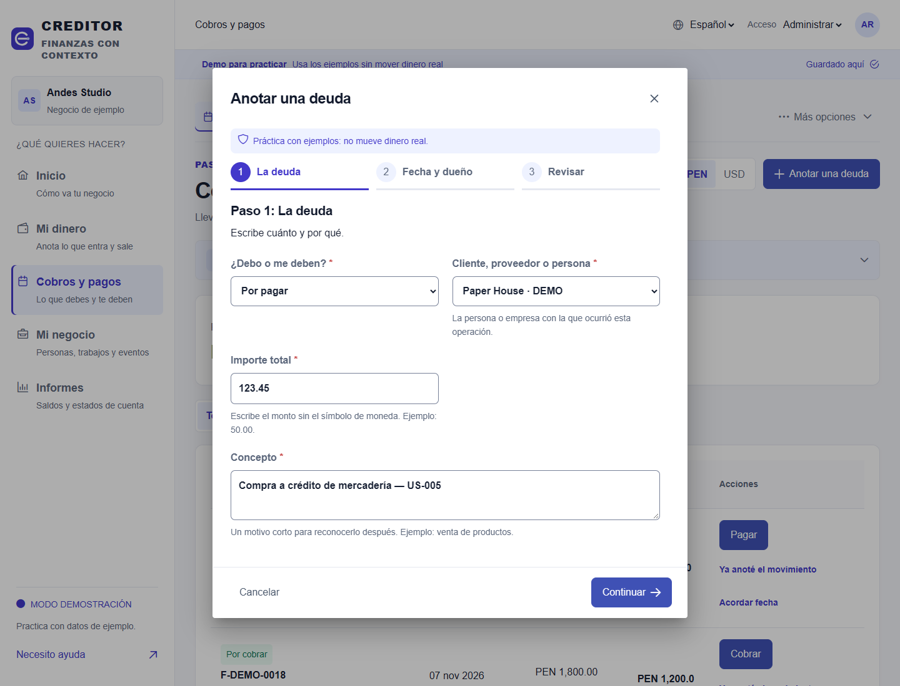
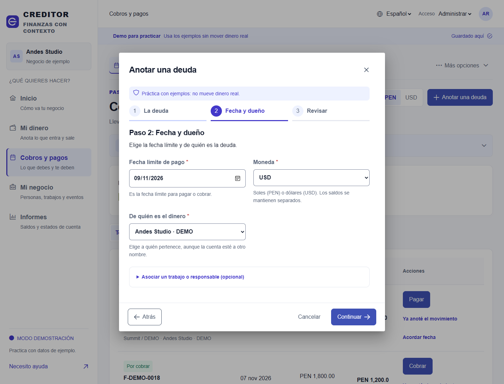
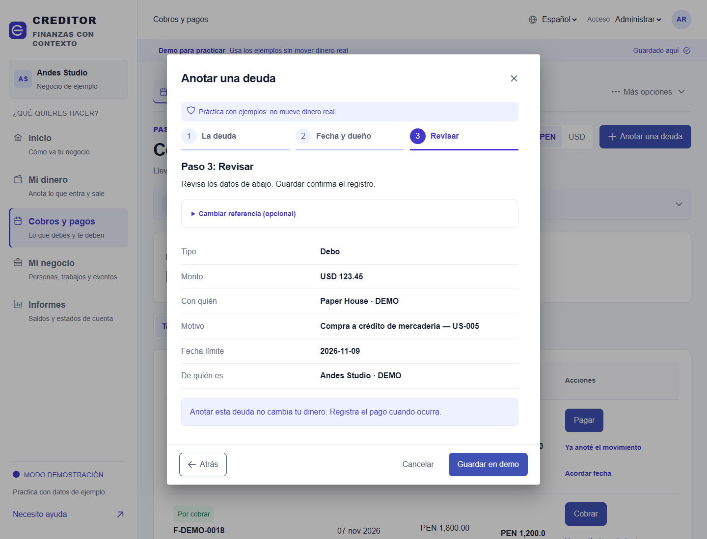

> Vista sincronizada del [informe canónico](../README.md), corte AV2 13/11/2026. Para editar contenido, modificar README y ejecutar `python tools/report/sync_chapters.py`.

# Bibliografía

Las fuentes de competencia, planes y mercado se consultaron el 03/10/2026 en sitios oficiales. [Registro detallado y límites de comparación](../assets/research/tb1/source-register.md). No se suman precios de países/planes distintos como si fueran cotizaciones equivalentes.

1. Alegra. (s. f.). *Planes y precios de contabilidad en Perú*. https://www.alegra.com/peru/contabilidad/precios/
2. Alegra. (s. f.). *Cuentas por pagar*. https://ayuda.alegra.com/es/cuentas-por-pagar
3. Odoo. (s. f.). *Planes y precios*. https://www.odoo.com/es/pricing
4. Odoo. (2026). *Vendor bills*. https://www.odoo.com/documentation/19.0/applications/finance/accounting/vendor_bills.html
5. Odoo. (2026). *Loans*. https://www.odoo.com/documentation/19.0/applications/finance/accounting/payables/loans.html
6. Zoho. (s. f.). *Zoho Books pricing, US edition*. https://www.zoho.com/us/books/pricing/
7. Zoho. (s. f.). *Vendor bills*. https://www.zoho.com/books/help/bills/
8. Ministerio de la Producción, OGEIEE. (2025). *Las Mipyme en cifras 2024*. https://www.producempresarial.pe/las-mipyme-en-cifras-2024/
9. Universidad Peruana de Ciencias Aplicadas. (2026). *Final project statement, Applications Web, versión 1.0*. Documento del curso 1ASI0730, periodo 202620, 43 páginas. TB1 pp. 31–32, Anexos A–C pp. 37–39.
10. Vue.js. (s. f.). *Vue documentation*. https://vuejs.org/guide/introduction.html
11. PrimeTek. (s. f.). *PrimeVue documentation*. https://primevue.org/introduction/

12. Allpatek / TerraNova. (2026). *Project report*. [Repositorio de referencia del esquema](https://github.com/upc-pre-202620-1asi0729-7753-Terranova/allpatek-report). Copia local Open-Source/allpatek-report/README.md consultada el 02/11/2026. Se reutiliza la organización documental, sin trasladar contenidos ni atribuciones de Open Source a CREDITOR.

### Fuentes internas de implementación y Sprint 2

Se conservan las fuentes adicionales incorporadas por la revisión remota: [evidencia técnica TB1](../docs/tb1/evidencia-local.md), [inventario de commits](../docs/tb1/commits-locales.md), [registro de ejecución de interfaz](../assets/ux/tb1/execution.json) y [historias/reglas del capítulo III](../README.md#capítulo-iii-requirements-specification). La referencia de una comprobación en GitHub el 04/10 es un antecedente de esa versión; esta reorganización inspeccionó objetos Git locales y no volvió a verificar disponibilidad remota ni repitió las pruebas.

# Anexos

| Anexo | Evidencia local | Estado y pendiente |
|---|---|---|
| A Student Outcome | [Acciones y conclusiones por integrante](../README.md#student-outcome-5). | Histórico y TB1 delimitados; reflexión/revisión del equipo pendiente. |
| B Investigación | [Entrevistas y guion](../README.md#capítulo-ii-requirements-elicitation--analysis), [plantilla de codificación](../assets/research/tb1/interview-coding-template.csv). | 4 registros existentes; faltan 2 S2, consentimientos/Stream y análisis codificado. |
| C Mapas y diseño | [Fuentes locales](../assets/research/tb1/README.md), [wireframes/flows/capturas](../assets/ux/tb1/README.md). | Propuestas locales y ejecución real; sincronización UXPressia/Figma/FigJam pendiente. |
| D Implementación | [Pruebas, versiones y capturas](../docs/tb1/evidencia-local.md), [commits por feature](../docs/tb1/commits-locales.md). | Solo local; no deployment TB1 ni API propia. |
| E Sprint | [Sprint 2 y sus ocho apartados](../README.md#522-sprint-2). | Preparación técnica; reunión, tablero, aceptación y analíticos del equipo pendientes. |
| F Paquete TB1 | [Inventario de archivos](../deliverables/tb1/README.md). | Report PDF, Keynote PPTX/PDF, Performance DOCX/PDF y ZIP locales. Performance sin calificación. |
| G Videos de Exposiciones | [Guion y tiempos](../docs/tb1/guion-exposicion.md). | Grabación MP4 y enlace privado Stream pendientes. No se sustituye con capturas. |
| H Videos de producto/equipo | Alcance AV2. | Preparar About-the-Product/About-the-Team en su hito, sin declarar grabaciones inexistentes. |
| I Revisión de retroalimentación | [Mejoras y pendientes por observación](../docs/tb1/feedback-resolution.md). | Diseño móvil/flujos/maquetación locales revisados; investigación, publicación y video requieren evidencia adicional. |

## A. Información académica y trazabilidad histórica

Los apartados 00.x conservan la numeración y el contenido del informe anterior. Versiones e Insights fueron trasladados al inicio, siguiendo el esquema de Allpatek.

### 00.1 Datos académicos

| Dato | Valor del informe |
|---|---|
| Universidad/carrera | Universidad Peruana de Ciencias Aplicadas, Ingeniería de Software. |
| Curso | 1ASI0730 Aplicaciones Web. |
| Periodo/NRC | 202620 / 16127. |
| Docente | Villafuerte Bazan, Oscar Ivan. |
| Equipo/proyecto | Grupo 2 / CREDITOR. |
| Hito/corte | TB1 Stage Review, preparación local al 03/10/2026. |
| Report | [Organización y repositorio](https://github.com/Grupo-Desarrollo-Aplicaciones-Web/upc-project-report). |
| Fecha de presentación | Confirmar horario: 24 horas antes de la segunda sesión sincrónica semanal. |

### 00.2 Integrantes e identidades de Git

El historial de `develop` permite vincular los aportes con las identidades que cada integrante utilizó. Los conteos corresponden al corte del **18 de septiembre de 2026** y sirven como referencia de trazabilidad; la calidad del aporte se evalúa por los artefactos producidos y no solo por la cantidad de commits.

| Código | Integrante | Usuario de GitHub | Identidades observadas en Git | Commits en `develop` al corte |
|---|---|---|---|---:|
| u20221a371 | Juan Manuel Santos Torres | [@JuanManuel312](https://github.com/JuanManuel312) | `JuanManuel312 <103543254+JuanManuel312@users.noreply.github.com>` | 34 |
| u20241a314 | Sebastián Gutarra Velapatiño | [@SebastianGutarra](https://github.com/SebastianGutarra) | `SebastianGutarra <166082725+SebastianGutarra@users.noreply.github.com>` y `Sebastián Gutarra <u20241a314@upc.edu.pe>` | 26 |
| u202215188 | Miguel Angel Egocheaga Suyo | [@MiguelAngel0107](https://github.com/MiguelAngel0107) | `MIguelAngelES7` y `Miguel Angel`, ambos con `95198651+MiguelAngel0107@users.noreply.github.com` | 53 |

### 00.4 Resumen de aportes por integrante

#### 00.4.1 Juan Manuel Santos Torres

1. **Introducción y enfoque Lean UX.** Elaboró contenido del Startup Profile, antecedentes, problemática, análisis 5W2H, supuestos, hipótesis y segmentos objetivo.
2. **Planificación del Sprint 1.** Documentó el Sprint Goal, las historias de la landing, criterios de aceptación, estimaciones y matriz de colaboración.
3. **Validación.** Preparó el protocolo de entrevistas de validación, tareas de usabilidad, reglas de medición e inspección de las diez heurísticas.
4. **Seguimiento de la entrega.** Registró evidencia del desarrollo, criterios de ejecución de la landing y pendientes de publicación.

Evidencias principales: [`6d5670c`](https://github.com/Grupo-Desarrollo-Aplicaciones-Web/upc-project-report/commit/6d5670c), [`d8db0dd`](https://github.com/Grupo-Desarrollo-Aplicaciones-Web/upc-project-report/commit/d8db0dd), [`a6d8e49`](https://github.com/Grupo-Desarrollo-Aplicaciones-Web/upc-project-report/commit/a6d8e49) y [`d053c0b`](https://github.com/Grupo-Desarrollo-Aplicaciones-Web/upc-project-report/commit/d053c0b).

#### 00.4.2 Sebastián Gutarra Velapatiño

1. **Identidad visual.** Incorporó el logotipo, la paleta, la muestra tipográfica y las primeras reglas de estilo de CREDITOR.
2. **Landing Page UI Design.** Avanzó el capítulo IV hasta la sección 4.3.2 con wireframes, mock-ups y el patrón visual de navegación.
3. **Diseño de la aplicación web.** Añadió el wireframe y mock-up de “Mis operaciones / Nueva operación”, posteriormente revisados dentro del alcance de CREDITOR.
4. **Investigación y personas.** Actualizó datos del registro de entrevistas e incorporó imágenes y correcciones de enlace para las User Personas.

Evidencias principales: [`7e990fb`](https://github.com/Grupo-Desarrollo-Aplicaciones-Web/upc-project-report/commit/7e990fb), [`ff39563`](https://github.com/Grupo-Desarrollo-Aplicaciones-Web/upc-project-report/commit/ff39563), [`7c41cda`](https://github.com/Grupo-Desarrollo-Aplicaciones-Web/upc-project-report/commit/7c41cda) y [`25f9923`](https://github.com/Grupo-Desarrollo-Aplicaciones-Web/upc-project-report/commit/25f9923).

#### 00.4.3 Miguel Angel Egocheaga Suyo

1. **Estructura y configuración del informe.** Inicializó el repositorio, organizó capítulos, ramas de trabajo, convenciones y control de entrega.
2. **Elicitación y especificación de requisitos.** Desarrolló el análisis competitivo, diseño de entrevistas, Needfinding preliminar, User Stories, Impact Mapping y Product Backlog.
3. **Arquitectura y diseño técnico.** Documentó arquitectura de información, flujos, EventStorming, C4, clases, modelo ER y reglas de integridad respaldadas por `database/schema.sql`.
4. **Integración GitFlow.** Preparó ramas documentales y Pull Requests hacia `develop`, verificó enlaces y diagramas, y mantuvo las fuentes Mermaid junto con sus exportaciones.

Evidencias principales: [`a4e85c6`](https://github.com/Grupo-Desarrollo-Aplicaciones-Web/upc-project-report/commit/a4e85c6), [`fcaf13a`](https://github.com/Grupo-Desarrollo-Aplicaciones-Web/upc-project-report/commit/fcaf13a), [`3086a32`](https://github.com/Grupo-Desarrollo-Aplicaciones-Web/upc-project-report/commit/3086a32) y [Pull Request #1](https://github.com/Grupo-Desarrollo-Aplicaciones-Web/upc-project-report/pull/1).

### 00.5 Matriz de responsabilidad de AV1

La tabla resume la responsabilidad que puede demostrarse con el contenido actual. “Responsable principal” identifica a quien produjo la mayor parte de la evidencia del bloque; “colaborador” reconoce aportes complementarios visibles en el historial.

| Bloque de AV1 | Responsable principal | Colaborador(es) | Evidencia en el informe |
|---|---|---|---|
| Startup Profile, problemática y Lean UX | Juan Manuel | Miguel | `docs/01-introduction.md` |
| Análisis competitivo y diseño de entrevistas | Miguel | Juan y Sebastián | `docs/02-requirements-elicitation-analysis.md` |
| Registro de entrevistas y User Personas | Sebastián | Juan | `docs/02-requirements-elicitation-analysis.md` y `assets/research/` |
| User Stories, Impact Map y Product Backlog | Miguel | Juan | `docs/03-requirements-specification.md` |
| Style Guidelines y Landing Page UI Design | Sebastián | Miguel | `docs/04-product-design.md` y `assets/branding/` |
| UX de aplicación, diagramas y prototipo especificado | Miguel | Sebastián | `docs/04-product-design.md` y `assets/architecture/` |
| Sprint 1, validación e inspección heurística | Juan Manuel | Miguel | `docs/05-implementation-validation-deployment.md` |
| Arquitectura de software y base de datos | Miguel | Sebastián, mediante insumos visuales | `docs/04-product-design.md`, `assets/architecture/` y `database/schema.sql` |
| Control de entrega y trazabilidad del informe | Miguel | Juan y Sebastián | `docs/08-av1-delivery-checklist.md` e historial Git |

### 00.7 Criterio de actualización

Este capítulo atribuye únicamente aportes respaldados por commits o artefactos presentes en el repositorio. Las entrevistas, pruebas con usuarios, despliegues, reuniones o revisiones que ocurran fuera de Git deben añadirse con su fecha, responsable y enlace de evidencia. Antes de entregar, el equipo debe revisar esta matriz y confirmar que describe su trabajo real.

### 00.12 Collaboration Insights de la preparación TB1

La nueva preparación se registra con la identidad de Miguel y conserva los aportes históricos de Juan y Sebastián. No se atribuyen los nuevos commits a otros integrantes. Las features se integraron localmente con merges `--no-ff`, sin cambiar el historial remoto ni publicar una release. El análisis de colaboración se puede reproducir con `git log --format='%h %an <%ae> %s'` en cada repositorio.

| Integrante | Evidencia histórica utilizada | Acción TB1 comprobada | Revisión siguiente |
|---|---|---|---|
| Juan Manuel | Problema, Lean UX y planificación/validación de Sprint 1. | Insumos reutilizados. Nuevas acciones TB1 no confirmadas. | Confirmar objetivo/LACX y contrastar hipótesis con entrevistas. |
| Sebastián | Marca, bocetos y registros de entrevista de AV1. | Insumos reutilizados. Nuevas acciones TB1 no confirmadas. | Revisar las pantallas actuales y trasladarlas a Figma. |
| Miguel Angel | Requisitos, arquitectura e integración del informe. | Nuevos commits personales de report, landing y frontend, pruebas y paquete local. | Coordinar revisión cruzada, grabación y publicación autorizada. |

Las tablas de commits locales son evidencia de control de versiones. Analíticos GitHub de TB1 y aprobaciones del equipo requieren publicación y participación real posterior; no se incluyen capturas reconstruidas.

## B. Evidencia local posterior al corte TB1: 02/11/2026

Este apartado actualiza la lectura del avance real sin alterar los cortes AV1/TB1. Se inspeccionaron archivos locales ya existentes; **esta revisión documental no volvió a ejecutar las pruebas de producto**. Se conservaron copias de evidencia con [manifiesto de origen y SHA-256](../assets/evidence/2026-11-02/manifest.json). Los resultados documentan ejecución local con datos ficticios; no acreditan integración completa, validación con usuarios ni despliegue.

| Producto/criterio | Evidencia existente inspeccionada | Alcance y pendiente |
|---|---|---|
| Frontend financiero Vue/PrimeVue | [Validación del 02/11](../assets/evidence/2026-11-02/frontend-validation.txt): 39 pruebas unitarias y 8 escenarios de navegador registrados; [contrato y límites de la demo](../assets/evidence/2026-11-02/frontend-financial-demo.txt). | Adaptador asíncrono `createFakeApi`, datos ficticios en navegador. La conexión HTTP con la API propia y la autorización del servidor siguen pendientes. La demo financiera posterior usa español inicialmente; el inglés por defecto descrito en TB1 corresponde al corte anterior. |
| Backend ASP.NET Core | [Verificación local](../assets/evidence/2026-11-02/backend-local-verification.txt), [arquitectura](../assets/evidence/2026-11-02/backend-architecture.txt) y [contrato de tesorería](../assets/evidence/2026-11-02/backend-treasury-api.txt). | Identidad, compras, abonos, documentos privados, CSV, adaptador BCRP y una vertical de tesorería manual implementados localmente. Transferencias, conciliación, facturas, préstamos y promesas del frontend no se declaran integrados al backend. |
| Pruebas del backend | TRX [dominio](../assets/evidence/2026-11-02/backend-domain.trx) e [integración](../assets/evidence/2026-11-02/backend-integration.trx): contadores inspeccionados, 33 + 106 = **139 aprobadas**, cero fallidas. | Registros existentes del 02/11. Pruebas aisladas con SQLite; no equivalen a ejecución PostgreSQL de producción. |
| HTTP real local | [32 comprobaciones Kestrel](../assets/evidence/2026-11-02/treasury-http-smoke.json), registradas a 2026-11-02T14:02:31.634196+00:00. | Compra PEN 100 − abono PEN 30 = saldo PEN 70. Tesorería USD 1 000 − 250 = 750: Andes 350, Marina 400 y titular 0. Datos sintéticos; no son operaciones bancarias reales. |
| PostgreSQL | El registro de backend documenta comprobación modelo/migraciones y SQL idempotente generado. | Migración, operaciones financieras y concurrencia contra PostgreSQL real pendientes; Docker estaba detenido en esa verificación. |
| Servicio externo BCRP | El registro histórico del 27/10 documenta HTTP 200 y observación del 26/10; pruebas del adaptador con respuestas controladas. | Evidencia de referencia cambiaria local; no implica conversión monetaria ejecutada, conexión bancaria ni integración del frontend. No se hizo una nueva consulta externa en esta revisión. |
| Despliegue e integración | Se conserva el deployment histórico de la landing AV1 como corte separado. | Sin evidencia verificada de nuevos frontend/backend desplegados o flujo integrado. Los criterios de TB1/AV2/TB2 que lo requieren siguen abiertos. |

### B.1 Consulta y descarga de información financiera

| Lugar actual | Acción/salida | Límite comprobado en código |
|---|---|---|
| Frontend → Mi dinero → Entradas y salidas, `#/finance/movements` | **Exportar CSV** descarga `creditor-demo-movements.csv` con movimientos demo filtrados. | `src/finance/FinanceWorkspace.vue`; exportación local del navegador. |
| Frontend → Ayuda y actividad, `#/finance/guide` | Exporta una copia JSON del conjunto local. | Copia de datos demo; no es un estado de cuenta bancario. |
| API propia separada, `GET /api/v1/purchases/export` | Descarga autenticada `creditor-obligations.csv`. | `src/Creditor.Api/Controllers/PurchasesController.cs`; aún sin conexión desde la UI financiera. |

No se acreditó un estado de cuenta bancario completo ni PDF operativo integrado. La conciliación de la demo importa extractos CSV ficticios y no conecta bancos. Estos reportes de producto son distintos del informe académico de este repositorio.

### B.2 Autorías y cortes de evidencia

Se conserva el [registro original de crédito y autoría del frontend](../assets/evidence/2026-11-02/frontend-authorship-allocation.txt). Distingue planificación compartida, `Author`, `Committer` y programación/validación realizadas por Miguel. Los seis commits por autor del corte histórico no acreditan seis aportes equivalentes de programación ni horas reales. No se reasignaron contribuciones en esta reorganización. Los hashes y artefactos históricos del informe se mantienen con su corte original.

### B.3 Evidencia posterior de US-005: compra a crédito

Evidencia local suministrada después de la reorganización del informe, con corte del **02/11/2026**. La revisión documental inspeccionó las tres capturas y conservó sus bytes originales en el repositorio. El recorrido vigente es **Cobros y pagos → Anotar una deuda → Por pagar**: proveedor, importe y concepto; moneda, vencimiento y dueño económico; revisión y guardado de la cuenta por pagar.

El ejemplo de las capturas utiliza **Paper House · DEMO**, **USD 123.45**, concepto «Compra a crédito de mercadería — US-005» y vencimiento **2026-11-09**. La revisión muestra que anotar la deuda no cambia el dinero y que el pago se registra cuando ocurre. El resultado de la prueba local comunicado para este recorrido fue el registro de una cuenta por pagar **sin generar movimiento de efectivo**. Esta revisión del informe no repitió esa prueba; las capturas conservadas muestran el formulario y la revisión previa al guardado.

**Paso 1 — Proveedor e importe de la compra a crédito.**

**Paso 2 — Moneda y fecha de vencimiento.**

**Paso 3 — Revisión de la obligación antes de guardar.**

**Estado de la observación: parcial.** Existe evidencia del flujo funcional local de compra a crédito como cuenta por pagar; no acredita el enlace final de Figma, RUC, adjunto ni detalle de productos en este registro directo. Tampoco acredita aceptación por pares, validación con usuarios, integración con la API ni despliegue. Las fuentes y SHA-256 de las tres imágenes figuran en el [manifiesto de evidencia](../assets/evidence/2026-11-02/manifest.json).

## C. Control de integridad y correspondencia con el enunciado

El informe se lee completo en **README.md**, con la jerarquía visual y navegación de Allpatek: carátula → versiones → colaboración → contenido → Student Outcome → capítulos → conclusiones/video de equipo → bibliografía → anexos. Las fuentes anteriores en `docs/`, diagramas, entregables y autorías se conservan como respaldo histórico. El README es ahora la versión documental principal; los PDF/PPTX/ZIP existentes conservan su fecha y no se anuncian regenerados por este cambio.

| Requisito del enunciado de Aplicaciones Web | Ubicación y lectura del estado |
|---|---|
| Índice y formato, pp. 4–8 | Portada, versiones, Insights e índice interno de hasta cuatro niveles. |
| Student Outcome 5, Anexo A, p. 37 | Párrafo y tabla de tres columnas, con acciones por integrante/hito y evidencia histórica conservada. Revisión/reflexión del equipo pendientes. |
| Needfinding, p. 12 | Capítulo II: tres registros S1 y uno S2 existentes. Para el mínimo de tres por segmento faltan dos S2 y completar la revisión, resúmenes, consentimiento, metadatos/capturas/Stream y análisis; no se equipara registro con entrevista validada. |
| Diseño y herramientas, pp. 29–30 | Capítulo IV: artefactos locales conservados. Sincronización UXPressia/Figma pendiente donde se exige; Mermaid/PlantUML/Structurizr DSL están permitidos para arquitectura, EventStorming, UML y datos. |
| Implementación por sprint, pp. 4–7 y 31–33 | Capítulo V conserva ocho apartados para Sprint 1/2 y reserva los ocho de Sprint 3/4 como pendientes. El backend local de noviembre tiene evidencia propia, sin cierre de sprint inventado. |
| Entrevistas de validación, p. 27 y Anexo D | 5.3.1–5.3.3: protocolo/registro/evaluaciones pendientes; 3–5 por segmento. Las pruebas automáticas no las sustituyen. |
| About-the-Product / About-the-Team, pp. 28 y 39 | 5.4 y sección de conclusiones: grabaciones, testimonios y enlaces reales pendientes. |
| Entregables e integración, pp. 2 y 31–33 | El anexo B delimita avances locales. Integración frontend/API propia y verificación del servicio tercero en el flujo final, PostgreSQL real y despliegues permanecen pendientes. |

Fuente: *Final project statement*, 1ASI0730, 202620, versión 1.0, 43 páginas. El archivo revisado es `upc-pre-202620-1asi0730-final_project-statement-abet_v1.pdf`. El enunciado fija requisitos y hitos; no contiene una tabla numérica de puntajes que permita declarar una calificación alcanzada.

### C.1 Matriz de observaciones del profesor

Las observaciones se contrastaron con el contenido actual y el registro histórico de retroalimentación. **Corregido** indica una corrección documental verificable; **parcial** exige todavía evidencia externa; **pendiente** no tiene respaldo suficiente para cerrarse. Este cuadro no cambia una calificación.

| Observación | Estado | Evidencia y corrección documental | Lo que falta para cerrarla |
|---|---|---|---|
| Omisión de frontend y Sprint 2 / 5.2.2 | **Parcial** | El informe incorpora la frontend local, Planning, LACX, siete tareas 4–8 h/43 h propuestas, desarrollo, capturas, servicios, deployment e Insights. Se rescata la ampliación documental remota de Juan y se conserva el inventario original de commits. | Acta/asignaciones aceptadas, tablero, revisión del equipo, video y despliegue real de nueva landing/frontend. |
| Marca CreditFlow mezclada con CREDITOR | **Corregido en el alcance documental actual; antecedente histórico identificado** | Portada, capítulos actuales y demo financiera se identifican como CREDITOR. El Sprint 1 archivado conserva CreditFlow con una advertencia explícita de versión previa; sus fuentes no se reescriben. | Revisar cualquier exportación histórica antes de utilizarla como una nueva entrega; los PDF/PPTX existentes no se regeneraron aquí. |
| Mockup de préstamo no corresponde a US-005 compra a crédito | **Parcial: flujo local de compra a crédito evidenciado** | [Anexo B.3](../README.md#b3-evidencia-posterior-de-us-005-compra-a-crédito): Cobros y pagos → Anotar una deuda → Por pagar, con proveedor, importe, moneda y vencimiento. Tres capturas inspeccionadas y resultado de prueba local comunicado: registro de cuenta por pagar sin movimiento de efectivo. Se conserva el prototipado histórico de Sebastián. | Enlace final Figma desktop/mobile, revisión del equipo y criterios completos. La evidencia nueva no acredita RUC, adjunto ni detalle de productos en el registro directo, ni validación con usuarios. |
| Falta PR y revisión por pares | **Pendiente para este incremento** | Se conserva la referencia histórica a PR #1 y los commits/merges existentes. El README no presenta una rama o merge local como revisión de otro integrante. | PR real, revisión identificable de otro integrante, observaciones resueltas y aprobación; no se fabricaron comentarios ni PR. |
| Fecha incorrecta y encabezados AV1 | **Corregido documentalmente** | Carátula de revisión local de noviembre de 2026, curso/periodo/equipo conservados; fechas AV1/TB1 se mantienen únicamente como cortes históricos. Se distinguen portada actual y evidencia anterior. | Confirmar fecha/horario de presentación y el hito de entrega real con el equipo. |
| Entrevistas incompletas | **Pendiente** | 2.2 conserva tres registros S1 y uno S2, con guion y controles de evidencia; no se declara completado el mínimo por segmento. | Al menos dos S2 adicionales y revisión de los cuatro registros, consentimiento, resúmenes, capturas, metadatos, Stream y análisis con citas/minutos. |
| Pruebas de usabilidad / validación | **Pendiente** | 5.3.1–5.3.3 organizan protocolo, registro y heurísticas. Se distinguen resultados automáticos existentes de sesiones con usuarios. | 3–5 entrevistas de validación por segmento, tareas observadas, hallazgos y evidencia audiovisual auténtica. |
| Integración, publicación y videos | **Actualizado técnicamente; pendientes externos** | El anexo B conserva el corte 02/11. La integración actual se documenta en Sprint 3; enlaces históricos de Product/Team se conservaron sin presumir validación. | El estado técnico actual sustituye este pendiente histórico en la matriz AV2: integración frontend/API y cambio a MySQL. Publicación HTTPS, grabaciones vigentes y aceptación continúan requiriendo evidencia. |

Herramientas locales: `python tools/report/validate_report.py` valida estructura, enlaces/recursos locales y copias de evidencia; `python tools/tb1/update_index.py` actualiza únicamente el índice interno del documento. La exportación histórica usa ahora el README completo para evitar duplicar los capítulos.

## Evidencia de publicación futura

Para cerrar TB1 después de autorización se incorporarán URL HTTPS de la nueva landing y primera frontend, SHA, fecha/run y capturas verificadas. El registro histórico observó el report como privado; su visibilidad actual no fue revalidada y no se modificó durante esta preparación local.

## D. Preparación y entregables TB1 históricos

Informe actualizado para revisión local al 03/10/2026. La nueva landing y primera frontend se encuentran en repositorios locales independientes. [Evidencia técnica](../docs/tb1/evidencia-local.md), [commits por feature](../docs/tb1/commits-locales.md), [control de entrega](../README.md#control-de-entrega-tb1-histórico) y [archivos TB1](../deliverables/tb1/README.md).

Preparación de la exposición: [prompt detallado para crear el PPT](../docs/tb1/prompt-crear-ppt.md) y [guion por diapositiva](../docs/tb1/guion-ppt-detallado.md), con video de 27:30 y ruta de sustentación de 12:00. Estos documentos no sustituyen la presentación y grabación reales.

[Presentación ampliada de 40 diapositivas](../deliverables/tb1/keynote-expanded/README.md): PPTX editable con notas y recorridos personalizados, más PDF de lectura. Se conserva la presentación anterior.

[Guiones individuales de Juan, Sebastián y Miguel](../docs/tb1/expositores/README.md): parlamentos completos, tiempos y acciones por expositor, con versiones Word y PDF para ensayar en clase o grabar el video.

La preparación no incluye push ni deployment. Las entrevistas adicionales, revisión en herramientas externas, acuerdos del equipo, desempeño y video permanecen pendientes cuando no existe evidencia.

## Control de entrega AV1 histórico

Esta ficha conserva pendientes del corte histórico AV1, no describe el avance actual TB1. Consultar el [control TB1](../README.md#control-de-entrega-tb1-histórico) y [ejecución local](../docs/tb1/evidencia-local.md).

Esta lista organiza los entregables de AV1. Un ítem solo se marca como listo al tener su archivo, enlace o evidencia verificable.

| Entregable | Evidencia esperada | Estado actual |
|---|---|---|
| Project Report | Informe completo, PDF exportado y repositorio Markdown actualizado. | Estructura y borradores avanzados; faltan evidencias de investigación, prototipos y datos académicos. |
| Keynote | Archivo editable y PDF con producto, equipo, avance y fotos autorizadas. | Pendiente. |
| Individual Member Performance Report | Documento del líder con aportes verificables de cada integrante. | Pendiente. |
| Supporting files | ZIP con artefactos necesarios para la evaluación. | Pendiente de definir contenido final. |
| Landing Page | URL HTTPS, commit desplegado, captura y verificación. | Publicación histórica del 18/09/2026, commit `cf734ff`. Correcciones TB1 locales documentadas aparte. |
| Video About-the-Product (hito AV2) | Video privado de Microsoft Stream y MP4, enlazado en anexos. | Pendiente. |
| Video About-the-Team (hito AV2) | Video privado de Microsoft Stream y MP4, enlazado en anexos. | Pendiente. |

### Revisión previa a publicación

1. Confirmar NRC, docente, fecha y perfiles de GitHub de todos los integrantes.
2. Completar seis o más entrevistas autorizadas, sus enlaces privados y el análisis por segmento.
3. Sustituir los borradores de personas, journey maps, empathy maps, EventStorming e Impact Map por artefactos con fuentes y capturas.
4. Revisar User Stories, prioridades y Sprint Backlog con los resultados de investigación.
5. Crear y enlazar wireframes, mock-ups y prototipo navegable reales.
6. Publicar la landing CREDITOR y registrar URL, proveedor, commit y verificación.
7. Verificar que cada integrante tenga contribuciones propias antes de preparar el PDF final.
8. Crear una rama `release/av1.0.0` solo cuando la lista esté completa y la versión sea revisable.

### Revisión del índice del capítulo IV frente al enunciado

El capítulo IV es parte de AV1. «Diseño documentado» significa que hay una especificación y un diagrama revisable; no equivale a prototipo aprobado, implementación o evidencia de una sesión de equipo.

| Ítem | Estado del informe | Evidencia que falta para cerrar AV1 |
|---|---|---|
| 4.1 Style Guidelines | Guías generales y web documentadas con marca, tipografía, colores y reglas de accesibilidad. | Verificar su aplicación en la landing final. |
| 4.2 Information Architecture | Mapa visual, organización, etiquetas, metadatos, búsqueda y navegación definidos. | Validar etiquetas y destinos de CTA con usuarios y aplicación real. |
| 4.3 Landing Page UI Design | Wireframes y mock-ups de referencia adjuntos; se identifican textos de CreditFlow que no corresponden a CREDITOR. | Actualizar y enlazar las vistas finales en Figma. |
| 4.4 Web Applications UX/UI Design | Pantallas, wireflow y cinco User Flows visuales especificados. Se conservaron el wireframe y mock-up aportados por el equipo. | Ajustar el mock-up de préstamo al flujo de compra prioritario, completar pantallas y revisar los flujos en Figma o herramienta equivalente. |
| 4.5 Web Applications Prototyping | Recorridos y criterios de interacción definidos. | Prototipo navegable de escritorio/móvil, enlace y video de navegación. |
| 4.6 Domain-Driven Software Architecture | EventStorming de diseño propuesto y diagramas de contexto, contenedores y componentes renderizados. | Sesión colaborativa documentada; revisión de límites de dominio y servicio externo elegido. |
| 4.7 Software Object-Oriented Design | Diagrama de clases con atributos, métodos, enumeraciones, relaciones y multiplicidades. | Revisión contra las clases C# cuando exista el backend. |
| 4.8 Database Design | Diagrama general y diagramas por contexto, con tablas, columnas, claves y restricciones respaldadas por SQL. | Aplicar migraciones en PostgreSQL y comprobar integridad con datos de prueba cuando exista la API. |

El enunciado permite Mermaid como Diagram-as-Code para UML, C4, ERD y EventStorming. Los SVG del capítulo IV se generaron desde fuentes `.mmd` editables. Las capturas de Figma, UXPressia, entrevistas, despliegue y colaboración solo se incorporarán cuando el equipo las produzca realmente.

## Control de entrega TB1 histórico

Corte: 3 de octubre de 2026. La preparación solicitada permanece local. Para cada criterio se distingue el artefacto técnico y la evidencia académica requerida.

| Criterio del hito | Preparación local | Pendiente para entrega |
|---|---|---|
| Registro de versiones, Insights y Student Outcome | Actualización TB1 con autoría real. | Validación de aportes/revisión del equipo y analíticos. |
| Artefactos previos corregidos | Lean UX, entrevistas, requisitos, dominio y fuentes revisados. | Entrevistas S2, codificación, evidencia UXPressia/Figma y sesiones reales. |
| Nueva landing | Código, legal, i18n/a11y y CTA preparados. | Publicación de versión nueva y verificación HTTPS. |
| Primera frontend | Flujos US-004–007 y datos demo locales. | Publicación, revisión del equipo e integración API futura AV2. |
| Sprint 2: ocho apartados | Ficha, backlog textual, commits y pruebas locales. | Acta/horario, acuerdos LACX, tablero y video navegación. |
| Project Report PDF | Exportación integral local. | Revisión final y contenido humano pendiente. |
| Keynote PPTX/PDF | Presentación TB1 local. | Ensayo y validación del equipo. |
| Performance DOCX/PDF | Formato por integrante y responsabilidades. | Team Leader y calificación/cumplimiento validados. |
| ZIP complementario | Fuentes/artefactos pertinentes, sin dependencias ni secretos. | Selección final acorde a las versiones entregadas. |
| Exposición | Guion y distribución temporal. | Grabación real MP4, Stream y anexo de enlace. |

El criterio de deployment del curso no queda cerrado por build local. Se respetó la excepción solicitada. Backend desplegado y videos About-the-Product/About-the-Team pertenecen a AV2.

### Comprobaciones finales

- Enlaces e imágenes locales resuelven.
- Modelos, historias y campos del incremento son consistentes.
- npm ci/test/build y escenarios de navegación registran resultados reales.
- Se conservan inglés por defecto, español latinoamericano y moneda propia del dato.
- Features y commits personales permiten revisar cambios sin modificar main.
- El PDF completo, presentación y formatos abren correctamente.
- Se identifican fuentes humanas pendientes sin atribuir reuniones/pruebas no realizadas.

La [revisión de retroalimentación](../docs/tb1/feedback-resolution.md) identifica las correcciones posteriores: wireframes móviles explícitos, flujos con errores/cancelaciones, tareas de 4–8 horas y PDF con cada sección numerada en página nueva. Completar una mejora documental no cambia por sí solo la calificación del curso ni cierra entrevistas, prototipo en Figma, deployment público o grabación.

## E. Reconciliación de las versiones local y remota

Se utilizó `develop` local `1da2d25` como base y se contrastó la referencia remota ya guardada `origin/develop` en `fda83ad` (09/10/2026). Al iniciar había 19 commits exclusivos locales y 23 de esa referencia. No se hizo fetch, pull ni sustitución global: esa comparación eliminaba numerosos recursos, guiones, controles de entrevistas y correcciones móviles.

Se incorporaron selectivamente la ampliación coherente de Sprint 2, sus fuentes internas y la captura de prototipado. Se conservaron las siete tareas de 4–8 horas, controles de investigación, caminos alternativos, presentaciones y guiones locales. Las referencias de Git originales se mantienen sin reescritura.

Las versiones remotas de los capítulos y su README se conservan como [copias exactas con manifiesto SHA-256](../assets/history/origin-develop-fda83ad/manifest.json). Son evidencia histórica de lo recibido, no una ratificación de todas sus afirmaciones. La tabla de commits del capítulo V remoto contiene etiquetas/enlaces/autores incompatibles con algunos objetos Git; para el contenido actual se utiliza el inventario canónico de Sprint 2 y la identidad del objeto, sin reproducir esas reasignaciones. Las propuestas de responsables no se convierten en aportes realizados. Los enlaces históricos a capturas inexistentes no se presentan como imágenes disponibles.

La rama de revisión incorpora contenido de ambos conjuntos; la divergencia de `develop` frente al remoto no se resolvió mediante una fusión global ni publicación. El checkout original y sus ramas de entrega se conservan. Esta organización permite revisar el documento y decidir la integración posterior con todo el historial disponible.

### E.1 Aportes posteriores disponibles en origin/main

La referencia remota ya guardada `origin/main` termina en `42e2d96` (27/10/2026) y contiene 18 commits de Sebastián posteriores a main local `0e68b7a`. Se revisó sin fetch y se conserva su historia en la integración local. Aporta cuatro capturas, ampliaciones documentales de Sprint 2 y correcciones de marca. Las capturas se incorporan en 4.4.3; las ampliaciones de sprint se cotejan con las fuentes ya conservadas.

Los archivos exactos de esa referencia se preservan con [manifiesto SHA-256](../assets/history/origin-main-42e2d96/manifest.json). Algunas filas pasan a «Realizado» sin adjuntar una prueba nueva; ese estado se registra como declaración de la versión y no como resultado verificado del incremento AV2. La tabla de commits contiene etiquetas, repositorios, autores y hashes cruzados, por lo que el inventario vigente utiliza objetos Git y conserva la tabla original solo como antecedente.

La referencia contiene un archivo de texto en `assets/ux/tb1`, mientras el documento integrado usa allí un directorio con capturas y recursos. Se conserva el archivo histórico dentro del snapshot y se mantiene el directorio de recursos operativo. No se borran esos artefactos para resolver el conflicto. Los cambios de fecha, marca y enlaces válidos se incorporan; las entrevistas, sesiones y revisiones no se dan por realizadas solamente por el cambio de una etiqueta.

## F. Auditoría de coherencia AV2: 13/11/2026

Se revisaron todas las secciones numeradas del documento contra el código y se mantuvo el corte histórico de las evidencias anteriores. El [barrido por sección](../docs/av2/auditoria-por-seccion.md) especifica fuente, corrección y límite para cada apartado. La [matriz del incremento](../docs/av2/estado-implementacion.md) distingue funciones conectadas, demo, API sin pantalla, resultados de prueba y pendientes. Los capítulos III–V y los diagramas AV2 son la especificación vigente; los PDF/PPTX históricos no fueron regenerados por esta revisión.

La rama de actualización se crea desde develop y preserva `feature/report-unified-allpatek` y los aportes locales de main mediante merges. La incorporación no publica nada, no altera main y no transforma una contribución histórica en trabajo realizado por otro autor.
