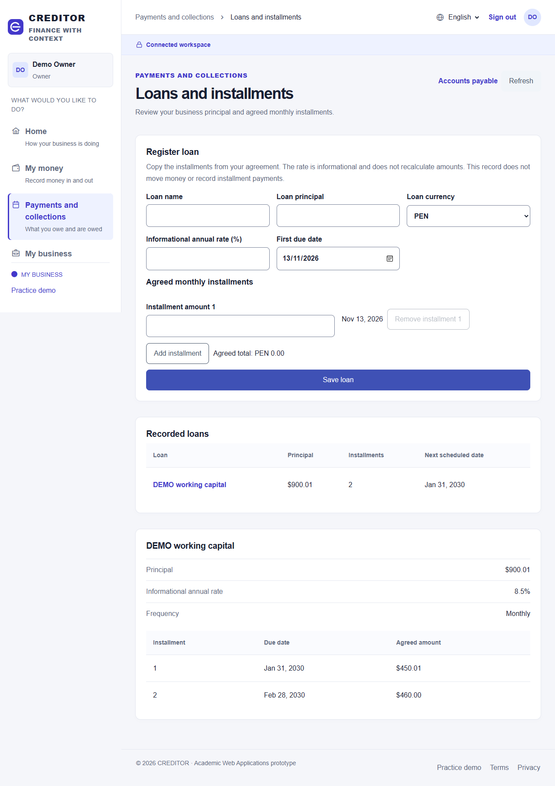
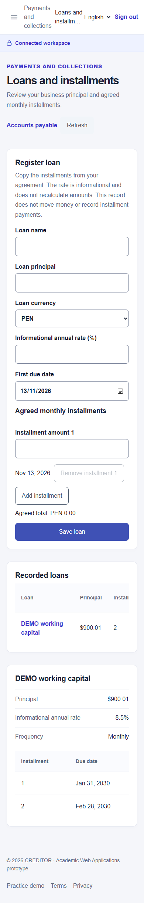
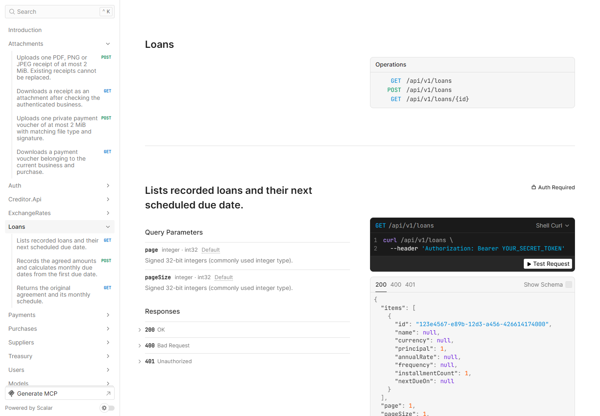

# Estado de implementación AV2

Corte documental: **13/11/2026**. Repositorios locales bajo `Documents/GitHub/Grupo-Desarrollo-Aplicaciones-Web`. Los resultados se atribuyen al código ejecutado y al motor indicado. Preparación local, sin push ni release. La revisión de enlaces locales no verifica disponibilidad de servicios externos.

## Correspondencia funcional

| Función visible o requerida | Frontend conectado | Backend | Límite |
|---|---|---|---|
| Registro de negocio/login | Identity; formulario conserva shell original. | Identity/JWT, contraseñas hash, límites de autenticación. | Token en memoria; recargar exige login. |
| Proveedores | Alta con nombre/email/RUC o identificador/telefono. | Supplier y consultas por negocio. | No consulta pública RUC ni validación SUNAT. |
| Compras | Alta, listado, detalle y resumen. | Purchase, FK por negocio y referencia normalizada única. | No factura tributaria ni inventario. |
| Abonos | Alta sucesiva, historial y saldo. | Payment dentro de Purchase; inserción explícita y concurrencia. | No pasarela ni movimiento automático de caja. |
| Comprobante/voucher | Adjuntar y descargar. | Metadata y archivo privado, autorización, tamaño/tipo. | No OCR ni verificación fiscal. |
| Filtros/CSV | Lista, resumen y export usan criterios aplicados. | Queries filtra negocio/texto/proveedor/moneda/estado/vencimiento. | No XLSX ni reporte PDF en servidor. |
| Préstamos | Lista/alta/detalle de cuotas acordadas. | Loan/LoanInstallment con importes explícitos. | Sin amortización automática, desembolso, pagos o estado de cuota. |
| Tesorería | Personas, proyectos, cuentas, movimientos y asignación. | CashAccount y repositorio, requestId idempotente. | Registro manual; sin banco real. |
| Estado de cuenta | Reports lee movimientos/asignaciones. | Rutas de tesorería; la UI compone el reporte. | No confundir con CSV de obligaciones ni estado bancario oficial. |
| Gestión de miembros | No hay formulario específico conectado. | POST /users, solo Owner. | Operable por API/Scalar. |
| Cotización externa | No hay vista específica conectada. | BCRPData/SBS y contrato de cotización. | No convierte operaciones ni mezcla monedas. |
| Cobros a clientes/facturas/promesas | Solo práctica. | Sin casos de uso equivalentes. | No se presentan como completados por la API. |
| Transferencias/reversos/conciliación | Solo práctica. | Sin casos de uso equivalentes. | Cambiar un tipo de movimiento no implementa esas transacciones compuestas. |

## Trazabilidad del código

| Área | Fuente inspeccionada en su repositorio |
|---|---|
| Saldo y abonos | `creditor-backend/src/Creditor.Domain/AccountsPayable/Purchase.cs`; `AccountsPayableService`; `EfAccountsPayableRepository`. |
| Filtros/lista/resumen/CSV | `AccountsPayableQueries.cs`; `creditor-web-app/src/contexts/accounts-payable/{infrastructure,application,presentation}`. |
| Préstamos | `Creditor.Domain/Loans/Loan.cs`, `Creditor.Application/Loans/LoanService.cs`, `LoansController`, adaptador y vista `contexts/loans`. |
| Base de datos | `CreditorDbContext`, configuraciones de Infrastructure y migraciones del proveedor. |
| Identidad | `Program.cs`, `CurrentUser`, `IdentityService` y `contexts/identity/application/session.js`. |
| Tesorería | `Creditor.Domain/Treasury`, `TreasuryService`, `EfTreasuryRepository`, contexto frontend treasury. |
| Documentos | `AttachmentService`, `AttachmentConfiguration`, `AttachmentsController`, `AttachmentPanel.vue`. |
| Externo | `BcrpExchangeRateService`, `ExchangeRateOptions`, `ExchangeRatesController`. |
| Interfaz original | `src/App.vue`, `src/finance`, `src/styles.css`, `src/router.js`. |

## Verificación observada

Evidencia copiada sin modificar y protegida con [manifiesto SHA-256](../../assets/evidence/2026-11-13/manifest.json); [contadores extraídos de TRX/JUnit](../../assets/evidence/2026-11-13/results-summary.json). Los escenarios de navegador son los mismos cuatro contra dos proveedores, no ocho flujos distintos. No se usa el resultado de SQLite para dar por aprobado MySQL.

| Ejecución | Resultado observado | Evidencia |
|---|---|---|
| Dominio backend | 33 aprobadas. | Registro de ejecución del backend; invariantes de agregados. |
| Baseline API SQLite | 113 aprobadas, 0 fallos. | [TRX SQLite](../../assets/evidence/2026-11-13/sqlite-baseline.trx). |
| Migraciones PostgreSQL | 17 aprobadas, 0 fallos/omitidas. | [TRX PostgreSQL](../../assets/evidence/2026-11-13/postgres-baseline.trx). |
| API con configuración MySQL | 113 aprobadas, 0 fallos: 109 usan MySQL y 4 conservan archivos SQLite explícitos por compatibilidad. | [TRX general](../../assets/evidence/2026-11-13/mysql-general.trx). |
| Migraciones MySQL | 15 aprobadas, 0 fallos/omitidas. | [TRX MySQL](../../assets/evidence/2026-11-13/mysql-migrations.trx). |
| Vue unitarias/build | 71 aprobadas y build correcto. | [Registro frontend](../../assets/evidence/2026-11-13/frontend-review.md). |
| Navegador de práctica | 22 aprobadas. | Mismo registro, suite independiente de API. |
| Vue ↔ ASP.NET ↔ PostgreSQL | 4 aprobadas, 0 fallos/omitidas. | [JUnit PostgreSQL](../../assets/evidence/2026-11-13/frontend-postgres.xml). |
| Vue ↔ ASP.NET ↔ MySQL | 4 aprobadas, 0 fallos/omitidas. | [JUnit MySQL](../../assets/evidence/2026-11-13/frontend-mysql.xml). |
| Contrato OpenAPI/Scalar | 3 aprobadas; navegador real sin errores/requests fallidas. | [TRX](../../assets/evidence/2026-11-13/scalar-docs.trx) y [registro del navegador](../../assets/evidence/2026-11-13/scalar-browser.json). |
| Servicio externo desde backend MySQL | HTTP 200 con fuente, atribución y fecha, consulta real del 13/11/2026. | [BCRPData/SBS](../../assets/evidence/2026-11-13/external-provider-probe.json). |

La suite conectada comprueba: compra PEN 125.75, abonos de 25.50 y 10.25, saldo 90.00 e historial después de volver a iniciar sesión; filtra por proveedor/moneda/estado/fechas y lee el CSV; liquida los 90.00 restantes y verifica que desaparezca del filtro pendiente sin perder detalle. Un fallo de summary bloquea la descarga hasta refrescar correctamente. El préstamo USD 900.01 conserva cuotas 450.01/460.00, tasa informativa 8.5 y fechas 31/01/2030 y 28/02/2030 tras recarga/login. También se prueban permisos Viewer, negocio ajeno, tesorería y falta de desbordamiento móvil.

Las migraciones MySQL incluyen esquema vacío y reaplicación, SQL idempotente repetido con datos ficticios, reinicio con usuarios/abonos/cuotas/tesorería intactos, restricciones de monto/moneda/fecha, importes extremos, concurrencia, recibo/vouchers e integridad por negocio. No se afirma que esto cubra todo escenario productivo.

### Capturas de la ejecución conectada con MySQL

## Cambio de motor y documentación

MySQL 8.4 es el motor elegido. Se conserva PostgreSQL como regresión y no se eliminan sus migraciones. La migración de esquema MySQL usa `Creditor.Migrations.MySql` y comienza en `20261113220305_InitialMySqlWorkspace`; no convierte automáticamente los registros de PostgreSQL/SQLite. Scalar presenta el contrato generado en `/scalar/v1`, disponible con el arranque cotidiano en `http://127.0.0.1:5188/scalar/v1`; el JSON sigue en `/swagger/v1/swagger.json`. Swashbuckle genera OpenAPI y Scalar reemplaza la interfaz de documentación. La comprobación en navegador usó el puerto aislado 5196: documento, JavaScript y favicon respondieron 200; se verificaron 31 paths documentados, operaciones Loans renderizadas y ausencia de errores. No representa publicación remota.

La llamada externa real a BCRPData/SBS devolvió HTTP 200, serie PD04640PD con fecha de observación 12/11 y recuperación 13/11; el JSON conserva atribución y URL de fuente. Es evidencia de comunicación con el proveedor, separada de pruebas simuladas y de cualquier consejo financiero. El frontend no aplica esa cotización automáticamente a saldos históricos.

## Límites que permanecen abiertos

1. Aceptación del sprint, revisión por pares, tablero y datos de desempeño del equipo.
2. Dos entrevistas S2 adicionales según el corte documentado, revisión de registros existentes y validación de usabilidad por segmento.
3. Sincronización/verificación de prototipos en herramientas requeridas y videos vigentes de producto/equipo.
4. Despliegue nuevo y prueba HTTPS; el usuario pidió mantener el trabajo local.
5. Conversión explícita de datos anteriores entre motores si se necesita conservarlos en MySQL; no se presume hecha por cambiar la configuración.
6. Decidir el backlog de las capacidades demo sin API y de las APIs sin pantalla. Las pruebas del incremento no acreditan cobertura funcional total de la demo.

## Cadena MySQL comprobada

- `20261113220305_InitialMySqlWorkspace`.
- `20261113221419_PreserveNormalizedReferenceAccents`.

La migración de referencias preserva la distinción entre CAFE y CAFÉ usando collation binaria para la referencia normalizada, manteniendo la comparación de mayúsculas mediante la normalización del dominio. El upgrade se verifica con datos ficticios existentes; no reescribe los importes ni referencias de negocio.
