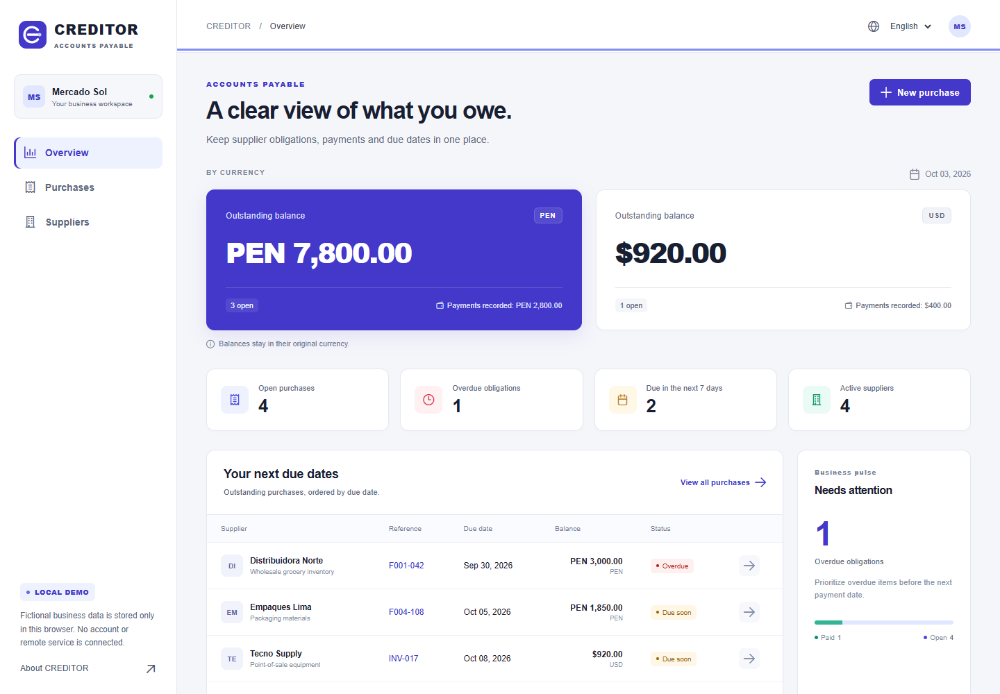
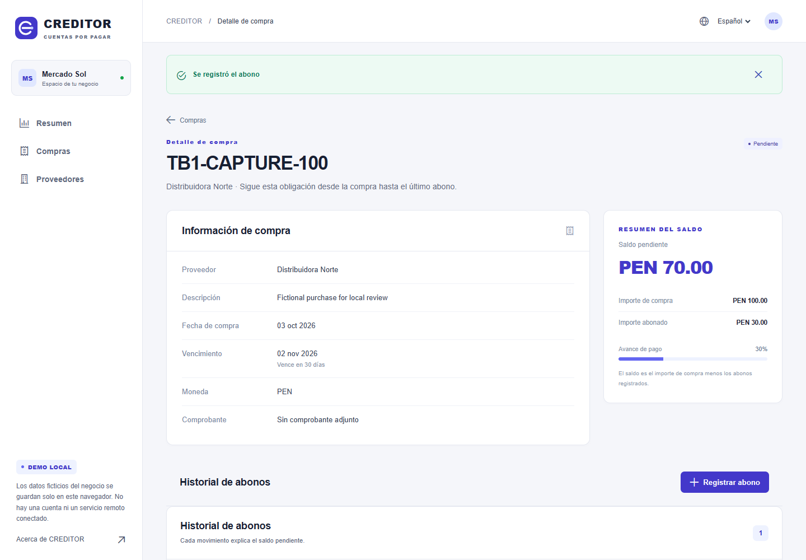
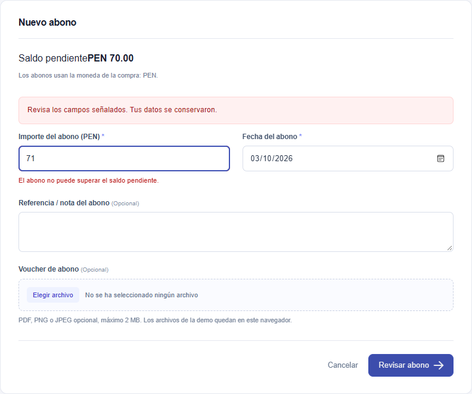

# 5.2.2. Sprint 2

**Corte de implementación:** 03/10/2026. **Revisión documental remota:** 04/10/2026. El incremento de CREDITOR incorpora consulta de obligaciones, registro de compras, abonos e historial con datos de demostración. Esta revisión utiliza los archivos de `develop`, el registro de ejecución y los commits consultables mediante GitHub.

El informe y sus evidencias ya están disponibles en el repositorio remoto. La implementación nueva de landing y frontend continúa descrita por la evidencia del 03/10 como local: no se encontró un remoto de `creditor-web-app` entre los repositorios accesibles de la organización. Los resultados de pruebas se citan del registro existente; no se han vuelto a ejecutar en esta revisión documental.

## 5.2.2.1 Sprint Planning 2

| Campo | Registro |
|---|---|
| Fecha/hora/lugar de reunión | Pendiente de registro del equipo. No se declara una reunión realizada. |
| Prepared by | Miguel Angel Egocheaga Suyo, preparación técnica local del informe. |
| Attendees | Pendiente de confirmar por el equipo. |
| Review Sprint 1 | Landing existente publicada el 18/09; informe y diseño requieren alineación al dominio de cuentas por pagar. |
| Retrospective Sprint 1 | Historial combina features/merges y cargas directas; mantener revisión y commits por bloque en el incremento. La sesión de retrospectiva no está registrada. |
| Sprint Goal propuesto | Propietario consulta saldo/vencimiento por moneda y administrador registra compra/abono conservando la composición del saldo. |
| Comprobación técnica | Compra PEN 100 y abono 30 producen saldo PEN 70; abono 71 se rechaza; importes USD no se suman a PEN. |
| Capacidad/Velocity | El equipo debe confirmar capacidad. No se dispone de velocidad real medida. |
| Historias de frontend | US-004 (8 SP), US-005 (8 SP), US-006 (5 SP), US-007 (5 SP): 26 SP relativos de la planificación existente. |
| Alcance adicional | Corrección de landing, i18n/a11y, términos, pruebas locales y evidencia del report. |

### Alcance y criterios de revisión

- Incluido: US-004–007, ajustes de US-001–003, ES/EN, accesibilidad, reglas de compra/abono, evidencia y documentación.
- Próximo incremento: US-008/009, API propia, autenticación, autorización, transacciones y persistencia de servidor.
- Fechas de inicio/fin, horario, lugar, participantes y capacidad del sprint: el equipo debe confirmarlos; el 03/10 es la fecha de evidencia técnica, no una duración inferida.

### Definition of Done para aceptación del incremento

1. La historia satisface sus criterios del [capítulo III](../03-requirements-specification.md).
2. El código y su commit de entrega pueden revisarse y reproducirse.
3. Build y pruebas pertinentes tienen un resultado registrado para la versión evaluada.
4. Monedas, validaciones, errores, navegación e idiomas conservan las reglas del dominio.
5. La documentación diferencia datos de demostración de operaciones de servidor.
6. El equipo registra revisión y aceptación. Si el criterio del hito exige publicación, se añade su URL y evidencia de deployment.

La evidencia técnica disponible permite **To-Review**; no permite declarar velocidad aceptada ni todas las historias Done sin el cierre del equipo.

## 5.2.2.2 Aspect Leaders and Collaborators

La matriz siguiente propone la revisión del incremento a partir de los roles históricos; no acredita una asignación acordada en reunión. Los commits de preparación del informe consultados en GitHub están asociados a @MiguelAngel0107. La propuesta de roles no acredita reuniones ni revisión de los demás integrantes.

| Integrante | GitHub | Producto/investigación | Diseño/revisión visual | Implementación/integración | Estado de acuerdo |
|---|---|---|---|---|---|
| Santos Torres, Juan Manuel | JuanManuel312 | L | C | C | Por confirmar para TB1. |
| Gutarra Velapatiño, Sebastián | SebastianGutarra | C | L | C | Por confirmar para TB1. |
| Egocheaga Suyo, Miguel Angel | MiguelAngel0107 | C | C | L | Autor comprobado de los commits de preparación del informe. |

L = líder propuesto del aspecto. C = colaborador propuesto. Los aportes realizados se comprueban con el historial; el Performance Report los evalúa por separado.

## 5.2.2.3 Sprint Backlog 2

El tablero del curso en Trello/Jira/YouTrack queda pendiente de sincronización. Esta tabla local conserva los work-items textuales para revisión, con estimaciones propuestas en horas; no son horas trabajadas.

| Story | Task | Descripción | Est. h | Assigned to | Estado de aceptación |
|---|---|---|---:|---|---|
| US-004 | T2-01 | Dashboard de saldos separados por moneda y vencimientos. | 4 | Miguel, preparación local | Implementación local; ver evidencia de ejecución. |
| US-004 | T2-02 | Filtros por proveedor/estado/moneda y rutas a detalle. | 3 | Miguel, preparación local | Implementación local; ver evidencia de ejecución. |
| US-005 | T2-03 | Formulario de compra con proveedor, moneda, importe, fecha y comprobante demo. | 5 | Miguel, preparación local | Implementación local; ver evidencia de ejecución. |
| US-005 | T2-04 | Validar campos, tenant de proveedor y manejo de errores. | 3 | Miguel, preparación local | Implementación local; ver evidencia de ejecución. |
| US-006 | T2-05 | Registrar abono y conservar historial/saldo en centavos. | 4 | Miguel, preparación local | Implementación local; ver evidencia de ejecución. |
| US-006 | T2-06 | Rechazar importe superior al saldo y conservar formulario. | 2 | Miguel, preparación local | Implementación local; ver evidencia de ejecución. |
| US-007 | T2-07 | Detalle con total, movimientos, fecha y referencia del voucher. | 3 | Miguel, preparación local | Implementación local; ver evidencia de ejecución. |
| US-001/003 | T2-08 | Landing CREDITOR, CTA por segmento y destinos legales. | 4 | Miguel, preparación local | Implementación local; ver evidencia de ejecución. |
| US-002 | T2-09 | Contacto de demostración honesto, sin prometer envío de email. | 2 | Miguel, preparación local | Contrato ajustado al alcance local. |
| Calidad | T2-10 | Inglés/es419, teclado, responsive y casos automatizados. | 4 | Miguel, preparación local | Verificación técnica local. |
| Report | T2-11 | Investigación, requisitos, modelos y evidencia de Sprint 2. | 5 | Miguel, preparación local | Preparado; fuentes humanas pendientes identificadas. |
| Entrega | T2-12 | Capturas, PDF, Keynote, formato performance y guion. | 4 | Miguel, preparación local | Artefactos locales; revisión del equipo pendiente. |

Total estimado propuesto: 43 horas. Los estados To-do/In-Process/To-Review/Done del tablero académico se confirmarán con el equipo; la entrega local técnica pasa a To-Review con sus resultados de prueba.

### Trazabilidad entre historias y cambios

| Historia / aspecto | Cambios registrados | Evidencia de aceptación disponible |
|---|---|---|
| US-004: obligaciones | `c545241`, dashboard, proveedores y filtros. | Captura dashboard y registro local de pruebas; revisión del equipo pendiente. |
| US-005: compra | `65d32b9`, `c545241`, reglas y formulario. | Pruebas de dominio y escenario de compra de PEN 100. |
| US-006: abono | `ee71505`, regla de saldo. | Abono de PEN 30 y rechazo de PEN 71 frente a saldo 70. |
| US-007: historial | `8f50367`, `799dbe3`. | Detalle, historial y persistencia después de recargar. |
| US-001–003: landing | `8fdd291`, `099ed12`, `ed3f923`. | CTA a aplicación local, contacto de demostración y páginas legales. |
| Calidad | `62eceff`, `c907c5a`, `fa9155c`. | Pruebas registradas y capturas ES/EN, escritorio/móvil. |
| Informe | `b9a2bb4`, `775efaf`, `967ff5f`. | Sprint, criterios y evidencia publicados en el repositorio del report. |

Los SHA de landing/frontend proceden del inventario local y no se presentan como commits remotos comprobados. Los SP y las horas son estimaciones distintas: **26 SP** para cuatro historias de frontend y **43 horas propuestas** para las doce tareas, incluyendo trabajos adicionales.

## 5.2.2.4 Development Evidence for Sprint Review

El inventario de preparación contiene **41 commits: 18 de report, 8 de landing y 15 de frontend**, incluidos merges. Se conserva cada mensaje, autor y fecha del [registro de origen](../tb1/commits-locales.md). El 04/10/2026 se comprobaron individualmente los 18 SHA del informe en GitHub y se añadieron sus enlaces. La consulta de los ocho SHA de landing no devolvió commits accesibles; se mantienen como evidencia local registrada. El frontend no dispone de un remoto identificado en la organización consultada.

Este inventario cubre la preparación TB1 descrita por la fuente, no todo el historial de vida del proyecto. Los merges documentan integración y no se cuentan como funcionalidades adicionales. Las evidencias de otros integrantes se conservan en [información del proyecto](../00-project-information.md).

### Commits del informe

| SHA | Fecha | Autor y correo | Mensaje | Body |
|---|---|---|---|---|
| [c2b7288](https://github.com/Grupo-Desarrollo-Aplicaciones-Web/upc-project-report/commit/c2b72880dfea0d40c54031579d0a2ab8ae0d3d69) | 2026-10-03 | MIguelAngelES7 <95198651+MiguelAngel0107@users.noreply.github.com> | docs(gitflow): define local TB1 feature and release workflow | Sin body |
| [4bfa283](https://github.com/Grupo-Desarrollo-Aplicaciones-Web/upc-project-report/commit/4bfa2839455010109b987127c54aced3c73a7a1a) | 2026-10-03 | MIguelAngelES7 <95198651+MiguelAngel0107@users.noreply.github.com> | chore(gitflow): integrate local workflow conventions | Sin body |
| [b9a2bb4](https://github.com/Grupo-Desarrollo-Aplicaciones-Web/upc-project-report/commit/b9a2bb410d1927b09e2076edea40d5b5442b363f) | 2026-10-03 | MIguelAngelES7 <95198651+MiguelAngel0107@users.noreply.github.com> | docs(sprint): prepare sprint two and preserve AV1 evidence | Sin body |
| [f16e8bd](https://github.com/Grupo-Desarrollo-Aplicaciones-Web/upc-project-report/commit/f16e8bdcc4bb725871d9c8779861b9b825b0140c) | 2026-10-03 | MIguelAngelES7 <95198651+MiguelAngel0107@users.noreply.github.com> | docs(evidence): define reproducible local TB1 verification | Sin body |
| [6d170fe](https://github.com/Grupo-Desarrollo-Aplicaciones-Web/upc-project-report/commit/6d170fe8f97ac0cedfa0a2fbf45c18aa863a89ec) | 2026-10-03 | MIguelAngelES7 <95198651+MiguelAngel0107@users.noreply.github.com> | chore(gitflow): integrate sprint two preparation | Sin body |
| [d6d1c47](https://github.com/Grupo-Desarrollo-Aplicaciones-Web/upc-project-report/commit/d6d1c47064683e42af6b681610be1ba9d152df7a) | 2026-10-03 | MIguelAngelES7 <95198651+MiguelAngel0107@users.noreply.github.com> | docs(ux): add local purchase and payment wireframes | Sin body |
| [084ad9a](https://github.com/Grupo-Desarrollo-Aplicaciones-Web/upc-project-report/commit/084ad9a599cbcdd588c3477105d3c82108f59062) | 2026-10-03 | MIguelAngelES7 <95198651+MiguelAngel0107@users.noreply.github.com> | docs(research): reconcile Lean UX competitors and interview evidence | Sin body |
| [775efaf](https://github.com/Grupo-Desarrollo-Aplicaciones-Web/upc-project-report/commit/775efaf733ddb1e25a51897dd92df2a4d2adbe5e) | 2026-10-03 | MIguelAngelES7 <95198651+MiguelAngel0107@users.noreply.github.com> | docs(requirements): align epics acceptance rules and TB1 backlog | Sin body |
| [3b5fb45](https://github.com/Grupo-Desarrollo-Aplicaciones-Web/upc-project-report/commit/3b5fb452ad1d7970f64ae45882e80ca87950ed4d) | 2026-10-03 | MIguelAngelES7 <95198651+MiguelAngel0107@users.noreply.github.com> | docs(architecture): align frontend containers classes and database | Sin body |
| [a3afc51](https://github.com/Grupo-Desarrollo-Aplicaciones-Web/upc-project-report/commit/a3afc5151398248704cfc70aa535b90da19d26ef) | 2026-10-03 | MIguelAngelES7 <95198651+MiguelAngel0107@users.noreply.github.com> | docs(design): align TB1 screens flows and local execution captures | Sin body |
| [8154fc5](https://github.com/Grupo-Desarrollo-Aplicaciones-Web/upc-project-report/commit/8154fc597d37710e91bb83e5d08b00f95a58a3a7) | 2026-10-03 | MIguelAngelES7 <95198651+MiguelAngel0107@users.noreply.github.com> | chore(gitflow): integrate local UX corrections | Sin body |
| [1546f42](https://github.com/Grupo-Desarrollo-Aplicaciones-Web/upc-project-report/commit/1546f423c93b59b7e5d92da6134363b10bb4a67e) | 2026-10-03 | MIguelAngelES7 <95198651+MiguelAngel0107@users.noreply.github.com> | chore(gitflow): integrate TB1 research corrections | Sin body |
| [23976e8](https://github.com/Grupo-Desarrollo-Aplicaciones-Web/upc-project-report/commit/23976e8862cb42f8b16e830e6b9bd51bd52b0c65) | 2026-10-03 | MIguelAngelES7 <95198651+MiguelAngel0107@users.noreply.github.com> | chore(gitflow): integrate requirements and model alignment | Sin body |
| [691f63c](https://github.com/Grupo-Desarrollo-Aplicaciones-Web/upc-project-report/commit/691f63c8eec11c2ab4bbeb9895cbecbe647d15cf) | 2026-10-03 | MIguelAngelES7 <95198651+MiguelAngel0107@users.noreply.github.com> | docs(outcome): record verified TB1 contributions and report index | Sin body |
| [2d8dcb2](https://github.com/Grupo-Desarrollo-Aplicaciones-Web/upc-project-report/commit/2d8dcb229883adaa142d38bf540b7c8cde820bbe) | 2026-10-03 | MIguelAngelES7 <95198651+MiguelAngel0107@users.noreply.github.com> | docs(delivery): update TB1 conclusions annexes and submission scope | Sin body |
| [ef18b2b](https://github.com/Grupo-Desarrollo-Aplicaciones-Web/upc-project-report/commit/ef18b2b47f4a42f0f57a69f96cac9ead144e339e) | 2026-10-03 | MIguelAngelES7 <95198651+MiguelAngel0107@users.noreply.github.com> | docs(report): correct profile version table and purchase wireframe | Sin body |
| [967ff5f](https://github.com/Grupo-Desarrollo-Aplicaciones-Web/upc-project-report/commit/967ff5f9d66e18cdfacac9cc964af55b16b3cafa) | 2026-10-03 | MIguelAngelES7 <95198651+MiguelAngel0107@users.noreply.github.com> | docs(evidence): record verified local tests and payment screenshots | Sin body |
| [ca3ee09](https://github.com/Grupo-Desarrollo-Aplicaciones-Web/upc-project-report/commit/ca3ee095fd3c3a736d597b1c32c66892387a8474) | 2026-10-03 | MIguelAngelES7 <95198651+MiguelAngel0107@users.noreply.github.com> | build(delivery): add reproducible local TB1 export and packaging tools |

- `feature/tb1-auditoria-prompt 3f8f34d`
- `feature/tb1-delivery ca3ee09`
- `feature/tb1-requirements-design 3b5fb45`
- `feature/tb1-research 084ad9a`
- `feature/tb1-sprint-evidence f16e8bd`
- `feature/tb1-ux-alignment a3afc51`
- `feature/tb1-workflow c2b7288`

### Commits de landing

| SHA | Fecha | Autor y correo | Mensaje | Body |
|---|---|---|---|---|
| 8fdd291 | 2026-10-03 | MIguelAngelES7 <95198651+MiguelAngel0107@users.noreply.github.com> | feat: present CREDITOR accounts payable content | Sin body |
| 5bc3d41 | 2026-10-03 | MIguelAngelES7 <95198651+MiguelAngel0107@users.noreply.github.com> | merge: integrate CREDITOR landing content | Sin body |
| 099ed12 | 2026-10-03 | MIguelAngelES7 <95198651+MiguelAngel0107@users.noreply.github.com> | feat: connect segment calls to action to configurable frontend | Sin body |
| 1ba613b | 2026-10-03 | MIguelAngelES7 <95198651+MiguelAngel0107@users.noreply.github.com> | merge: integrate frontend navigation | Sin body |
| ed3f923 | 2026-10-03 | MIguelAngelES7 <95198651+MiguelAngel0107@users.noreply.github.com> | feat: make local contact demo and legal pages accessible | Sin body |
| 410b973 | 2026-10-03 | MIguelAngelES7 <95198651+MiguelAngel0107@users.noreply.github.com> | merge: integrate accessible local contact and legal pages | Sin body |
| 62eceff | 2026-10-03 | MIguelAngelES7 <95198651+MiguelAngel0107@users.noreply.github.com> | fix: validate TB1 loan math and local quality workflow | Sin body |
| cc1b4cf | 2026-10-03 | MIguelAngelES7 <95198651+MiguelAngel0107@users.noreply.github.com> | merge: integrate verified local TB1 quality checks |

- `feature/contact-accessibility ed3f923`
- `feature/creditor-content 8fdd291`
- `feature/frontend-navigation 099ed12`
- `feature/tb1-quality-local 62eceff`

### Commits de frontend

| SHA | Fecha | Autor y correo | Mensaje | Body |
|---|---|---|---|---|
| e292287 | 2026-10-03 | MIguelAngelES7 <95198651+MiguelAngel0107@users.noreply.github.com> | feat(app): add Vue PrimeVue Material and bilingual application shell | Sin body |
| beeff2a | 2026-10-03 | MIguelAngelES7 <95198651+MiguelAngel0107@users.noreply.github.com> | chore(gitflow): integrate application foundation | Sin body |
| 65d32b9 | 2026-10-03 | MIguelAngelES7 <95198651+MiguelAngel0107@users.noreply.github.com> | feat(purchases): enforce tenant scoped credit purchase rules and local persistence | Sin body |
| c545241 | 2026-10-03 | MIguelAngelES7 <95198651+MiguelAngel0107@users.noreply.github.com> | feat(purchases): add dashboard supplier list filters and purchase registration | Sin body |
| b64c67d | 2026-10-03 | MIguelAngelES7 <95198651+MiguelAngel0107@users.noreply.github.com> | chore(gitflow): integrate accounts payable feature | Sin body |
| ee71505 | 2026-10-03 | MIguelAngelES7 <95198651+MiguelAngel0107@users.noreply.github.com> | feat(payments): add payment history and enforce remaining balance | Sin body |
| 9625af0 | 2026-10-03 | MIguelAngelES7 <95198651+MiguelAngel0107@users.noreply.github.com> | chore(gitflow): integrate purchase payments | Sin body |
| 8f50367 | 2026-10-03 | MIguelAngelES7 <95198651+MiguelAngel0107@users.noreply.github.com> | fix(payments): connect history records and translated heading | Sin body |
| c907c5a | 2026-10-03 | MIguelAngelES7 <95198651+MiguelAngel0107@users.noreply.github.com> | test(tb1): verify browser payment flow and accessible navigation | Sin body |
| f9cda20 | 2026-10-03 | MIguelAngelES7 <95198651+MiguelAngel0107@users.noreply.github.com> | docs(tb1): document local execution contracts and release workflow | Sin body |
| 5895830 | 2026-10-03 | MIguelAngelES7 <95198651+MiguelAngel0107@users.noreply.github.com> | chore(gitflow): integrate local quality checks | Sin body |
| fa9155c | 2026-10-03 | MIguelAngelES7 <95198651+MiguelAngel0107@users.noreply.github.com> | fix(i18n): preserve UTF-8 Spanish and page metadata | Sin body |
| 1cf715d | 2026-10-03 | MIguelAngelES7 <95198651+MiguelAngel0107@users.noreply.github.com> | chore(gitflow): integrate text encoding correction | Sin body |
| 799dbe3 | 2026-10-03 | MIguelAngelES7 <95198651+MiguelAngel0107@users.noreply.github.com> | fix(payments): make payment history readable on desktop and mobile | Sin body |
| f4d367f | 2026-10-03 | MIguelAngelES7 <95198651+MiguelAngel0107@users.noreply.github.com> | chore(gitflow): integrate payment history layout |

- `feature/accounts-payable c545241`
- `feature/app-foundation e292287`
- `feature/payment-history-layout 799dbe3`
- `feature/purchase-payments ee71505`
- `feature/tb1-copy-encoding fa9155c`
- `feature/tb1-quality-local f9cda20`

## 5.2.2.5 Execution Evidence for Sprint Review

La [evidencia de ejecución](../tb1/evidencia-local.md) registra comandos y resultados de build/test y las capturas de escenarios desktop/mobile. Se prueba la regla de saldo, moneda, tenant y validación de formularios. El video de navegación del equipo queda pendiente; las capturas locales no sustituyen ese video.

### Resultados de ejecución registrados el 03/10/2026

| Producto | Versión evaluada | Comando | Resultado consignado |
|---|---|---|---|
| Landing | `cc1b4cf` | `npm test`; `npm run build`; `npm audit --omit=dev` | 12 pruebas aprobadas, build aprobado y 0 vulnerabilidades de producción. |
| Frontend: dominio | `1cf715d` | `npm ci`; `npm test` | Instalación reproducible y 14 pruebas de dominio aprobadas. |
| Frontend: navegador y build final | `f4d367fa18fab41408a37bda873325078618a2d4` | `npm run test:e2e`; `npm run build` | 2 pruebas de navegador y build aprobados después del ajuste del historial. |

Fuente: [evidencia técnica](../tb1/evidencia-local.md). Entorno registrado: Windows, Node.js 24.21.0, npm 11.19.0 y Microsoft Edge para Playwright. Estas versiones corresponden al registro recibido, sin comprobación de instalación en esta revisión.

| Escenario | Resultado registrado | Evidencia |
|---|---|---|
| Compra PEN 100 + abono PEN 30 | Saldo PEN 70 y un movimiento; persiste al recargar. | [Saldo](../../assets/ux/tb1/frontend-balance-es.png), [historial](../../assets/ux/tb1/frontend-history-es.png). |
| Intento de abono PEN 71 con saldo 70 | Rechazo, entrada conservada y sin cambio del saldo/historial. | [Error de abono](../../assets/ux/tb1/frontend-payment-error-form.png). |
| Navegación landing → frontend | CTA a dashboard y registro de compra locales. | [Registro JSON](../../assets/ux/tb1/execution.json). |
| Formulario de contacto | Errores visibles; confirmación informa que nada fue enviado ni guardado. | [Validación](../../assets/ux/tb1/landing-contact-errors.png), [confirmación](../../assets/ux/tb1/landing-contact-demo.png). |
| Escritorio/móvil | 1440 × 1000 y 390 × 844; sin desbordamiento en las vistas registradas. | [Dashboard](../../assets/ux/tb1/frontend-dashboard-en.png), [móvil](../../assets/ux/tb1/frontend-mobile-es.png). |

El JSON registra `2026-10-03T19:37:15.375Z`, saldo PEN 70.00, rechazo de sobreabono, ausencia de desbordamiento en ambas páginas y lista vacía de errores de página. No demuestra por sí solo cobertura de todas las rutas ni una auditoría completa de accesibilidad.

## 5.2.2.6 Services Documentation Evidence for Sprint Review

La frontend utiliza un repositorio de datos local de demostración. La separación del adaptador permite integrar la API propia en AV2. Contratos previstos: GET/POST /api/v1/purchases, POST /api/v1/purchases/{purchaseId}/payments y consulta de proveedores. No se anuncia OpenAPI disponible ni respuestas de red ejecutadas de esos servicios. La persistencia local no ofrece autenticación real, almacenamiento privado de comprobantes ni concurrencia multiusuario.

### Contratos previstos para el siguiente incremento

| Operación prevista | Finalidad | Respuestas propuestas | Estado Sprint 2 |
|---|---|---|---|
| GET `/api/v1/purchases` | Consultar obligaciones con filtros y paginación por organización. | 200; 401/403 sin autorización. | Diseño, TS-001 pendiente. |
| POST `/api/v1/purchases` | Registrar compra según R-01–06. | 201; 400/422 para datos inválidos; 401/403. | Diseño, TS-001 pendiente. |
| POST `/api/v1/purchases/{purchaseId}/payments` | Registrar abono y actualizar saldo de forma atómica. | 201; 404 compra inaccesible; 422 sobreabono. | Diseño, TS-002 pendiente. |
| OpenAPI | Describir autenticación, parámetros, schemas y respuestas reales. | Contrato concordante con servicio ejecutado. | TS-003 pendiente. |

Fuente: [Technical Stories](../03-requirements-specification.md#331-technical-stories). El proveedor debe pertenecer a la organización; la compra conserva moneda PEN/USD, referencia, descripción, importe y fechas. El abono hereda la moneda y no supera el saldo. Los errores HTTP son objetivos del diseño; las validaciones del navegador no equivalen a respuestas ejecutadas del backend.

## 5.2.2.7 Software Deployment Evidence for Sprint Review

| Producto | Versión observada | Resultado |
|---|---|---|
| Landing AV1 | cf734ff, 18/09/2026 | Publicación histórica en Pages, documentada en capítulo V. |
| Landing TB1 | Nuevos commits locales | Build y previsualización local; sin deployment nuevo. |
| Frontend TB1 | Repositorio local creditor-web-app | Build y previsualización local; sin remoto ni deployment. |

El usuario debe publicar las dos versiones para cumplir el criterio de TB1 del curso. Esa acción fue excluida de la preparación actual y no se presenta como pendiente técnico resuelto.

## 5.2.2.8 Team Collaboration Insights during Sprint

La preparación corrige el dominio de cartera de créditos a cuentas por pagar, reintegra la release anterior y separa implementación, datos locales, pruebas y despliegue. Los commits nuevos usan la cuenta de Miguel. Los insumos de Juan y Sebastián se reconocen en la evidencia histórica del capítulo 00; no se les atribuye el código nuevo sin commits o artefactos propios.

Pendientes del equipo: validar LACX, registrar reuniones/tablero, completar investigación S2/análisis, revisar diseños en herramientas requeridas, grabar navegación/exposición y validar desempeño individual. La revisión técnica local y los límites se detallan en [control TB1](../09-tb1-delivery-checklist.md).

### Acuerdos necesarios para cerrar la revisión

| Información | Situación comprobada | Dato que debe proporcionar el equipo |
|---|---|---|
| Planning y cierre | No hay actas en las fuentes consultadas. | Inicio/fin, fecha/hora/lugar, asistentes y acuerdos. |
| Responsabilidades | Autoría de report comprobada; roles de colaboración propuestos. | Líder y colaboradores acordados por aspecto. |
| Tablero y aceptación | Backlog textual disponible. | URL/captura del tablero e historias aceptadas. |
| Aplicación remota | Frontend descrita como repositorio local. | URL del repositorio y rama, si ya se creó. |
| Deployment nuevo | Solo publicación histórica de AV1 referenciada. | URL, SHA, run/fecha y capturas de landing/frontend nuevas, si existen. |
| Colaboración y video | Documentación técnica e historial disponibles. | Reuniones/revisiones reales y enlace de grabación. |

## Conclusiones, Bibliografía y Anexos

El cierre integral del informe se mantiene en [Conclusiones y recomendaciones](../06-conclusions-recommendations.md) y [Bibliografía y anexos](../07-bibliography-appendices.md). Esas secciones reúnen los resultados del incremento, sus límites, fuentes e inventario de evidencias.
